# 飞书文档：列表筛选相关交互

列表筛选相关交互

## 保存视图

功能介绍：用户可根据不同业务场景，灵活配置筛选项（含查询条件、筛选项排序），并将配置结果另存为不同视图，后续访问时可直接调用，减少重复操作，提升工作效率。

**系统视图、默认视图概述：**
1. 系统视图：列表初始视图，当用户无自定义视图或未设置默认视图时自动调用
2. 默认视图：如果自定义视图设置了【默认】则下次重新进入该列表时，会自动获取已设置的默认视图

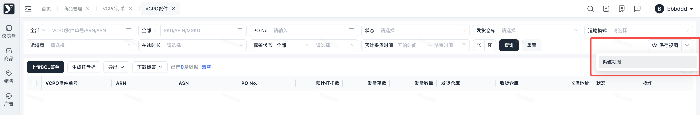

### 交互演示

1. 第一步：配置筛选项或设置排序

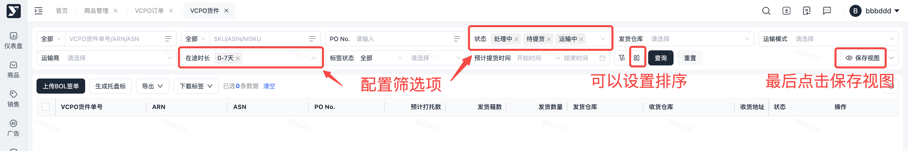

1. 第二步：点击【保存视图】按钮，出现下拉气泡，输入视图名称；如果想要设为默认视图，则勾选，最后点击保存按钮

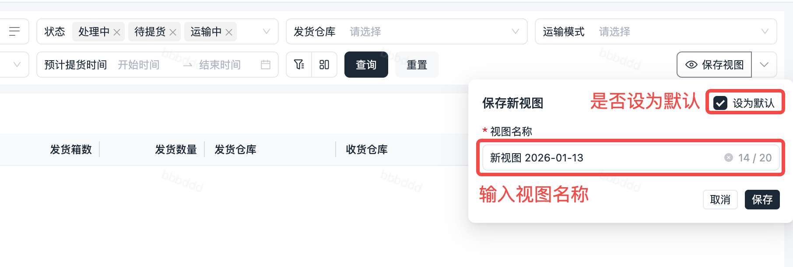

1. 调用视图：点击保存视图后面的【下拉箭头】，选择需要调用的视图

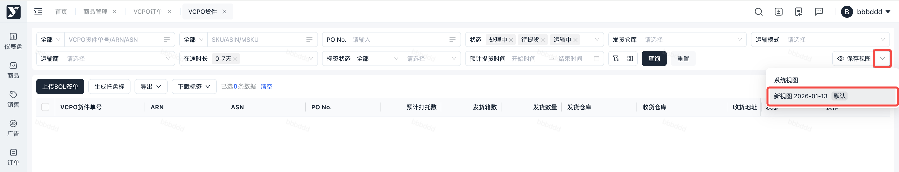

1. 编辑、删除：可修改视图名称及删除视图

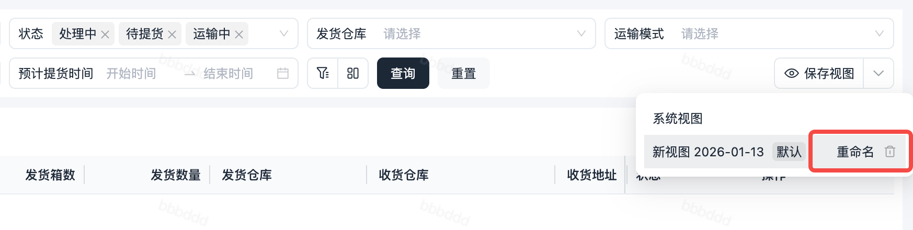

## 更多筛选

功能介绍：为了提升列表纵向空间利用率，筛选项最多显示2行，超过2行会收到【更多筛选】下拉框内。

### 交互演示

1. 更多筛选入口：当【更多筛选】筛选项【有值】时，图标入口处会显示【数量角标】

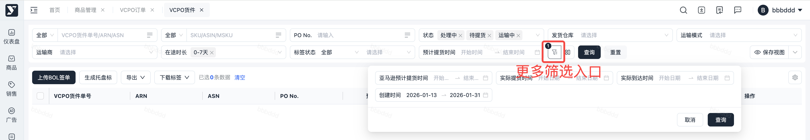

## 筛选条件自定义布局

功能介绍：考虑到不同业务场景对字段排序的需求存在差异，为提升操作灵活性，用户可自定义拖动排序

### 交互演示

1. 入口：点击【自定义布局】图标，出现下拉气泡

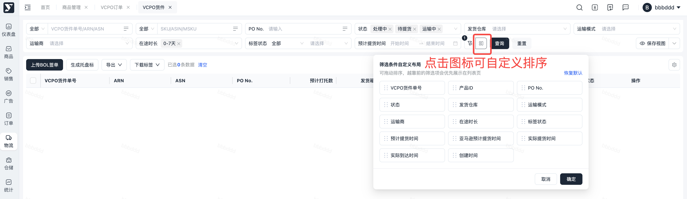

1. 拖动排序：将鼠标移至需排序的字段上，可直接拖动调整顺序。若筛选项数量较多，排序越靠前将优先在列表页展示，排序靠后的筛选项可能会被收纳至“更多筛选”框内。如果不想要当前的设置，可点击【恢复默认】。

## 筛选项交互

#### 批量搜索

1. 支持多字段组合搜索

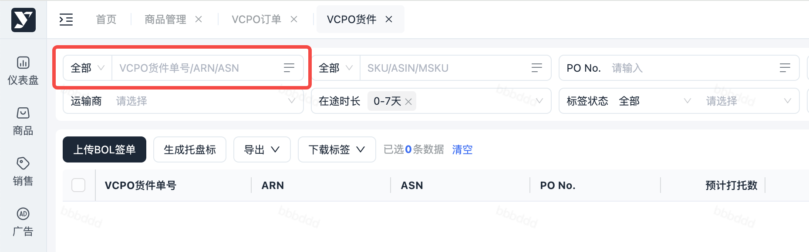

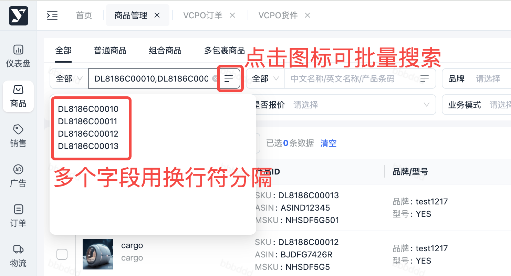

#### 下拉多选

1. 当枚举值 ≥ 5个时，提供【全选/反选】功能

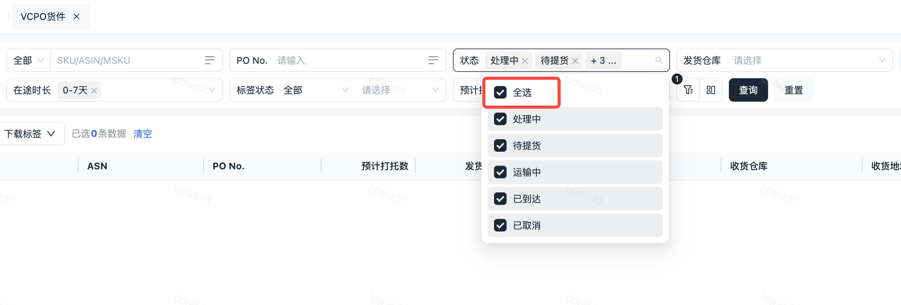

1. 支持【仅选此项】快捷操作，供不同业务场景使用，点击仅选此项后，该选项会覆盖原来已选值

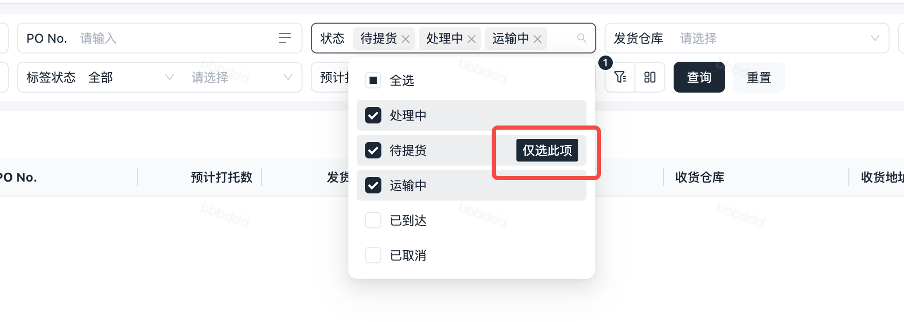
