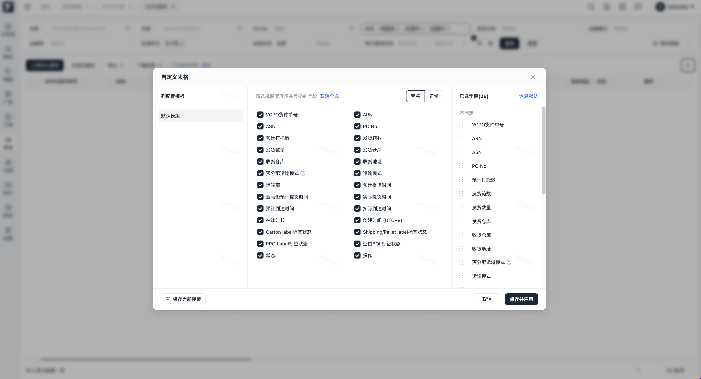
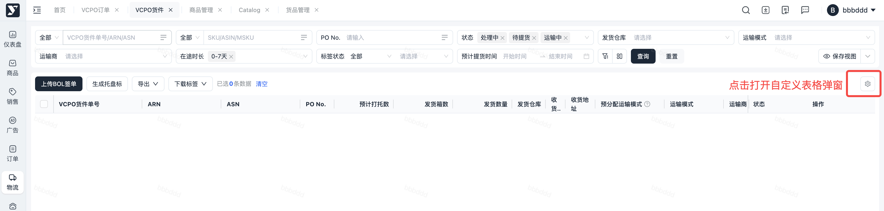
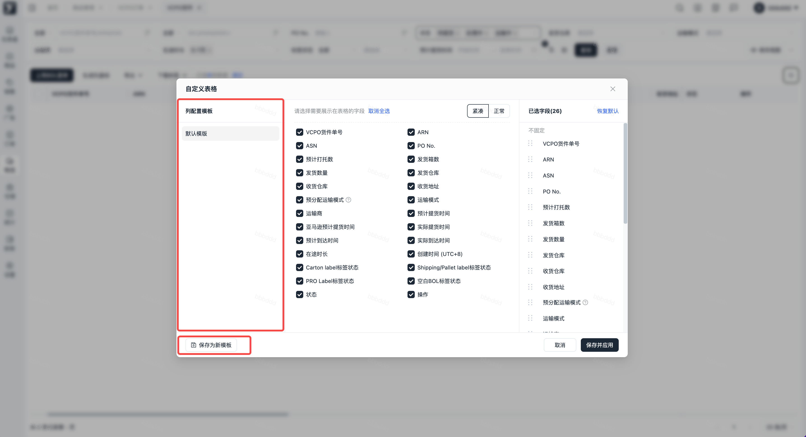
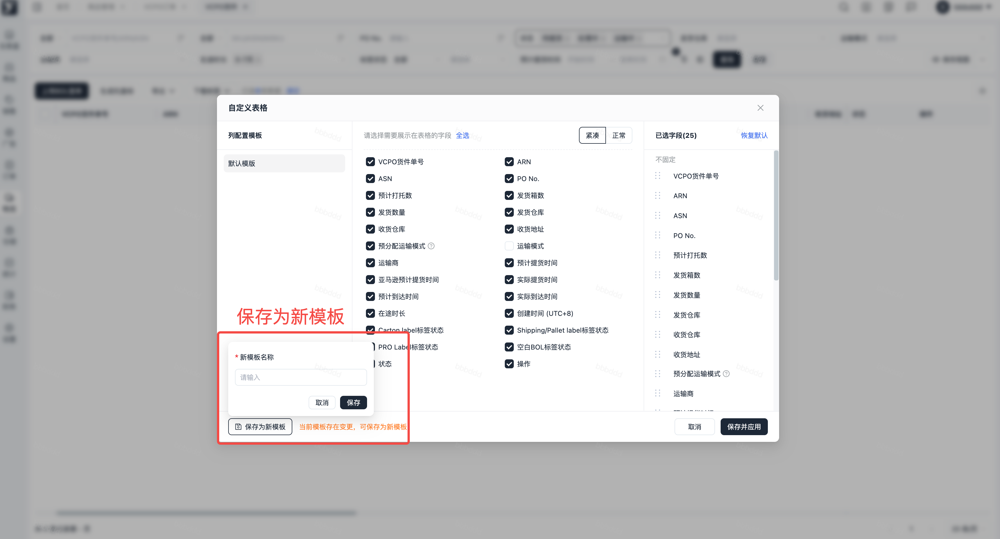
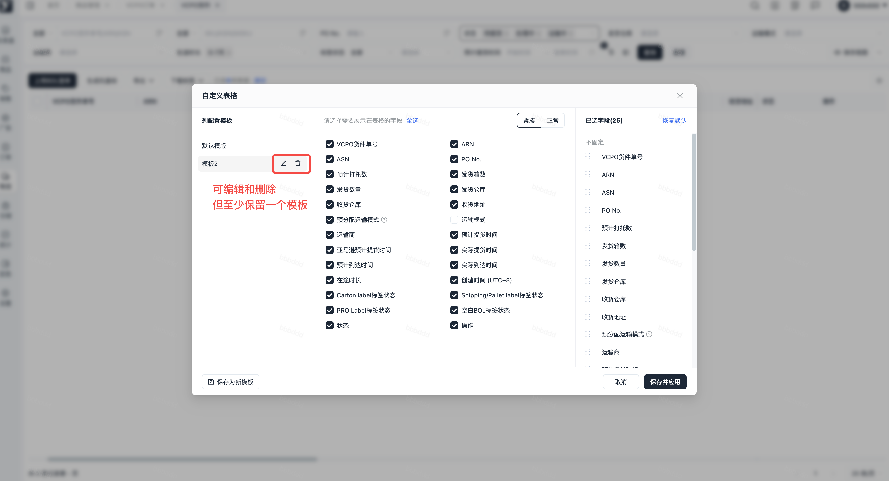
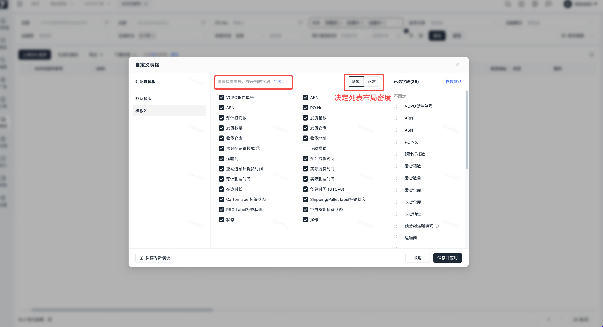
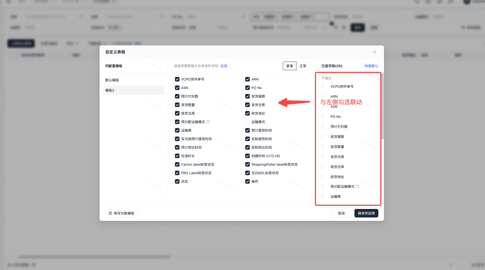
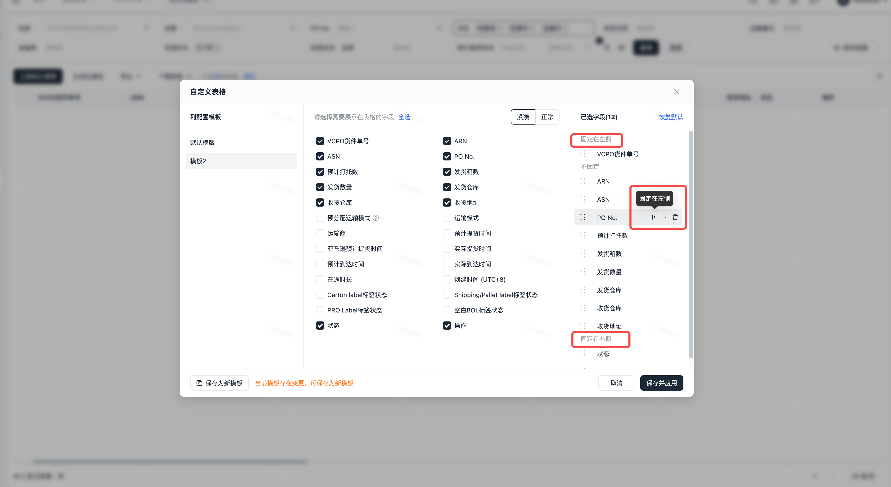
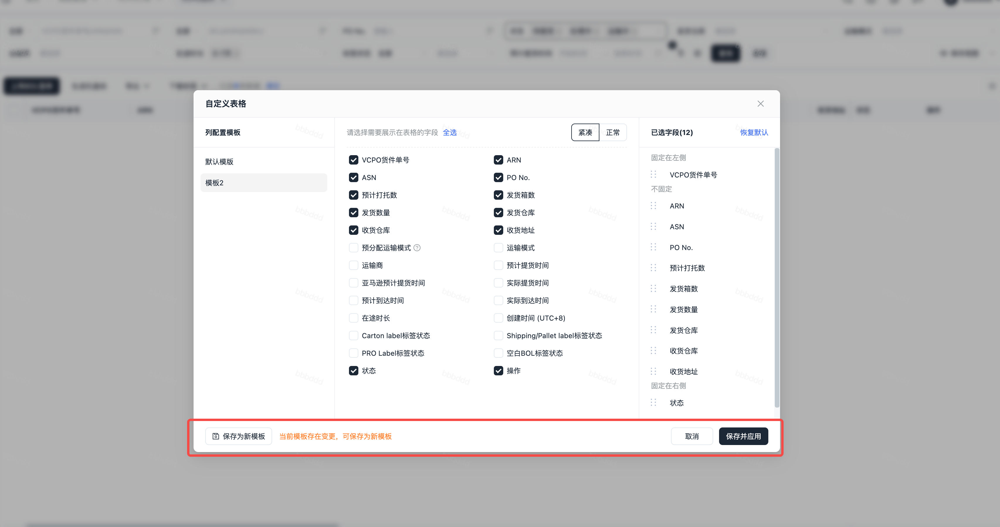

# 飞书文档：自定义表格+列拖动

## 一、自定义表格

**功能介绍：**自定义表格，可根据不同业务需求，保存列表配置，减少重复操作。用户可以自由选择表格要展示的字段，支持保存为专属模板，后续直接调用，同时能切换 “紧凑 / 正常”布局视图，适配不同的查看习惯。

### 交互细节

#### 功能入口

自定义表格入口位于**每个列表页的表格右上方**，点击【齿轮图标】即可进入自定义表格弹窗进行列配置

#### 模块 1：左侧「列配置模板」

1. **默认模板**：系统预设的标准字段、排序及默认布局，可编辑命名及配置
2. **保存为新模板**：

 - 操作逻辑：当用户调整完字段 / 顺序后，点击【保存为新模板】按钮 → 弹出模版名称命名输入框 → 输入模板名，这套配置会被保存到 “列配置模板” 列表中，点击保存并应用后，下次进入该列表会自动调用该设置。
 - 场景：适合不同岗位（比如仓储岗 / 物流岗）保存专属字段模板

#### 模块 2：中间「待选字段 + 视图控制」

1. **待选字段列表**：

 - 交互逻辑：点击字段前的复选框，**勾选 = 加入右侧已选字段**；**取消勾选 = 从右侧已选字段中移除**
2. **取消全选**：

 - 交互逻辑：点击后，所有已勾选的字段会自动取消勾选，同时右侧 “已选字段” 会被清空
 - 场景：适合 “从零开始重新配置” 的场景
3. **紧凑 / 正常切换**：

 - 交互逻辑：点击按钮后，**控制表格的显示密度**
 - 细节：【紧凑】视图会压缩字段间距，可提升数据展示密度，但视觉美观度会受一定影响；【正常”】视图间距宽松，可降低视觉疲劳，但数据容量会降低。

 

#### 模块 3：右侧「已选字段」

1. **字段排序**：

 - 交互逻辑：鼠标 hover 到字段左侧的「:::」图标 → 光标变成 “拖动小手” → 按住拖动到目标位置 → 松开后，表格中该字段的显示顺序会同步变化
 - 细节：拖动时会有 “占位条” 提示最终位置
2. **字段操作：**

 - 包含操作：可设置列表字段【固定在左侧/右侧】或【取消固定】
 - 固定在左侧：当表格字段较多时，会出现横向滚动，如果希望该字段不跟随滚动，就可设为固定左侧（如产品信息）
 - 固定在右侧：如操作按钮、状态类字段可固定右侧，不跟随列表进行滚动，方便浏览与操作

 
3. **恢复默认**：

 - 交互逻辑：点击后，右侧已选字段会**恢复到系统预设的字段 + 顺序**（覆盖当前所有修改）
 - 场景：配置混乱时快速重置

#### 模块 4：底部「操作按钮」

1. **保存并应用**：

 - 交互逻辑：点击后，当前 “已选字段 + 排序 + 视图模式” 会**立即应用到列表页，并关闭配置弹窗**
2. **取消**：

 - 交互逻辑：点击后，弹窗直接关闭，**所有未保存的配置会被丢失**，列表页配置将保持之前的状态。

#### 操作视频

## 二、表格列拖动

功能介绍：列表字段默认列宽为系统预设值；若预设宽度不满足实际使用需求，用户可**拖动表头字段**自由调整列宽，直至符合使用预期。（注意：为了更好的适配屏幕，部分字段列宽设置了最小值，则不允许拖动到更小）

1. **视频演示：**
