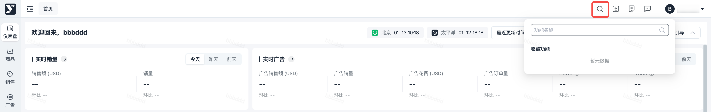
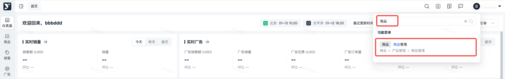
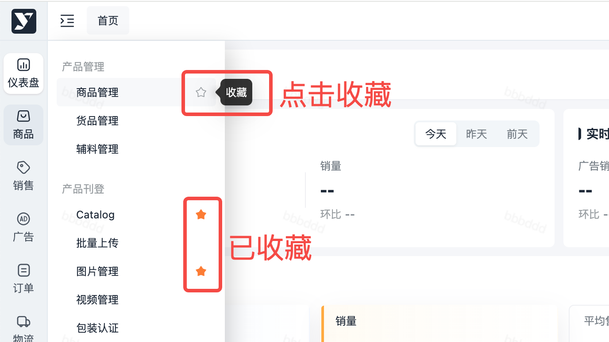
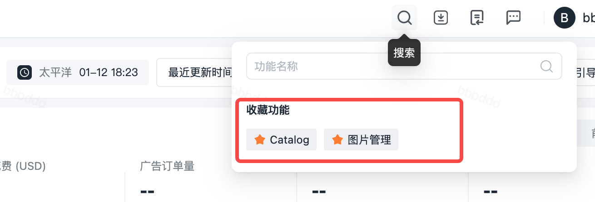

# 飞书文档：菜单搜索 + 收藏功能

## 一、功能介绍

该功能**帮助用户快速定位 + 一键访问常用功能的工具**，不用在长菜单里逐个查找：

- 「搜索」：输入关键词，模糊查询菜单名称包括其层级（定位到末级菜单）
- 「收藏」：把常用功能存到 “收藏区”，下次直接调用

## 二、操作步骤

### 模块 1：菜单搜索（找功能）

1. **搜索菜单入口**：点击页面顶部的「 🔍 」图标，即可打开下拉搜索框

1. **输入关键词**：比如想找 “商品管理”，输入 “商品”或“商品管理”等关键词

1. **打开菜单**：点击搜索结果就能直接打开对应的功能页面

### 模块 2：功能收藏（存常用功能）

1. **找到目标菜单**：展开左侧菜单，定位到要收藏的功能（比如 “商品管理”）
2. **点击收藏按钮**：功能名称右侧的「星星图标」，点击后星星会变成 “已选中状态”（变实心），同时会弹出 “已收藏” 提示

1. **访问收藏功能**：点击「 🔍 」图标，已收藏的功能会显示在这里，直接点击就能打开

## 三、操作视频
