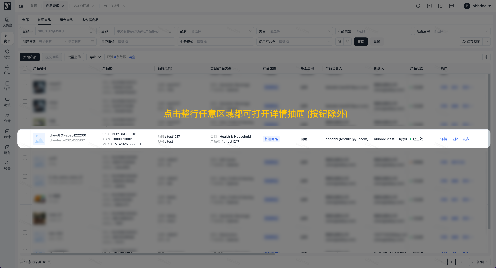
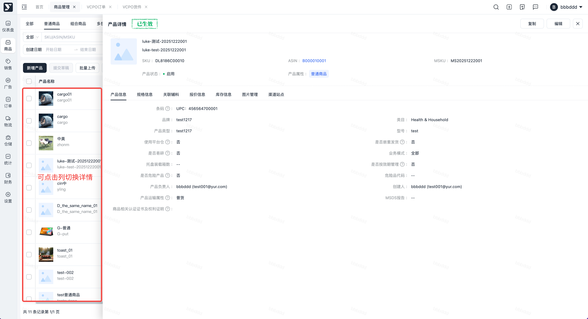
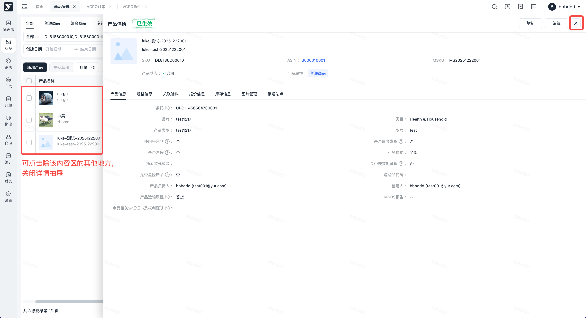

# 飞书文档：详情抽屉

## 文档信息

| 项 | 内容 |
| --- | --- |
| 远程文档 | https://q1njej8cpab.feishu.cn/wiki/Szr2wXk2iibm8Mkhyy5cBYT9nxc |
| 图片处理 | 本地下载（assets/images） |
| 快照时间 | 2026-08-06 |
| 来源命令 | `lark-cli docs +fetch --api-version v2 --doc https://q1njej8cpab.feishu.cn/wiki/Szr2wXk2iibm8Mkhyy5cBYT9nxc --doc-format markdown --as user --format json --jq .data.document.content` |
| 格式处理 | fd-doc-markdown-sync/scripts/normalize-feishu-doc-markdown.mjs |

---

详情抽屉

## 一、功能介绍

详情抽屉功能提供给用户**不跳页、快速查看单条数据的详情**：

- 不用离开当前列表页，避免重复切换页面
- 一键触发，比点 “详情按钮” 更高效
- 详情会展示比列表更全的信息

## 二、操作步骤

1. **打开详情：**点击列表中该条数据整行**任意区域（除按钮区外），**页面侧边会弹出抽屉详情 （文字上下空白区域均可尝试）

1. **抽屉切换：**打开抽屉后，可点击抽屉左侧表格其他单元格，抽屉将切换至对应条目（只能切换列表当前页，可把页条数设大一点）

1. **关闭抽屉：**方式 2 选 1：点击抽屉右上角的**「×」按钮**。或点击抽屉左侧列表内容区外的其他地方（顶部和菜单导航除外）

## 三、操作视频
