# 飞书文档：DF可售库存

## 功能介绍

DF可售库存：可查看并能设置产品在某仓库的DF可售库存数量，且将此设置与VC后台保持同步。

## 页面路径

【仓储】-【库存管理】-【DF可售库存】

## 系统流程

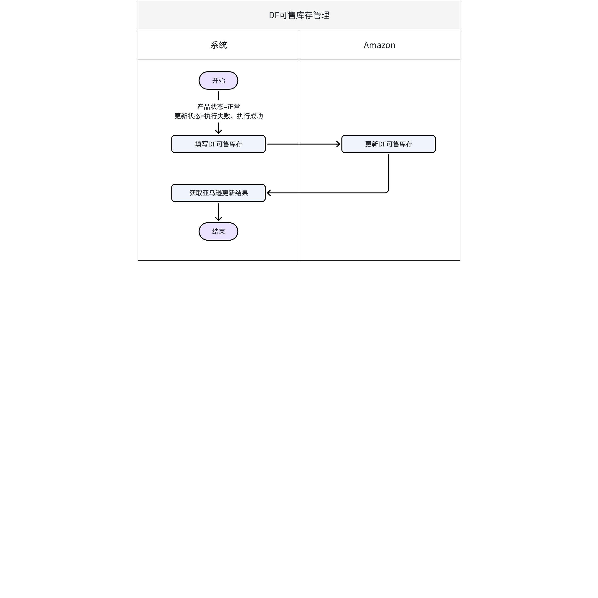

## 操作指南

### 查看DF可售库存

1. 可售库存执行状态/包裹执行状态说明：

 1. 执行中：同步亚马逊的任务正在执行中

 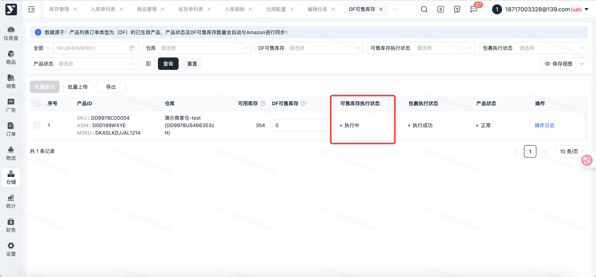

 1. 执行成功：同步亚马逊的任务执行成功

 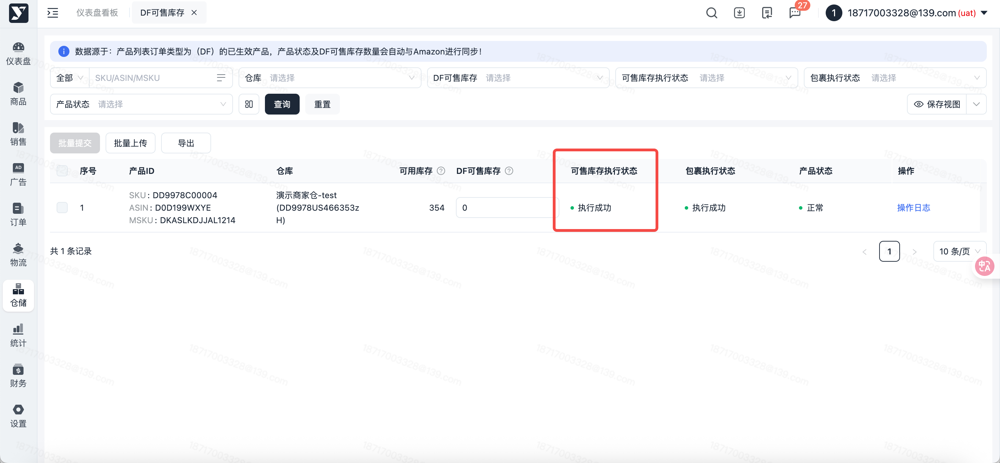

 1. 执行失败：同步亚马逊的任务执行失败

 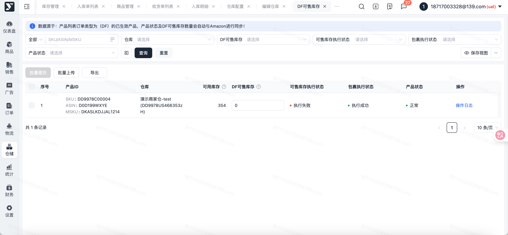

### 提交

1. 功能描述：维护单个产品ID+仓库的【DF可售库存】后，提交更新后库存至亚马逊
2. 操作步骤：

 1. 选中需要维护可售库存的产品ID+仓库，在【DF可售库存】栏位输入数量注意：

 - 可用库存＞0，且可售库存执行状态为 “执行成功”，且产品状态为 “正常” 时，可编辑【DF可售库存】
 - DF可售库存需 ≤ 可用库存，且不能为负数
 - DF可售库存、产品状态：会定时与VC同步，获取到VC最新的DF可售库存信息及产品状态

 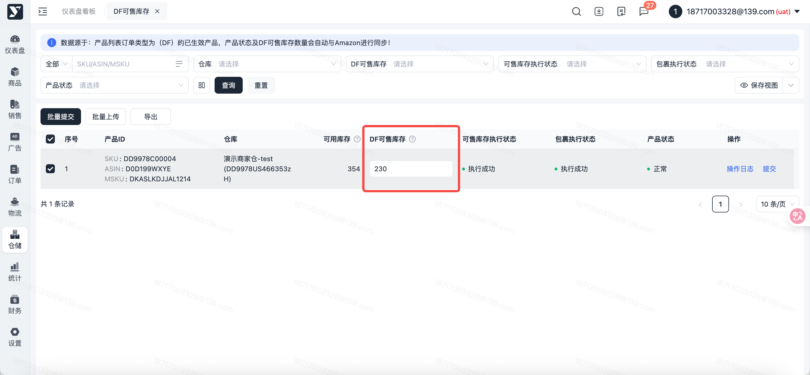
 2. 点击【提交】按钮，产品ID+仓库的【DF可售库存执行状态】更新为 “执行中”

 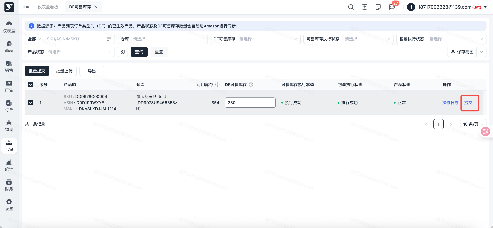

### 批量提交

1. 功能描述：批量维护【DF可售库存】后，批量提交库存至亚马逊
2. 操作步骤：

 1. 批量在【DF可售库存】栏位输入数量后，DF可售库存列表的复选框会默认勾选
 2. 点击【批量上传】按钮，DF可售库存执行状态更新为 “执行中”

 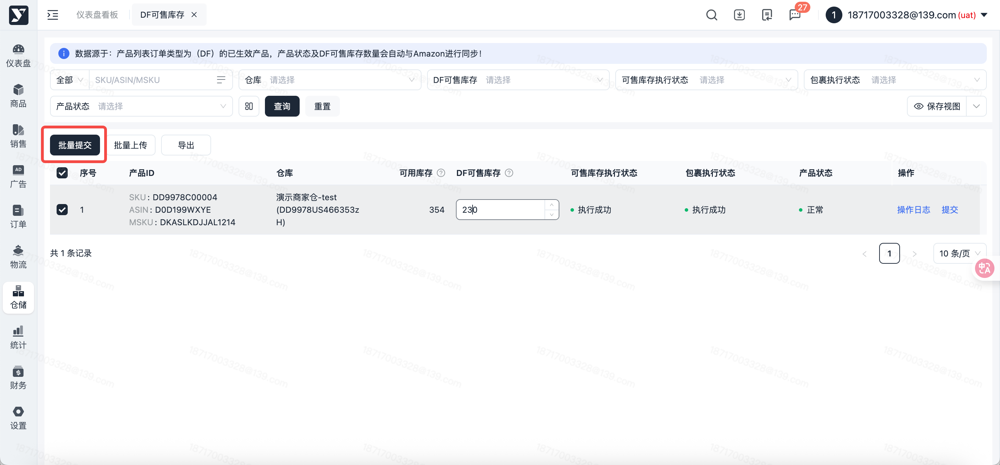

### 批量上传

1. 功能描述：在Excel 维护DF可售库存后，快速导入系统注意：

 - 请提前通过筛选条件查询后，确定需要更新DF可售库存的数据范围
 - 若未提前筛选，导入模板会默认导出下载所有DF可售库存数据，导致系统卡顿
2. 操作步骤：

 1. 按条件筛选后，点击【查询】按钮，确认需要变更DF可售库存的范围

 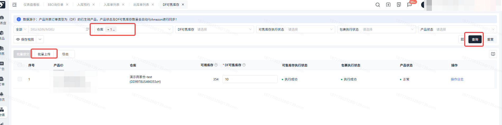
 2. 点击【批量上传】按钮，在批量上传弹窗中，点击【模板下载】，将Excel导入模板下载至本地说明：Excel模板 仅显示可售库存执行状态为 “执行成功”的产品ID+仓库

 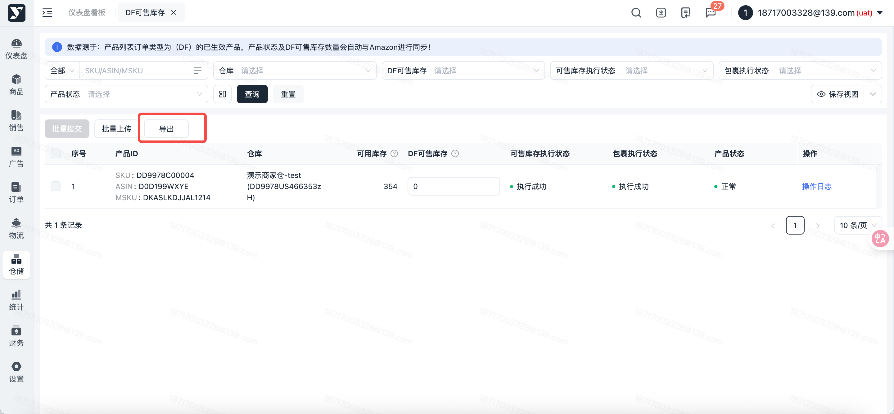

 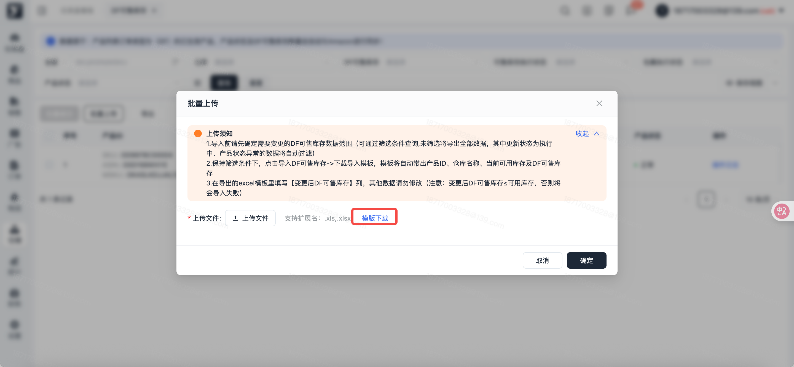

 1. 在Excel 模板表格中填写【变更后DF可售库存】后，保存Excel

 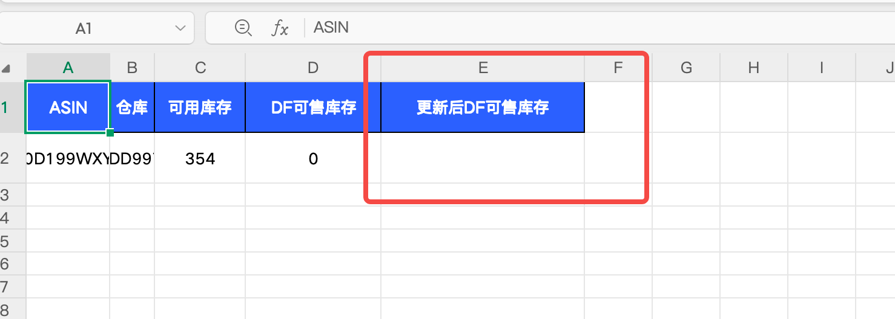
 2. 回到批量上传弹窗页面，点击【上传文件】，选择本地已保存的Excel

 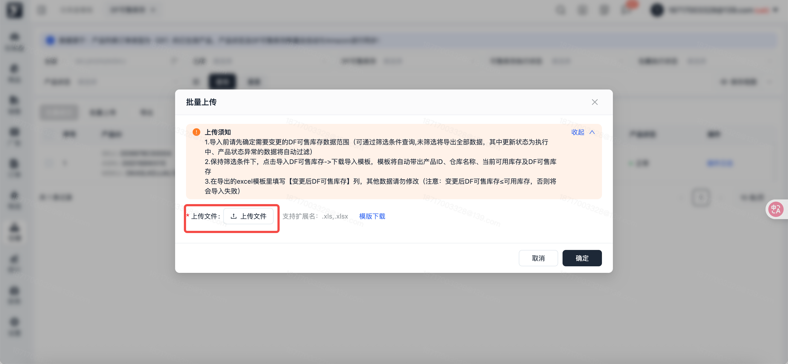
 3. 系统自动校验Excel 填写内容，并在【校验预览】栏位显示校验结果

 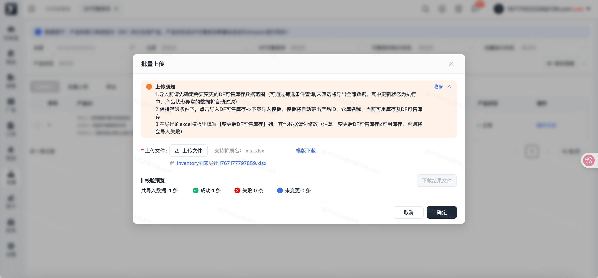
 4. 点击【下载结果文件】，查看导入失败数据、失败原因，可修改后重新提交

 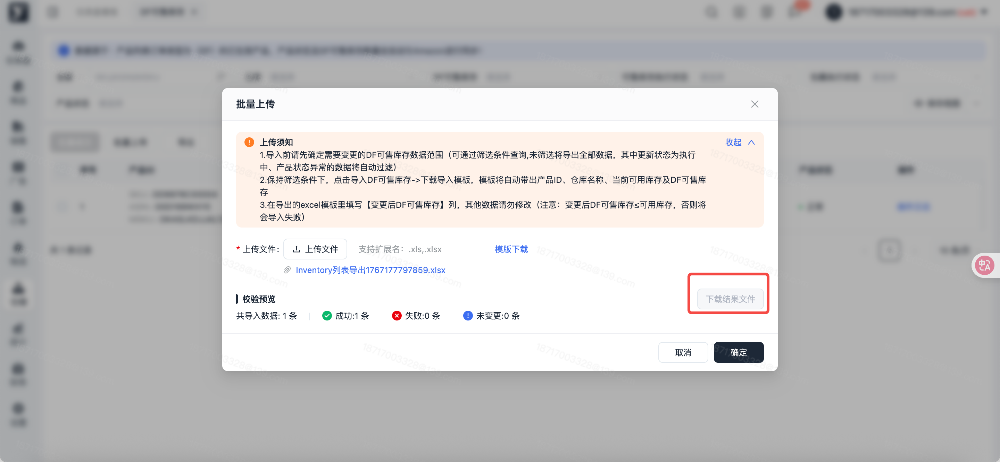
 5. 点击【确定】，提交导入成功数据到DF可售库存

 

### 导出

1. 功能描述：批量导出DF可售库存数据
2. 操作步骤：

 1. 不勾选、按条件筛选、勾选DF可售库存列表后，点击【导出】按钮，自动导出Excel 格式的库存数据到本地

 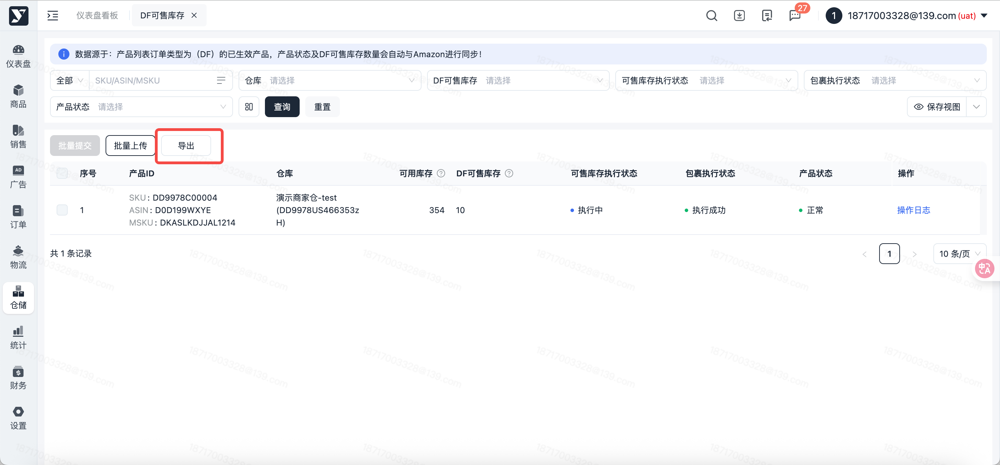

### 操作日志

1. 功能描述：查看DF可售库存的历史更新记录
2. 操作步骤：

 1. 点击【操作日志】按钮，弹窗显示历史更新记录

 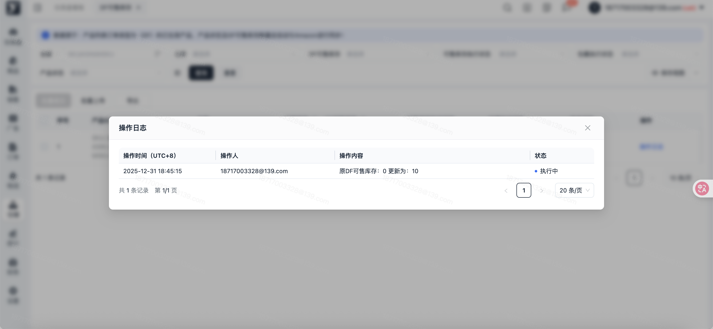

## 常见问题

### 列表数据来源

来源：产品列表中，订单类型（DF）且已生效状态的产品数据，按仓库（DF类型）维度生成。
