# 飞书文档：仓库配置

## 文档信息

| 项 | 内容 |
| --- | --- |
| 远程文档 | https://q1njej8cpab.feishu.cn/wiki/BHM8w7jG0iLJBbkmkWcceH2InDh |
| 图片处理 | 本地下载（assets/images） |
| 快照时间 | 2026-08-06 |
| 来源命令 | `lark-cli docs +fetch --as user --doc "<remote>" --jq ".data.markdown"` |
| 格式处理 | fd-doc-markdown-sync/scripts/normalize-feishu-doc-markdown.mjs |

---

仓库配置

当前版本：v1.0.1

## 功能介绍

在平台端用户可新增对应的仓库并对其进行管理，也可以查看系统提供的【平台仓】和【自营仓】的仓库信息，选择合适的仓库进行收发货。

## 页面路径

【仓储】-【仓库配置】

## 注意事项

1. 需注册成功平台端账号，且有权限的账号才可以设置仓库。
2. 请尽量使用谷歌浏览器，避免使用Safari浏览器，否则可能出现某些功能不兼容的情况。

## 系统流程

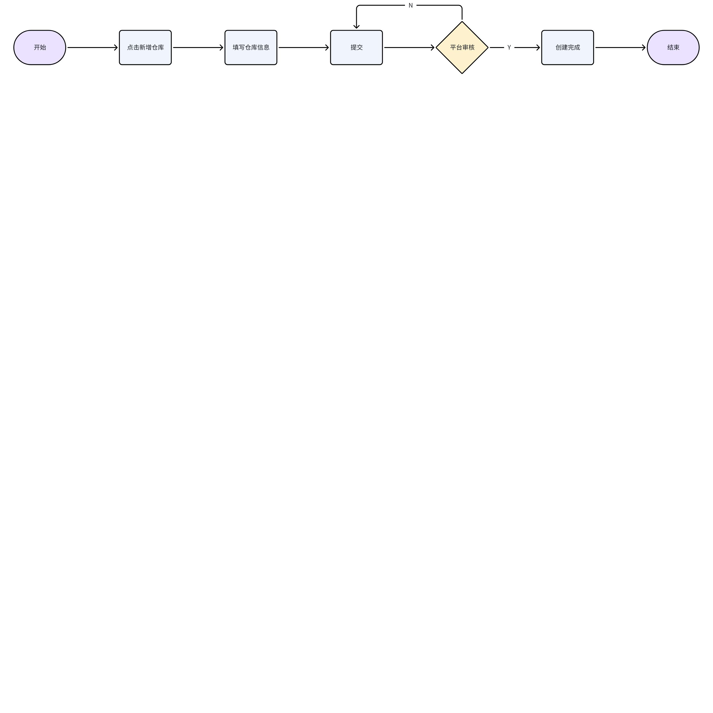

> 画板来源：token=`SP1fwJcIKhEK7KbBaBRcy6gQnpR`

## 操作指南

### 查看仓库列表

1. 功能描述：显示客户新增的仓库信息以及系统内置的【平台仓、自营仓】；客户查看对应的仓库信息，根据实际业务情况，选择合适的仓库进行操作。
2. 审核状态说明

 1. 待审核：仓库提交后的默认状态

 

 1. 已通过：客服审核通过之后的状态

 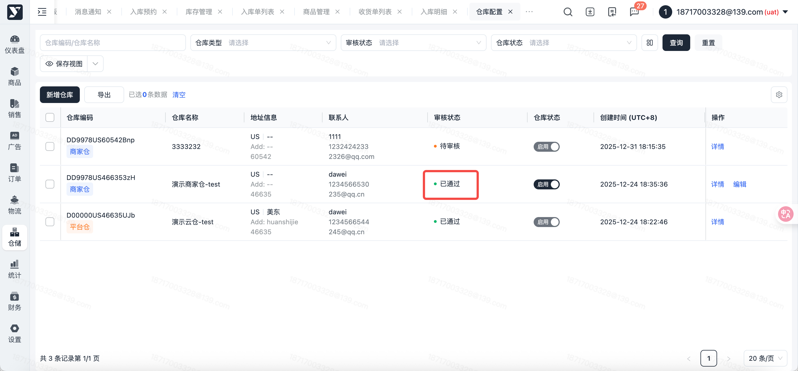

 1. 未通过：客户审核未通过的状态

 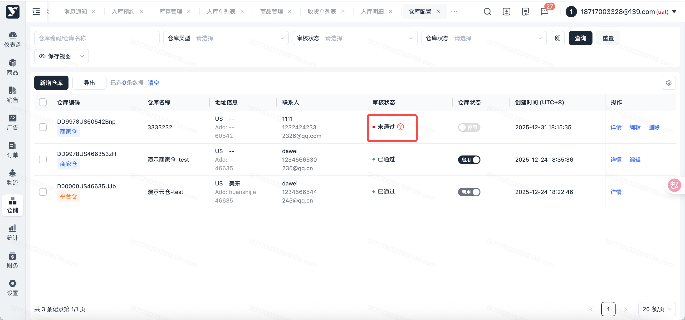

### 新增仓库

1. 功能描述：手工新增商家仓；客服审核通过后，方可开展出入库业务。
2. 操作步骤：注意：如上信息非常重要请仔细核对后准确填写

 1. 点击【新增仓库】按钮

 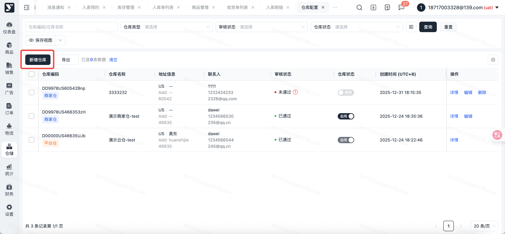

 1. 进入【新增仓库】编辑页面，填写仓库信息、联系人、仓库工作时间

 1. 仓库信息：标记 \* 字段，为必填内容，注意：【街道地址】需与州、城市、邮编匹配
 2. 仓库业务类型（非必填）

 1. 勾选DF业务类型，需要额外上传UPS账号和UPS确认书信息，未勾选不会生成对应仓库的DF inventory数据

 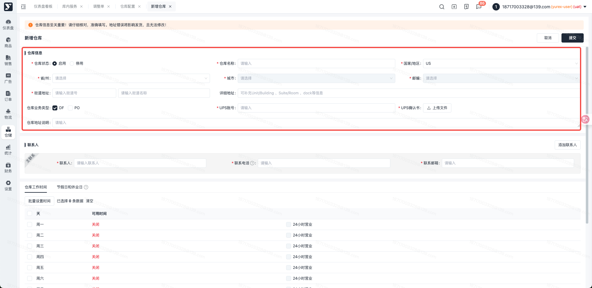
 3. 联系人：仓库可联系的【联系人、联系电话、联系邮箱】

 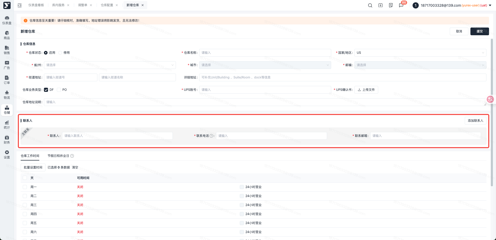

 1. 仓库工作时间：仓库真实工作时间（承运商可上门提货的时间），点击【批量设置时间】按钮，弹窗中设置时间后，可以选择应用到周一-周日

 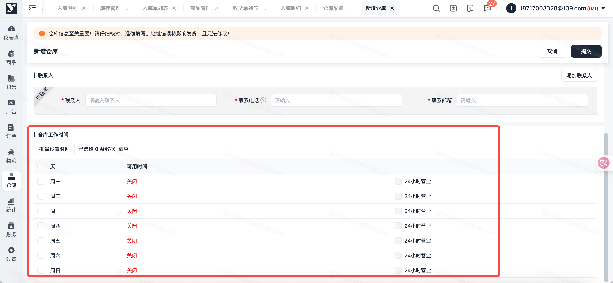

 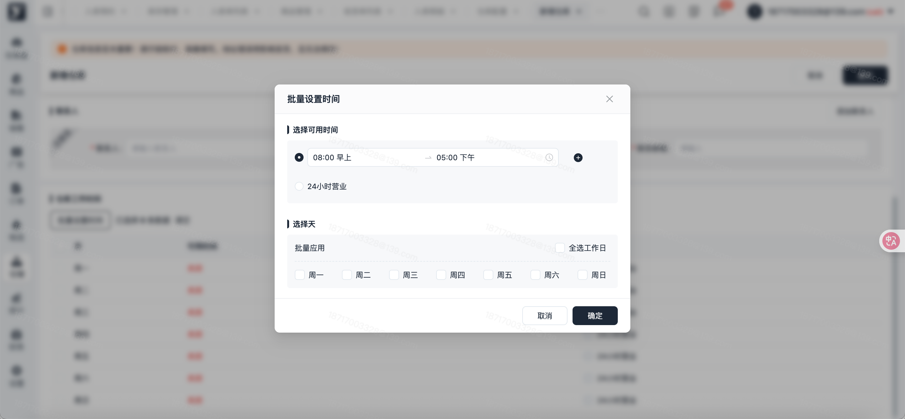

 1. 其他信息：仓库实际的“卸货能力”支持的车型

 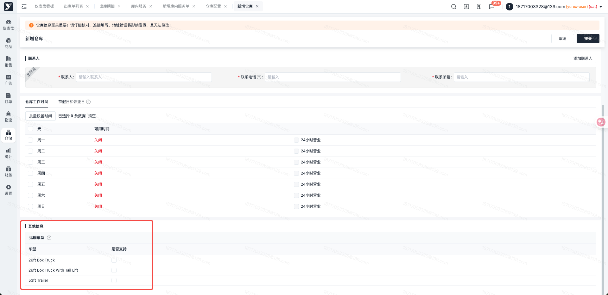

 1. 确定仓库信息填写无误后，点击【提交】按钮

 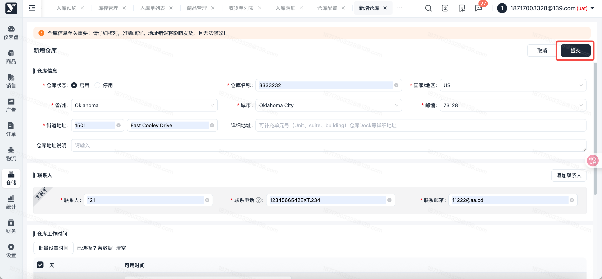

 1. 系统二次校验地址准确性：

 1. 若校验地址后的推荐地址与原地址不相同，黄色字体标记，可根据实际情况选择使用推荐地址或者原地址提交，也可以点击【取消】，返回编辑页面修改

 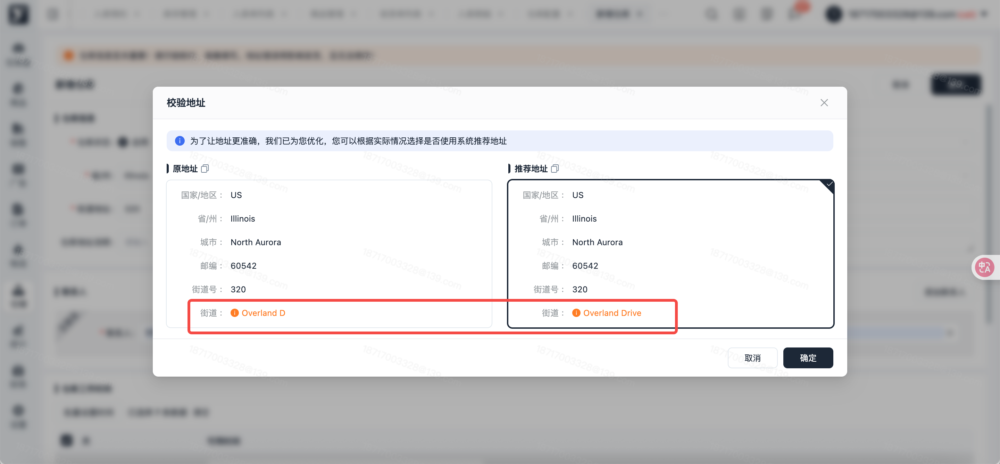

 1. 若确定地址信息无误，点击【确定】按钮

 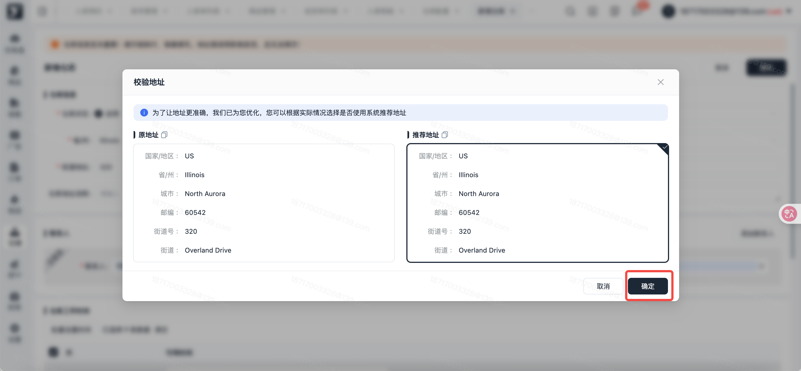
 2. 提交成功，仓库审核状态更新为 “审核中”，等待客服审核

 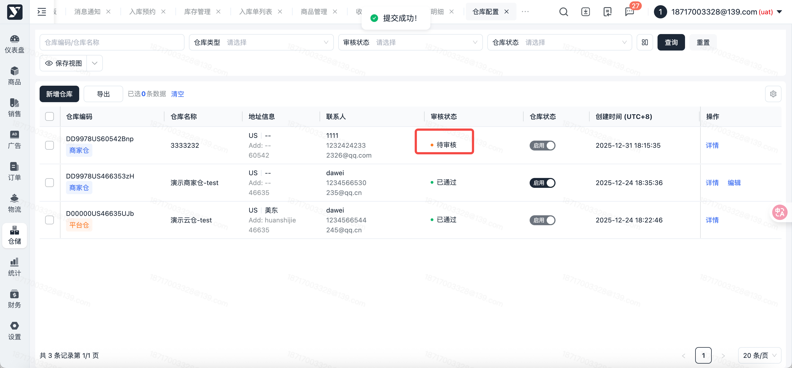

 1. 客服审核通过后，仓库审核状态更新为 “已通过”

 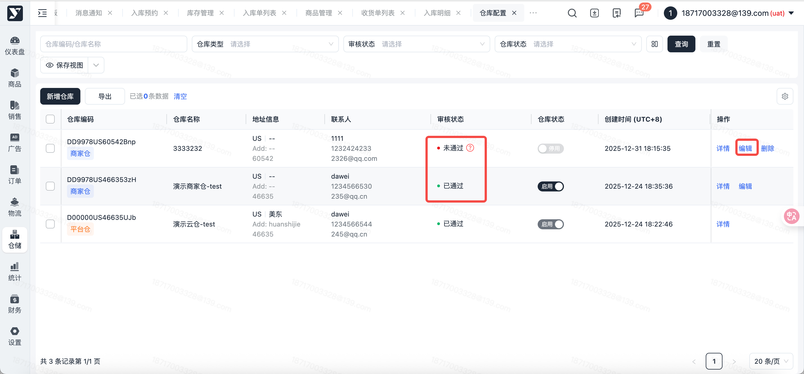

 1. 客服审核驳回后，仓库审核状态更新为 “未通过”，可根据驳回原因【编辑】后再提交审核

 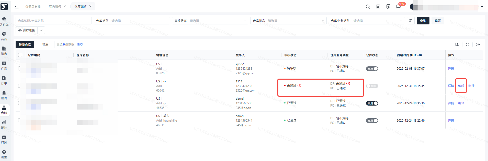

### 编辑

1. 功能描述：仓库审核通过或审核被驳回后，可编辑修改仓库信息

 1. 即满足编辑仓库的前提条件为：仓库审核状态为“未通过” 或 “已通过”
 2. 仓库审核状态为 “未通过”时，可修改 所有仓库信息、联系人、仓库工作时间，保存后审核状态为 “审核中”
 3. 仓库审核状态为 “已通过” 时，仅可修改 联系人、仓库工作时间，保存后审核状态不变
2. 操作步骤：

 1. 选中需修改的仓库，点击【编辑】按钮

 1. 编辑时可后补仓库业务类型

 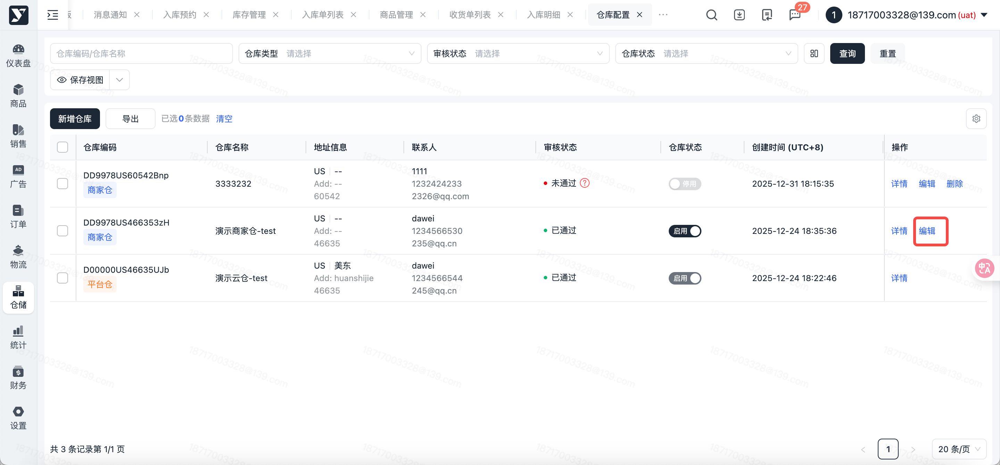

 1. 进入编辑页面，修改信息后，点击【保存】按钮

 1. 勾选DF业务类型时，需要平台审核

 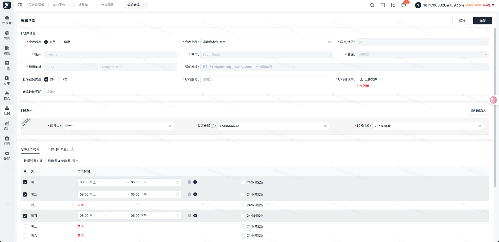

## 常见问题

### 仓库审核未通过，能进行修改吗

1. 仓库审核未通过，目前不能对未通过的仓库信息进行修改，可根据未通过的原因，进行【新增仓库】操作，新增仓库，重新进行审核。

### 仓库状态怎么修改

1. 您可以联系您对应仓储物流管理员，让工作人员对仓库状态进行修改。

### Amazon物流里为什么选不到我创建的仓库

1. 您可以联系您对应仓储物流管理员，让工作人员查看VC推送是否正常。
