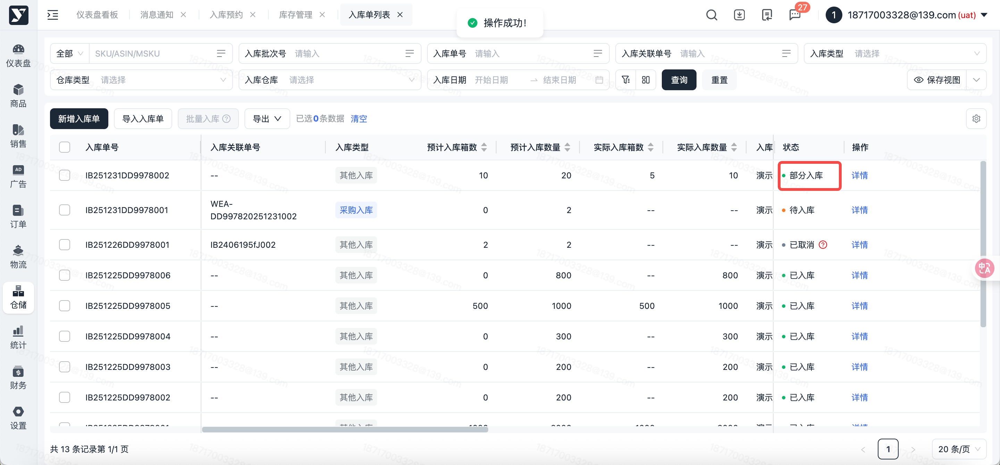

# 飞书文档：入库管理

## 文档信息

| 项 | 内容 |
| --- | --- |
| 远程文档 | https://q1njej8cpab.feishu.cn/wiki/FGDswOAAgi8FqFkpX6jcZZCjnNe |
| 图片处理 | 本地下载（assets/images） |
| 快照时间 | 2026-08-06 |
| 来源命令 | `lark-cli docs +fetch --as user --doc "<remote>" --jq ".data.markdown"` |
| 格式处理 | fd-doc-markdown-sync/scripts/normalize-feishu-doc-markdown.mjs |

---

入库管理

当前版本：v1.0.0

## 功能介绍

可查看所有业务类型，所产生的入库订单，入库状态、入库时间、入库产品、数量等。

## 页面路径

【仓储】-【入库管理】

## 系统流程

> 画板来源：token=`IVy6w7ZaEhosMObTWvGc4lkknAe`

## 操作指南

### 入库单列表

1. 页面路径：【仓储】-【入库管理】-【入库单列表】
2. 功能描述：

 1. 入库预约单审核通过后，此页面自动生成【采购入库单】
 2. 支持新增【其他入库单】
3. 入库单状态说明：

 1. 待入库：初始状态，实际入库数量为0

 

 1. 入库中：分批次收货，实际入库数量 小于 预计入库数量，且还未操作【完成入库】

 

 1. 部分入库：实际入库数量 小于 预计入库数量，且已操作【完成入库】

 

 1. 已入库：实际入库数量 等于 预计入库数量

 

 1. 已取消：入库单被取消

 

#### 新增入库单

##### 单个新增

1. 功能描述：通过【新增入库】按钮，手工创建其他入库单。
2. 操作步骤：

 1. 点击【新增入库】按钮

 

 1. 进入【新增入库单】页面，填写入库单基础信息，其中，标注\* 字段为必填内容

 

 1. 基础信息填写完毕，点击【添加产品】按钮，添加入库单产品信息

 

 1. 选择产品ID后，点击【确定】按钮，弹窗消失，返回新增页面

 

 1. 填写产品信息

 1. 【预计入库箱数】或【预计入库数量】

 - 当入库单--库存类型为【整箱库存】时，需填写【预计入库箱数】和输入【装箱数量】

 
 - 当入库单--库存类型为【散件库存】时，需填写【预计入库数量】

 
 2. 预报产品尺寸、预报产品重量：默认带出商品中心值，可修改

 
 3. 生产日期、保质日期：当产品需按效期管理时，此两栏默认为空，需填写

 
 2. 确认入库单信息填写无误后，点击【提交】或【提交并入库】

 

 1. 点击【提交并入库】按钮，二次弹窗点击【确定】后：提交成功，入库单状态更新为 “已入库”，可直接生成WMS可用库存

 
 2. 点击【提交】按钮：提交成功，入库单更新为 “待入库” ，可操作【入库】或【取消入库】

 

##### 批量导入

1. 功能描述：通过Excel批量导入方式，快捷创建入库单
2. 操作步骤：说明：入库仓库名称、产品ID、库存类型 为必填内容

 1. 点击【导入入库单】按钮，在弹窗中下载导入模板

 

 

 1. 导入模板下载至本地后，打开Excel，先阅读注意事项后，填写导入模板内容

 

 1. Excel填写完毕并保存后，在【导入入库单】弹窗中，点击【上传文件】按钮，选择本地的Excel

 

 1. 导入成功，系统自动解析并校验内容

 

 1. 内容校验成功，点击【确定】或【确定并入库】按钮：

 1. 点击【确定】：入库单创建成功后，状态为 “待入库”，还需再提交入库

 

 1. 点击【确定并入库】：入库单创建成功后，状态为 “已入库”，直接生成WMS 可用库存

 

#### 入库

##### 单个提交入库

1. 功能描述：入库单状态为 “待入库” 时，点击入库单上的【入库】按钮，提交入库，生成WMS可用库存
2. 操作步骤：说明：

 1. 选择需入库的单据，点击【入库】按钮

 

 1. 进入入库详情页面，输入【实际入库数量、实际外箱尺寸、实际产品重量】说明：【实际外箱尺寸、实际产品重量 】仅当SKU+装箱数量第一次入库时，要求必须填写；后续入库系统会默认带出，可在带出的基础上修改

 

 1. 确定填写信息无误后，点击【提交】按钮

 

 1. 提交成功，自动返回入库单列表页面，系统会根据填写的 实际入库数量，更新入库单状态

 1. 实际入库数量 小于 预计入库数量时，提交成功后，订单状态更新为 “入库中”，可操作：

 1. 入库：表示分批次收货，可继续填写【实际入库数量】

 

 1. 完成入库：表示结束收货，点击【完成入库】后，订单状态更新为 “部分入库”

 

 

 2. 实际入库数量 等于 预计入库数量时，提交成功后，订单状态更新为 “已入库”

 

 1. 入库提交成功后，可在【收货单列表】、【入库明细】 页面，查看对应的收货明细

 

##### 批量提交入库

1. 功能描述：同时勾选多个入库单，批量提交入库；提交成功后，默认 实际入库数量 等于 预计入库数。

 1. 满足操作【批量入库】的前提条件：入库单状态为 “待入库” 或 “入库中”
2. 操作步骤：

 1. 批量勾选满足状态的入库单，点击【批量入库】按钮，二次弹窗点击【确定】，提交成功，入库单状态更新为 “已入库”

 

#### 完成入库

1. 功能描述：入库单状态为 “入库中” 时，点击【完成入库】结束收货；用于部分入库场景，即 实际入库数量 小于 预计入库数量
2. 操作步骤：

 1. 选择状态为 “入库中” 的单据，点击【完成入库】按钮，二次弹窗点击【确定】

 

 

 1. 提交成功，入库单状态更新为 “部分入库”

 

#### 取消入库

1. 功能描述：入库单状态为 “待入库” 时，可取消入库
2. 操作步骤：

 1. 在列表中找到需要取消的入库订单，状态=待入库，可取消，点击【取消入库】按钮

 

 1. 在弹窗中输入【取消原因】，点击【确定】按钮，取消成功，订单状态更新为 “已取消”

 

#### 导出

1. 功能描述：批量导出入库单列表、入库单详情
2. 操作步骤：

 1. 不勾选、按条件筛选、勾选入库单，点击【导出列表】按钮，自动导出Excel 格式的入库单到本地

 

 1. 不勾选、按条件筛选、勾选入库单，点击【导出详情】按钮，自动导出Excel格式的入库单详情到本地

 

### 收货单列表

1. 页面路径：【仓储】-【入库管理】-【收货单列表】
2. 功能描述：入库单提交入库后，展示入库单对应的收货明细。当入库单多分批次收货，会生成多个收货单。

#### 导出

1. 功能描述：批量导出收货单列表、收货单详情
2. 操作步骤：

 1. 不勾选、按条件筛选、勾选收货单，点击【导出列表】按钮，自动导出Excel 格式的收货单到本地

 

 1. 不勾选、按条件筛选、勾选收货单，点击【导出详情】按钮，自动导出Excel格式的收货单详情到本地

 

### 入库明细

1. 页面路径：【仓储】-【入库管理】-【入库明细】
2. 功能描述：入库单提交入库后，按产品ID维度展示入库单对应的入库明细

#### 导出

1. 功能描述：批量导出入库明细
2. 操作步骤：

 1. 不勾选、按条件筛选、勾选入库明细，点击【导出】按钮，自动导出Excel 格式的入库明细到本地

 

## 常见问题

### 入库订单来源

1. 入库订单来源于：仓储-入库预约单：采购入库。仓储管理-入库单列表：其他入库。
