# 飞书文档：入库预约

入库预约

当前版本v1.0.0

## 功能介绍

1. 入库预约：客户在预备发货至仓库时，提前通过平台端创建预约单，通过预约单方式，仓库可以提前做好准备，安排好相应的人员和资源，以便在货物到达时能够快速、高效地进行入库操作。
2. 确认到港：运输方式为【海运、铁运】时，货物到港后，需在系统操作确认到港。
3. 提交发货：将即将到达的货物提前入库准备的操作，便于仓库人员提前做好库存管理，确保货物能够准确存放。

## 页面路径

【仓储】-【入库管理】-【入库预约】

## 注意事项

1. 请您发货前注意《头程包装来货规范》，避免产品的损伤
2. 若您选择的发货仓库为商家仓，提交申请后将自动入库
3. 请注意箱唛与SKU的贴标规范

## 系统流程

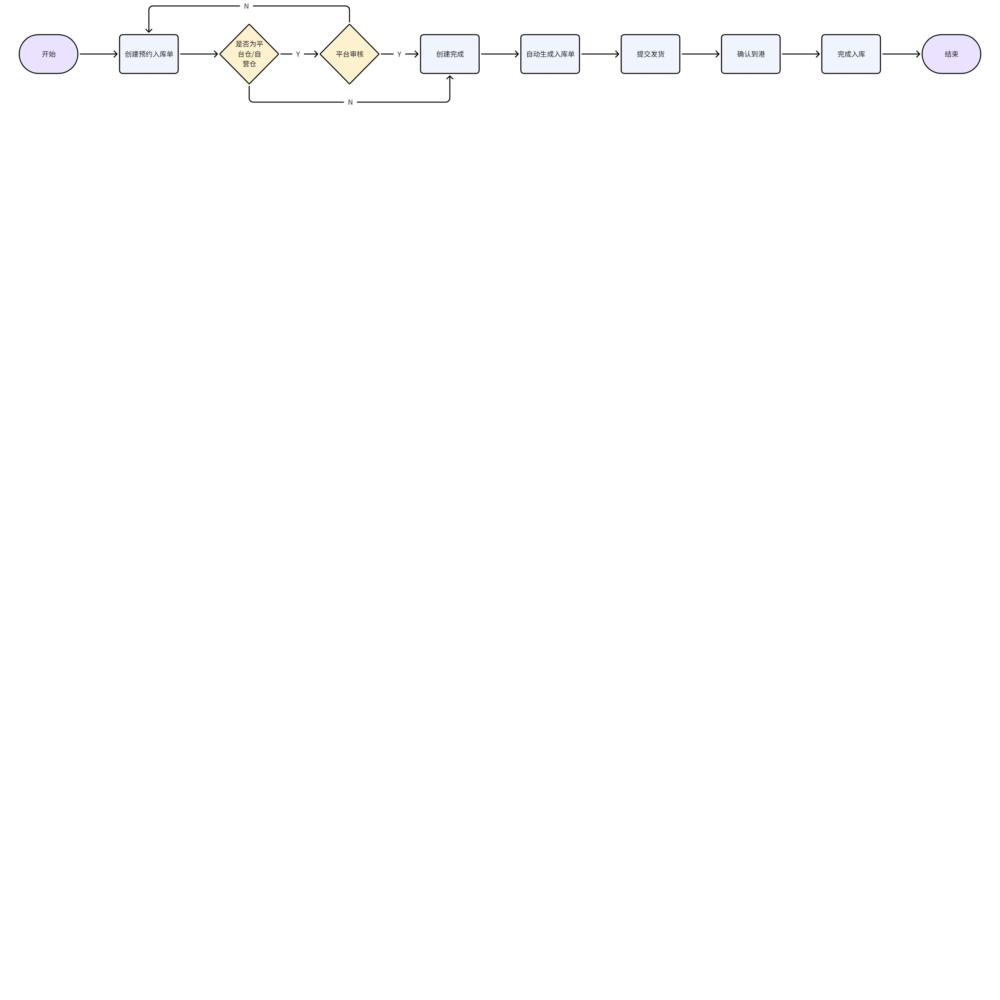

## 操作指南

### 新增入库预约

1. 功能描述：手工新增入库预约单
2. 操作步骤：说明：

 1. 点击【新增预约入库】

 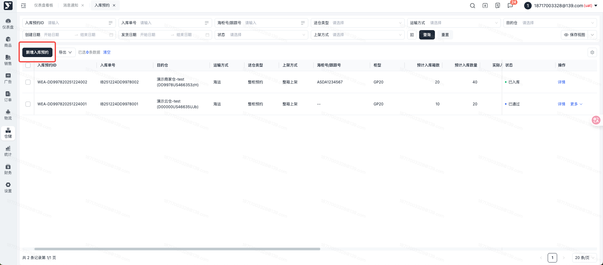

 1. 进入新增编辑页面，填写到仓信息：目的仓、送仓类型、柜型、运输方式、预计发货时间、预计到仓时间（**西邮暂时不支持快递送仓）**注意：不建议采用快递方式送仓。如确有快递送仓的紧急需求，请及时通过企微群联系Yurex平台物流经理。

 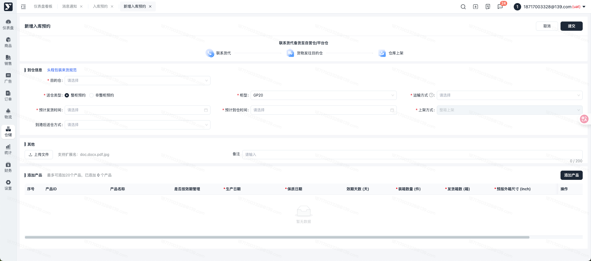

 1. 必填信息填写完毕，点击【添加产品】，添加入库预约单产品明细

 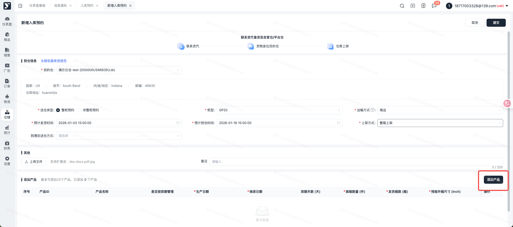

 1. 进入【添加产品】页面，选择产品信息；产品添加完毕，点击【确定】，自动返回编辑页面

 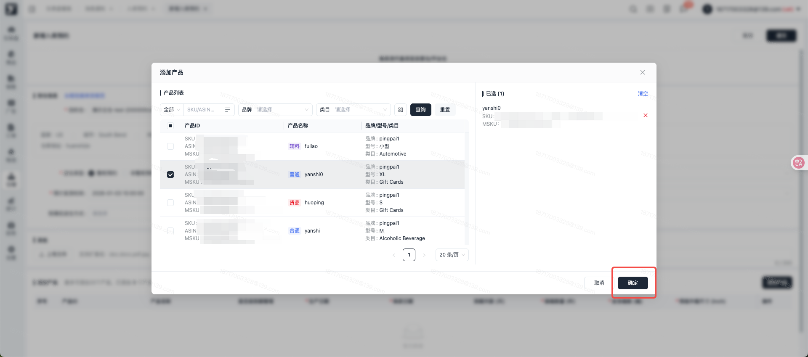

 1. 填写发货箱数

 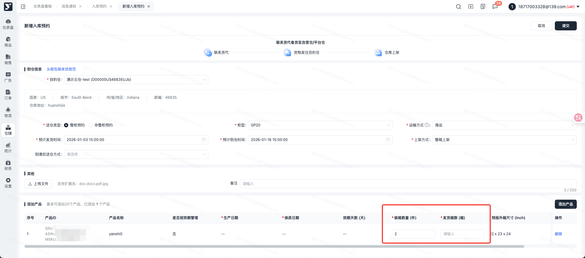

 1. 检查信息填写无误后，点击【提交】，预约单状态更新为 “待审核” 或“已通过”

 - 入库预约单--目的仓类型为【商家仓】时，状态为 “已通过”，无需审核
 - 入库预约单--目的仓类型为【平台仓、自营仓】时，状态为 “待审核”，需客服审核

 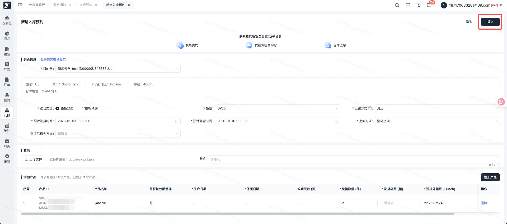

 1. 审核通过，预约单状态更新为 “已通过”（此状态的入库预约单，系统会自动生成状态为待入库的【采购入库单】）

 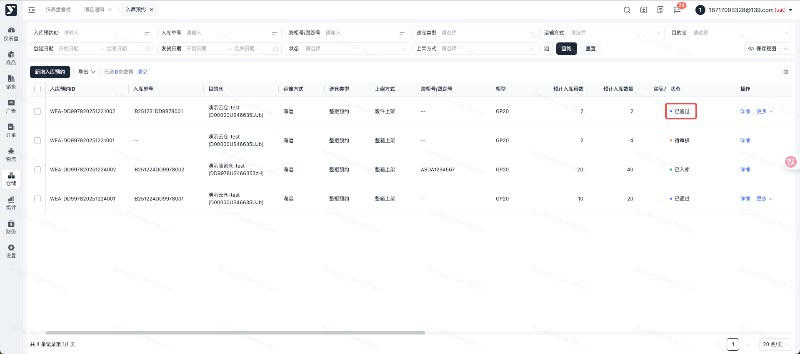

### 打印箱唛

1. 功能描述：入库预约单状态为 “已通过” 时，打印箱唛
2. 操作步骤：

 1. 打印箱唛：鼠标悬浮在【更多】上，点击【打印箱唛】按钮，系统自动生成标签预览

 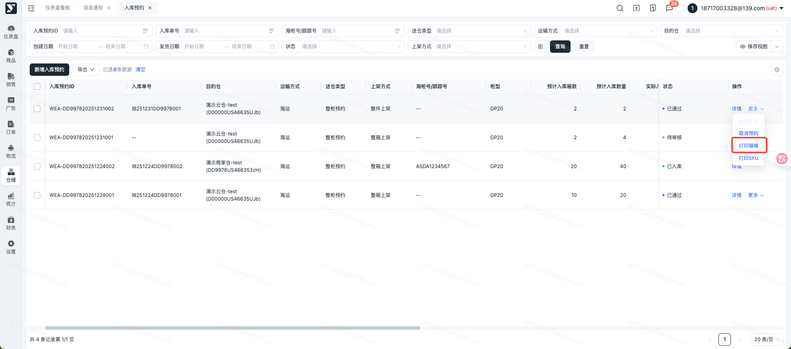

### 打印SKU标签

1. 功能描述：入库预约单状态为 “已通过” 时，打印SKU标签

 - 仅当入库预约单--目的仓类型为【平台仓、自营仓】时，可打印SKU 标签
2. 操作步骤：

 1. 打印SKU：鼠标悬浮在【更多】上，点击【打印SKU】按钮，系统自动生成标签预览

 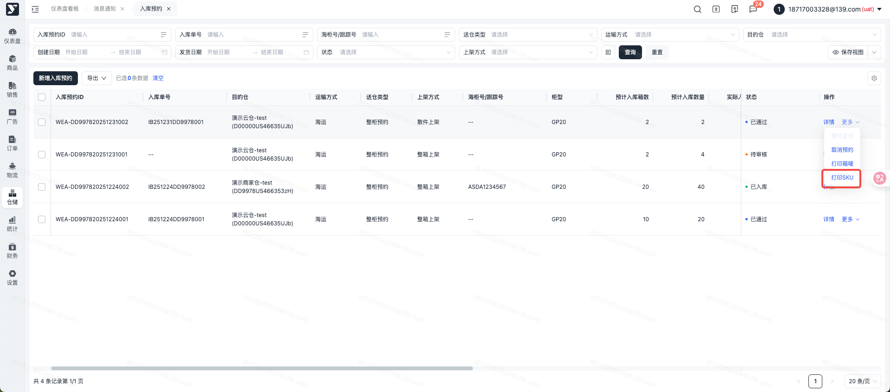

### 提交发货

1. 功能描述：确认货物从国内已发走后，在系统操作发货
2. 操作步骤：

 1. 鼠标悬浮在【更多】上，点击【提交发货】按钮

 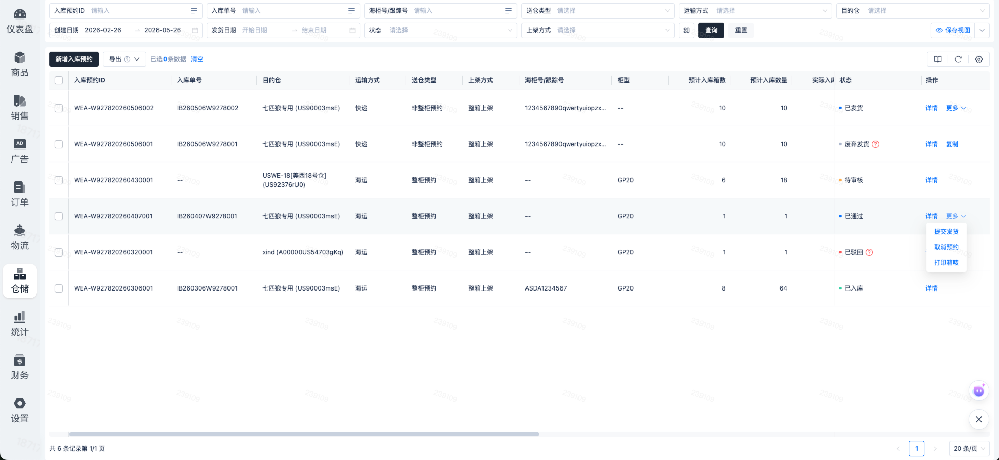

 1. 进入【提交发货信息确认】页面，若入库预约单信息与新增时不一致，可再修改；同时，补充【预计到港时间、海柜号/跟踪号、货代公司、运输公司、运输公司官网、货代联系方式】

 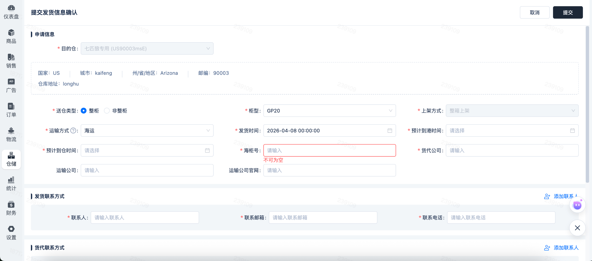

 1. 检查入库预约单无误后，点击【提交】按钮，提交成功，入库预约单状态更新为 “已发货”

 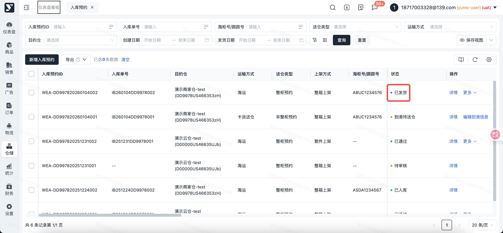

### 更新发货信息

1. 功能描述：入库预约单状态为 “已发货” 时，可再修改【运输方式、预计到港时间、预计到仓时间】
2. 操作步骤：

 1. 鼠标悬浮在【更多】上，点击【更新发货信息】按钮

 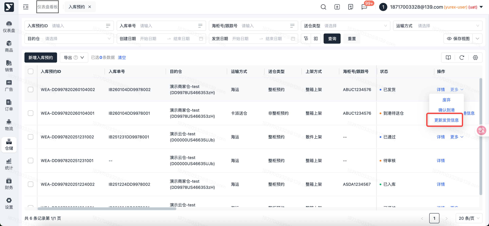

 1. 进入【更新发货信息】页面，修改信息后，点击【提交】按钮

 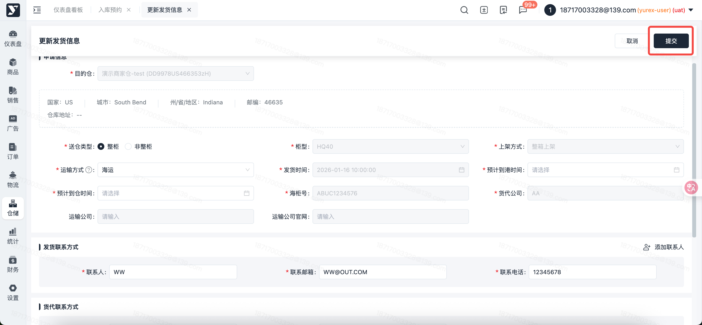

 1. 提交成功，入库预约单状态更新为 “更新待审核”，等待客服审核更新信息

 

 1. 客服审核通过：入库预约单状态更新为 “已发货”

 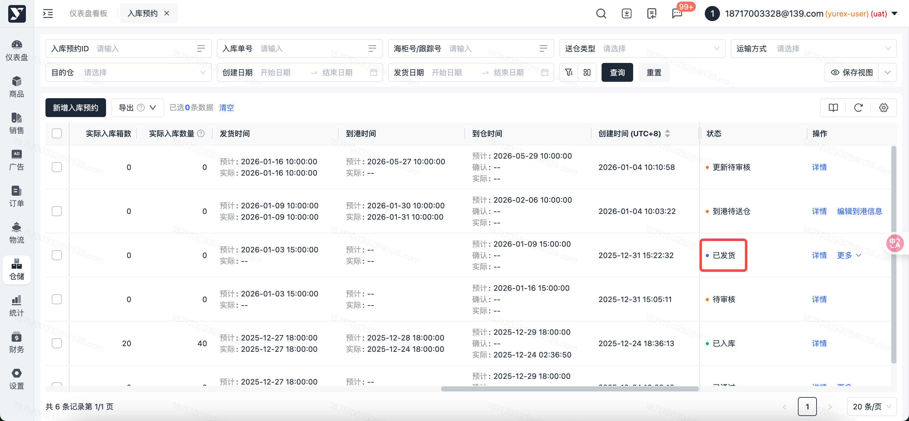

 1. 客服审核驳回：入库预约单状态更新为 “更新失败”，需要再次提交【更新发货信息】

 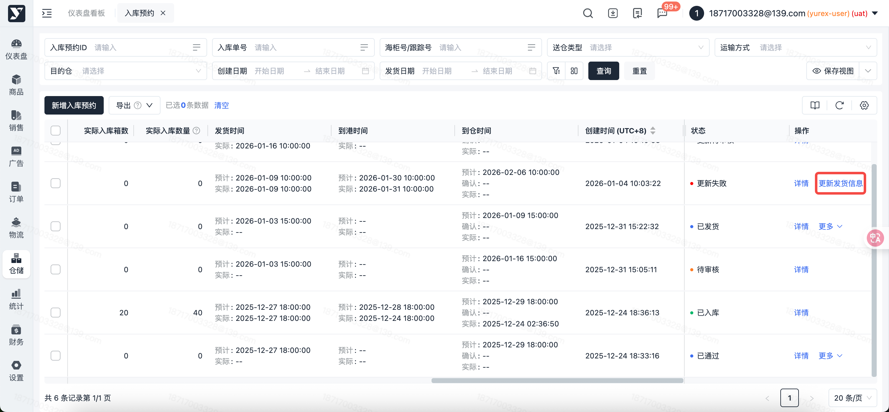

### 确认到港

1. 功能描述：货到到达目的国港口后，需操作【确认到港】
2. 系统满足操作确认到港的前提条件：

 - 运输方式为【海运】或【铁运】
 - 且入库预约单状态为【已发货】
3. 操作步骤：

 1. 鼠标悬浮在【更多】上，点击【确认到港】按钮

 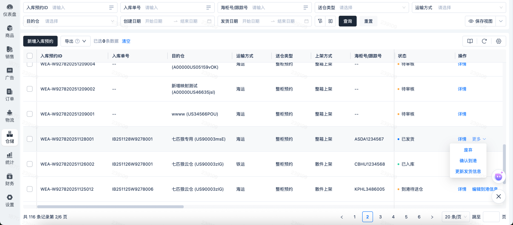

 1. 在弹窗中，输入【到港时间、到港后送仓方式】，点击【确定】按钮，

 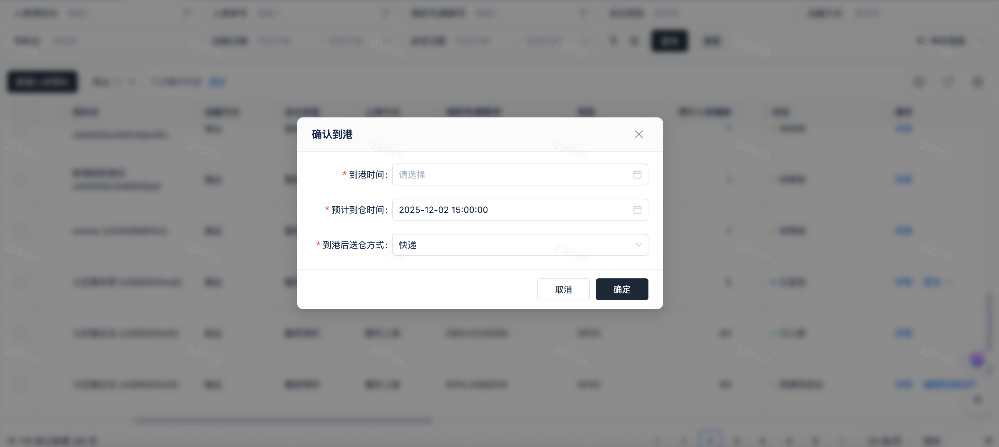

 1. 提交成功后，入库预约单状态更新为 “到港待送仓”，可再次【编辑到港信息】

 - 二次【编辑到港信息】，不可再修改【到港后送仓方式】

 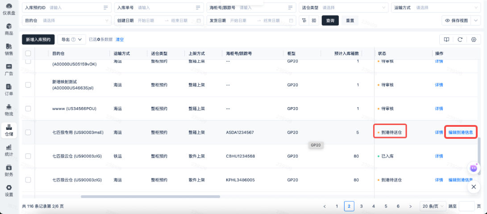
 2. 入库预约单对应的入库单状态为 “已入库” 或 “部分入库” 时，入库预约单的状态会联动更新为 “已入库”或“部分入库”

 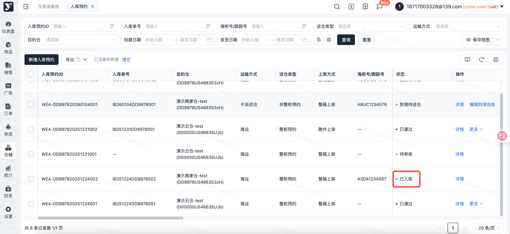

### 取消预约

1. 功能描述：入库预约单状态为 “已通过” 时，可取消入库预约单
2. 操作步骤：

 1. 鼠标悬浮在【更多】上，点击【取消预约】按钮

 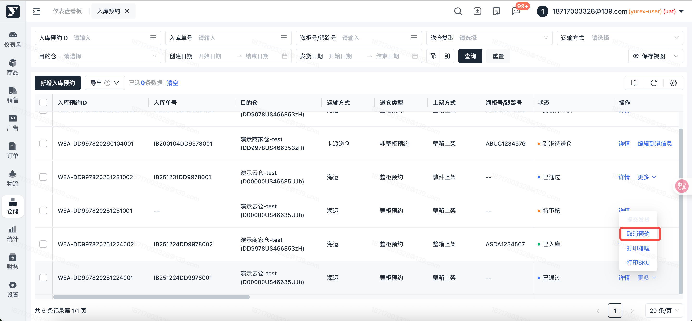

 1. 在弹窗中输入取消原因，点击【确定】，取消成功，预约单状态更新为 “已取消”

 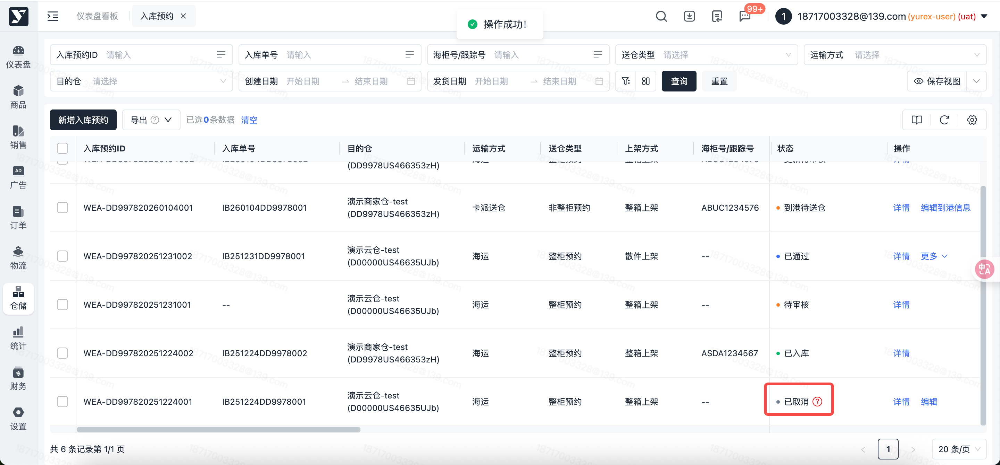

### 废弃

1. 功能描述：入库预约单状态为 “已发货” 时，可废弃入库预约单
2. 操作步骤：

 1. 鼠标悬浮在【更多】上，点击【废弃】按钮

 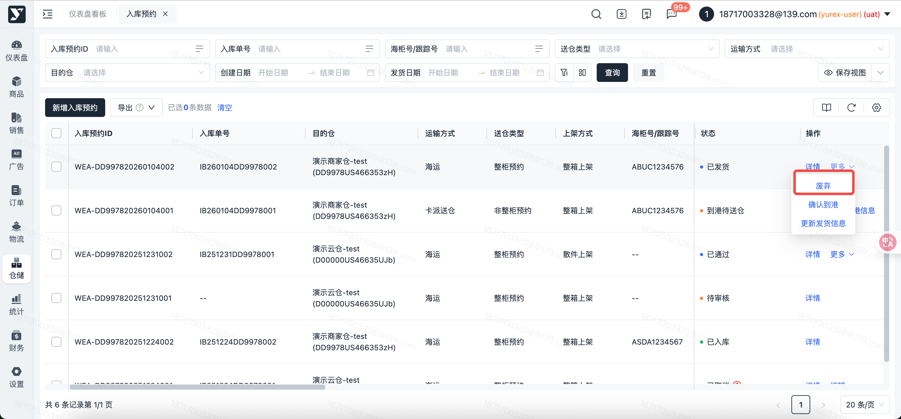

 1. 在弹窗中，填写废弃原因，点击【确定】按钮，提交成功，入库预约单状态更新为 “废弃发货”

### 导出

1. 功能描述：批量导出入库预约单列表、入库预约单详情
2. 操作步骤：

 1. 不勾选、按条件筛选、勾选入库预约单，点击【导出列表】按钮，自动导出Excel 格式的入库预约单到本地

 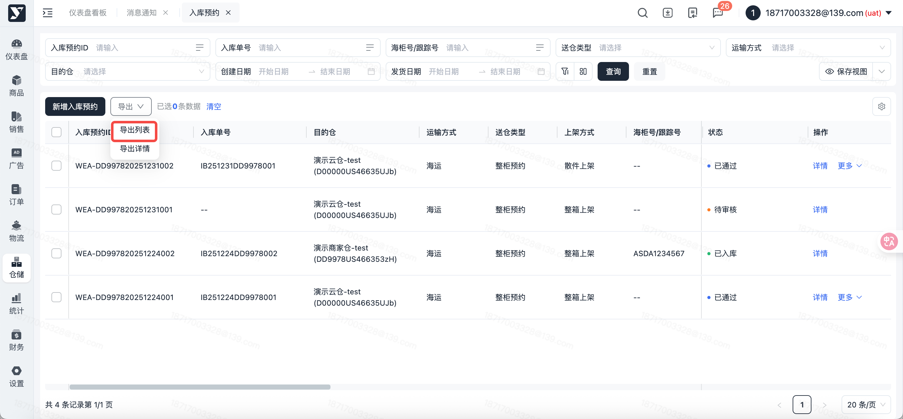

 1. 不勾选、按条件筛选、勾选入库预约单，点击【导出详情】按钮，自动导出Excel格式的入库预约单详情到本地

 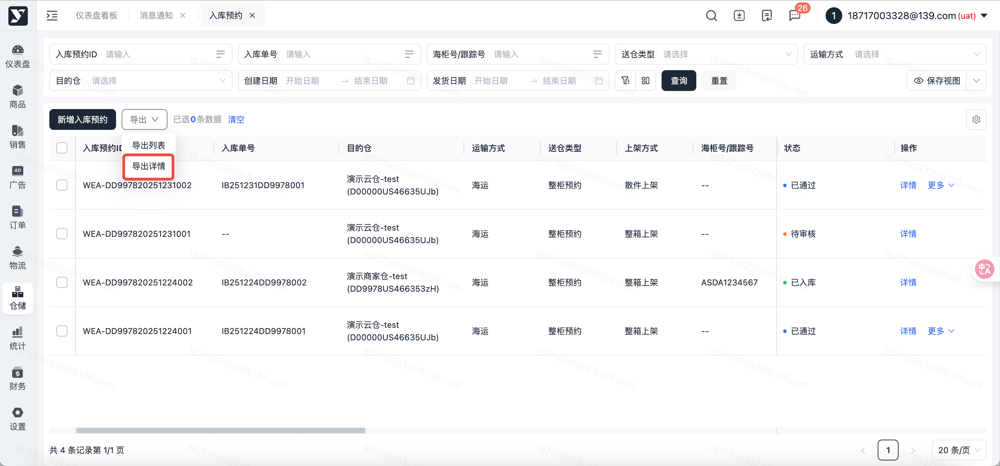
