# 飞书文档：库存管理

## 文档信息

| 项 | 内容 |
| --- | --- |
| 远程文档 | https://q1njej8cpab.feishu.cn/wiki/ABzbwgHp5iD7AekLOmOcEJc3n7b |
| 图片处理 | 本地下载（assets/images） |
| 快照时间 | 2026-08-06 |
| 来源命令 | `lark-cli docs +fetch --as user --doc "<remote>" --jq ".data.markdown"` |
| 格式处理 | fd-doc-markdown-sync/scripts/normalize-feishu-doc-markdown.mjs |

---

库存管理

当前版本：v1.0.0

## 功能介绍

1. 库存管理：可查看仓库中所有产品库存汇总、库存动态、库存明细等（也可区分查看：整箱库存、散件库存）。

## 页面路径

【仓储】-【库存管理】

## 系统流程

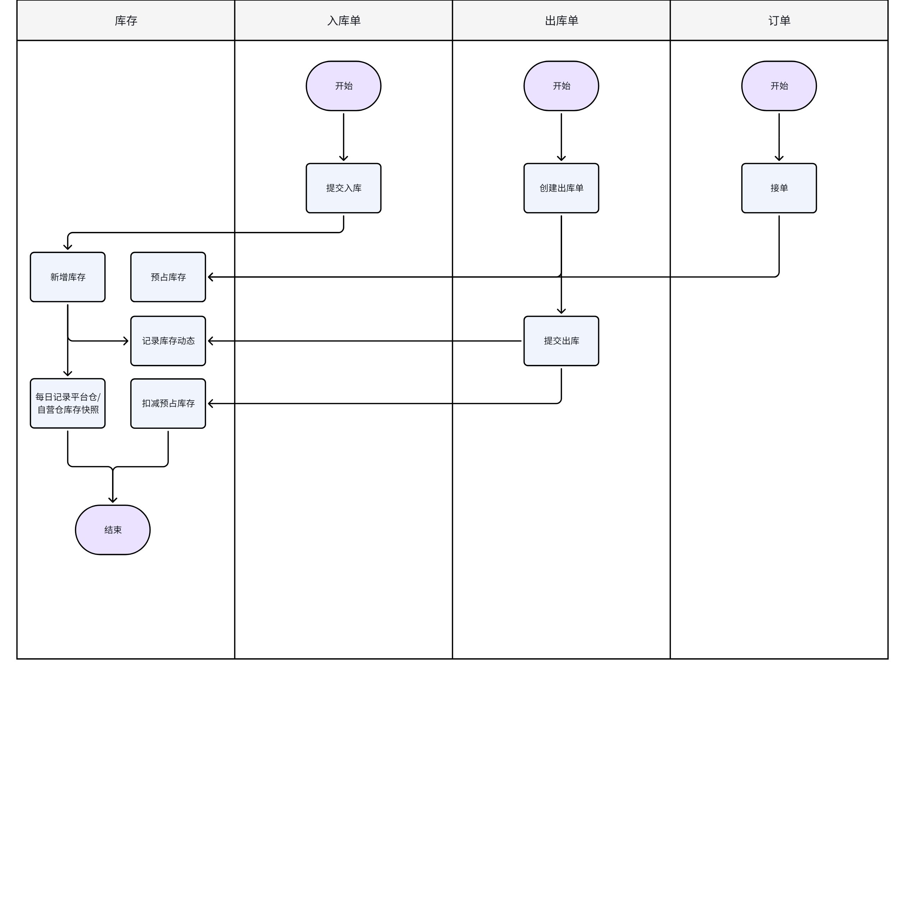

> 画板来源：token=`UjagweEO6hNGaBb0BOcc8cddnuc`

## 操作指南

### 实时库存

#### 库存汇总

1. 功能描述：汇总SKU在各仓库的可用库存、预占库存、冻结库存、在库库存、可加工数量

 1. 可用库存：可用于接单的数量

 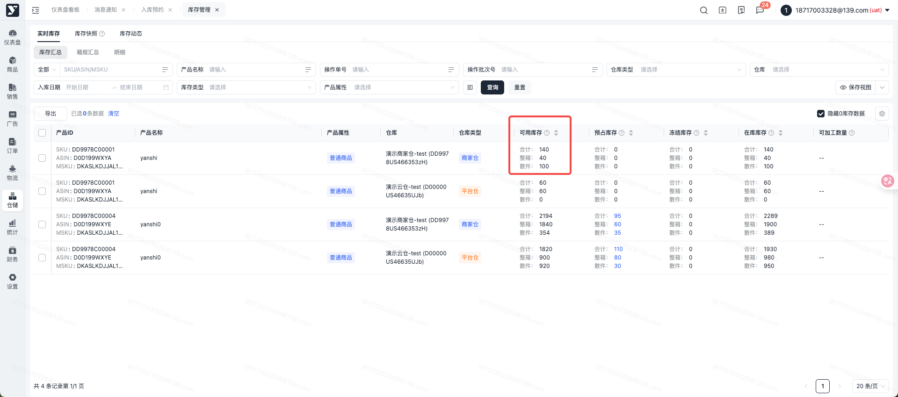

 1. 预占库存：被业务订单占用的数量，点击预占库存数字，可查看预占明细

 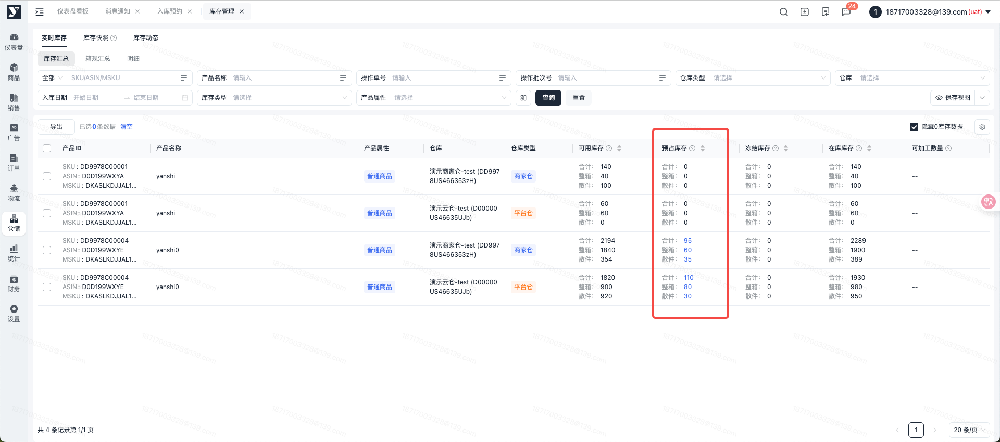

 1. 冻结库存：指因不合格/不合规/已过效期等原因，导致无法正常销售的数量

 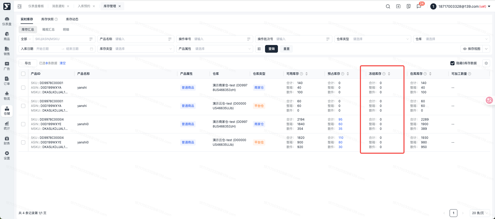

 1. 在库库存：目前在仓的所有库存数量，包括可售库存、预占库存、待出库库存和冻结库存

 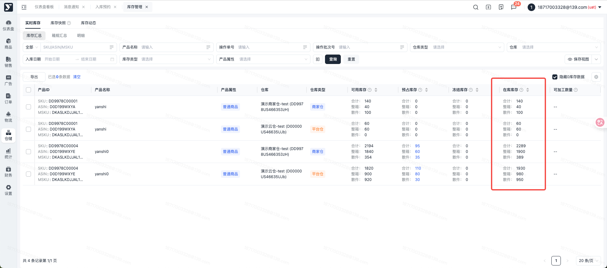

 1. 可加工数量：目前在仓产品，加工完成后的商品数量

 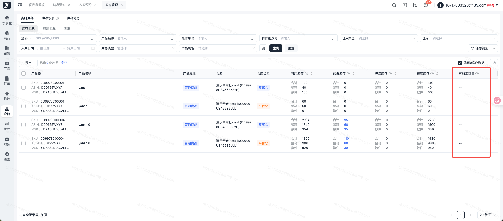

#### 箱规汇总

1. 功能描述：按箱规汇总SKU在各仓库的可用库存、冻结库存、在库库存

 1. 可用库存：可用于接单的数量

 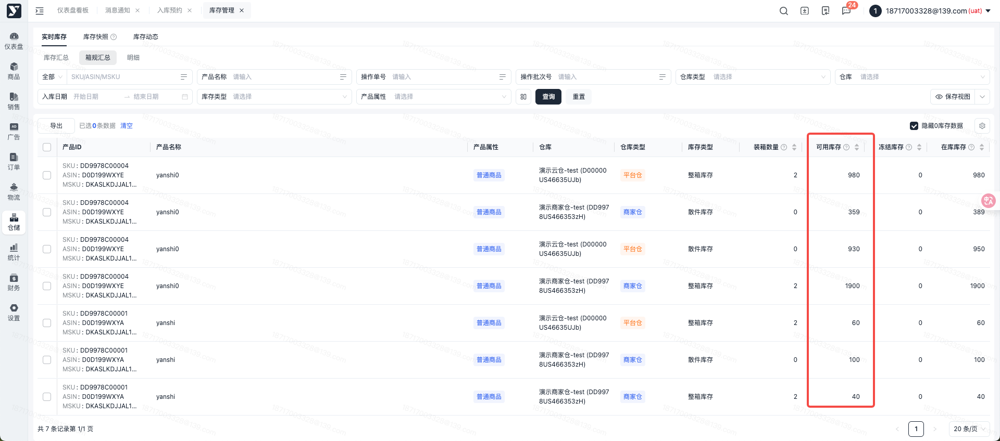

 1. 冻结库存：指因不合格/不合规/已过效期等原因，导致无法正常销售的数量

 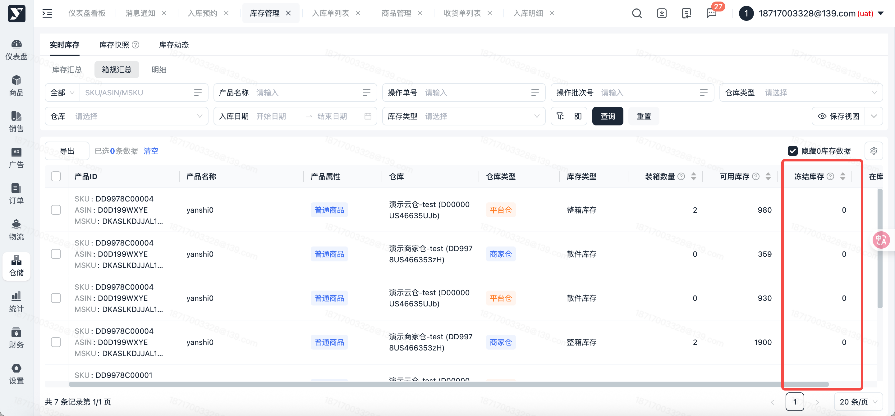

 1. 在库库存：目前在仓的所有库存数量，包括可售库存、预占库存、待出库库存和冻结库存

 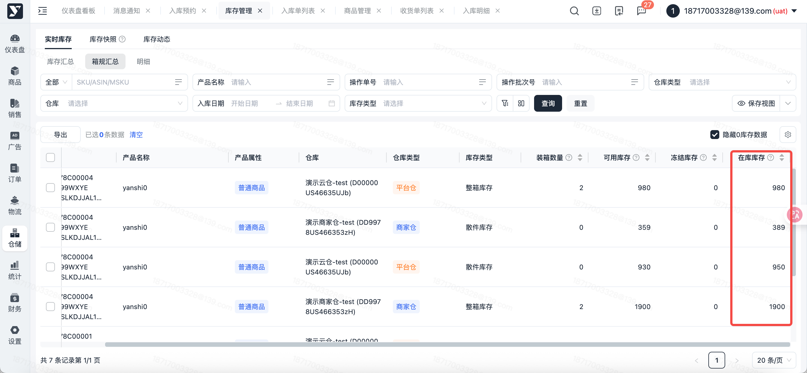

#### 明细

1. 功能描述：按入库批次维度显示SKU的整箱+散件 在库库存

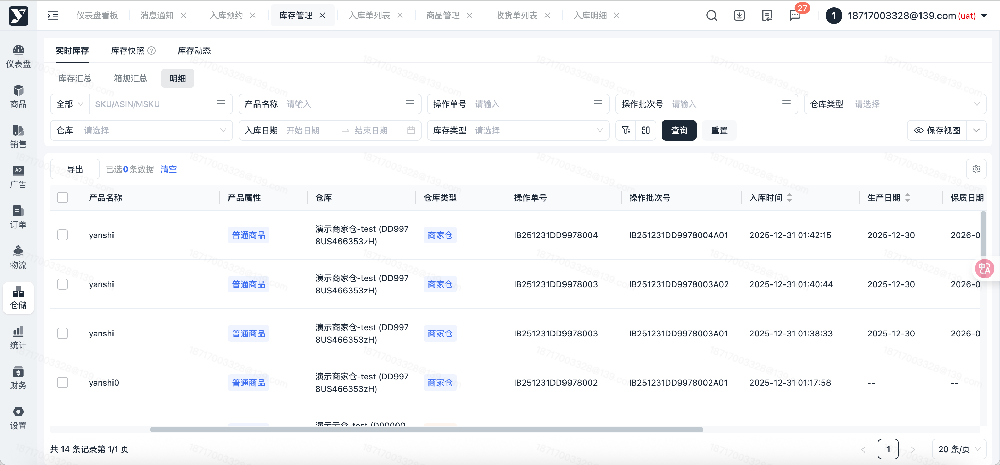

### 库存快照

#### 汇总

1. 功能描述：仓库类型为自营仓/平台仓时，展示SKU的库存快照。可查看SKU的期初库存、总入库库存、总出库库存、期末库存，默认展示近一个月的数据。

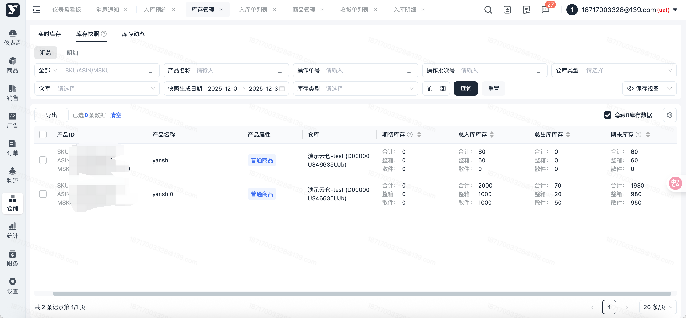

#### 明细

1. 功能描述：仓库类型为自营仓/平台仓时，按入库批次维度显示SKU在过去某一天的在库库存。

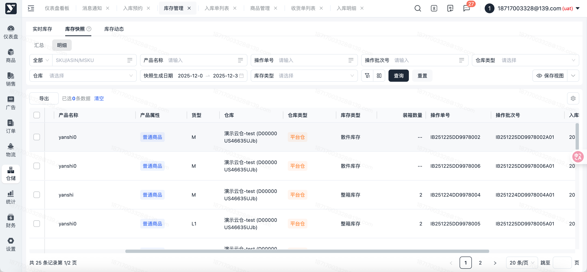

### 库存动态

1. 功能描述：SKU产生入库、出库、拆箱、合箱等影响库存变化的操作后，在此页面记录的变动情况，以便追溯

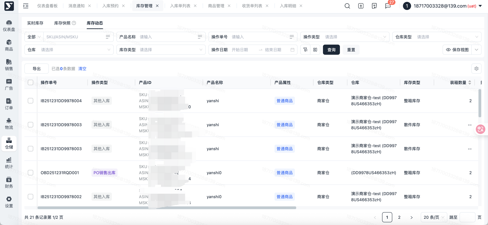

### 导出

1. 功能描述：批量导出库存数据
2. 可导出范围：实时库存、库存快照、库存动态
3. 操作步骤：

 1. 按条件筛选、批量选中后，点击【导出】按钮，自动导出Excel 格式的出库明细到本地

 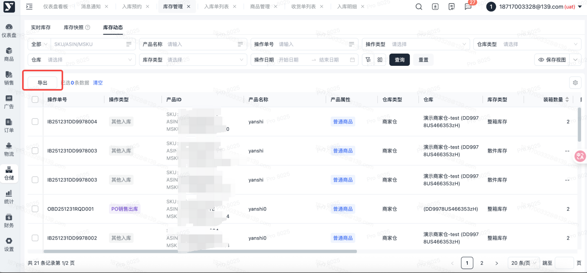
