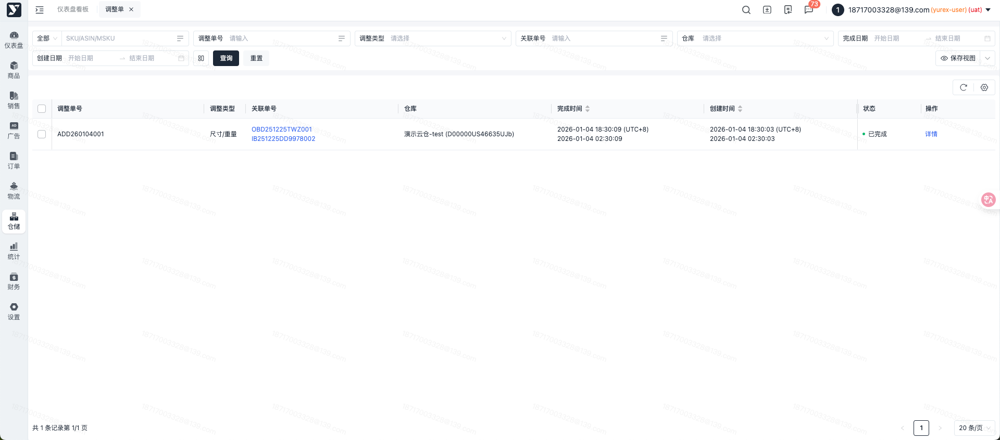
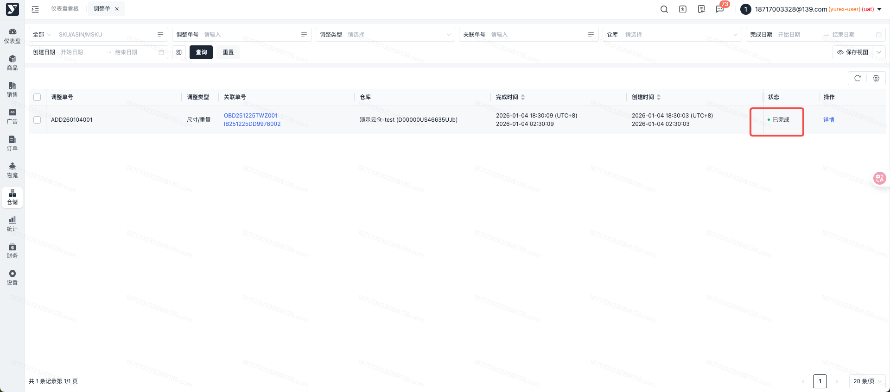
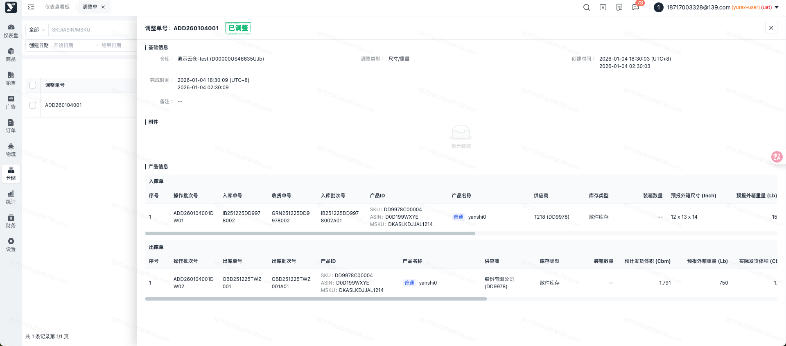

# 飞书文档：调整单

## 文档信息

| 项 | 内容 |
| --- | --- |
| 远程文档 | https://q1njej8cpab.feishu.cn/wiki/E2JpwaoyniOdWFkKP2WcMxofnAh |
| 图片处理 | 本地下载（assets/images） |
| 快照时间 | 2026-08-06 |
| 来源命令 | `lark-cli docs +fetch --api-version v2 --doc https://q1njej8cpab.feishu.cn/wiki/E2JpwaoyniOdWFkKP2WcMxofnAh --doc-format markdown --as user --format json --jq .data.document.content` |
| 格式处理 | fd-doc-markdown-sync/scripts/normalize-feishu-doc-markdown.mjs |

---

调整单

## 功能介绍

1. 当手动操作入库/出库填写数量或者尺寸/重量错误、仓库盘点账面与实际库存不符等异常情况，需要调整库内库存数量或者尺寸重量时可用调整单进行调整（仅限平台仓）

## 页面路径

【仓储管理】-【库存管理】- 【调整单】

## 操作指南

### 调整单列表

1. 功能说明：显示已完成的调整单

 

### 调整单详情

1. 功能描述：查看调整单详情
2. 操作步骤

 1. 点击【详情】按钮，显示调整单详细信息

 

 
