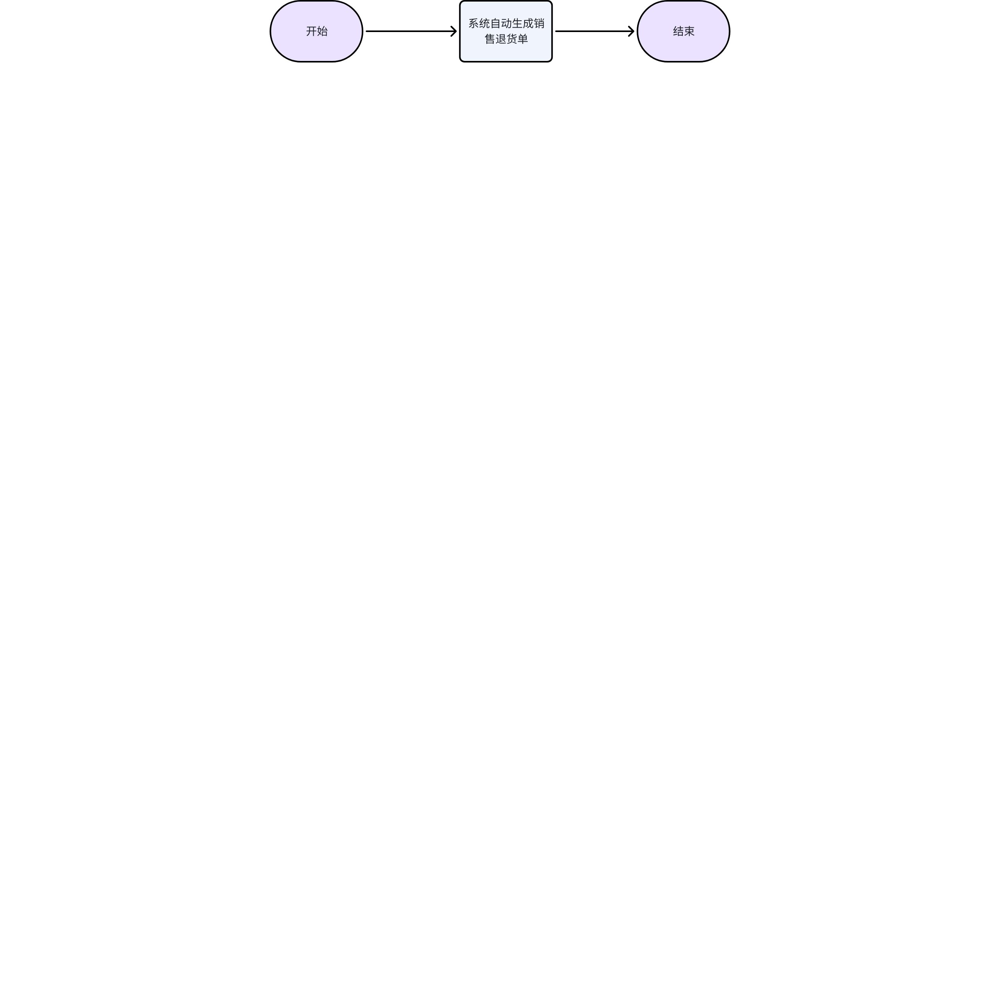
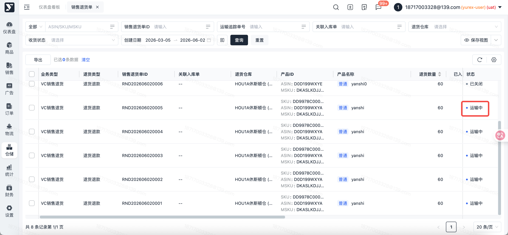
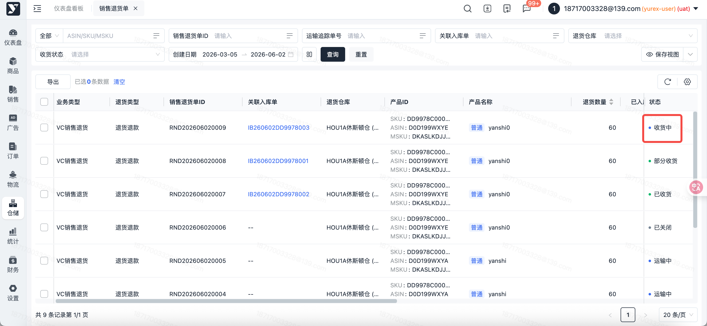
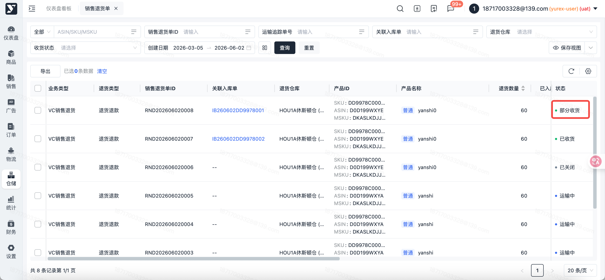
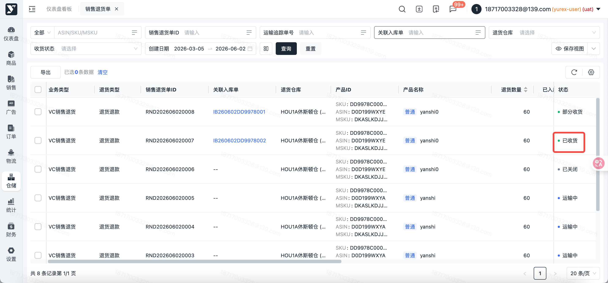
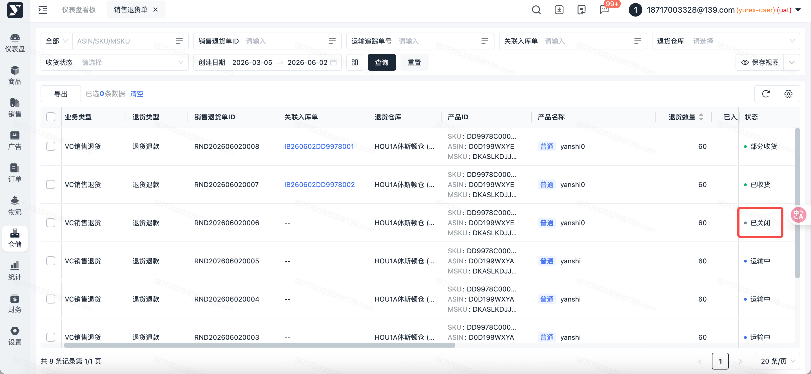
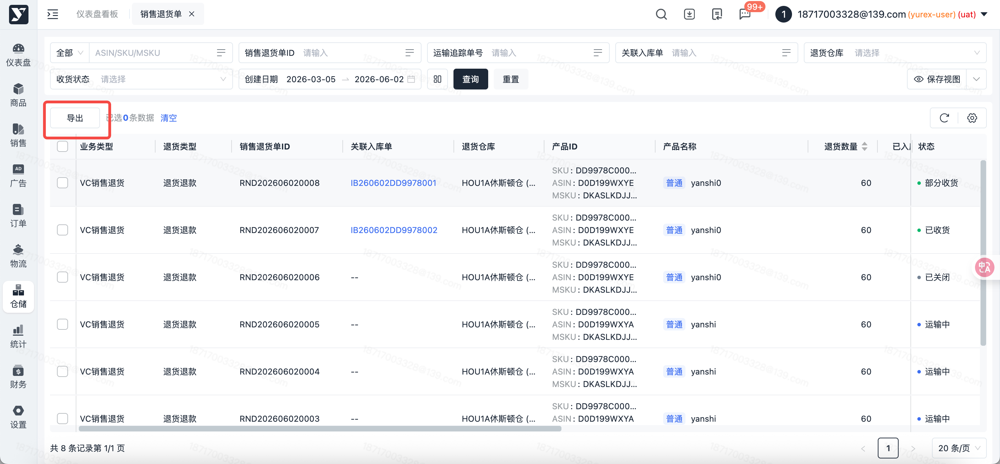

# 飞书文档：销售退货单

## 功能介绍

1. 销售退货单：可查看所有销售退货单，管理销售退货单数据，包括退货仓库、退货状态、退货产品、数量等信息。

## 页面路径

【仓储】-【销售退货】-【销售退货单】

## 系统流程

## 操作指南

### 销售退货单列表

1. 页面路径：【仓储】-【销售退货单】-【销售退货单列表】
2. 功能描述：展示亚马逊销售退货单数据，统一管理VC退货订单。
3. 销售退货单状态说明：

 1. 运输中：初始默认状态，退货货物正在运输途中

 

 1. 收货中：已创建入库单且部分货物已入库（0 < 入库数量 < 退货数量）

 

 1. 部分收货：已关闭退货单且部分货物已入库（0 < 入库数量 < 退货数量）

 

 1. 已收货：入库数量等于退货数量

 

 1. 已关闭：手动关闭退货单，且入库数量为0

 

#### 导出

1. 功能描述：在运输中状态下，当后续退货产品无法到仓或仓库无法找到产品时，可关闭退货单结束流程
2. 操作步骤

 1. 点击【导出】按钮
 2. 系统自动导出当前筛选条件下，以Excel格式的销售退货单列表到本地。如有勾选数据，优先导出勾选数据；否则导出当前搜索条件下的数据

 
