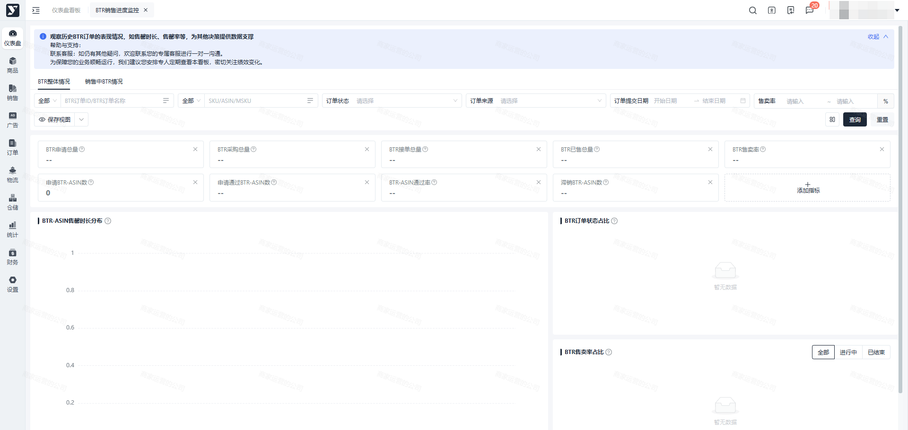
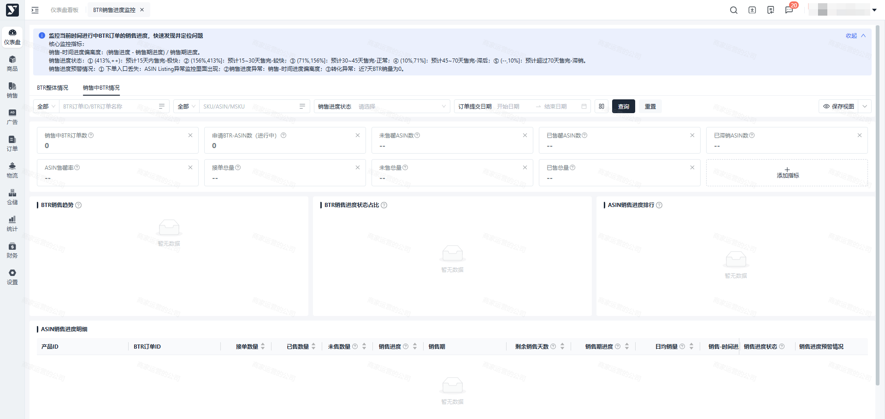

# 飞书文档：BTR销售进度监控

## 文档信息

| 项 | 内容 |
| --- | --- |
| 远程文档 | https://q1njej8cpab.feishu.cn/wiki/MzSnwWTCwiNcqUkkiDicFKIvnXb |
| 图片处理 | 本地下载（assets/images） |
| 快照时间 | 2026-08-06 |
| 来源命令 | `lark-cli docs +fetch --api-version v2 --doc https://q1njej8cpab.feishu.cn/wiki/MzSnwWTCwiNcqUkkiDicFKIvnXb --doc-format markdown --as user --format json --jq .data.document.content` |
| 格式处理 | fd-doc-markdown-sync/scripts/normalize-feishu-doc-markdown.mjs |

---

BTR销售进度监控

当前版本：v1.0.0

## 功能介绍

BTR整体情况：整合系统所有BTR订单各项指标、售罄时长分布及状态和售卖率占比情况

销售中BTR情况：统计系统进行中状态的BTR订单指标及售卖情况统计分析

## 页面路径

【仪表盘】-【订单】-【BTR销售进度监控】

## 操作流程

### BTR整体情况

1. 功能描述/操作步骤：默认显示全部BTR订单的各项指标及占比分析

 1. 可根据顶部筛选项查询对应维度的BTR数据情况

 

### 销售中BTR情况

1. 功能描述/操作步骤：默认显示进行中状态的BTR订单各项指标及销售情况

 1. 顶部点击“销售中BTR情况”tab标签，显示订单状态=进行中的BTR销售情况看板

 
