# 飞书文档：仪表盘

## 文档信息

| 项 | 内容 |
| --- | --- |
| 远程文档 | https://q1njej8cpab.feishu.cn/wiki/IKreweFNBiDA2nkDdqZcDGjAnCd |
| 图片处理 | 本地下载（assets/images） |
| 快照时间 | 2026-08-06 |
| 来源命令 | `lark-cli docs +fetch --api-version v2 --doc https://q1njej8cpab.feishu.cn/wiki/IKreweFNBiDA2nkDdqZcDGjAnCd --doc-format markdown --as user --format json --jq .data.document.content` |
| 格式处理 | fd-doc-markdown-sync/scripts/normalize-feishu-doc-markdown.mjs |

---

仪表盘

当前版本：V2.0.0

## 功能介绍

仪表盘能够直观地呈现各类关键数据，提供精准的数据支持，助力实现高效决策。它可以全面监控销售动态、库存情况等多个重要方面，从而切实提升运营效率，增强企业在市场中的竞争力。

## 注意事项

1. 仪表盘内的数据指标来自于不同的模块，可能会存在一定的更新时差。
2. 数据更新时间可以参考板块右上角的统计日期，若没有统计日期表示此板块会实时更新，您查看到的已经是当时的最新数据。

## 操作流程

##

#### 操作路径

【首页】

1. 进入YUREX系统可见，首页页签不可关闭。

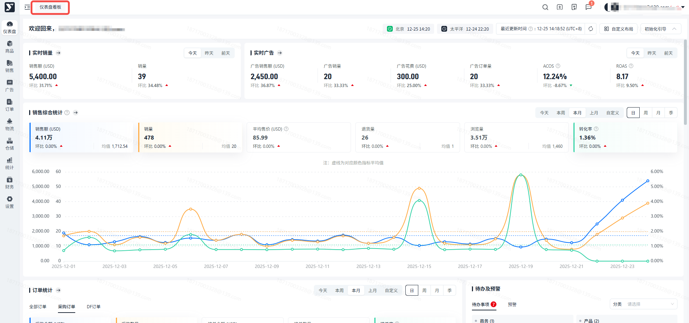

1. 点击【初始化引导】，页面会展开系统的使用教程，点击某个具体步骤，可进入详细教程页，助您探索系统。

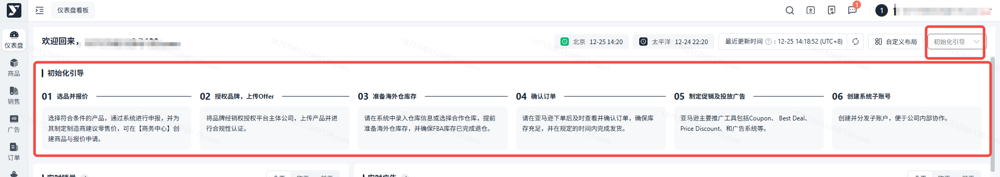

#### 实时数据

在仪表盘页面，您可以查看到最近3天（今天、昨天、前天）所有ASIN的实时销售数据和实时广告数据，若您想要查看更多详细数据，可以点击【实时销量】或【实时广告】旁的箭头，进入对应报表模块查看ASIN详细情况。

1. 查看实时销量

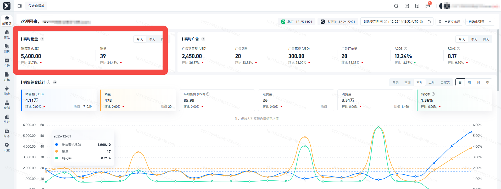

1. 查看实时广告

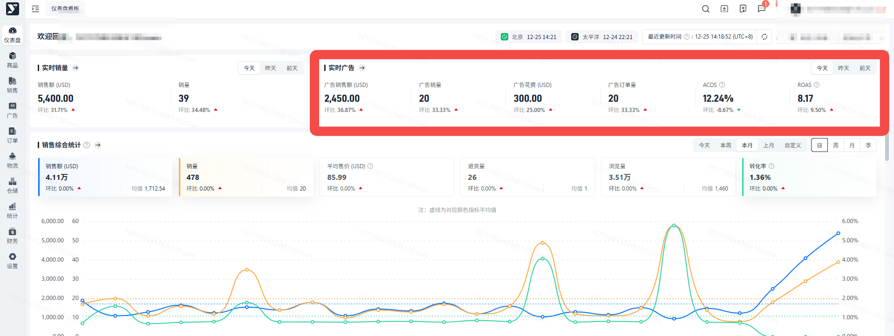

#### 订单统计

在订单统计板块您可以查看到入驻以来所有订单的订单总金额、总数量；其中包括亚马逊向您下的采购订单数量、采购金额，以及您的接单金额、接单数量和接单率；以及DF订单的下单数量和订单金额。

您可以点击每个指标框进行取消或选中图表的显示

1. 全部订单

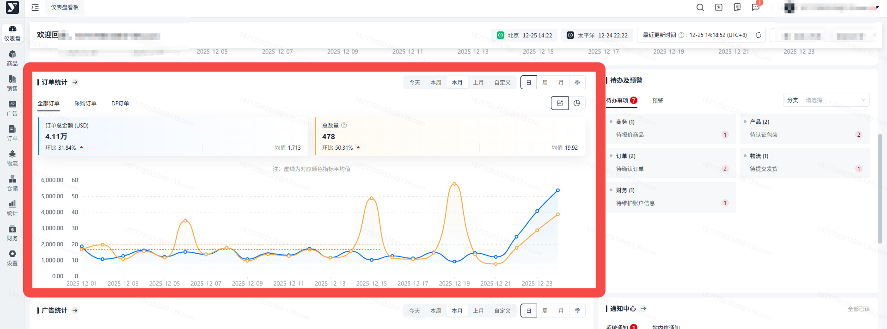

1. 采购订单

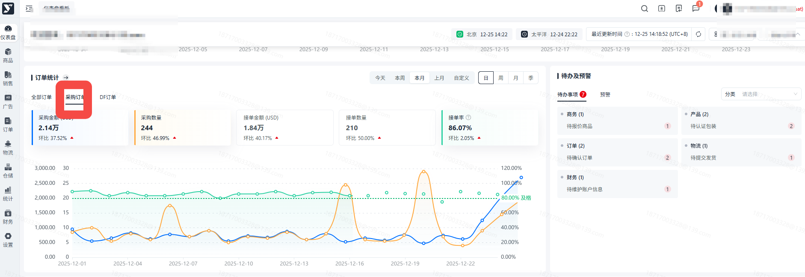

1. DF订单

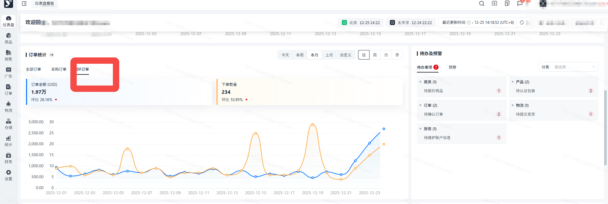

#### 待办及预警

在此板块您可以查看还有多少需要及时处理的事项，点击单个事项可直接定位到对应的页面，快速处理。

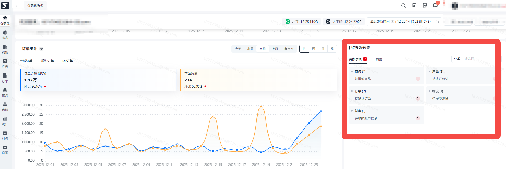

#### Top20排行榜

在此板块您可以查看入驻以来所有订单总金额、总数量排名前20的列表，帮助您定位主打产品和规划资源分配；支持切换列表展示维度、排序规则；

1. 销售

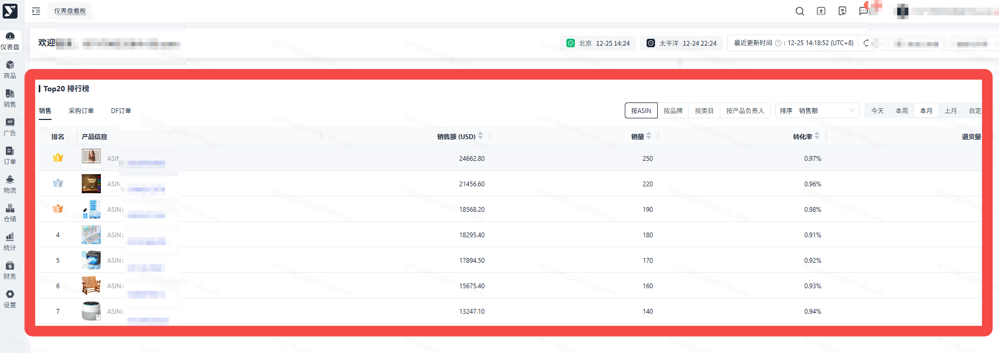

1. 采购订单

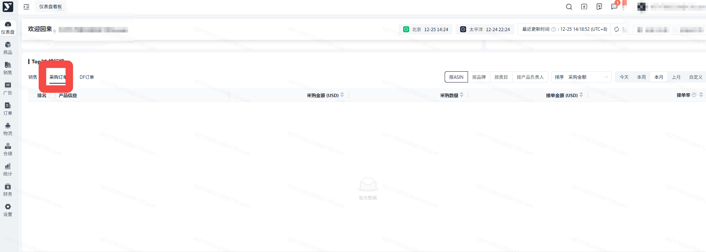

1. DF订单

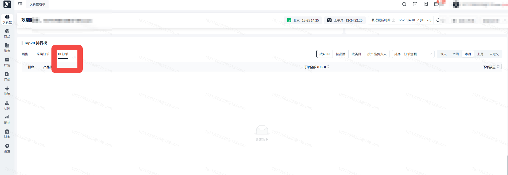

#### 销售综合统计

在仪表盘页面，您可以查看到所有ASIN的销售统计数据，也可以切换时间统计维度，查看更早的数据；若您想了解更多详细数据，可以点击【销售综合统计】旁的箭头，进入报表模块查看ASIN详细情况。

您可以点击单个指标取消或选中图表趋势的显示，且与该指标相同颜色的虚线代表该指标的平均值线。

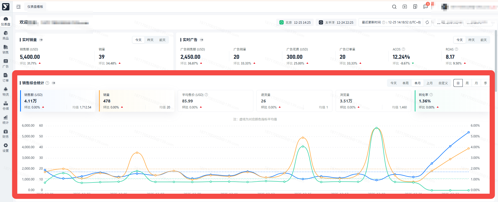

#### 库存统计

在此板块可以查看您的仓库库存分布以及VC库存的可售货值情况，也可以通过图表查看到在途库存、可用库存、可售库存的情况。

1. 库存分布

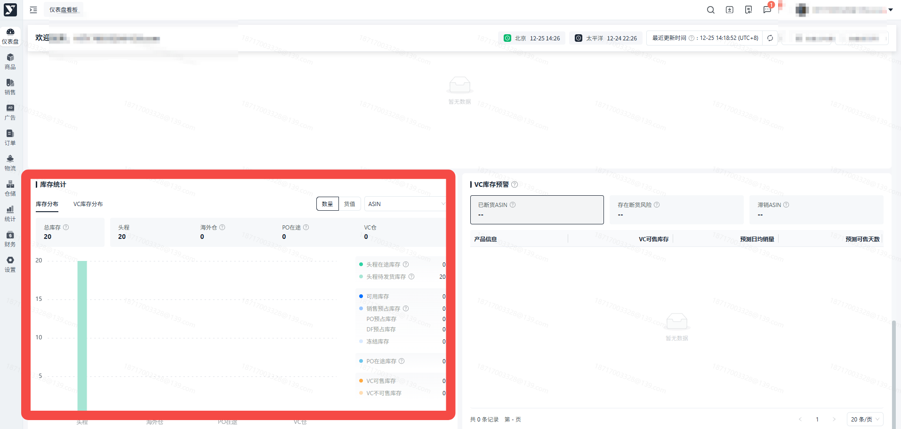

1. VC库存分布

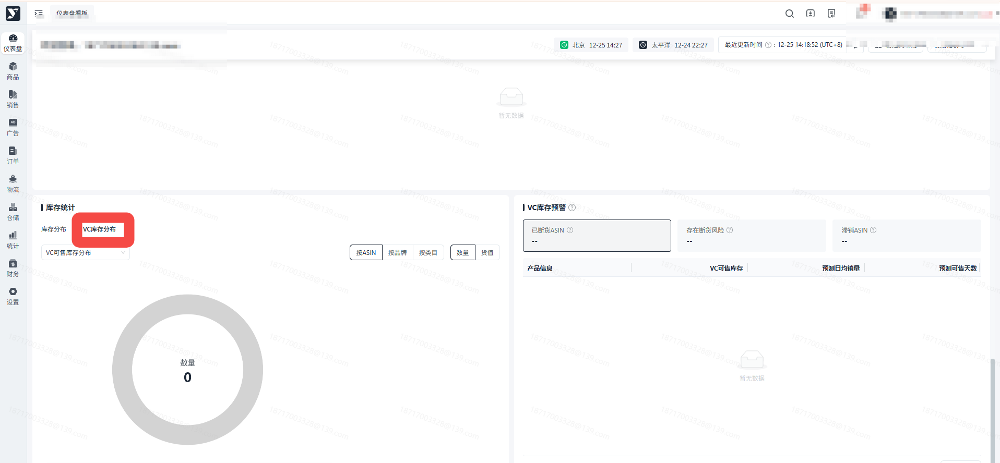

#### VC库存预警

根据亚马逊近7、14、30天加权平均的日均销量，结合亚马逊可售库存计算出的VC库存预警；您可以重点关注这部分ASIN进行补货。

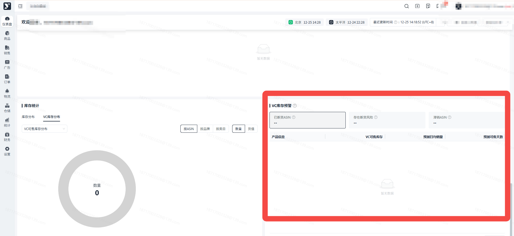

#### 通知中心

1. 系统通知：当前账号接收到的所有系统消息都可在此处查看，点击某条消息可以查看详情。

您可以通过点击【通知中心】右侧按钮进入通知中心列表查看所有详情，且支持分类筛选。

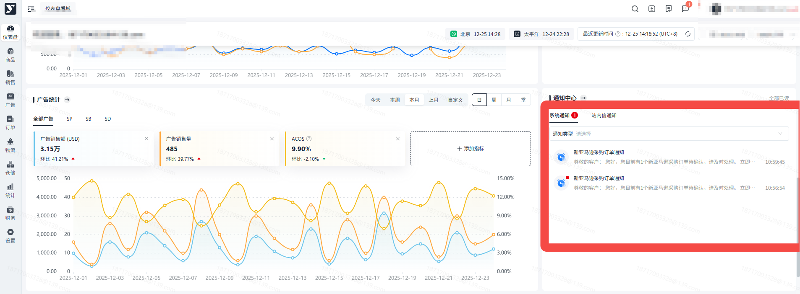

1. 站内信通知：当前账号接收到的所有站内信消息，点击某条消息可以查看详情。

您可以点击单个分类进行查看对应分类下的所有消息。

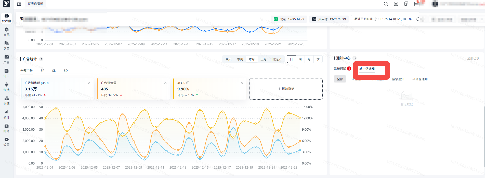

#### 自定义布局

通过此功能，您可以调整首页板块的展示布局。

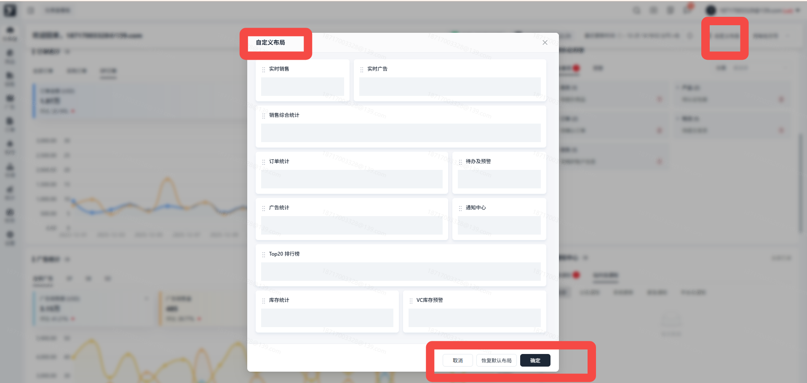

## 常见问题

##

答：首页需配置权限后才可查看，请进入【角色管理】中，选中您想要为其分配权限的角色，选择【基础模块】，勾选【首页】和【仪表盘】并保存，即可为角色赋予查看仪表盘的权限。

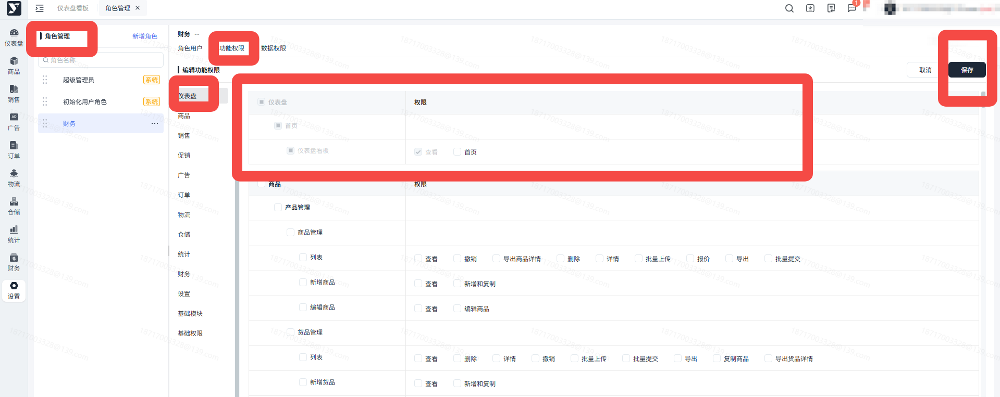

##

答： 首页默认展示本月或今日的实时数据，可能是接口没有拉取更新。
