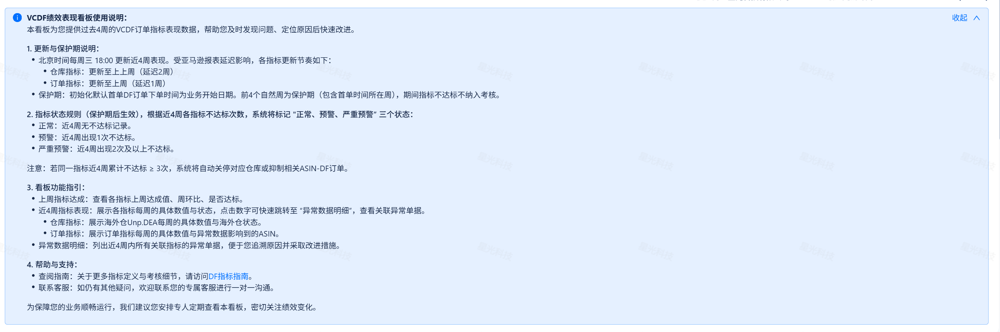
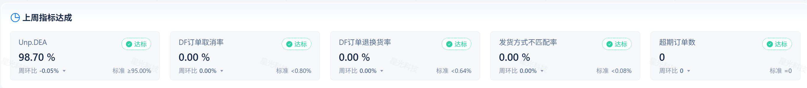
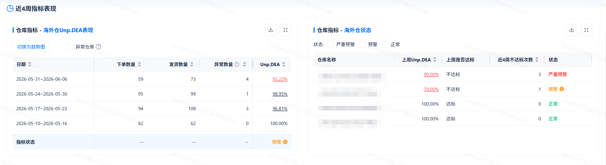
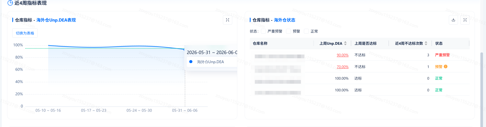
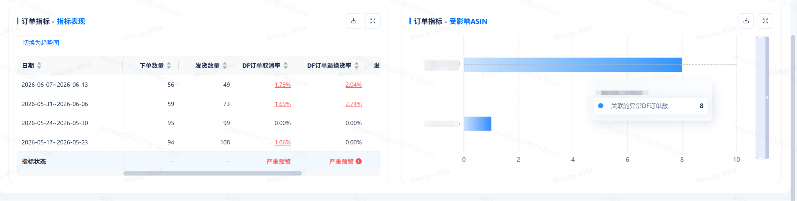
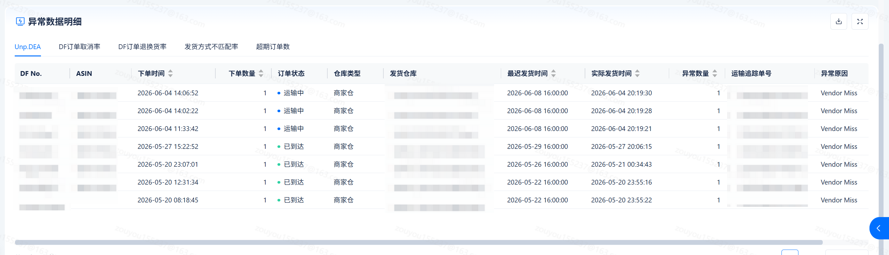

# 飞书文档：VCDF绩效表现

## 功能介绍

功能说明：展示DF指标近4周达成情况以及导致指标异常的异常数据明细。

看板更新时间：北京时间每周三 18：00

- 仓库指标：本周三更新至上上周
- 订单指标：本周三更新至上周

## 页面路径

【仪表盘】-【履约绩效】-【VCDF绩效表现】

## 指标介绍

| 指标名称 | 指标定义 | 计算公式 |
|-|-|-|
| Unp.DEA | 过去四周，供应商真实交付全流程指标出现异常(<95%)的情况。 | 1-（Unp.DEA 异常单元数 / 下单数量之和）\* 100% |
| DF订单取消率 | 过去四周，因供应商自身原因导致DF订单被取消的比例。 | 取消数量之和 / 下单数量之和 \* 100% |
| DF订单退换货率 | 过去四周，供应商DF订单产生退货或换货的比例。 | 退换货数量之和 / 实际发货数量之和 \* 100% |
| 发货方式不匹配率 | 过去四周，供应商实际发货方式与亚马逊指定发货方式不一致的包裹比例。 | 发货方式不匹配包裹数之和 / 实际发货包裹数之和 \* 100% |
| 超期订单数 | 过去四周，供应商已超过最迟发货日期才提交出库的DF订单总数。 | 取值 “实际发货时间 ＞ 最迟发货时间” 的订单数之和 |

更多指标要求、提升指标绩效等细节，参见文档：[供应商VCDF绩效指南](https://q1njej8cpab.feishu.cn/wiki/NDkDw0d7uiTHfLkvMjec6Lr6nSM)

## 看板介绍

### 看板使用说明

1. 功能描述：提供看板使用说明，帮助用户快速了解看板布局及功能

### 上周指标达成

1. 功能描述：通过指标卡展示近一周指标达成情况。
2. 指标卡内容：

 1. 指标名称
 2. 上周指标达成数值：

 1. 除“超期订单数” 为整数，其他指标均为百分比保留2位小数
 2. 指标数值 ＜标准值时，红色字体显示
 3. 周环比= 上周指标达成数值- 上上周指标达成数值，保留2位小数
 4. 标准值：每个指标要求达成的标准值

 - Unp.DEA：≥ 95.00%
 - DF订单取消率 ＜ 0.80%
 - DF订单退换货率 ＜ 0.64%
 - 发货方式不匹配率 ＜ 0.08%
 - 超期订单数 = 0
 5. 达标/不达标：指标数值≥标准值时，显示 “标准”；反之，红色字体显示 “不标准”

### 近4周指标表现

1. 功能描述：分别展示订单指标、仓库指标近4周的指标达成、指标状态。
2. 指标状态说明：

 1. 近4周不达标次数 = 0 时， 状态绿色字体显示 “正常”
 2. 近4周不达标次数 = 1 时，状态橙色字体显示 “预警”
 3. 近4周不达标次数 ≥ 2 时，状态红色字体显示 “严重预警”
 4. 相邻两周，状态出现升级时，在状态旁边显示标签：

 - 状态由 “正常” 变更为 “预警” ， 显示 “新增预警”
 - 状态由 “预警” 变更为 “严重预警”，显示“预警升级”

#### 仓库指标

1. 功能描述：展示周维度 或 周+仓库维度的Unp.DEA 达成百分比。

 1. 仓库指标-海外仓Unp.DEA表现：

 1. 表格默认按周显示近4周的Unp.DEA 达成百分比 及 近4周仓库指标状态
 2. 当勾选 “异常仓库” ，表格增加 “考核开始日期、仓库名称” 字段，显示近4周Unp.DEA＜95% 的仓库

 - 考核开始日期：初始化统一为 “首单DF下单日期”，仓库重开后，考核开始日期更新为 “开仓日期”
 3. 当勾选 “异常仓库 + 全部仓库”，显示近4周产生DF 业务的所有仓库Unp.DEA 达成百分比
 2. 仓库指标-海外仓状态：

 1. 展示近4周产生DF业务所有仓库的仓库指标状态
2. 交互说明：

 1. Unp.DEA 数值 ＜100% 时，点击 Unp.DEA 数值，可自动跳转到Unp.DEA 异常明细
 2. 点击 “切换为趋势图” 显示周维度的Unp.DEA 趋势

 

 

#### 订单指标

1. 功能描述：展示周维度的订单指标达成百分比

 1. 订单指标-指标表现

 1. 表格默认按周显示近4周的订单指标达成百分比 及 近4周订单指标状态
 2. 订单指标-受影响ASIN

 1. 订单指标近4周异常单据涉及的ASIN，以及ASIN关联到的异常DF订单数
2. 交互说明：

 1. 订单指标 数值＞0 时，点击指标数值，可自动跳转到对应指标的异常明细tab页

 

### 异常数据明细

1. 功能描述：展示近4周指标涉及到的异常数据明细

