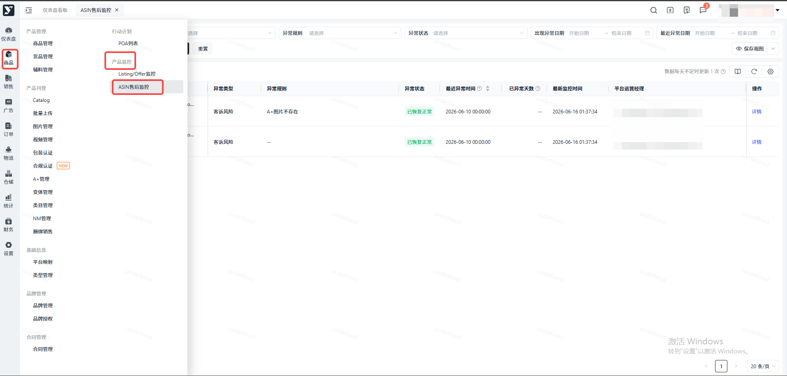
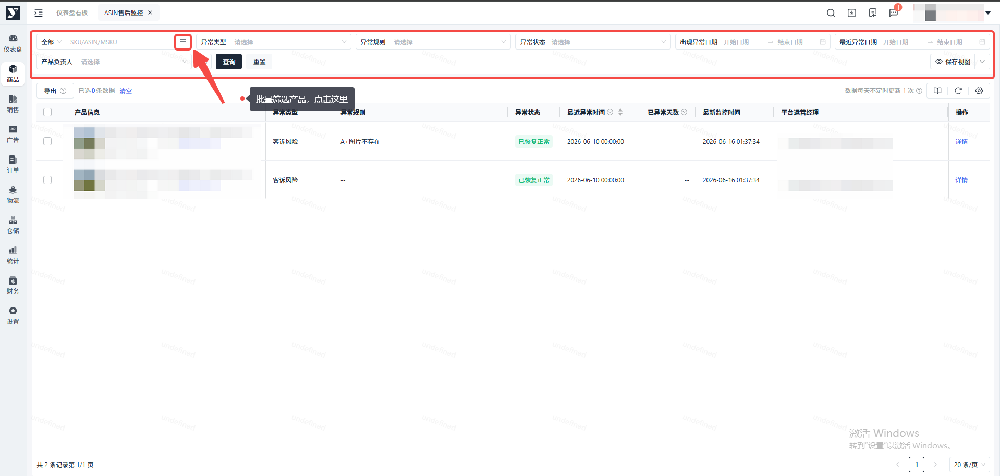
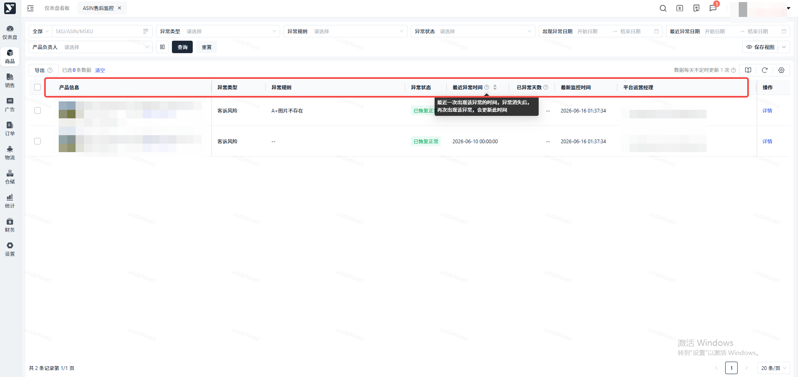
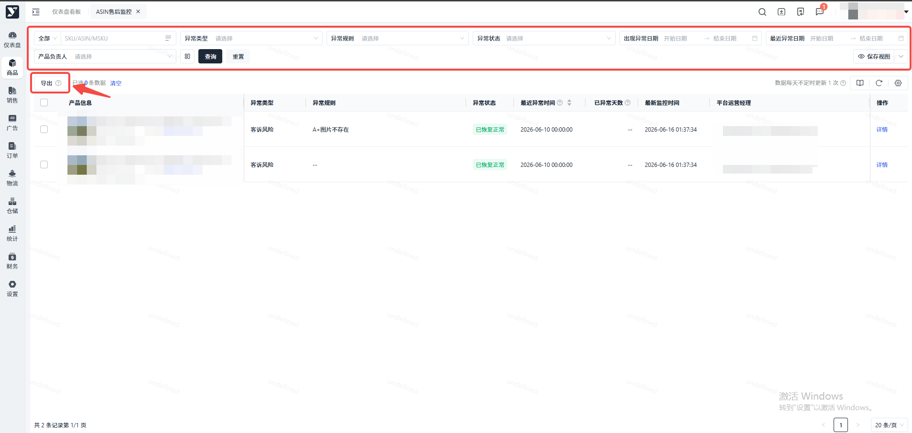
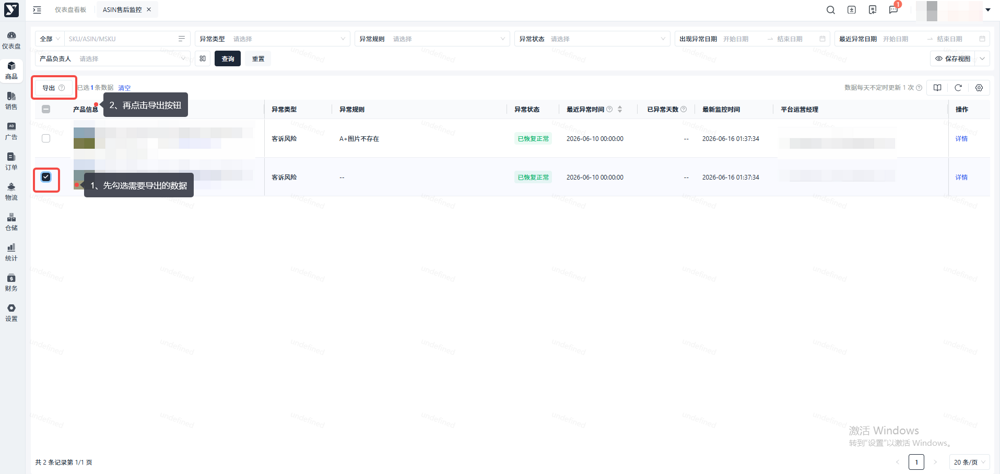
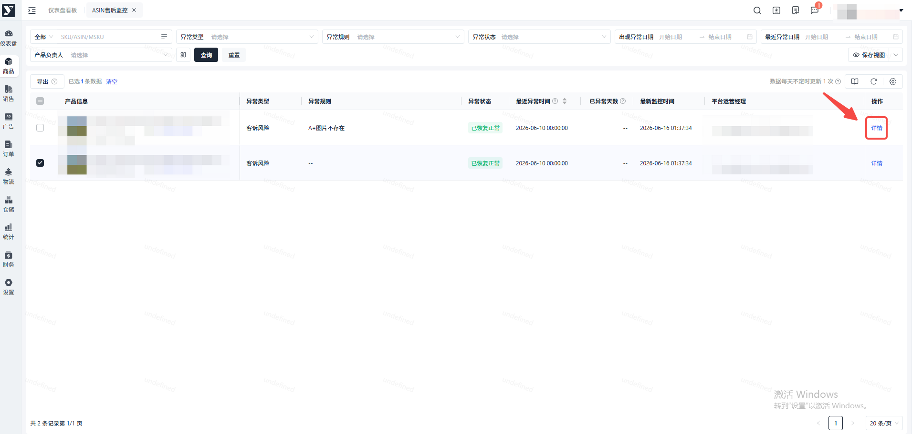
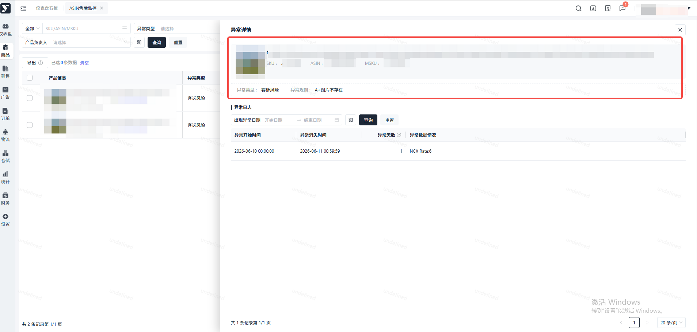
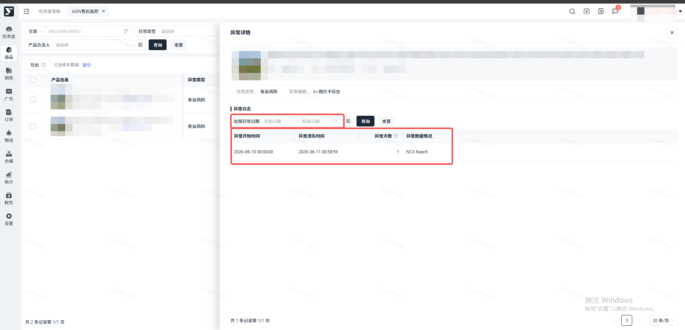

# 飞书文档：ASIN售后监控

监控指标异常判断规则，以及财务资金暂扣、补偿、恢复逻辑，详见：

## 功能介绍

系统每日自动监控1次所有“生效成功”状态Offer的售后异常情况，当检测到Offer的“销量”、“退货率”、“Buybox价格”、“Listing质量”、“促销”、“合规认证”、“客诉风险”和“库存滞销”异常时，记录异常数据（以ASIN+异常类型+异常规则维度，某个ASIN某种异常第一次被检测到，则生成一条数据，后续该ASIN再次检测到该异常，仅更新数据不生成新的记录），当检测到异常消失时，记录异常消失时间。

## 页面路径

【商品】-【产品监控】-【ASIN售后监控】

## 操作步骤

### 搜索条件

支持按 SKU/ASIN/MSKU、异常类型、异常规则、异常状态、出现异常日期、最近异常日期和产品负责人 筛选异常

> - SKU/ASIN/MSKU：一次最多输入200个，精准搜索
> - 异常状态：异常中、已恢复正常，**默认查询 异常中**
> - 出现异常日期：**查询的是在对应日期范围出现过异常的ASIN**，比如 查询上周出现过异常的ASIN
> - 最近异常日期：**查询的是最近一次异常在对应日期范围的ASIN**，比如 查询最近一次异常是上周的ASIN，**默认查询最近90天**

### 列表字段

异常列表展示产品信息、异常类型、异常规则、异常状态、最近异常时间、已异常天数、最新监平台运营经理 字段

> - 最近异常时间：是LA时间，支持排序，表示：最近一次出现该异常的时间，异常消失后，再次出现该异常，会更新此时间
> - 已异常天数：如果该异常当前仍是异常中，则会展示具体值，通过当前时间 - 最近异常时间计算得到，计算公式：已异常天数 = 当前时间 - 最近异常时间

### 数据导出

#### 导出全部数据

通过搜索条件搜索过滤数据，再导出所有数据

> 一次最多可导90天数据，如需导出更长日期范围的数据，请分成多次导出
>
> 如果不选择最近异常日期，默认导出最近90天的数据，如果选择的最近异常日期范围大于90天，则默认导出开始日期\~开始日期+90天的数据

#### 导出选中数据

勾选需要的数据，再点击导出

### 查看异常详情（历史）

### 异常详情，上方展示对应异常ASIN的图片、标题、SKU、MSKU、ASIN码、异常类型和异常规则

### 异常详情，下方异常日志列表展示：异常开始时间、异常消失时间、异常天数、异常数据情况

> - 支持按 出现异常日期 筛选
> - 异常天数计算逻辑：如果异常消失，异常天数 = 异常消失时间 - 异常开始时间；如果异常未消失，异常天数 = 当前时间 - 异常开始时间
> - 异常数据情况：展示判断异常的相关指标值
> - 特别说明：如果某个ASIN的某种异常一直存在，那么每天都会生成一条异常明细记录

