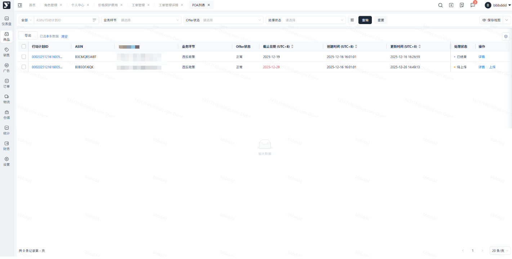
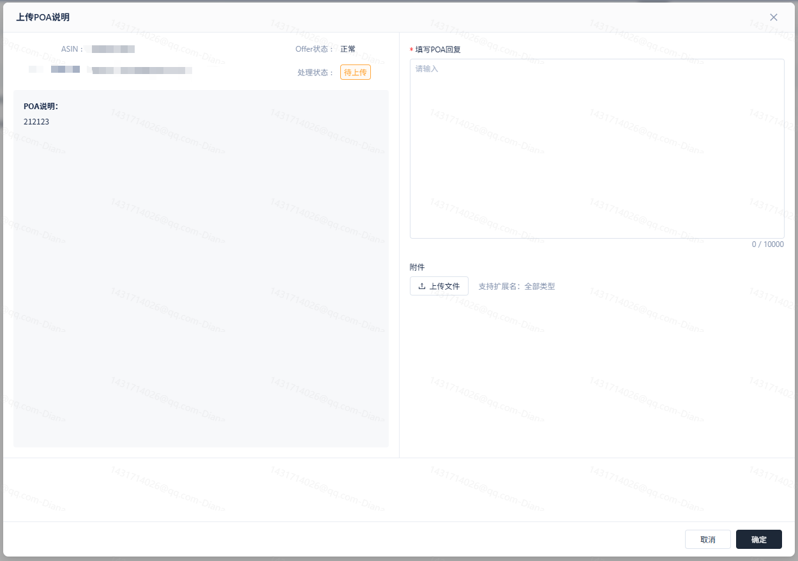
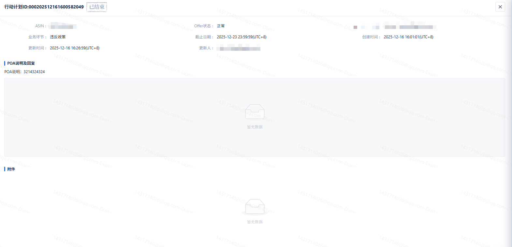

# 飞书文档：POA列表

## 文档信息

| 项 | 内容 |
| --- | --- |
| 远程文档 | https://q1njej8cpab.feishu.cn/wiki/EMT2wIzMHitC1pk6V2Qch2fJnmg |
| 图片处理 | 本地下载（assets/images） |
| 快照时间 | 2026-08-06 |
| 来源命令 | `lark-cli docs +fetch --api-version v2 --doc https://q1njej8cpab.feishu.cn/wiki/EMT2wIzMHitC1pk6V2Qch2fJnmg --doc-format markdown --as user --format json --jq .data.document.content` |
| 格式处理 | fd-doc-markdown-sync/scripts/normalize-feishu-doc-markdown.mjs |

---

POA列表

## 功能介绍

当亚马逊平台因客户投诉等原因，向卖家发出要求提交**行动计划**的邮件时，相关产品的ASIN可能会受到销售限制。为解除限制，供应商需配合服务商完成行动计划申诉流程。

## 注意事项.

1. 收到POA消息后，需要3个工作日内完成上传。
2. 上传的文件大小总和，尽量保持在10兆以内。所有附件总和超过10兆，会被亚马逊退回。

## 操作步骤

1. 当有需要处理的POA数据时，系统会发送一条POA消息。可以在站内信中查看。
2. 收到消息后，可至【商品】-【行动计划】-【POA列表】中查看对应的数据。

1. 状态说明：

 1. 未开始：服务商已接收到亚马逊关于指定ASIN的合规审查邮件（行动计划要求），但运营经理尚未开始处理分发。
 2. 待上传：运营经理已分析邮件内容，并将具体的整改要求与文件清单正式下达给对应的供应商，等待供应商上传所需材料。
 3. 已上传：供应商已按要求将行动计划上传至系统。此时材料处于就绪状态，等待运营经理审核并向亚马逊提交申诉
 4. 已结束：申诉流程完结。此状态为最终状态，涵盖两种结果：**申诉成功**（ASIN限制已解除）或**申诉失败**（根据既定策略，流程关闭）。
2. 点击上传按钮，可查看运营经理分发的整改要求，在右侧POA回复中，填写回复内容并上传行动计划文件，点击确定后，则交给运营经理审核并提交给亚马逊。

1. 点击详情按钮，可查看运营经理分发的整改要求，已经供应商回复内容和上传的附件。

1. 上传结束后，最快5个工作日内得到反馈。可根据“处理状态”和“Offer状态”查看处理结果。
