# 飞书文档：A+管理

## 功能介绍

1. 亚马逊的A+页面是一种特殊的商品详情页面，允许卖家使用额外的图片和文本来完善商品描述。
2. A+页面不仅展示了产品的基本信息，还可以包含产品细节、公司理念等，使卖家能够以更富有创意和吸引力的方式展示产品，提高品牌知名度和客户对产品的理解，还能增加销售和减少退货。可以更好地吸引和保留顾客，提高产品在市场上的竞争力。
3. 您可以在此根据您的需求进行对应的A+资料提交，最多选择5个A+模块进行提交。
4. 当您上传A+资料时，我们会对其进行检查，确认上传的A+资料图片符合Amazon的要求，若提示上传失败，请根据提示信息对A+资料进行修改后重新进行上传。
5. 当您不确定你想要实现的A+模块效果时，请参考我们提供的A+模版进行内容填充。

## 注意事项

1. A+资料上传的文件格式规定为：.xlsx .xls .zip .rar格式，单文件大小不超过50mb，数量不超过5个。
2. A+资料里的图片

 1. 格式应为 JPEG/JPG、PNG（首选 JPG）。
 2. 颜色应为 RGB 或 CMYK（首选 RGB，因为 CMYK 颜色在我们网站上显示时有时会出现色调变化）。
 3. 分辨率应至少为 72 dpi。
 4. 尺寸要求根据模版不同，对应的尺寸要求不同，请按照规定尺寸上传。
3. A+资料里的文字

 1. 文字应为英文显示
 2. 字符数量要求根据模版不同，对应的字符限制不同，请按照规定字符数量上传。
4. Amazon对A+会有一定的审核时间，请耐心等待。
5. 请尽量使用谷歌浏览器，避免使用Safari浏览器，否则可能出现某些功能不兼容的情况。

## 操作步骤

### 操作路径

【商品】—【产品刊登】-【A+管理】

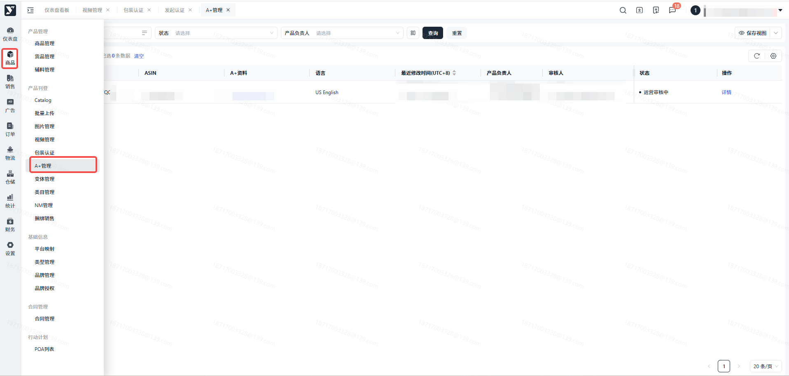

### 点击页面的【新增A+页面】

进入A+上传页面

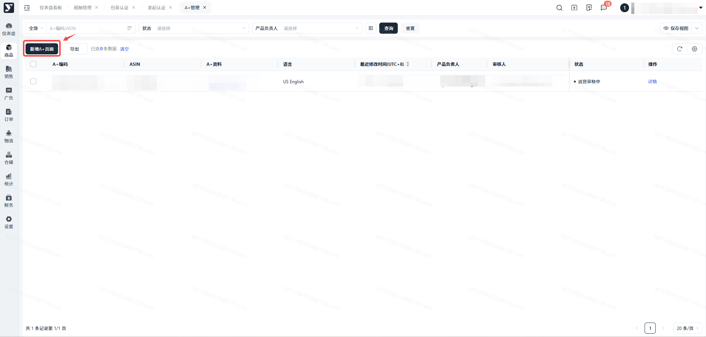

### 点击【下载A+模版】

【A+模版】可帮助您快速了解A+不同模块的要求和展示方式。若您对Amazon的A+模版信息非常了解，可跳过此操作。

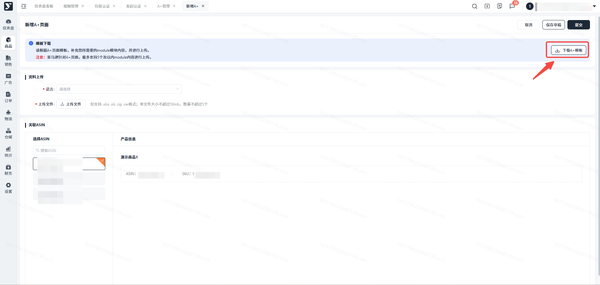

### 选择【语言】

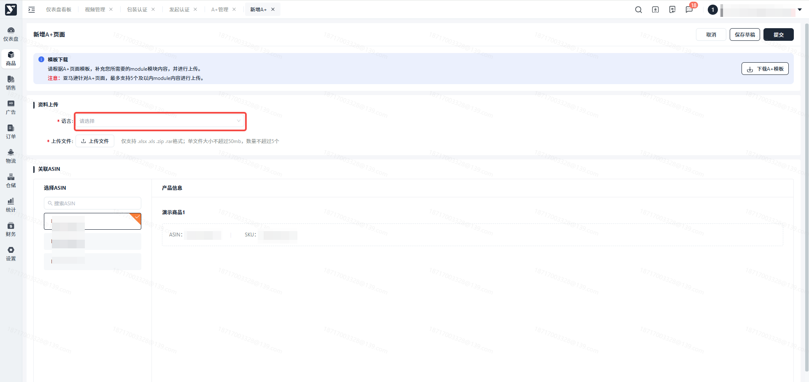

### 点击【上传文件】

上传的文件资料仅支持 .xlsx .xls .zip .rar格式；单文件大小不超过50mb，数量不超过5个。可根据模版整理展示对应你想实现的A+排版，然后把对应的图片文字资料进行压缩打包后上传。

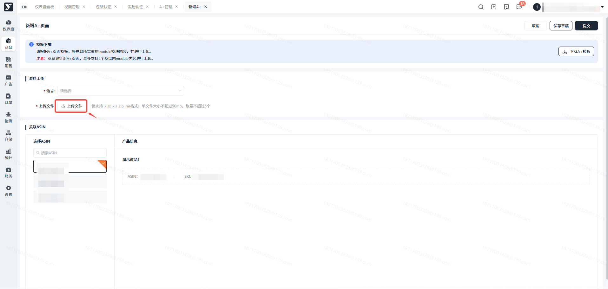

### 选择想要关联的ASIN

选择对应的ASIN后，在右方可以展示对应的产品信息。

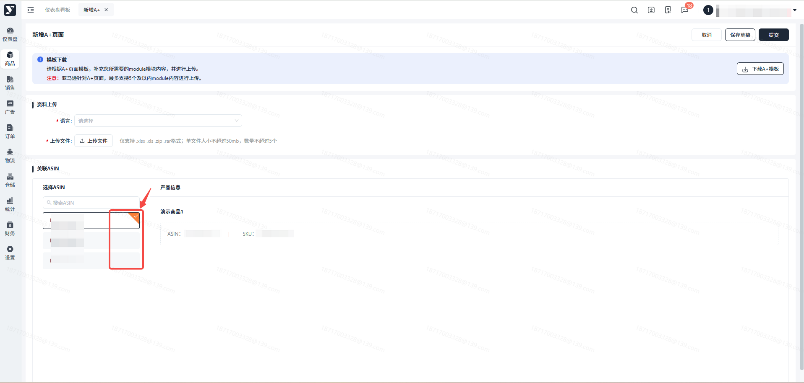

### 点击【保存草稿】

可对当前的【A+页面】进行保存，但是不会进行提交到管理端，可对保存为草稿状态的【A+页面】进行修改。

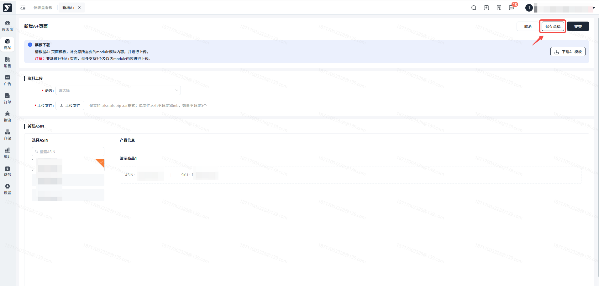

### 点击【提交】

可对当前的【A+页面】进行提交，提交至管理端进行审核。审核通过后，会改变您所关联商品在Amazon上的A+展示，请谨慎操作。

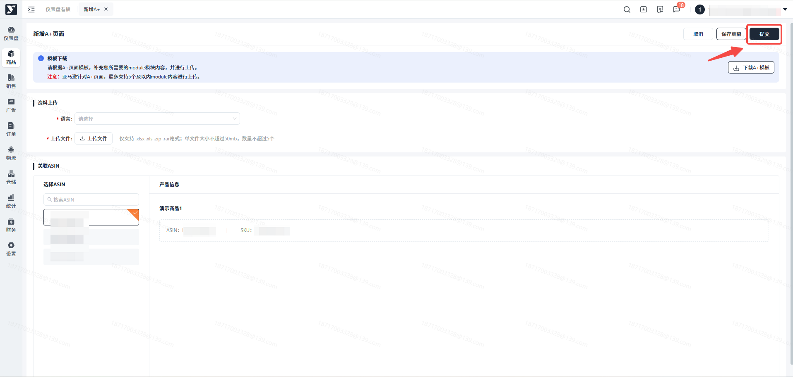

### 点击【详情】/【编辑】/【删除】

点击【详情】，可以查看对应上传的A+信息。

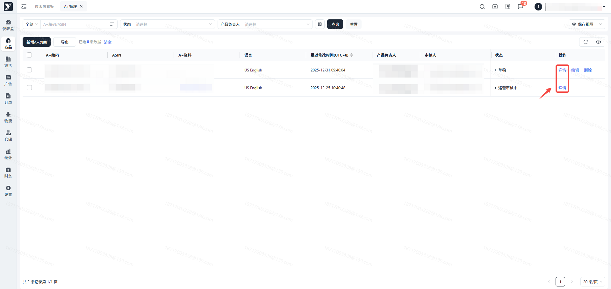

针对【草稿】状态的A+,您可以点击【编辑】功能对A+进行编辑，点击【删除】功能对草稿状态的A+进行删除。

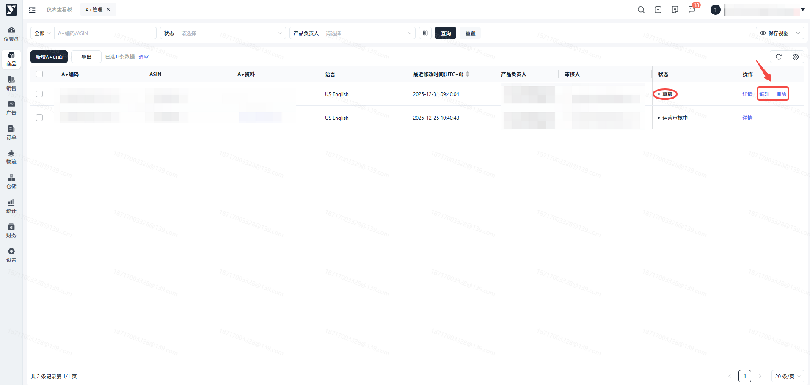

### 审核通过

当此条数据状态变为【审核通过】时，表示您的A+已经在Amazon中上传成功。

审核通过后，您所关联的ASIN将会根据您上传的A+资料进行对应模块的内容展示。

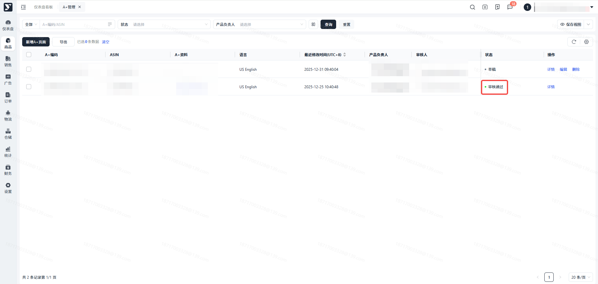

### 审核失败

当此条数据状态变为【审核失败】时，表示您的A+已经在Amazon中上传失败。

若是审核失败，将不会对您所关联的ASIN的A+进行任何改变。您可以根据反馈的失败原因对A+资料进行修改后重新提交。

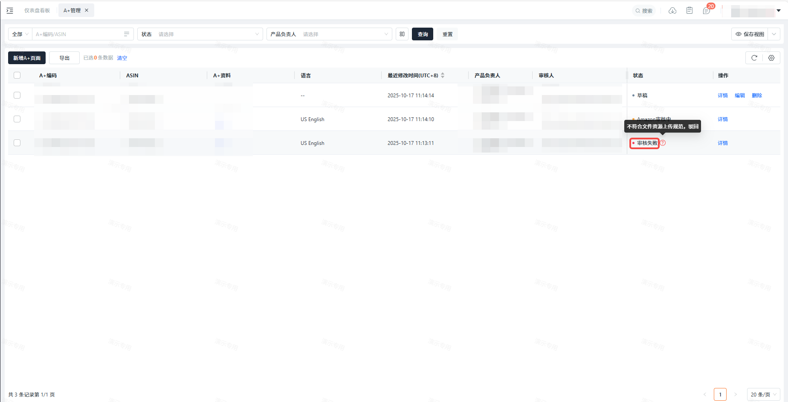

## 常见问题

**答：**亚马逊页面上的A+显示可能会产生延迟，审核通过后可能需要24小时才能显示在网页上，如果您的A+超过这个时间仍未更新，请联系运营人员解决。
