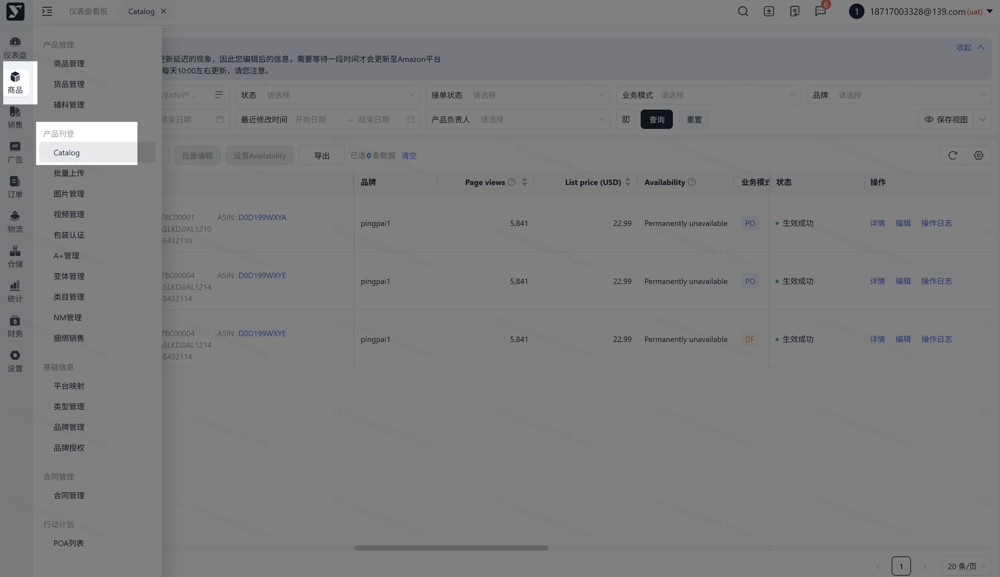
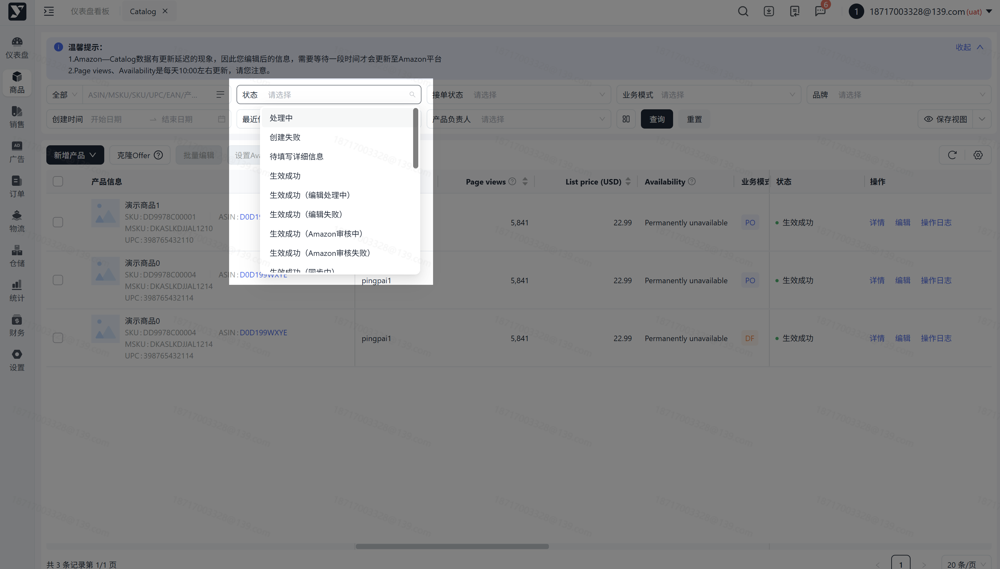
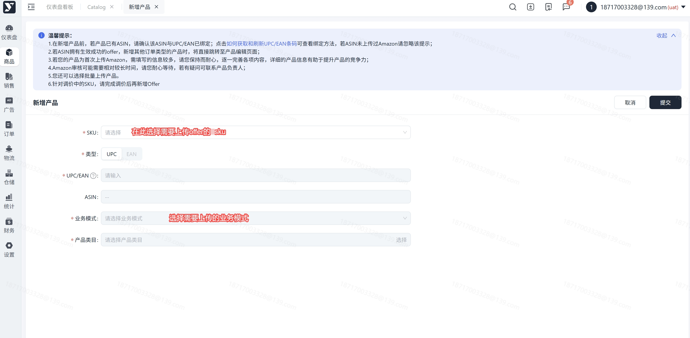
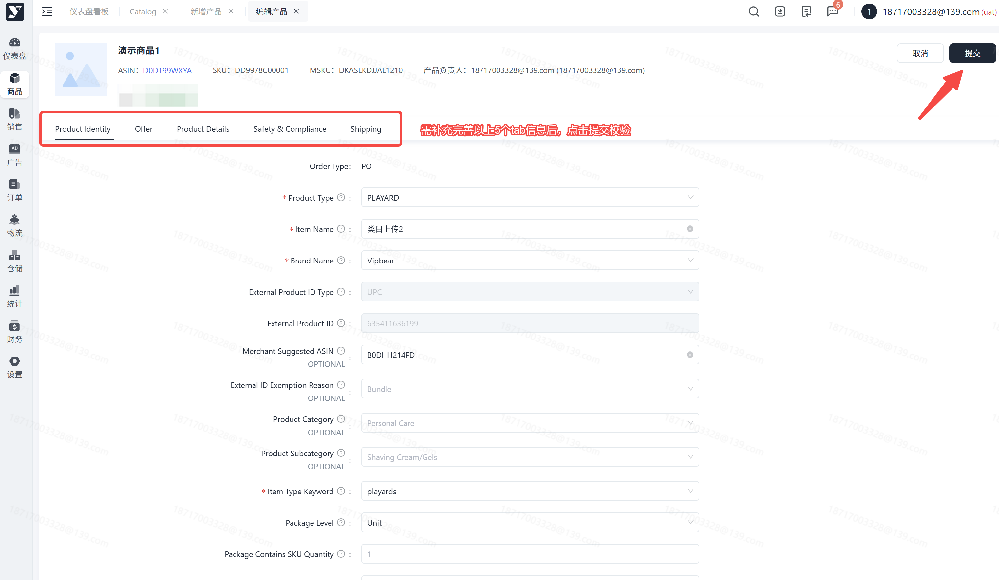
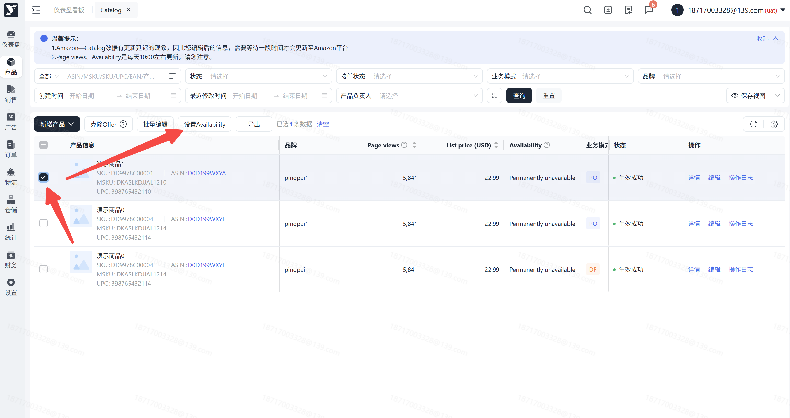
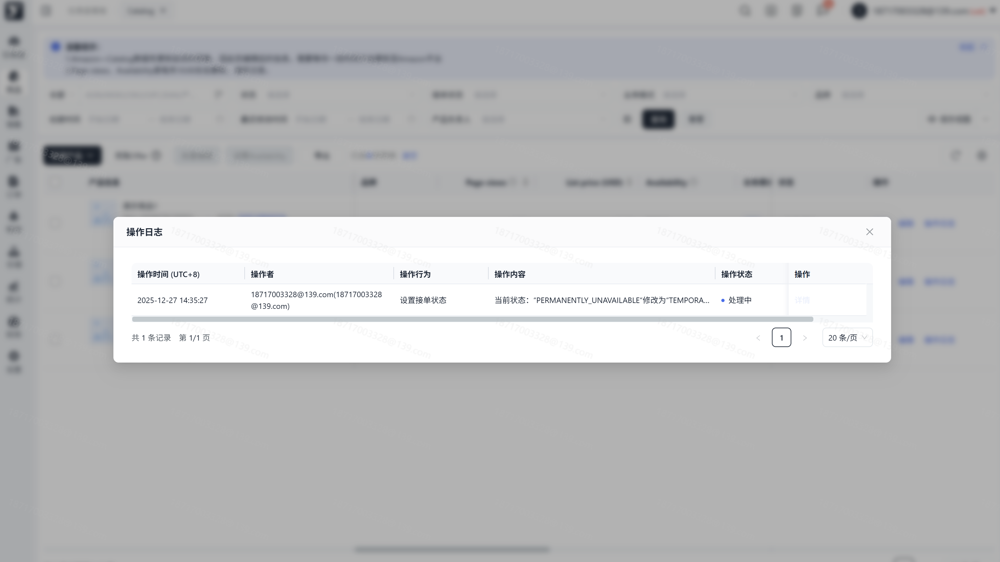
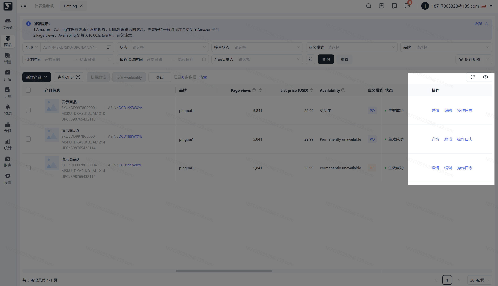

# 飞书文档：Catalog

## 功能介绍

Catalog是指卖家通过此模块的功能将产品通过上传至亚马逊，卖家可以在亚马逊平台上展示其商品的详细信息，包括商品名称、描述、价格、图片、库存情况等，让买家了解商品的特性和优势，增加产品的曝光率，提高销售。

## 注意事项

1. 若审核时间较久，请及时联系运营。
2. 每个产品需要填写的内容较多，请您耐心输入，提高产品的竞争力

## 操作流程

### 操作路径【商品】-【产品刊登】-【catalog】

1. offer根据不同业务模式分别进行展示，您可以通过业务模式进行区分查看；
2. 支持不同筛选，您可以根据您需要的数据进行选择；

### Catalog状态释义

1. 处理中：新增/编辑点击提交后，流转为该状态，表示亚马逊正在审核offer；
2. 创建失败：表示您新增offer亚马逊审核失败，我们会获取具体的报错原因，您可以点击详情查看具体报错原因，根据报错原因进行处理，再重新提交；
3. 待填写详细信息：表示当前offer已成功获取到对应模板，您可以填写对应内容后，再点击提交；
4. 生效成功：表示您已成功新增offer，可至亚马逊前台页面查看，listing内容是否无误，若有问题，可通过编辑调整；
5. 生效成功带有不同子状态说明：

 1. 编辑处理中：表示您进行了offer的编辑，我们正在进行数据的处理；
 2. 编辑失败：表示您此次编辑offer的操作为失败，您可以点击详情或操作日志查看具体失败原因，再重新提交；
 3. Amazon审核中：表示您此次的编辑，亚马逊正在审核中，请耐心等待；
 4. Amazon审核失败：表示您此次的编辑，亚马逊最终审核失败，您可以点击详情或者操作日志查看具体失败的原因，再重新提交；
 5. 同步中：表示正在更新offer的数据，更新成功后，将取消该子状态；

#### 操作路径【商品】-【产品刊登】-【catalog】-【新增产品】

1. 选择的SKU为在采购报价已成功申请报价的产品，若还未申请报价，请您先至采购报价申请对应的报价；
2. 不同业务模式的offer，需单独进行上传；
3. UPC/EAN支持修改（UPC12位数字，EAN13位数字）；
4. 类目请您选择最小类目进行上传；
5. 输入完成对应的信息后，再点击【提交】；
6. 提交成功后，列表生成一条数据-等待系统—拉取模版，状态【处理中】
7. 模版获取成功后，填写相关信息，状态为【待填写详细信息】

#### 填写模板

模版获取成功后，填写相关信息

1. 需注意以下2点：a.①REQUIRED必填项，不能为空；

 ②OPTIONAL选填项，在提交时不会校验是否填写；

 ③CONDITIONALLY REQUIRED可能是一个必填项，但在提交时不会验证是否为空；

 ④RECOMMENDED推荐填写项，但在提交时不会验证是否为空

1. 【 \* 】为必填项，提交时会校验必填项，未填写点击【提交】会有提示；

### 创建失败编辑后再次提交

【创建失败】-列表区点击【编辑】进入页面，根据报错原因填写完成后再次点击【提交】

### 【生效成功】offer编辑上传

释义：指已经在Amazon成功生成offer的产品，再次进行某项内容的编辑，并提交Amazon审核

列表区【生效成功】状态，点击【编辑】，进入编辑页面，点击【提交】

提交后返回列表，状态【生效成功】带【Amazon审核中】标签，审核通过去掉标签状态【生效成功】不带标签，若失败标签带【Amazon审核失败】

#### 修改 Availability

操作路径：【产品刊登】-【catalog】-【批量操作】-【修改Availability】-点击【确定】

> 1. 提交成功后，列表显示为【更新中】，待该字段消失后将更新为当前的接单状态，您可以通过【操作日志】查看是否编辑成功；
> 2. 若调整为【Available】会校验您当前的库存，若库存为0，需补充完库存后才能调整为可接单状态；

#### 查看修改进度

查看接单状态修改进度【产品刊登】-【catalog】-【操作日志】

### 【操作日志】

1. 进行的任何编辑行为，都会生成一条行为记录，在【操作日志】点击【查看】即可阅览具体编辑内容

## 常见问题

若在使用过程中遇到问题，可以参考此文档。

表示Amazon还在审核该offer，您不用担心，若超过12小时依然处于审核状态，可联系客服为您处理。

产品需是在【商品】-【商品管理】生效中的产品同时【采购报价】中已生效的报价，才可以上传至Amazon。

新增产品第一步，您确定UPC/EAN后，我们已提交亚马逊审核，亚马逊审核通过将不能再次修改。
