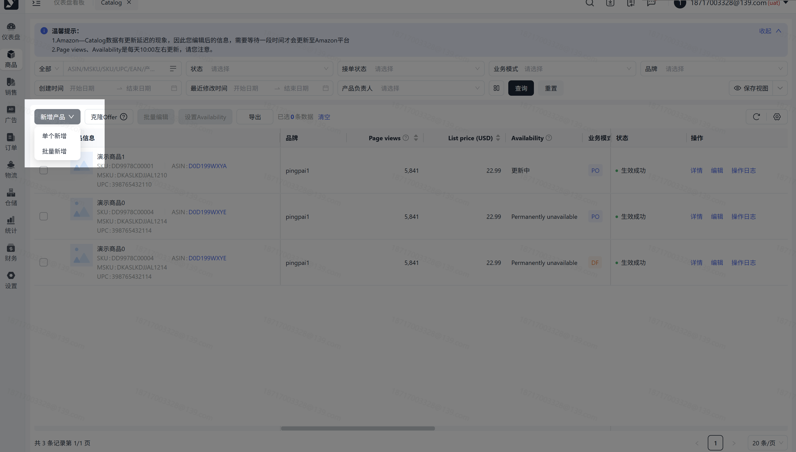
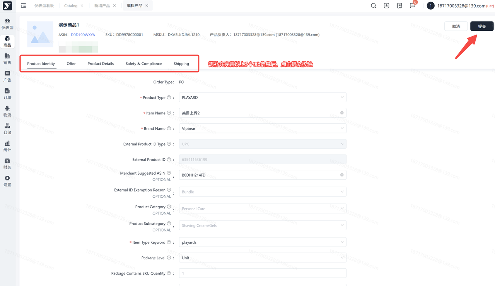
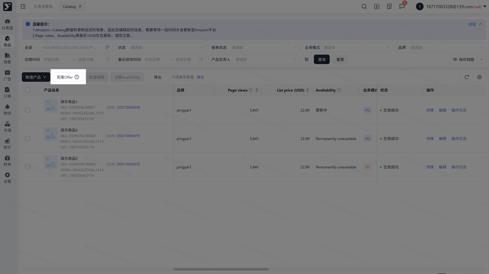
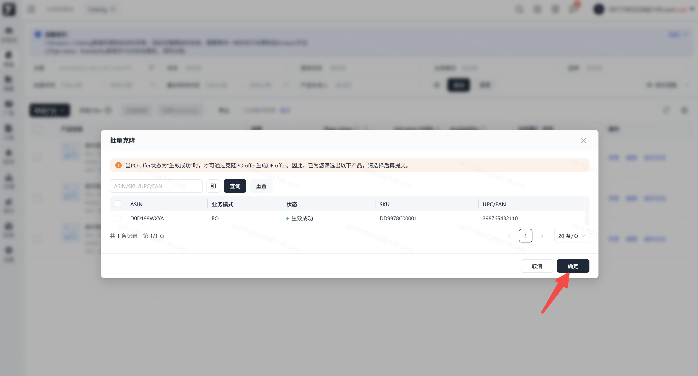

# 飞书文档：DF offer

## 功能介绍

1. 在【新增产品】页面，支持用户上传DF offer
2. 支持复制已生效成功的PO Offer，使用户更快捷地新增DF offer（反之同理）
3. 新增【批量克隆】功能
4. 支持批量克隆“生效成功”状态下的PO offer
5. 可通过订单类型筛选Offer

## 注意事项

1. 若审核时间较久，请及时联系运营。
2. 每个产品需要检查和输入的内容较多，请您耐心检查，提高产品的竞争力。

## 操作流程

### 操作路径【商品】-【产品刊登】-【catalog】-【新增产品】

### 复用 PO Offer 信息

若填写的信息校验出存在生效成功的PO offer，提交后系统自动复制PO offer的数据至新增DF offer页面中，状态为：待填写详细信息。此时可再检查下页面数据后，再点击提交

### 提交审核

点击提交后，页面跳转至列表页，状态为：处理中，等待亚马逊审核；审核通过后，状态为：生效成功；若审核失败，状态为：创建失败，可再次编辑数据后再次提交

### 操作路径【商品】-【产品刊登】-【catalog】-【克隆offer】

### 克隆 Offer

点击【克隆offer】，弹出弹框，弹框中的数据来自于列表中生效成功的PO offer且不在产品提交审核中；可勾选或全选ASIN进行批量克隆

### 提交克隆

点击【确定】后，列表中生成DF offer数据，状态为：处理中；审核通过后，状态为：生效成功

## 常见问题

**答：**表示Amazon还在审核中，若超过20小时依然处于审核状态，可联系客服为您处理。

**答：**因为PO offer必须是生效成功状态，且不在产品调价审核中，如果满足以上2个条件还是不能进行克隆，可联系客服为您处理。

**答：**可能是因为提交的同时正好产品在调价审核中，若仍有疑问，请联系运营。
