# 飞书文档：NM管理

## 文档信息

| 项 | 内容 |
| --- | --- |
| 远程文档 | https://q1njej8cpab.feishu.cn/wiki/TbcCwhgt0iP5JXkcr2xcKklrnph |
| 图片处理 | 本地下载（assets/images） |
| 快照时间 | 2026-08-06 |
| 来源命令 | `lark-cli docs +fetch --api-version v2 --doc https://q1njej8cpab.feishu.cn/wiki/TbcCwhgt0iP5JXkcr2xcKklrnph --doc-format markdown --as user --format json --jq .data.document.content` |
| 格式处理 | fd-doc-markdown-sync/scripts/normalize-feishu-doc-markdown.mjs |

---

NM管理

## 功能介绍

1. Newer Model属于关联流量的一种，卖家可以在原始SKU的Listing详细页面中设置Newer Model，并在旧SKU页面下显示新产品的链接，以方便新SKU的流量转换。

## 注意事项

1. 若您的产品需要Newer Model，此模块为您提供了Newer Model文件模版，您只需填充文件后进行上传即可。
2. 上传Newer Model文件时请注意：

 1. 必须先下载指定的Newer Model模版文件，然后填充该文件，并将文件名改为“Newer_version_template”后再上传；
 2. 文件格式要求：.xlsx .xls，文件大小不超过3Mb，一次仅支持上传单个文件；
3. 填写产品ASIN时，需与模版文件中的ASIN保持一致。
4. 当您上传Newer Model文件后，我们将进行审核，检查您上传的产品是否符合Amazon规范。若收到“审核通过”，意味着Newer Model申请成功；若收到“审核失败”的提示，请根据提示内容重新修改内容后再次上传。
5. 若您不清楚Newer Model要求，可点击“帮助文档”查看Newer Model要求与规则。
6. Amazon审核Newer Model需要一定的时间，请耐心等待。
7. 考虑到兼容性，请使用谷歌浏览器。

## 操作步骤

##

#### 操作路径

【商品】-【产品刊登】-【NM管理】

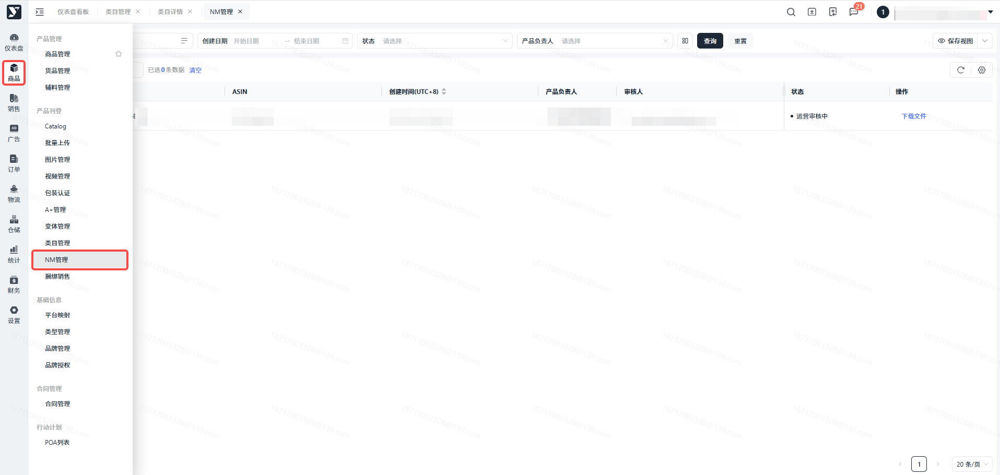

#### 点击【上传Newer Model】

> 进入上传Newer Model页面

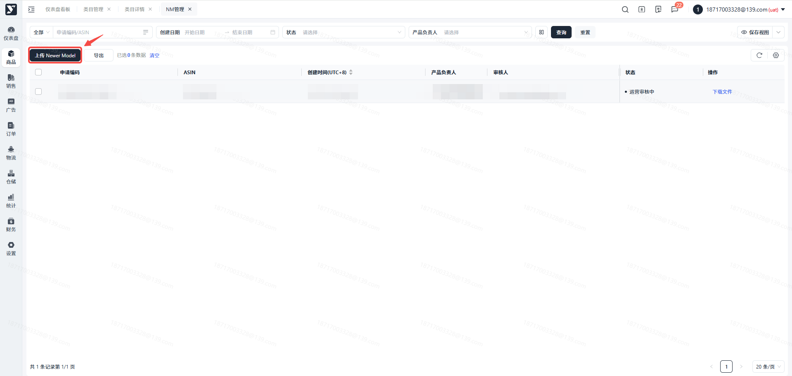

#### 点击【下载模版】

> 根据表头填写产品信息

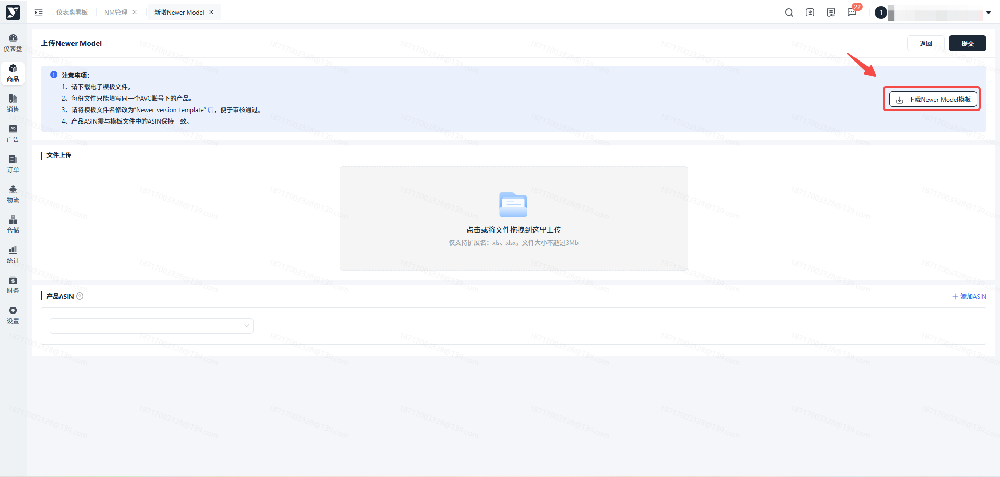

#### 文件上传

> 点击或将文件拖动至文件上传区域

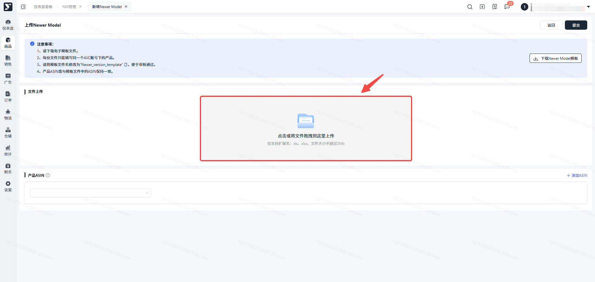

#### 填写产品ASIN

> 为了让您在Newer Model列表页能更快捷地查询到已上传Newer Model的ASIN，请在该步输入上传文件中的所有ASIN。
>
> 提交成功后，您可在列表页通过搜索ASIN查询到历史上传文件以及审核状态等。

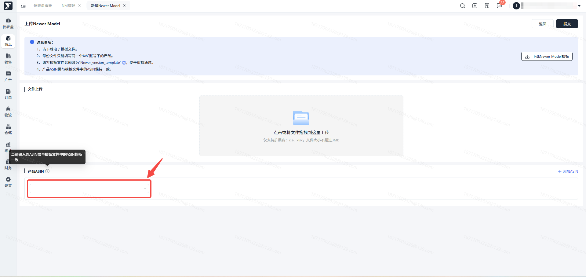

#### 点击【提交】

> 提交成功后将直接跳转至Newer Model列表页，并自动生成该条申请。

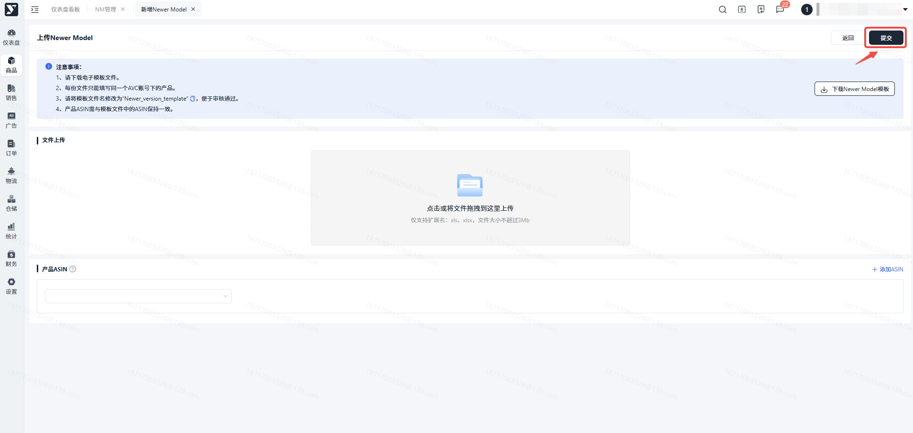

#### 点击【更多】

> 可查看上传时输入的所有产品ASIN。

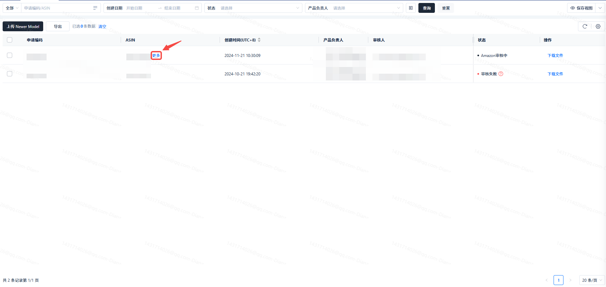

#### 点击【下载文件】

> 可通过【下载文件】查看历史上传文件。

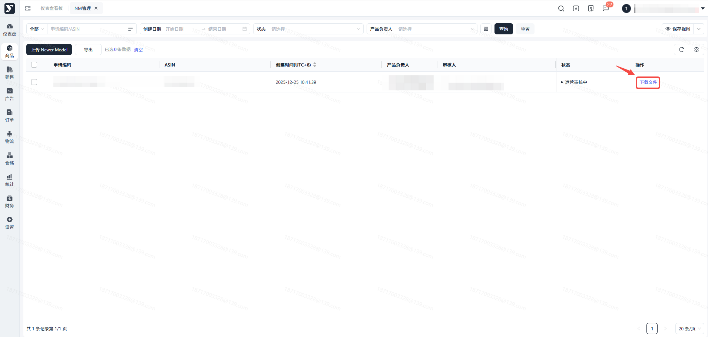

#### 当此条数据状态变为【运营审核中】时，表示您的Newer Model已提交成功，并已提交至管理端。

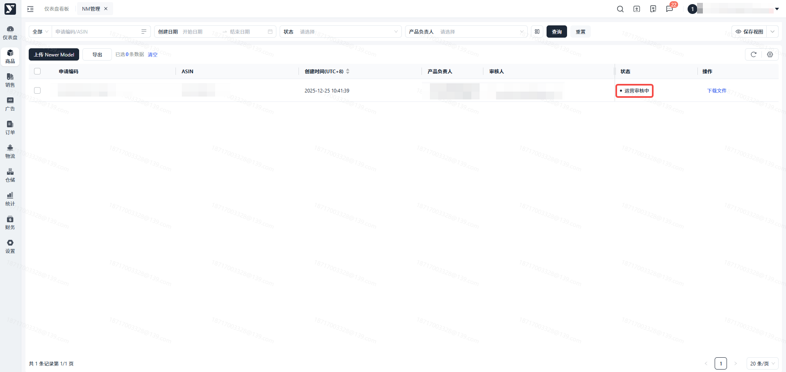

#### 当此条数据状态变为【审核通过】时，表示您的Newer Model产品已经审核通过。

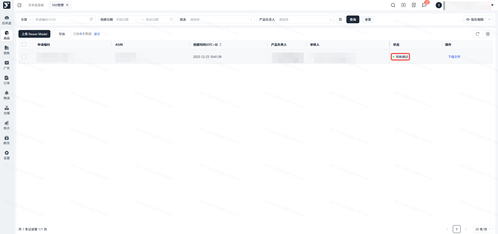

#### 当此条数据状态变为【审核失败】时，表示您Newer Model在Amazon审核失败。

> 若审核失败，您可以根据反馈的失败原因修改产品Newer Model信息重新提交。
>
> 也可点击“帮助文档”，查Newer Model要求。

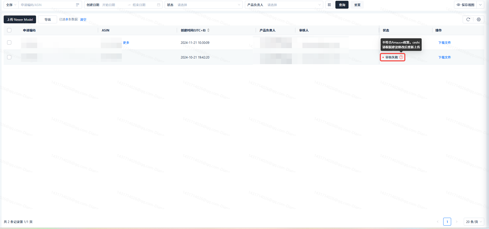

## 常见问题

##

**答：**只要提交成功，列表内都会生成一条新的数据，不存在覆盖现象。因此，即便您再次提交相同的文件内容也不会覆盖原数据。

##

**答：**是的，该模版是Amazon所提供的，为了审核通过，请在模版中进行填写。

##

**答：**Amazon前台页面上的Newer Model展示可能会存在延迟现象；如果您的Newer Model超过24小时在Amazon未更新，请联系运营人员解决。
