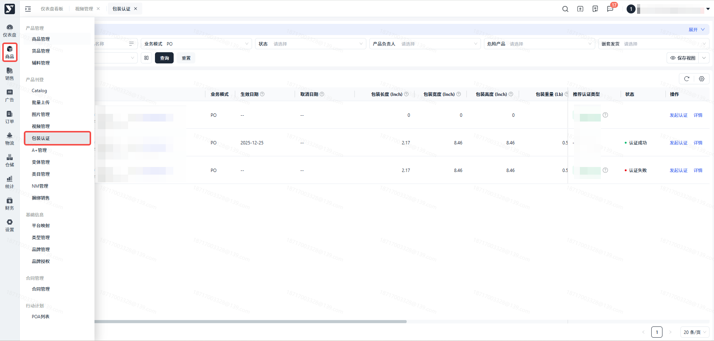
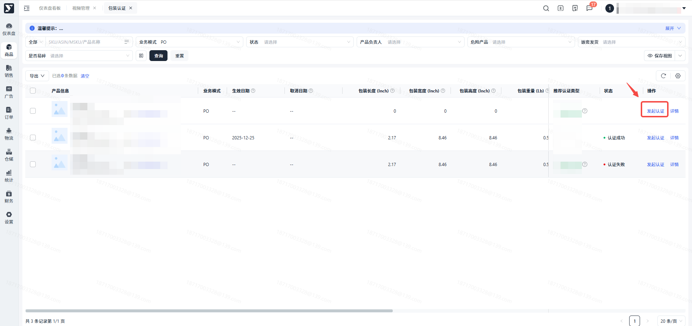
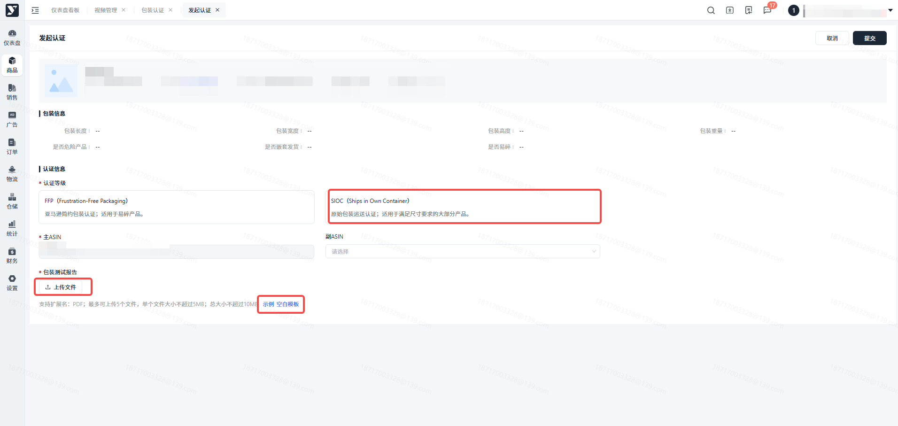
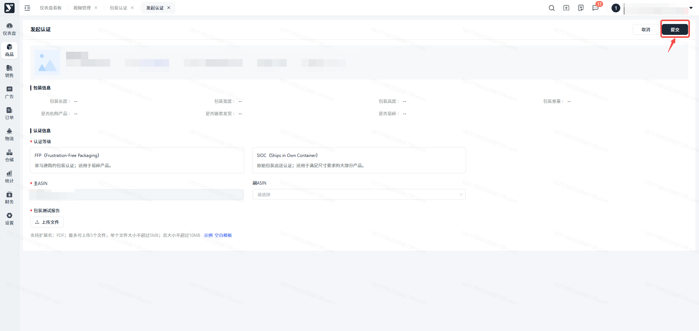

# 飞书文档：包装认证

## 功能介绍

您可以在此模块发起对产品的包装认证。

## 注意事项

### SIPP(Ships in Product Packaging)

——自有包装发货计划

- **Tier 1: FFP（Frustration-Free Packaging）**：亚马逊简约包装认证。要求包装商品先通过ISTA6-Amazon.com-SIOC 规定的实验项目，且所用包装材料均为无污染可回收利用材料，外包装需便于开启，亚马逊定义为在 120 秒内可以将外包装开启且内部商品可以取出 。对于易碎品包装箱使用率务必超过 30%，非易碎品包装箱使用率务必超过 50%。
- **Tier 2: SIOC（Ships in Own Container）**：亚马逊自带集装箱运输包裹认证。指商品在已有外包装内发货销售，即亚马逊不需再次外包装销售。所有参加SIPP的商品，其包装都必须通过自检或国际安全运输协会 (ISTA) 6 实验室测试的物理性能测试，其包装测试的目的是确保供应商产品在不使用亚马逊提供的额外包装的情况下，产品仍然可以完好地抵达消费者手中。

## 操作流程

### 操作路径

【商品】-【产品刊登】-【包装认证】

### 申请包装认证

1. 您可以在当前页面查看所有已生成Offer的产品。对于状态为【待认证】的产品，**请及时发起包装认证，否则货物送达FBA仓库后可能会产生罚款**。
2. 认证前请仔细阅读温馨提示：

 1. 亚马逊针对产品包装尺寸及重量设定了明确的规范，具体为：若产品包装的最长边超过18英寸、次长边超过14英寸、最短边超过8英寸，或包装总重量达到20磅，则该类产品需遵循严格的包装认证要求。对于未达到上述标准且未取得相应认证的产品，若被运送至亚马逊仓库，将面临罚款处罚。不过，以下特定类别的产品可免于包装认证流程。

 - (1)产品包装不超过18\*14\*8英寸，重量小于20磅。
 - (2)有任何危险品分类和运输规定的ASIN（例如，包含锂离子电池的ASIN）
 - (3)Prime Pantry、Amazon Fresh 或 Media 中的 ASIN。
 - (4)最长边小于 6 英寸、最短边小于 0.375 英寸或中间边小于 4英寸的ASIN。这些是认证所需的最小尺寸。
 - (5)ASIN至少已存在24个月，且在过去12个月中向亚马逊发货的数量少于100件。
 - (6)ASIN在向亚马逊发货时的包装方式是将单个销售单元嵌套或锁定，以最大限度地提高货运效率，例如将垃圾桶嵌套在一起。
 - (7)产品包装最长边大于108Inch。
 2. 所有产品的包装尺寸将统一采用英寸（Inch）作为单位提交认证，重量的计量则统一以磅（Lb）为单位。您在提交申请材料时，可以使用任意单位标注相关数据，我们将负责将其转换为上述统一单位，以便进行后续的评估与认证工作。
3. 通过【推荐认证类型】判断您的产品适合的认证等级，若为SIOC-Type A 类，那么您可以选择自测，只需提供自测报告；
4. 点击【发起认证】，进入表单页，选择适合该产品的认证等级。

1. 主ASIN为当前发起认证的产品，若该产品有其他变体产品，且尺寸重量满足亚马逊合并认证的要求，则可以在此处添加副ASIN，副ASIN将跟主asin保持同样的认证结果。

1. 上传包装测试报告，若您对认证文件不熟悉，我们为您提供了自测报告的模版和示例文件，可以选择性下载。

1. 完成后点击提交，我们会尽快审核您的认证报告，您可以在系统中查看跟进认证的状态。

### 【认证取消】

若您的产品认证状态变更为【认证取消】这说明您的包装出于某些原因（例如货损率、投诉率过高），亚马逊取消了产品的认证资质，您需要调整打包方式，并重新发起认证，否则货物发送到亚马逊仓库仍然会产生罚款。

### 【认证失败】

当您的申请结果为认证失败时，您可以查看失败原因并重新认证，我们不会限制您提交认证的次数。

### 【无需认证】

当您的申请结果为无需认证时，代表您可以不进行包装认证将产品发往仓库而不会产生罚款。如果后续您更新了产品的包装，仍然需要再次提交认证申请。

### 【认证成功】

当您的申请结果为认证成功时，代表此产品已经通过了亚马逊的包装认证，您可以直接将货物发送至亚马逊仓库。如果后续您更新了产品的包装，仍然需要再次提交认证申请。

## 常见问题

答：亚马逊允许部分产品不进行包装认证，您可以咨询运营人员如何将产品包装更新为无需认证。

以下类别可以不进行包装认证：

--产品包装不超过18\*14\*8英寸，重量小于20磅

--有任何危险品分类和运输规定的 ASIN（例如，包含锂离子电池的 ASIN）

-- Prime Pantry、Amazon Fresh 或 Media 中的 ASIN

-- 最长边小于 6 英寸、最短边小于 0.375 英寸或中间边小于 4 英寸的 ASIN。这些是认证所需的最小尺寸。

-ASIN至少已存在8个月，且在过去12个月中向亚马逊发货的数量少于250件。

-ASIN在向亚马逊发货时的包装方式是将单个销售单元嵌套或锁定，以最大限度地提高货运效率，例如将垃圾桶嵌套在一起。

答：亚马逊并不会强制要求您进行包装认证，但如果您的产品规格或重量超过亚马逊允许的范围而没有通过包装认证，亚马逊入仓后会扣除每一个包裹＄1.80 至 4.40 的罚款费用。

答：如果一个ASIN或一组ASIN在尺寸、材料、重量和包装数量上与主ASIN相似，并且不是易碎品、液体或包含机械部件，那么它们将符合“形态认证”的资格。在获得批准后，它们将与伴随的主要ASIN获得相同的认证。
