# 飞书文档：变体管理

## 文档信息

| 项 | 内容 |
| --- | --- |
| 远程文档 | https://q1njej8cpab.feishu.cn/wiki/AODMwN2k4ibiKskzFlocVtW3n5b |
| 图片处理 | 本地下载（assets/images） |
| 快照时间 | 2026-08-06 |
| 来源命令 | `lark-cli docs +fetch --api-version v2 --doc https://q1njej8cpab.feishu.cn/wiki/AODMwN2k4ibiKskzFlocVtW3n5b --doc-format markdown --as user --format json --jq .data.document.content` |
| 格式处理 | fd-doc-markdown-sync/scripts/normalize-feishu-doc-markdown.mjs |

---

变体管理

## 功能介绍

1. 变体是指一组被称为变体系列的产品。这些产品的所有特征都相同，只是在特定尺寸或不同属性上有所不同。
2. 变体不仅能够让买家在一个Listing页面上看见所有的商品选项，还能延长其在产品页面的浏览时间，从而增加转化率，提高购买效率。

## 注意事项

1. 若您的产品需要变体，此模块为您提供了变体文件模版，您只需填充文件后进行上传即可。
2. 上传变体文件时请注意：

 1. 必须先下载指定的变体模版文件，然后填充该文件，并将文件名改为“VariationSheet”后再上传；
 2. 文件格式要求：xls，文件大小不超过3Mb，一次仅支持上传单个文件；
3. 填写产品ASIN时，需与模版文件中的ASIN保持一致。
4. 当您上传变体文件后，我们将进行审核，检查您上传的产品是否符合Amazon规范。若收到“审核通过”，意味着产品变体申请成功；若收到“审核失败”的提示，请根据提示内容重新修改内容后再次上传。
5. 若您不清楚如何划分变体产品，可点击“帮助文档”查看产品变体要求与规则。
6. Amazon审核变体需要一定的时间，请耐心等待。
7. 考虑到兼容性，请使用谷歌浏览器。

## 操作步骤

##

#### 操作路径

【商品】-【产品刊登】-【变体管理】

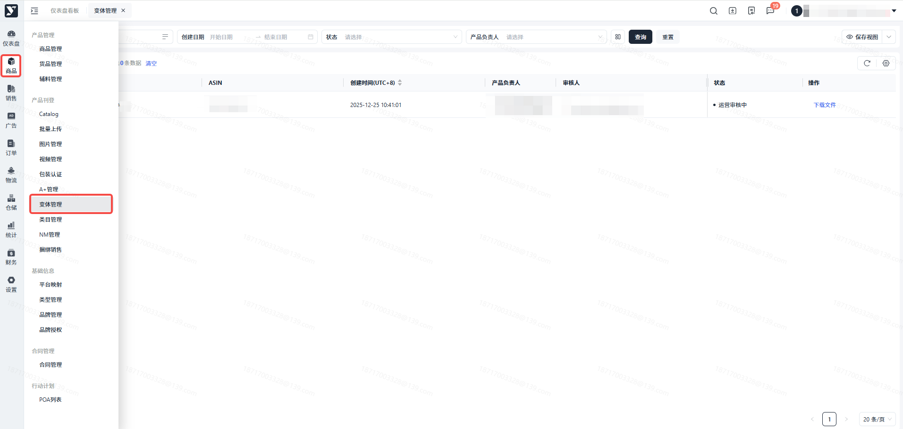

#### 点击【上传变体】

> 进入上传变体页面

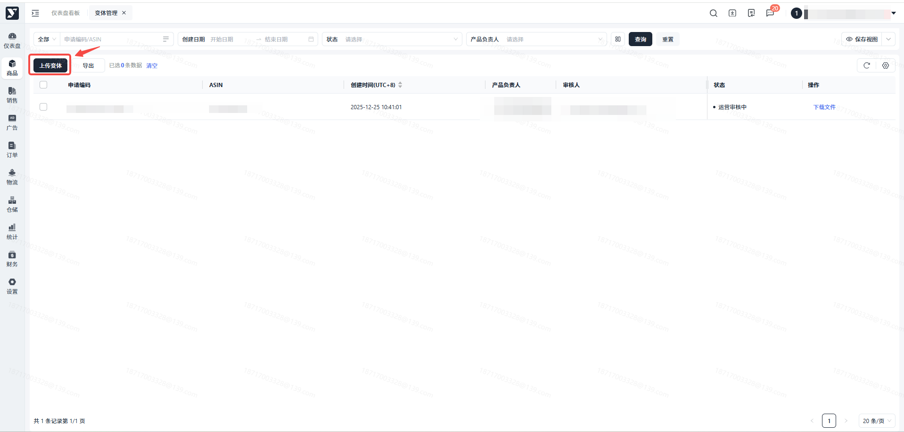

#### 点击【下载变体模版】

> 【变体模版】中为您提供了3种产品的变体信息供您参考，您可以按照示例填写产品变体。

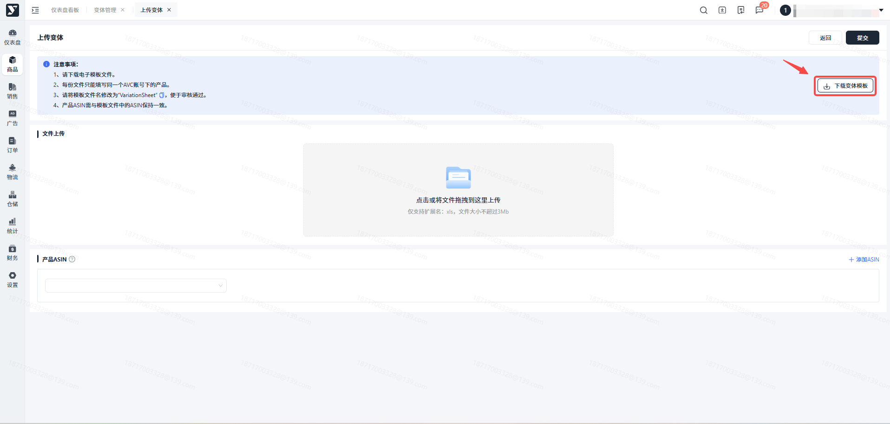

#### 文件上传

> 点击或将文件拖动至文件上传区域

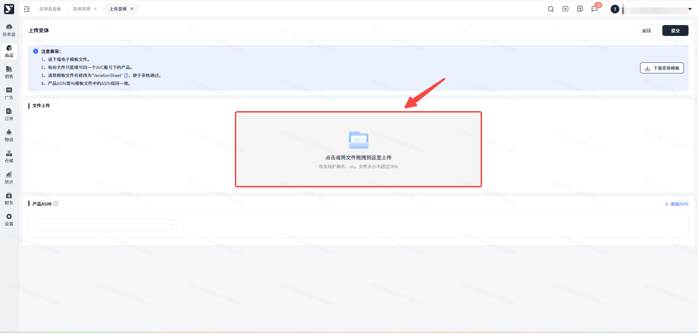

#### 填写产品ASIN

> 为了让您在变体列表页能更快捷地查询到已上传变体的ASIN，请在该步骤输入上传文件中的所有ASIN。
>
> 提交成功后，您可在列表页通过搜索ASIN查询到历史上传文件以及审核状态等。

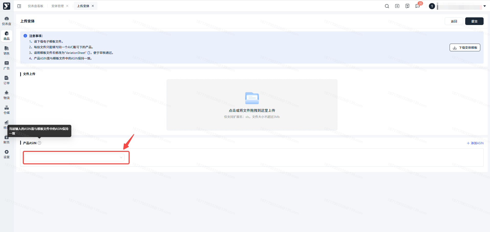

#### 点击【提交】

> 提交成功后将直接跳转至变体列表页，并自动生成该条申请。同时也意味着管理端已经收到您的变体申请，审核通过后，Amazon listing页面会展示产品变体。

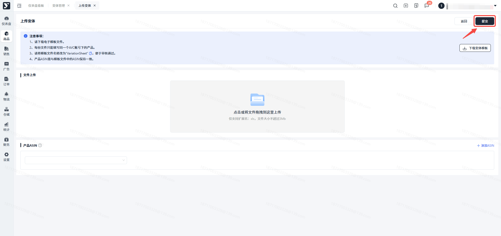

#### 点击【更多】

> 可查看您上传时输入的所有产品ASIN。

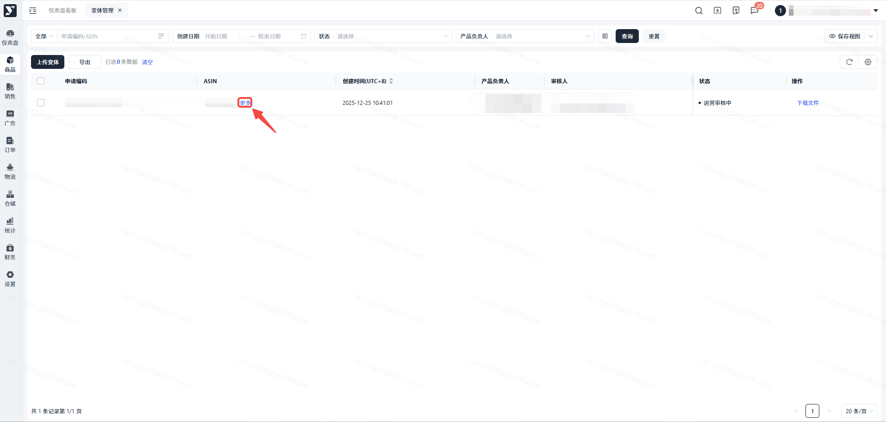

#### 点击【下载文件】

> 可通过【下载文件】查看历史上传文件。

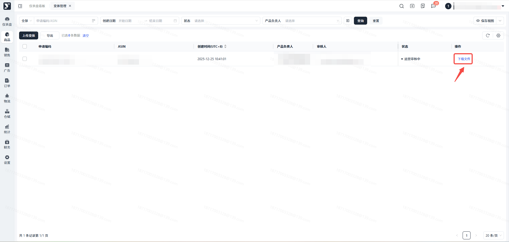

#### 当此条数据状态变为【运营审核中】时，表示您的变体已提交成功，并已提交至管理端。

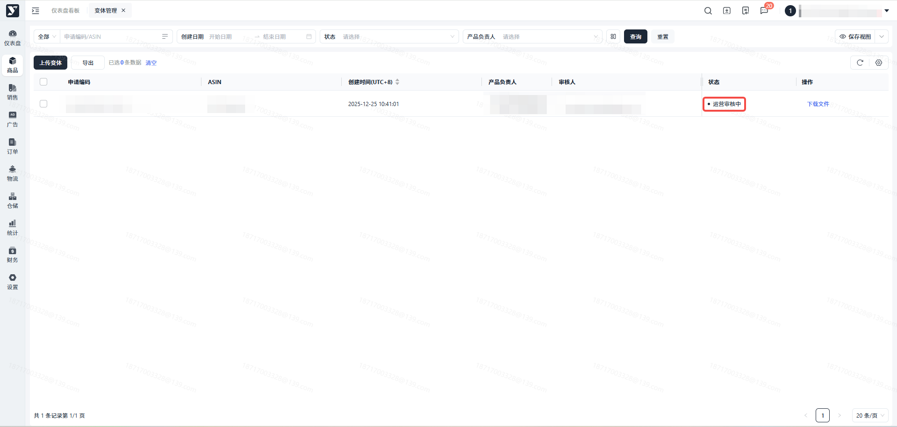

#### 当此条数据状态变为【审核通过】时，表示您的变体产品已经在Amazon中审核通过。

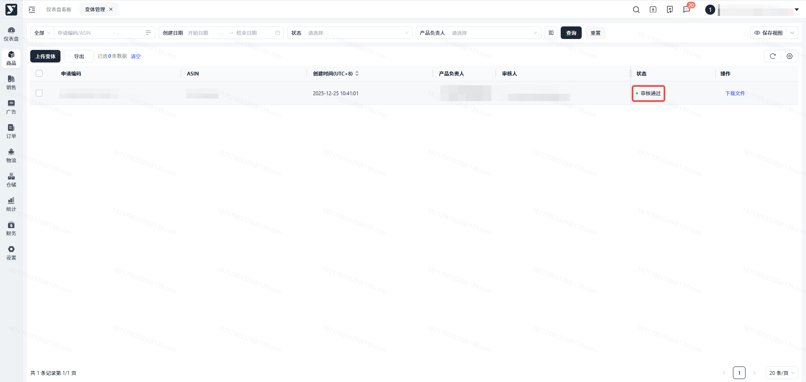

#### 当此条数据状态变为【审核失败】时，表示您的变体在Amazon中审核失败。

> 若审核失败，您可以根据反馈的失败原因修改产品变体信息重新提交。

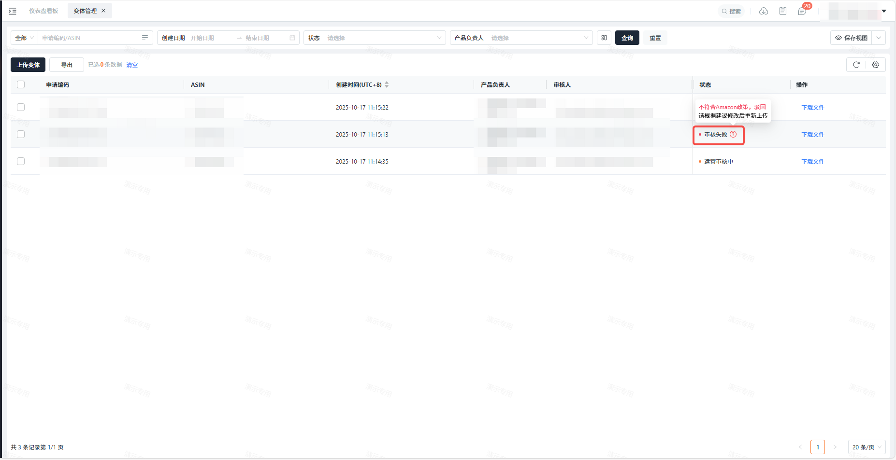

## 常见问题

##

**答：**只要提交成功，列表内都会生成一条新的数据，不存在覆盖现象。因此，即便您再次提交相同的文件内容也不会覆盖原数据。

##

**答：**是的，该模版是Amazon所提供的，为了审核通过，请在模版中进行填写。并且在该模版内准备了3种产品变体信息示例，您可根据示例进行填写。

##

**答：**Amazon前台页面上的变体展示可能会存在延迟现象；如果您的产品变体信息超过24小时在Amazon未更新，请联系运营人员解决。
