# 飞书文档：合规认证

## 功能介绍

在亚马逊商城发布商品，必须遵守与这些商品及商品 Listing 相关的所有适用法律、法规、标准以及亚马逊的政策。合规是保障客户、合作伙伴及员工安全的关键。为确保亚马逊商城销售的商品符合最高标准且可供客户安全使用，必须能通过相应的合规文件证明：在亚马逊商城提供的所有商品均满足监管及政策要求。

## 页面路径

【商品】-【产品刊登】-【合规认证】

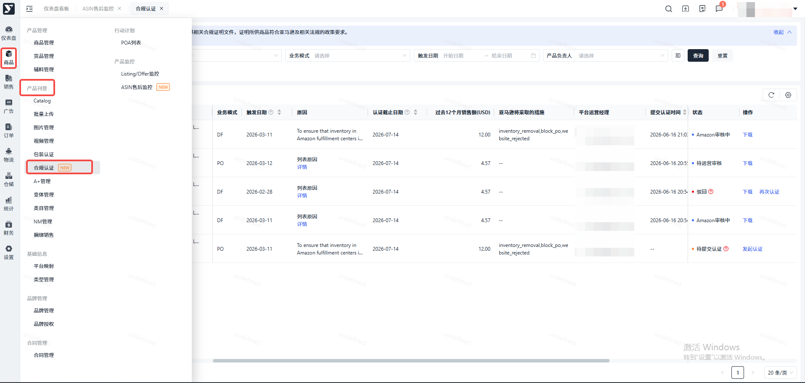

## 操作步骤

### 筛选条件

筛选条件，支持按SKU/ASIN/MSKU/产品名称、状态、业务模式、触发日期、产品负责人 筛选

> - SKU/ASIN/MSKU/产品名称：支持输入多个的输入框，最多输入200个，模糊搜索
> - 状态：待提交认证、待运营审核、Amazon审核中、驳回、认证成功、无需认证，支持多选
> - 默认查询最近90天触发合规认证的数据
> - 仅能查看自己权限的产品

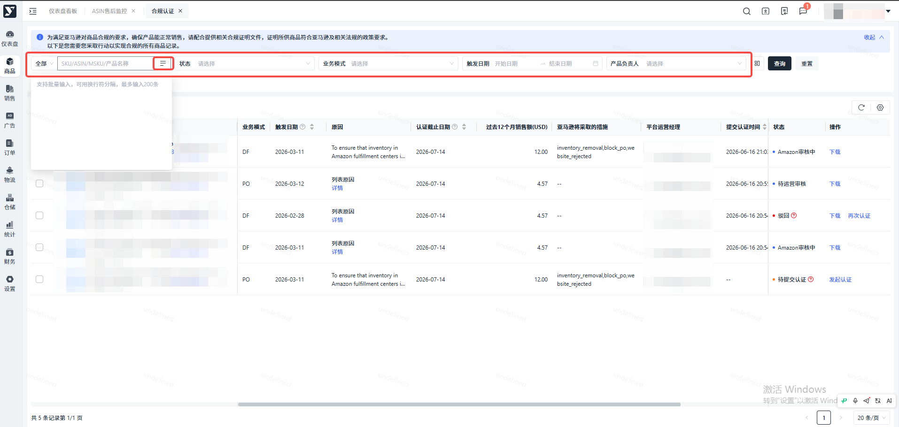

### 列表字段

合规认证列表，展示产品信息、业务模式、触发日期、原因、认证截止日期、过去12个月销售额、亚马逊将采取的措施、平台运营经理、提交认证时间、认证完成时间和状态 指标

> - 数据与上方搜索条件联动
> - 相关时间都是LA时间，并且支持排序，默认按触发日期倒序

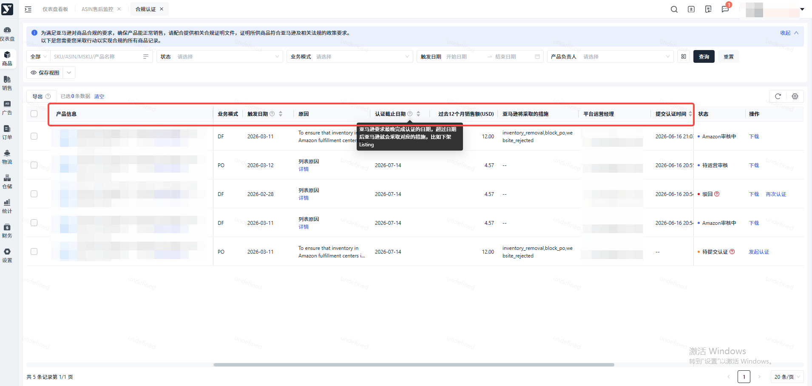

### 查看亚马逊详情原因

如果亚马逊有返回详情的原因，可悬停“详情”文字查看

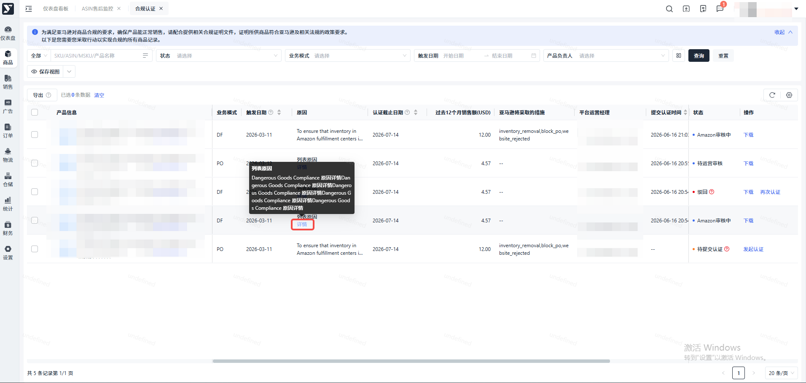

### 查看认证说明

悬停到待提交认证状态后面的？小图标，可查看提交认证的相关说明

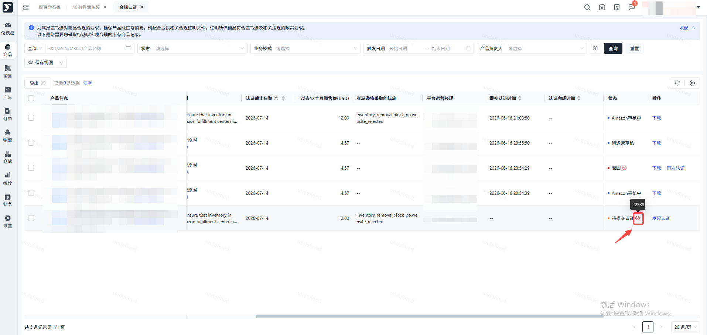

### 查看平台驳回原因

悬停到驳回状态后面的？小图标，可查看平台运营驳回的原因

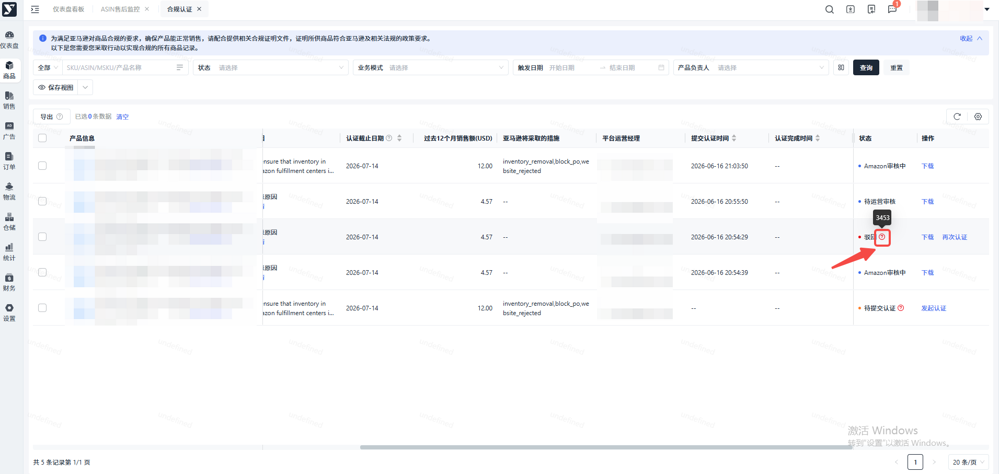

### 数据导出

#### 导出全部数据

通过搜索条件搜索过滤数据，再导出所有数据

> - 一次最多可导90天数据，如需导出更长日期范围的数据，请分成多次导出
> - 如果不选择触发日期，默认导出最近90天的数据，如果选择的触发日期范围大于90天，则默认导出开始日期\~开始日期+90天的数据

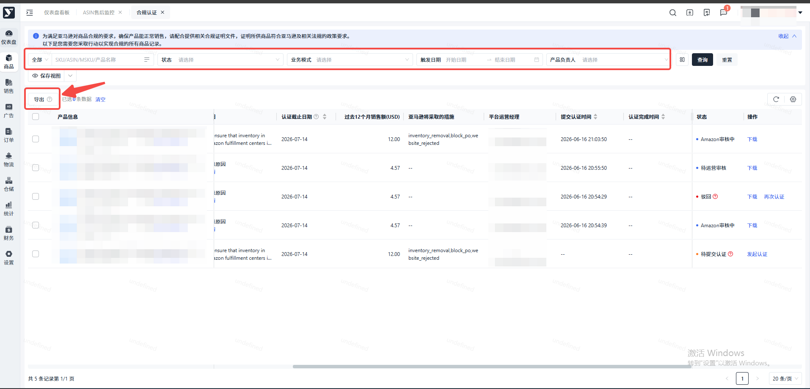

#### 导出选中数据

勾选需要的数据，再点击导出

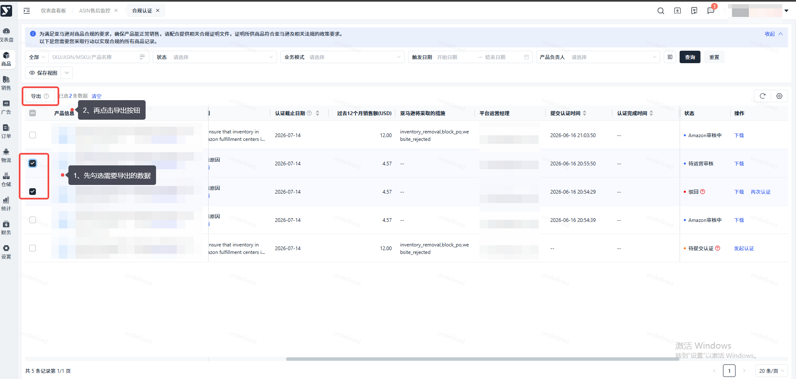

### 发起认证

> 待提交认证状态，支持操作发起认证

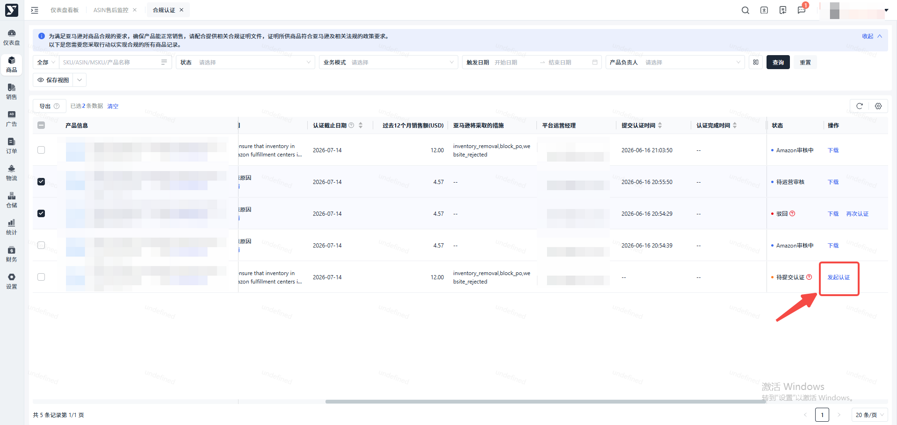

### 提交认证申请

根据认证说明信息，准备认证资料并上传，再点击确定按钮，提交认证申请

> - 弹窗标题中会展示认证ASIN
> - 支持 jpg、jpeg、gif、png、pdf、doc、docx、xlsx、xls 格式，最多上传5个文件，单个文件不超过 5MB

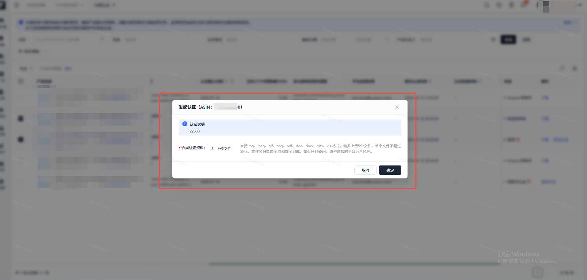

### 再次认证

> 驳回状态，支持操作次认证

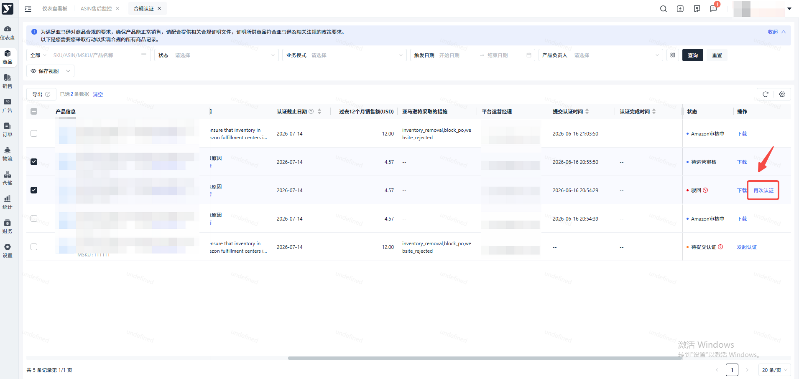

### 重新提交认证申请

根据平台运营审核驳回原因，重新准备认证资料并上传，再点击确定按钮，再次提交认证申请

> - 弹窗标题中会展示认证ASIN
> - 支持 jpg、jpeg、gif、png、pdf、doc、docx、xlsx、xls 格式，最多上传5个文件，单个文件不超过 5MB
> - 再次提交认证申请后，列表页面的提交认证时间会更新

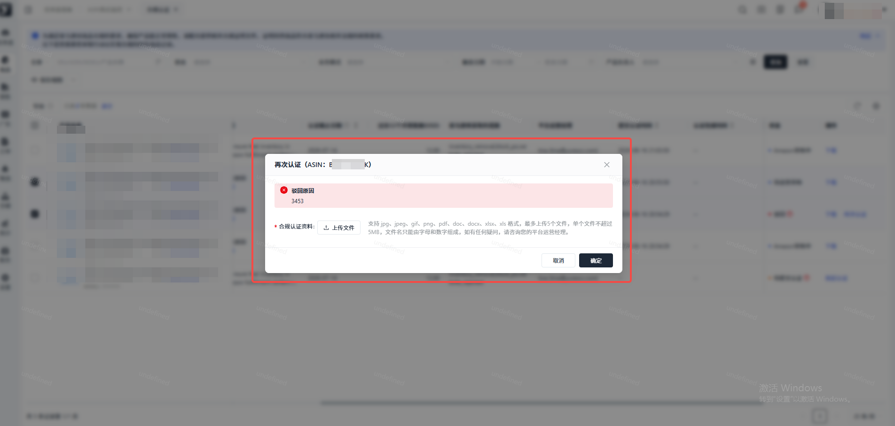

### 下载提交的认证资料

> - 提交过认证申请的数据，支持操作下载
> - 下载的是最近一次提交认证上传的认证资料

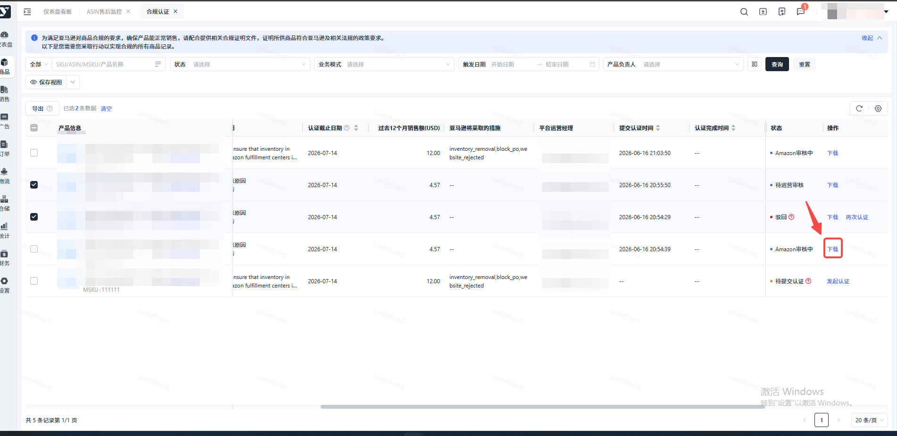

### 站内消息

> 系统每日 08:10 自动发送合规认证汇总站内消息，仅推送有数据的统计项；
>
> 三类统计维度独立计算、数据不互斥，单条产品认证可同时被多个维度统计：
>
> - 今日新增需提交 / 重提合规认证产品数量
> - 超 7 天未提交 / 重提合规认证产品数量
> - 距亚马逊认证截止日不足 30 天预警产品数量

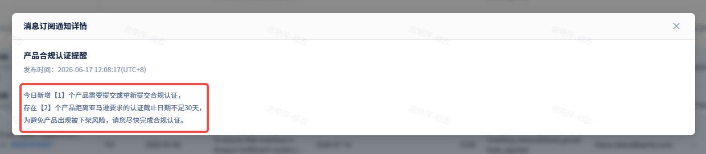
