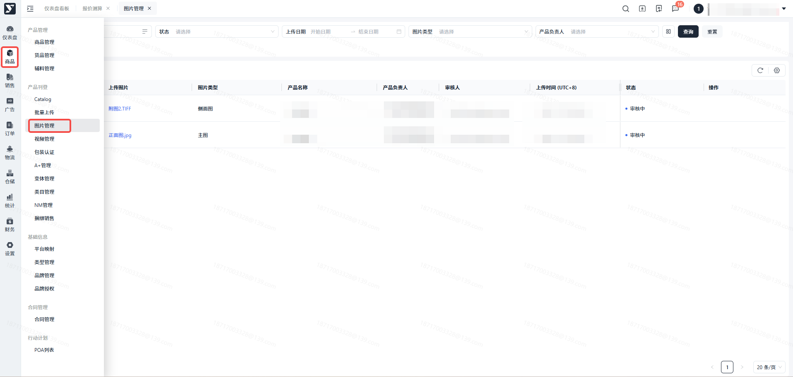
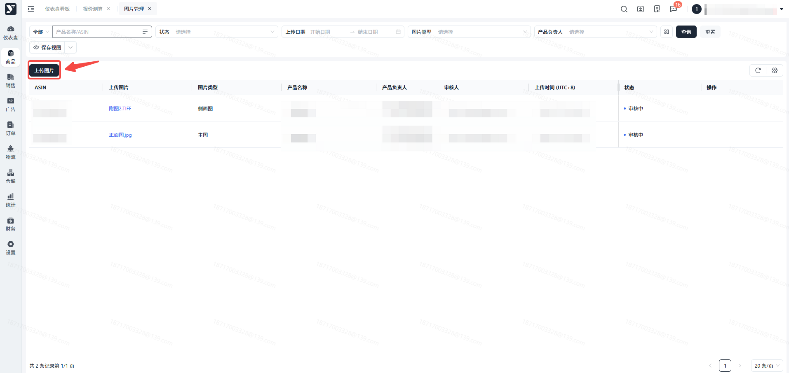
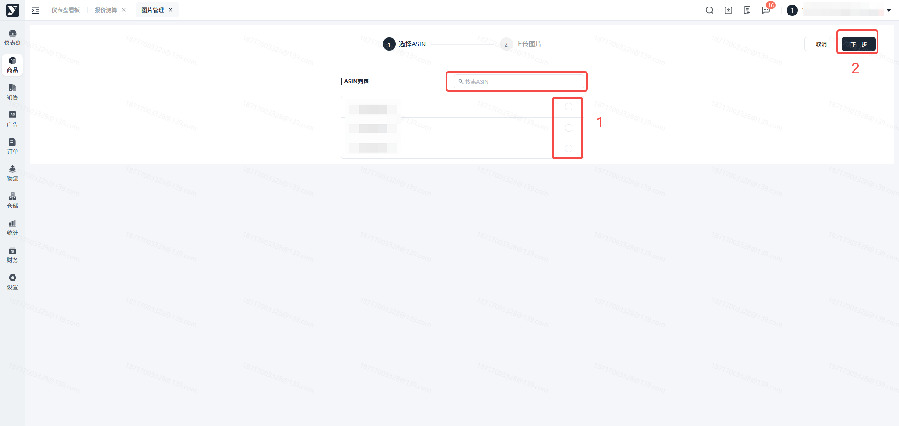
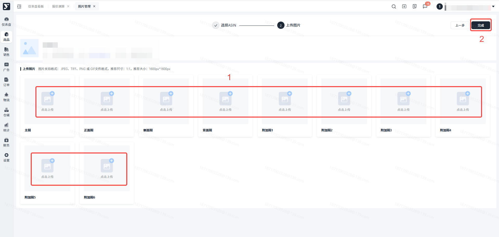
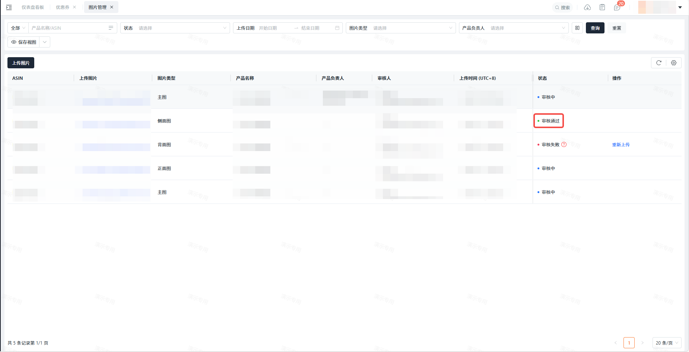
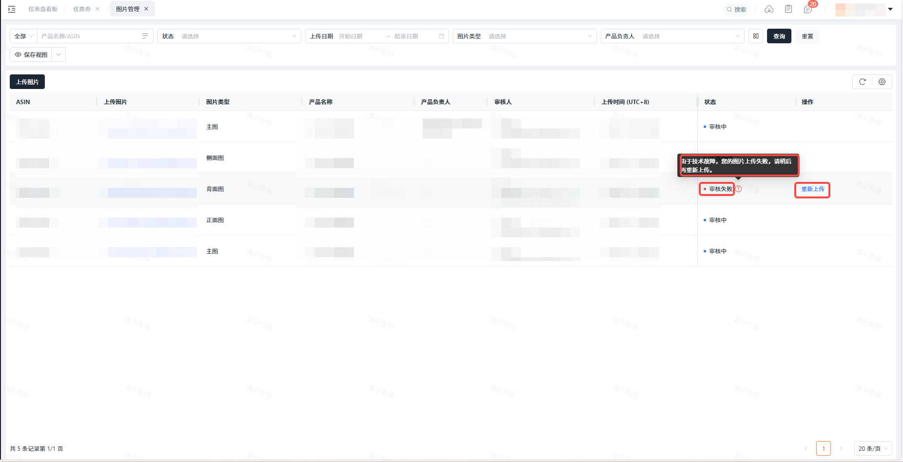

# 飞书文档：图片管理

## 功能介绍

- 图片是在亚马逊上销售产品的重要组成部分。它们使客户更容易评估和了解您的产品，您可以在此进行产品图片的上传和下载。
- 亚马逊上的每个产品都必须至少有一张产品图片。建议至少有六张图片和一个视频，最多可上传8张图片。
- 当您上传图像文件时，我们会对其进行检查，以确认其符合技术文件要求。不符合这些要求的文件不会上传。此外，如果发现您的产品列表上的图片不符合亚马逊的政策，产品在亚马逊网站中可能无法被搜索出来，直到您提供符合要求的图片为止。

## 注意事项

### **技术要求**

- 文件格式应为 JPEG/JPG、PNG、TIFF 或 GIF（首选 JPG）。
- 颜色应为 RGB 或 CMYK（首选 RGB，因为 CMYK 颜色在我们网站上显示时有时会出现色调变化）。请参阅下面的图片颜色部分。
- 分辨率应至少为 72 dpi。
- 细节页面的最佳缩放体验要求文件最长边为 1600px 或更大。缩放已被证明有助于提高销售额。如果您无法满足这一要求，用于缩放的文件最小尺寸为 1000px，用于网站的文件最小尺寸为 500px。
- 文件最长边不能超过 10,000 像素。

### **主图**

页面上的第一张图片为“主要产品形象”，这张图片也会在搜索结果中显示给客户。

您的主要产品形象必须:

• 以逼真、专业的图片形式准确呈现产品，而不是占位符。

• 有一个纯白色的背景(RGB颜色值:255，255，255)。这能够在搜索和产品详情页面为客户创建一致的运输体验。

• 显示产品占图片的 85%

• 产品上或背景中不得有文字、徽标、边框、色块、水印或其他图形。多件产品的大小必须相对应，不得放大任何一件。

• 在图片框架内展示整个产品，不得截取任何部分。

• 不展示未随附的配件或任何可能会让客户产生混淆的道具。

• 只在图片中展示一次产品，例如只展示正面，而不同时展示正面和背面。

不包含包装，除非包装是产品的重要特征，如手提箱或礼品篮。

• 不得展示人体模型的任何部分，无论人体模型的外观如何。这包括透明、纯色、肉色、框架或衣架。

• 展示单只鞋，面向左侧，呈 45 度角。这适用于所有鞋类。

• 服装附件或多件包装应平放，不带模特。

• 如果是成人尺码的服装，必须有模特。模特必须站立，不得坐着、跪着、靠着或躺着。不过，我们鼓励展示各种身体活动能力和使用辅助技术（如轮椅和假肢）的模特。

### **产品图片**

所有产品图片，无论是主要的还是其他的，都必须:

• 准确地代表你所销售的产品。

• 与产品标题相符。

• 不包含裸体或性暗示。这包括模特和图画。

展示没有模特的儿童服装平面图。

• 不包含客户评论、五星图片、免运费等声明或卖家特定信息。

• 不包含任何亚马逊徽标或商标、变体、修改或任何与亚马逊徽标和商标混淆性相似的内容。这包括但不限于任何带有 "Amazon"、"Prime"、"Alexa "或 Amazon Smile 设计的文字或徽标。

• 不包括亚马逊使用的任何徽章，或与此类徽章相似的变体、修改或任何易混淆的内容。这包括但不限于 "亚马逊之选"、"优质之选"、"亚马逊Alexa"、"与亚马逊Alexa一起使用"、"最畅销 "。

## 操作流程

### 操作路径

【**商品】-【产品刊登】-【图片管理】**

### 点击****

### 选择产品

选中想上传图片的产品ASIN后点击下一步。

### 上传图片

进入上传图片页面，每一个产品最多可以同时上传10张图片。

选择对应的图片位置点击上传，从设备中选中一张图片进行上传。

注：当您选中图片点击上传后，此张图片就会进行审核，审核通过后就会展示在您的产品在亚马逊的详情页中，请谨慎上传。

当图片“审核中”状态时，如长时间未收到审核结果，您可以联系运营人员解决。

### 上传成功

当此条数据状态变为时，表示您的图片已经成功上传至亚马逊了。

### 审核失败

当此条数据状态变更为时，表示您的图片未通过审核，将不会被展示在亚马逊产品详情页中

您可以选择重新上传，或者点击详情查看图片上传失败的原因。

## 常见问题

**答**：亚马逊页面上的图片可能会产生延迟，审核通过后可能需要24小时才能显示在网页上，如果您的图片超过这个时间仍未更新，请联系运营人员解决。

**答**：系统会自动为上传的文件修改他们的名称，所以您上传的文件仍为原文件，只是修改了文件名，并不会影响原本的文件内容。

**答**：目前版本不支持删除已经上传成功的图片，您只能选择另一张图片替换掉原图片。

**答**：可以上传图片/视频的产品前提条件是，该产品在【Catalog】中为生效成功的状态，若不满足此条件，您在上传图片/视频时无法选择此产品。
