# 飞书文档：批量上传

## 功能介绍

批量上传是针对产品列表模块开发的批量上传offer的功能，卖家可以通过批量上传的方式快速的上传offer信息，上传成功后卖家可以在亚马逊前台页面查看产品的详细信息。

## 注意事项

1. 填写模板请注意带有“REQUIRED”为必填项，请务必填写；
2. 批量上传与批量编辑需分别下载模板；
3. 请勿修改模板任何内容，否则上传将失败；
4. 若您选择的是通过ASIN获取模板，获取成功后请勿在模板中添加未选择的ASIN，否则上传将失败；
5. 若您选择的是通过类目获取模板，获取成功后请勿在模板中添加未选择的类目，否则上传将失败，单次下载模板最多可选20个最小类目，最多500条SKU；
6. 上传offer可能会存在部分成功、部分失败的Offer数据，请您不要担心，成功的offer数据您可在**产品列表**查看亚马逊是否已审核成功，失败的Offer数据我们会给到您具体的错误原因，您修改后可再次提交；
7. 建议您单次上传勿选择较多的ASIN，亚马逊审核需要一定的时间，请您耐心等待。

## 操作流程

### 操作路径【产品刊登】-【批量上传】

1. 可通过ASIN、UPC/EAN、类目或其他条件搜索您所需要的数据
2. **？显示为失败的原因**
3. 列表分为2个Tab页：下载模板、offer上传状态

 1. 下载模板：列表的数据为用户下载的模板数据
 2. Offer上传状态：指用户填写完成后上传offer提交亚马逊校验的数据

### 操作路径1【产品刊登】-【catalog】-【新增产品】-【批量新增】

1. 步骤一：点击--选择
2. 步骤二：选择批量新增

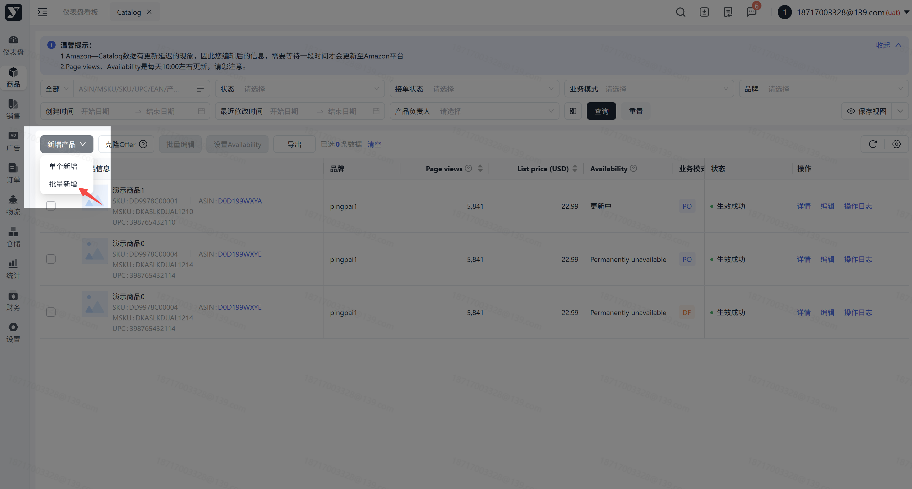

### 操作路径2【产品刊登】-【批量上传】-【下载模板】

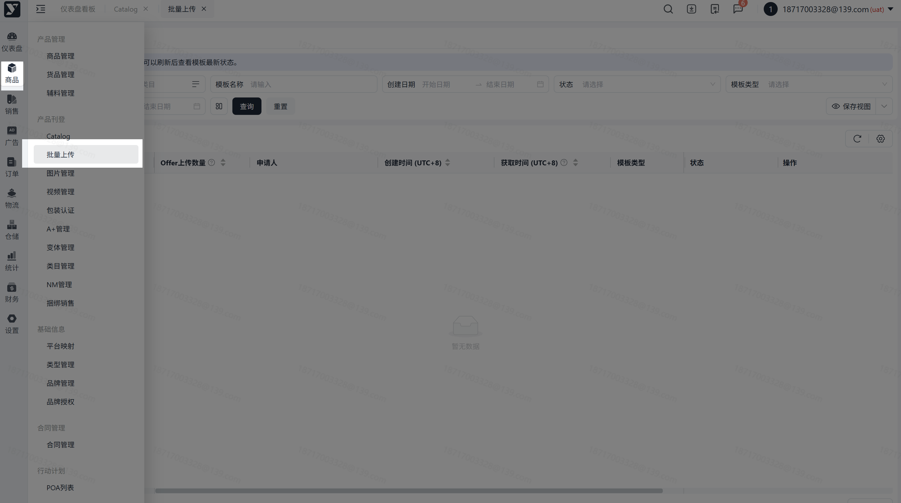

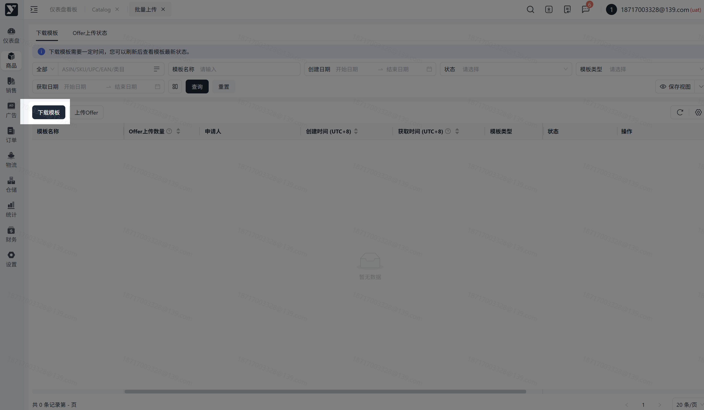

### 下载模板方式1：【通过ASIN上传】

### 通过 ASIN 下载模板

操作路径：选择通过ASIN进行批量上传-点击下一步-选择需上传ASIN-点击下载模板-等待模板获取成功

> 1. 所选SKU/ASIN为采购报价中已生效的数据
> 2. 可通过ASIN、UPC、EAN、SKU先搜索您需要获取模板的数据
> 3. 选择完成后点击【下载模板】等待模板生成
> 4. 列表生成数据，等待模板下载成功

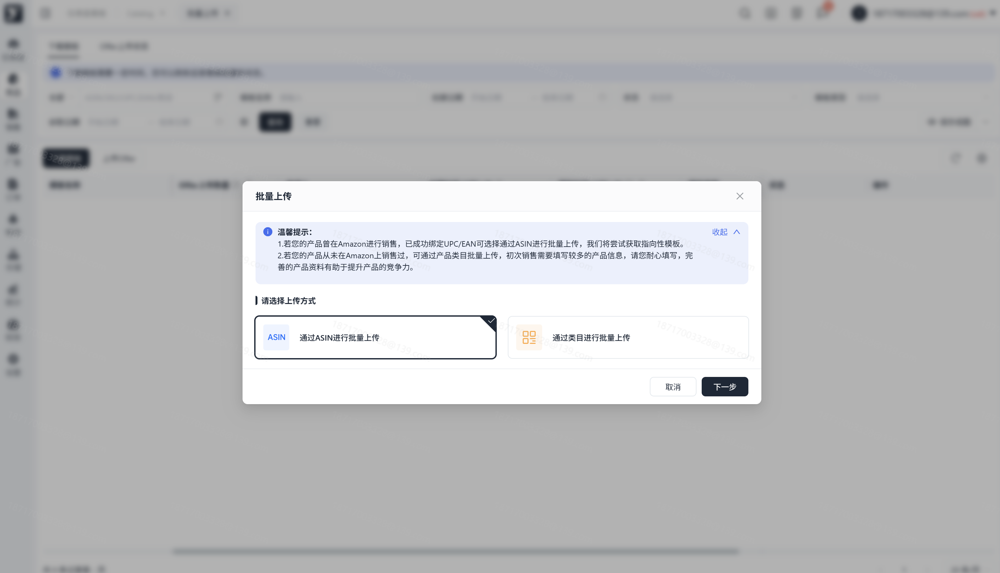

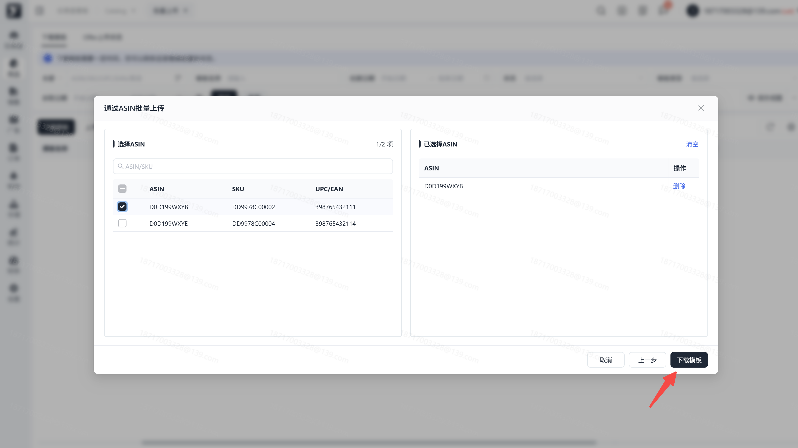

### 通过类目下载模板

下载模板方式2：【通过类目进行批量上传】

### 类目模板下载步骤

操作路径：选择通过类目进行批量上传-点击下一步-选择需获取的最小类目-点击下载模板-等待模板获取成功

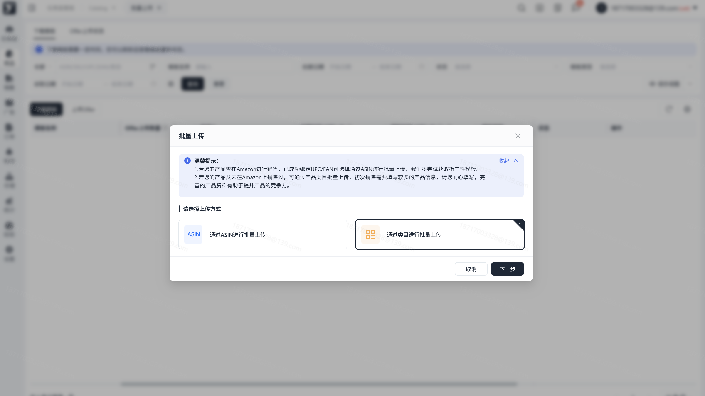

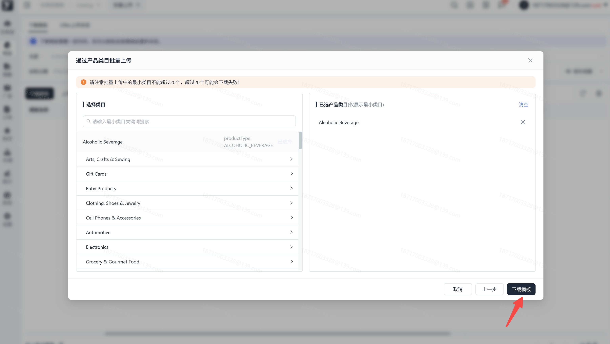

### 上传 Offer 模板

操作路径：【产品刊登】-【批量上传】-【上传Offer】-【上传模板】

> 1. 上传成功的数据，可在Offer上传状态中查看，同时可在产品列表查看对应的数据状态

> 1. 若上传报错，可通过提示下载模板至本地，查看具体的报错原因，报错的字段会单独表示出来，请您注意

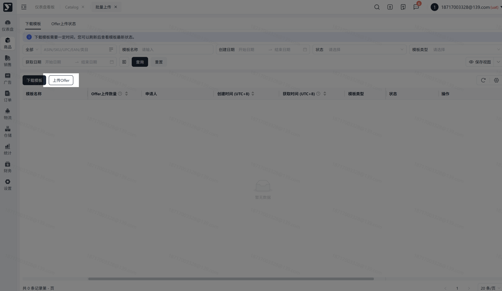

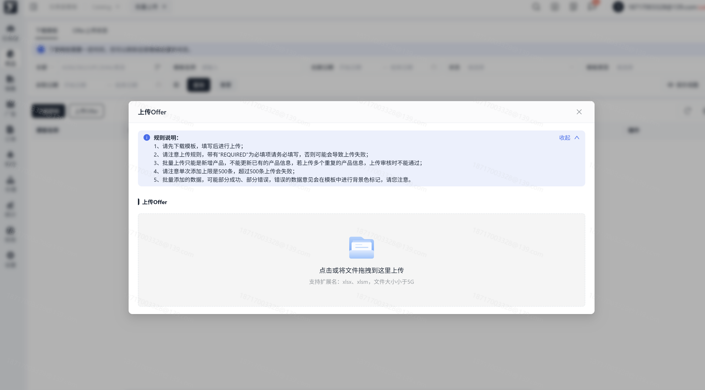

### 查看 Offer 上传状态

操作路径：【产品刊登】-【批量上传】-【Offer上传状态】

1. 点击【获取模板】可将之前操作上传的模板保存至本地；
2. 点击【获取错误模板】可将上传校验失败的模板保存至本地，根据报错原因修改后重新上传；

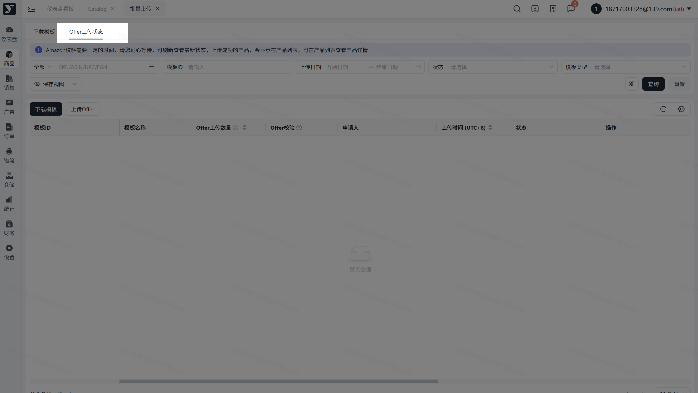

### 操作路径：【产品刊登】-【产品列表】-【批量操作】

> 复选框选择需批量编辑的数据，点击后【批量上传】-【下载模板】生成对应数据，等待模板获取成功

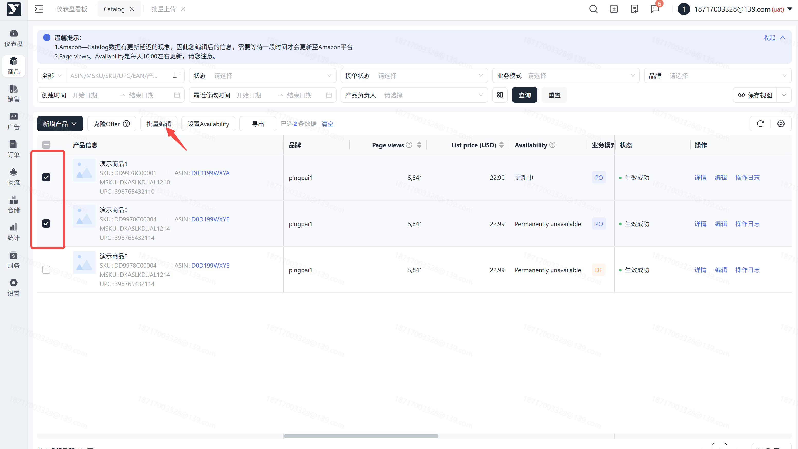

## 常见问题

> 若在使用过程中遇到问题，您可以参考此文档

针对Amazon校验失败下载的模板，我们是帮您过滤到亚马逊已经校验通过的数据，您可以在Catalog查看最新审核的情况，报错的数据您可以根据具体的报错原因，修改后重新上传。重新上传将生成一条新的数据，您可以刷新页面查看最新状态

您第一上传模板我们将会对您填写的内容进行初步的校验，确保亚马逊要求的必填项您都填写完成，Amazon校验失败是因为亚马逊审核，发现可能某字段填写的不符合亚马逊的要求，故亚马逊报错，您可参照亚马逊报错的具体原因，修改后重新上传

不能修改的内容，我们已经置灰，这些字段表示已经通过亚马逊审核，您不能再次更改

## 常见报错处理

> 若您在使用过程中，上传Offer后，系统页面给到以下的报错，具体报错的操作，您可以参考以下帮助进行操作

1. 报错提示：**该SKU未在采购报价成功申报，请确认是否输入正确！——**此报错文案表示您在下载的模板中添加的SKU还未在采购报价进行报价的申请，您需先在采购报价申请报价，报价成功后可再次上传Offer模板；
2. 报错提示：**该SKU品牌与采购报价不匹配，请确认后重新输入！**——此报错文案表示，您通过类目下载的模板所选择的Brand Name与【采购报价】模块所填写的品牌不一致所导致的报错，您需参照【采购报价】的保持一致，才能上传成功；
3. 报错提示：**该SKU List Price与采购报价MSRP不匹配，请确认后重新输入！**——此报错文案表示，您在批量上传模板中所填写的List Price与您在【采购报价】中的MSRP不一致导致的报错，您需将模板中的价格调整为与【采购报价】一致后再进行Offer的上传操作；
4. 报错提示：**ASIN为必填项，请输入必填项！**——此报错文案表示您通过ASIN下载的批量模板，在上传Offer时系统校验时发现ASIN不存在，故报错，需补充上正确ASIN，再上传Offer；
5. 报错提示：**该SKU未在采购报价成功申报，请确认是否输入正确！**——此报错文案表示您在上传的Offer信息中，所填写的SKU不正确，未在【采购报价】进行申请，需先至【采购报价】模块申请后再进行Offer的上传操作；
6. 报错提示：**该SKU信息有误，请联系平台运营经理！**——此报错文案表示您在上传的Offer信息中，所填写的SKU数据存在异常，您可以联系我司的平台运营经理，引导您下一步操作；
7. 报错提示：**模板不合法!**——此报错文案表示您所上传的模板格式或文件错误，请您检查您所上传的模板信息，上传正确的模板；
8. 报错提示：**请勿更改模板格式！**——此报错文案表示您所上传的模板中，修改了模板的样式，系统检验后给到的报错，请您勿修改模板，按照下载的模板进行填写Offer信息；
9. 报错提示：**未获取到该SKU对应的模板，请移除该产品！**——此报错文案表示您通过ASIN下载的批量模板中，在填写Offer信息时，添加了未获取模板的ASIN（也就是您第一步选择ASIN下载模板的操作，并未选择该数据），需按照报错原因，删除该产品后重新上传Offer；
10. 报错提示：**Order Type选择错误，请重新选择！**——此报错文案表示您在上传的模板中修改了Order Type对应的内容，我们提供的是下拉选择框，请您勿修改下拉框的内容，按照模板提示操作；
11. 报错提示：**Excel模板最多支持500条数据！**——此报错文案表示您所上传的模板中，填写的数据超过了500条，系统单次上传的模板限制为500条，请您移除后再上传；
12. 报错提示：**该ASIN与SKU匹配不上，请确认是否输入正确！**——此报错文案表示您在模板填写的产品信息，SKU和ASIN的对应与【采购报价】不一致，请您确认数据与【采购报价】保持一致后再上传Offer；
13. 报错提示：**该SKU正在调价中，请调价完成后再上传！**——此报错文案表示您所上传的模板中，该条产品信息正处于【产品调价】中，需在调价完成后再进行上传Offer和编辑Offer的操作；
14. 报错提示：**该SKU不是生效成功的Offer！**——此报错文案表示您编辑Offer或上传Offer时，填写的SKU已在【Catalog】中存在数据，您需移除该条SKU信息后重新上传，被移除的该条SKU可在【Catalog】进行操作；
15. 报错提示：**该SKU不存在！**——此报错文案表示，您进行批量编辑的操作，上传Offer时在模板中添加了您之前并未选择的SKU所导致的报错，您需移除该条SKU后再进行上传Offer，被移除的该条SKU信息您可以至【Catalog】进行单个/批量的编辑操作；
16. 报错提示：**该SKU已在Amazon审核中，请勿重复上传！**——此报错文案表示您上传Offer时，系统校验到您在模板中填写的数据，已在【Catalog】中存在，且已提交给亚马逊审核，您需移除该条产品信息后重新上传，被移除的产品信息可在【Catalog】中查看；
17. 报错提示：**该SKU已在Catalog中，请勿重复上传！**——此报错文案表示您所上传的模板中，系统校验时发现该条产品数据已在【Catalog】中存在，且状态可能是生效成功状态，您需移除该条产品后再进行上传的操作，被移除的产品信息可在【Catalog】中查看；
18. 报错提示：**该SKU对应的ASIN与商务上报填写的ASIN不一致，请检查后重新上传！**——此报错文案表示您所上传的Offer中填写的产品信息的SKU与ASIN不一致，系统给到了报错，请您至【采购报价】中查看该SKU所对应的ASIN的正确的值，修改后重新填写模板再进行上传。
