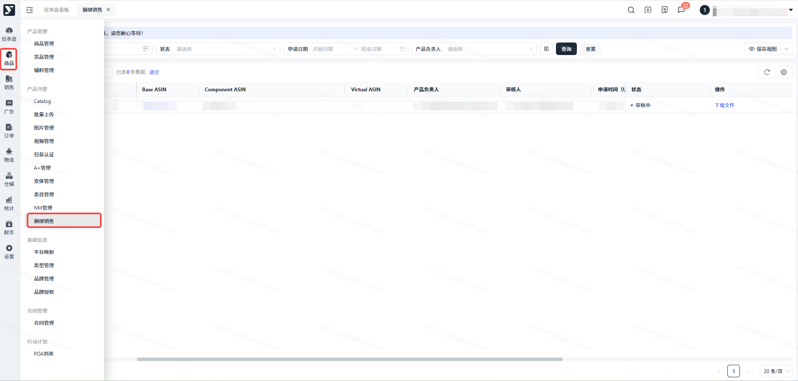
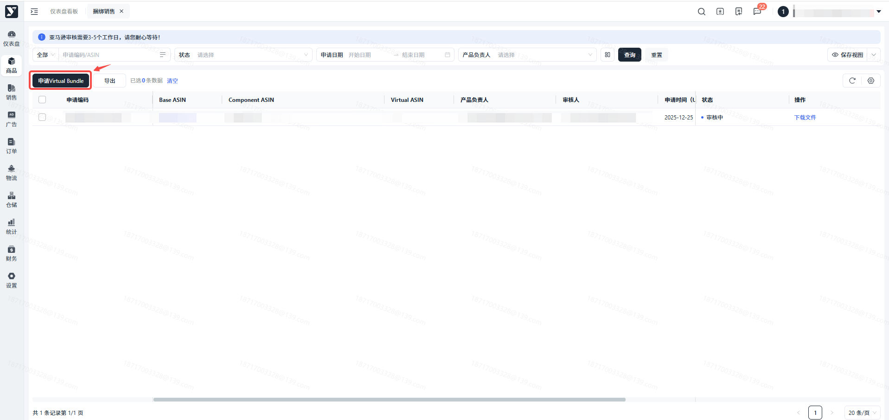
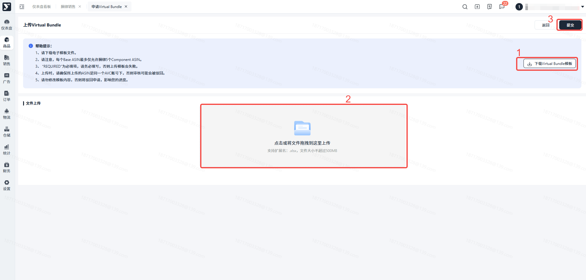
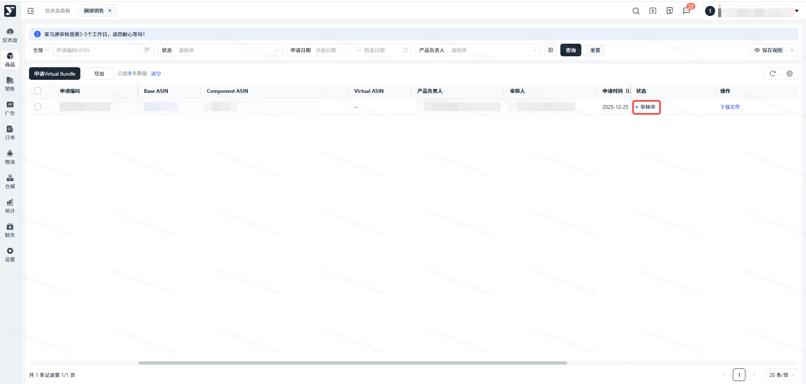
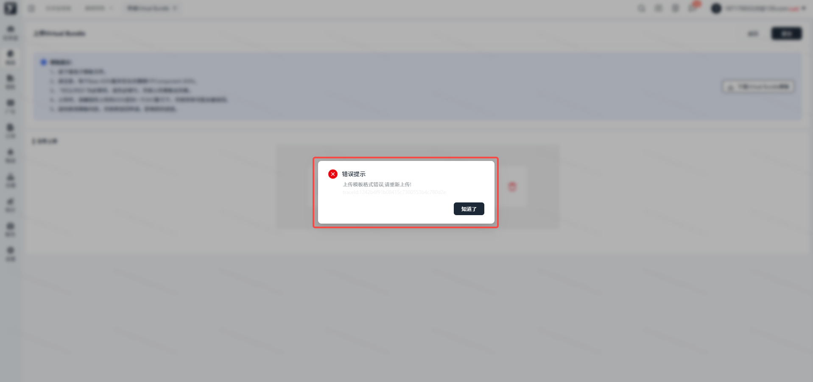
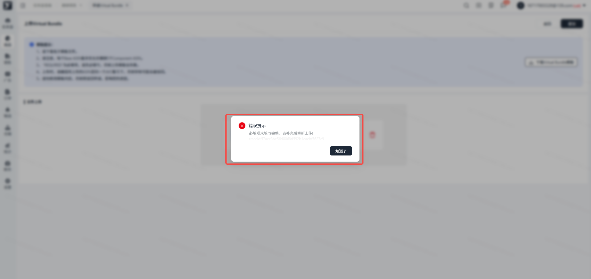

# 飞书文档：捆绑销售

## 功能介绍

Virtual Bundle（捆绑销售）允许您将多个ASIN的商品组合成一个新的虚拟ASIN进行销售，通过捆绑销售功能，您可以灵活组合商品，通过热销商品带动冗余库存或新品销售，提升销量。

## 注意事项.

1. 您提交申请后，亚马逊审核需3-5个工作日，请您耐心等待；
2. 审核失败的申请，您可以重新再次发次申请；
3. 填写模板时，请您注意，带有“REQUIRED”字段为必填项，否则上传会提示您失败；
4. 考虑到兼容性，请使用谷歌浏览器。

## 操作步骤

### 申请Virtual Bundle

#### 菜单路径【商品】-【产品刊登】-【捆绑销售】

#### 申请 Virtual Bundle

点击【申请Virtual Bundle】，获取Bundle模板，模板保存至本地，填写完成后上传，上传模板后需再次点击右上角【提交】按钮

#### 查看申请

提交完成后，列表会生成对应的数据，您可以查看您提交的申请

#### 上传模板报错处理

##### 模板不符合要求

模板不符合要求，不是我们提供您的模板，请您【下载Virtual Bundle】模板完成填写后再次上传

##### 必填项缺失

必填项未填写，会有此报错，您需检查您模板中，带有“REQUIRED”字段的内容，按照要求输入，再重新提交

