# 飞书文档：类目管理

## 文档信息

| 项 | 内容 |
| --- | --- |
| 远程文档 | https://q1njej8cpab.feishu.cn/wiki/R69xwyBs5ioBfekv2ohcfUTYnhb |
| 图片处理 | 本地下载（assets/images） |
| 快照时间 | 2026-08-06 |
| 来源命令 | `lark-cli docs +fetch --api-version v2 --doc https://q1njej8cpab.feishu.cn/wiki/R69xwyBs5ioBfekv2ohcfUTYnhb --doc-format markdown --as user --format json --jq .data.document.content` |
| 格式处理 | fd-doc-markdown-sync/scripts/normalize-feishu-doc-markdown.mjs |

---

类目管理

## 功能介绍

1. 供应商可在“类目管理”模块中对产品的类目进行增删改查；
2. 当您申请类目修改后，我们会对其进行审核，确认修改的类目符合Amazon的要求，若提示审核失败，请根据提示信息对产品类目进行修改后重新发起申请。
3. 通过对类目进行增删改的方式，既能确保商品能够准确归类，提升用户体验，还能重新获取新类目排名，以此获取更多的曝光度、点击率、以及Listing流量，从而提高转化率和销售额。

## 注意事项

1. 修改类目时请注意：

 1. 产品列表中生效成功的Offer可对类目进行修改、新增与删除。
 2. 原类目和新类目都只展示一级类目和最小类目。
 3. 新增类目时，若想保留1个原类目，需同时将原类目填入新类目中。
 4. 填写表单时，请分别填写一级类目和最小类目。
 5. 关于Node ID展示位置，在系统中有提示，可点击下载PDF文档查看。
2. 考虑到兼容性，请使用谷歌浏览器。

## 操作步骤

##

#### 操作路径

【商品】-【产品刊登】-【类目管理】

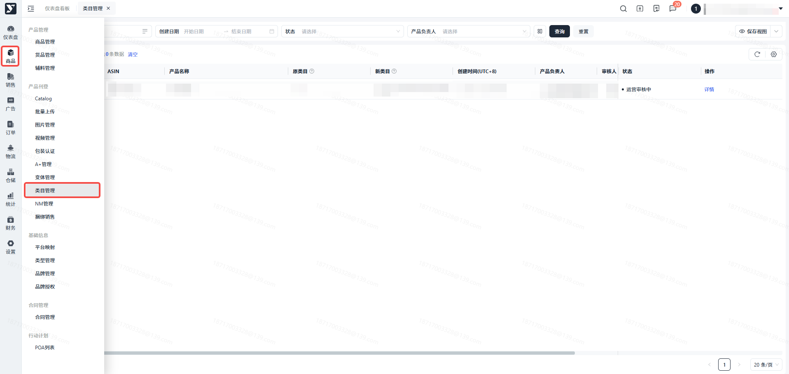

#### 点击【类目修改】

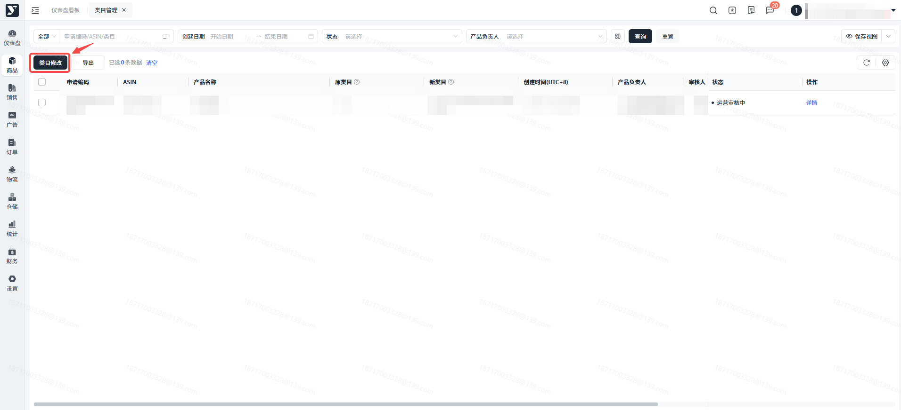

#### 填写【产品信息】、【原类目】、【新类目】

生效成功的Offer可以对类目进行增删改，ASIN可选择的范围也来源于生效成功的Offer；

Node ID可根据帮助文档内的提示去填写；

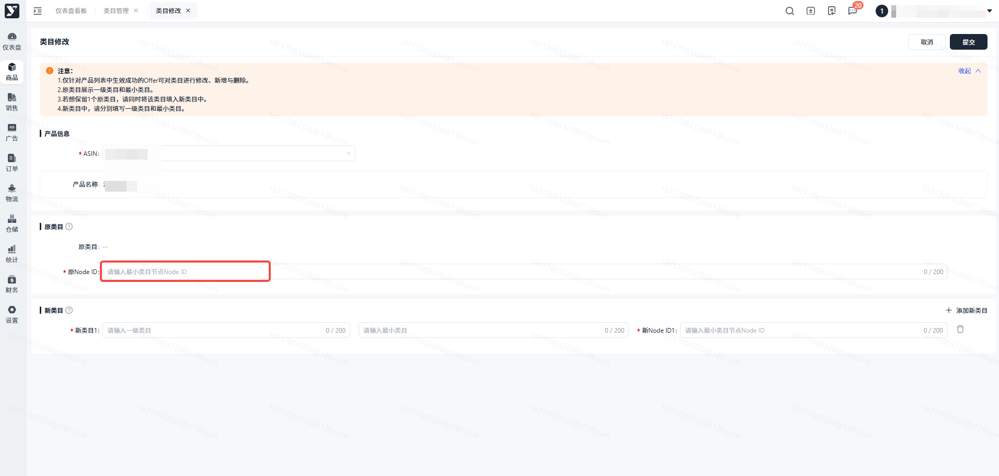

#### 选择完ASIN后，可填写【原类目】、【新类目】

最多可填写2个新类目；

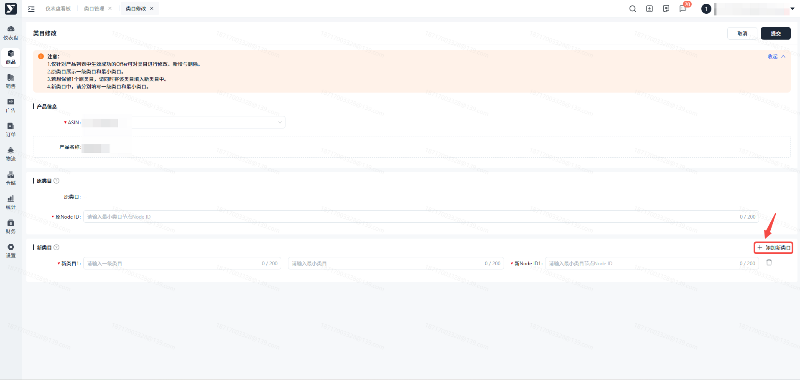

#### 点击【提交】

提交成功后将直接跳转至类目管理列表页，并自动生成该条申请。同时也意味着管理端已经收到您的申请。

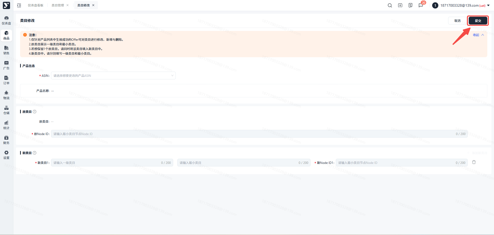

#### 当此条数据状态变为【运营审核中】时，表示您的类目修改申请已提交成功至管理端，运营正在审核中。

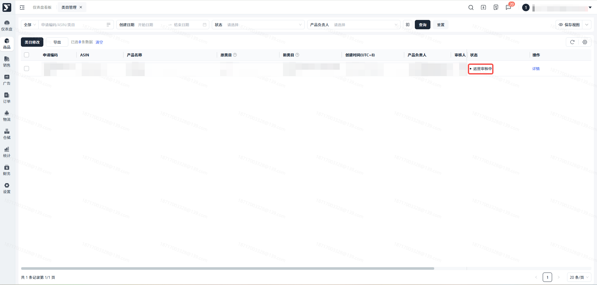

#### 当此条数据状态变为【审核通过】时，表示您修改的类目已经展示在Amazon前台页面。

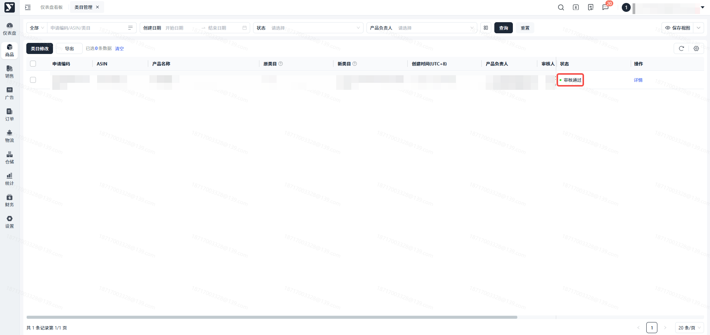

#### 当此条数据状态变为【审核失败】时，表示您的类目修改在Amazon审核失败。

您可以根据反馈的失败原因修改后重新提交。

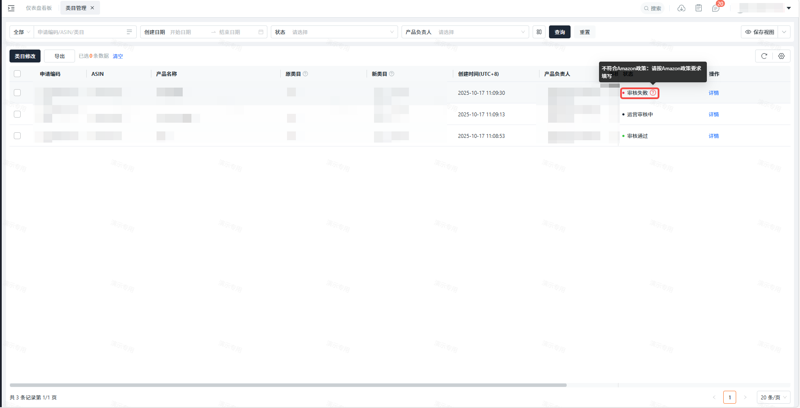

#### 点击【详情】，进入详情页

#### 【运营审核中】详情页

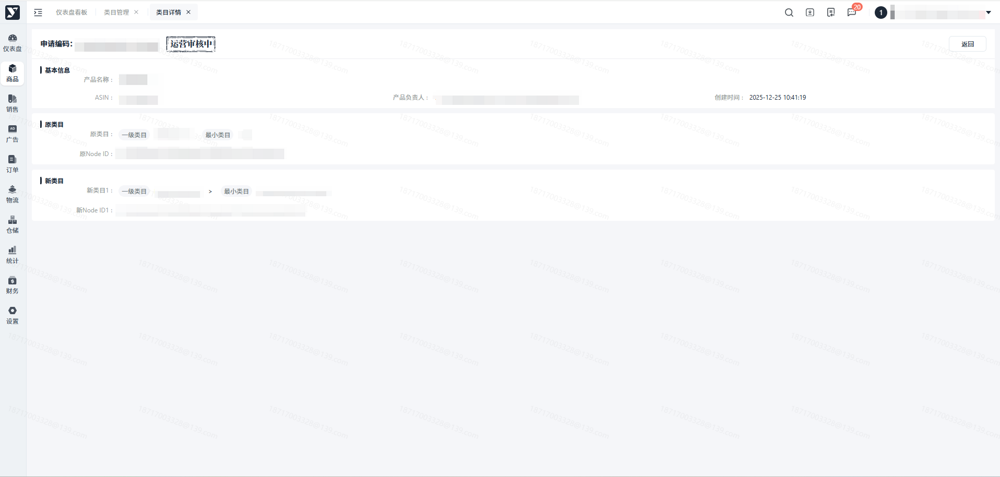

#### 【审核通过】详情页

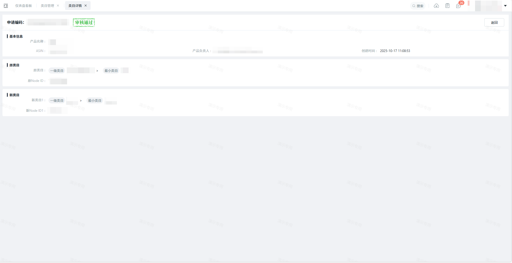

#### 【审核失败】详情页

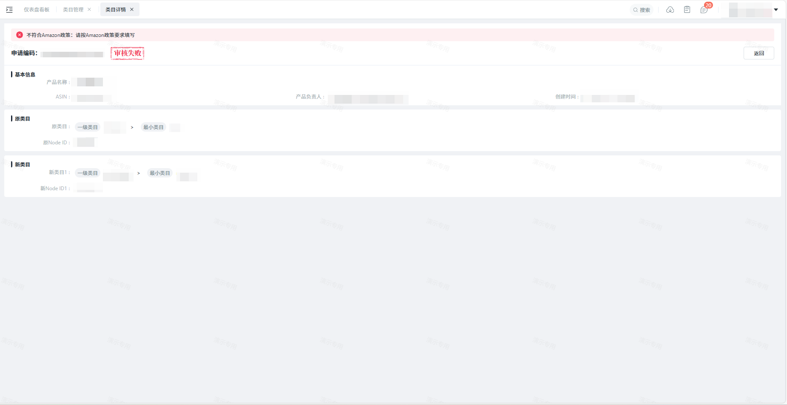

## 常见问题

##

**答：**只要提交成功，列表内都会生成一条新的数据，不存在覆盖现象。

##

**答：**不可以，请先填写产品本身的类目，再填写新增的类目，以便运营审核。
