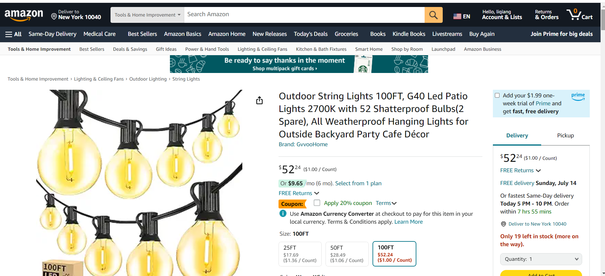
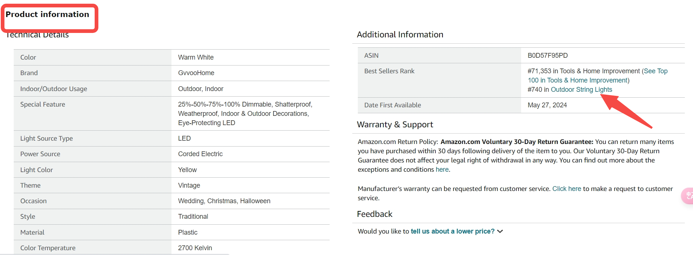
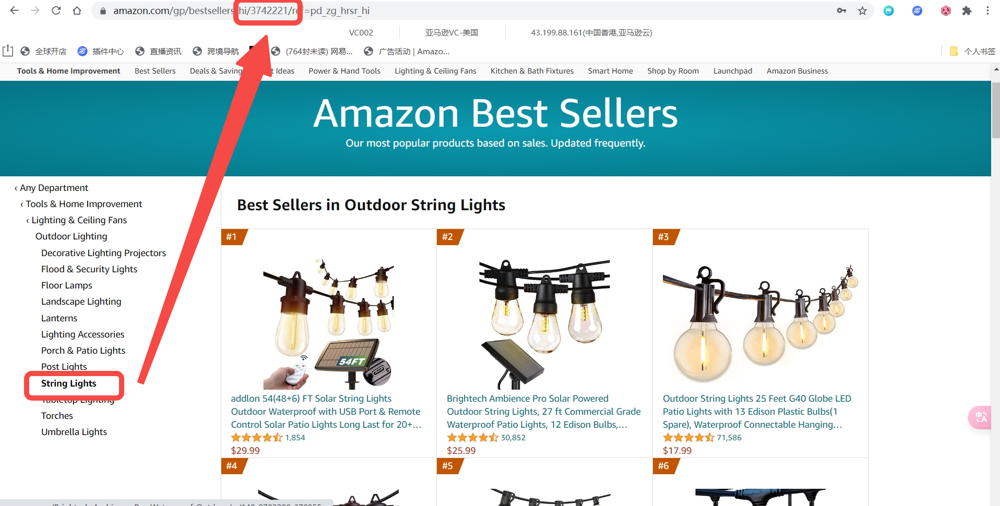

# 飞书文档：获取Node ID - 帮助文档

## 获取Node ID - 帮助文档

### 步骤一：搜索ASIN，进入Amazon Listing页面

该产品的类目为：Tools & Home Improvement > Lighting & Ceiling Fans > Outdoor Lighting > String Lights

### 步骤二：页面中找到Promotion Information ---> Best Sellers Rank --> 点击类目

### 步骤三：跳转至Amazon Best Sellers网页，通过选择最小类目节点，可在网址上找到对应的Node ID

该产品的最小类目节点为：String Lights，所对应的Node ID为3742221。

