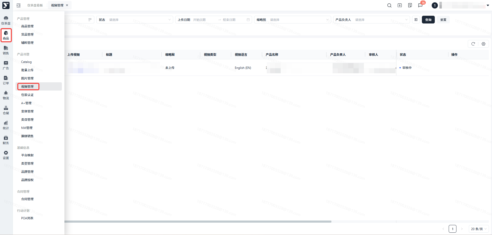
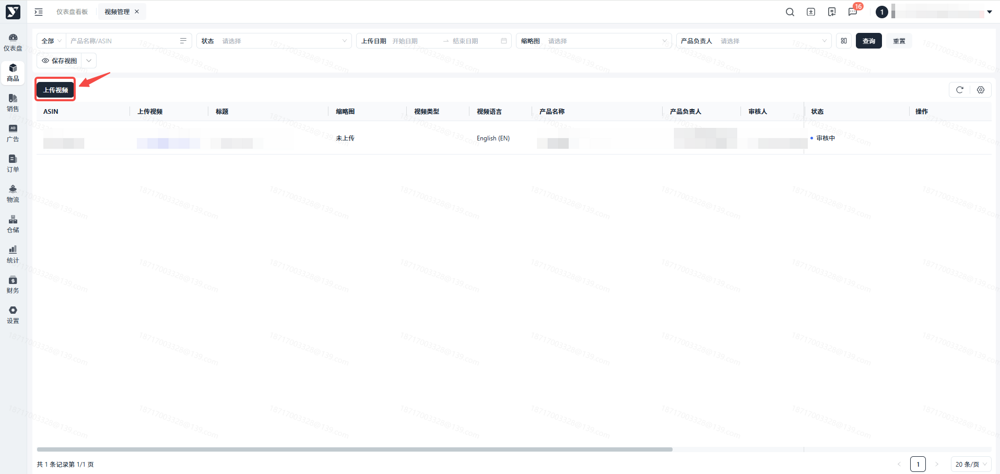
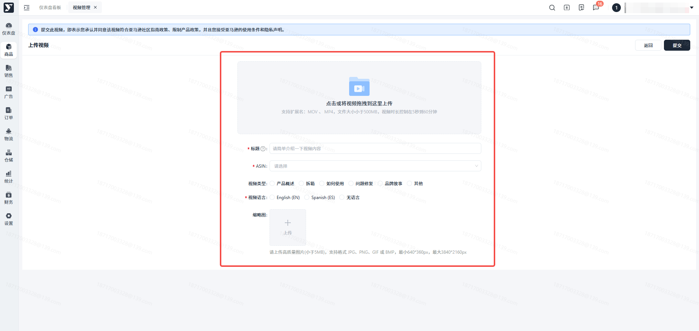
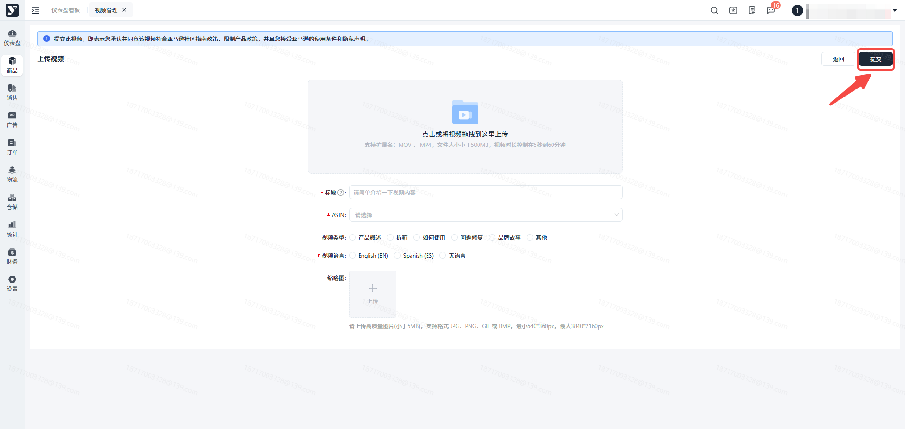
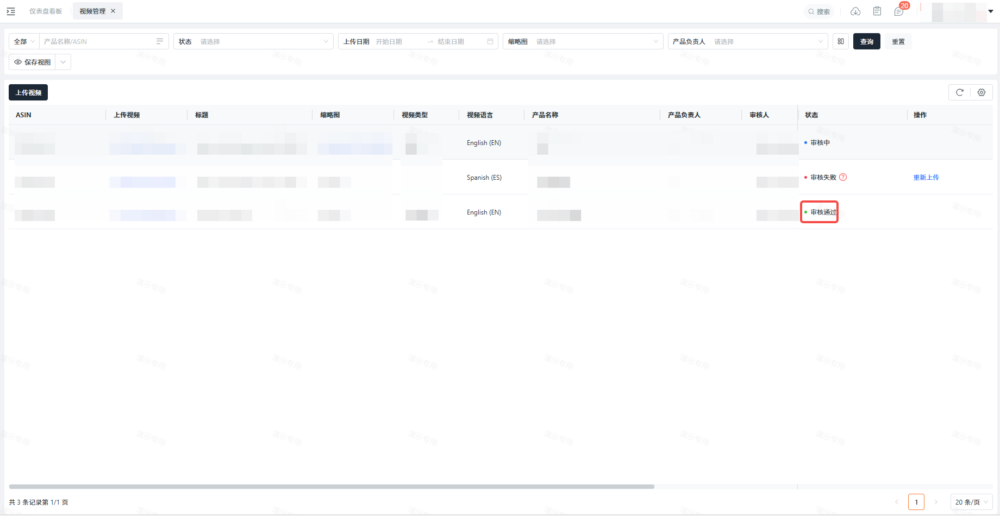
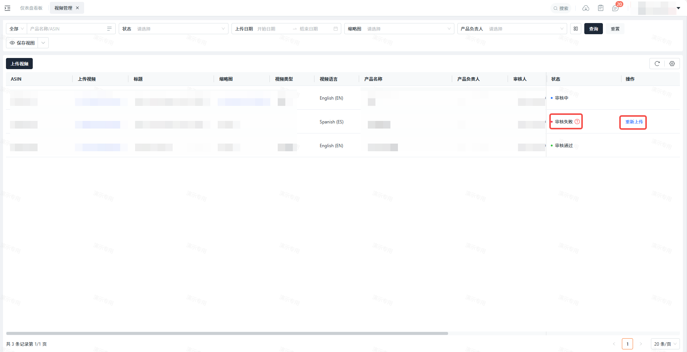

# 飞书文档：视频管理

## 功能介绍

您可以在此进行产品视频的上传，视频有利于提高产品的转化率。上传的视频还可能出现在产品详情页的视频部分和搜索结果中。视频将会被审查，以确保其符合亚马逊的视频内容政策。审查一般需要 24 小时，但节假日期间可能需要 5 个工作日。

## 注意事项

### 技术要求

- 视频文件：建议上传高质量的文件，最高可达 1080p。目前可接受的文件格式为 MOV 和 MP4。视频上传仅支持小于 5 GB 的文件大小。视频中不得包含任何网络链接、URL 或行动号召，以免引导客户离开产品详情页。目前不支持批量上传视频。
- 缩略图：要更改自动生成的预览图片，请单击缩略图并上传新的高质量图片（5 MB 以下），格式可以是 JPG、PNG、GIF 或 BMP。
- 视频标题：确保标题简洁明了，因为标题会显示在视频旁边。
- 时长：视频必须长于 5 秒，短于 1 小时。

### 视频建议

- 演示性：加入视频的主要好处是可以让客户看到产品的实际效果。客户希望了解产品的价值和特点，如产品的外观、使用方法和声音。
- 描述性：描述产品、产品特点、预期用途以及与其他选择不同的原因。如果相关，还可以详细介绍产品的尺寸和重量，以及使用、清洁、存储或组装的难易程度。
- 以产品为重点：视频旨在帮助客户进行产品研究。为了描述产品，视频应提供视觉、文字和画外音内容，提供有关产品特点、用途、材料和尺寸或类似特征的可验证信息。
- 以亚马逊为重点：内容应与产品有关，不应包含外部信息。
- 简明扼要：最好的视频能在短时间内提供有用的信息，避免冗长的介绍和不必要的内容。顾客更喜欢三分钟以内的短视频。
- 真实可信：客户希望了解他们正在考虑的产品的真实情况，因此视频必须可信，才能赢得客户的信任。提供真实、准确、有根据的产品声明，避免夸张、商业语言或公司品牌。
- 良好的制作价值：良好的视频制作元素，如充足的照明、良好的产品可见度和高质量的音频，是视频整体体验的关键因素。低质量会削弱客户的信心和信任。有效的屏幕演示者声音要亲切、真诚、乐于助人。
- 让客户持续购物：当客户观看您的视频时，他们正处于购物状态。通过鼓励他们专注于产品，帮助他们保持购物状态。不要把顾客引向其他网站或社交媒体渠道，从而偏离正轨。
- 标题和缩略图要有意义，并能准确表达您的内容：标题和缩略图能激发客户观看视频的兴趣。创建的视频标题应简短但具有描述性，语法正确，并明确设定客户对将要观看内容的期望。
- 缩略图应具有强烈而生动的图像，在小尺寸下看起来效果良好，并能传达视频的关键信息。如果在缩略图中添加文字，请使用易于在屏幕上阅读的字体。

### 权利和侵权

- 不要发布侵犯他人知识产权或其他专有权利的内容。只上传您拥有或您已获准使用的内容。例如，除非获得所有相关第三方的许可，否则不要在视频中播放音乐或包含图片、艺术品或其他视听作品。如果您没有获得品牌所有者的许可，请避免在视频中出现带有明显品牌标识的服装、珠宝或配饰。
- 亚马逊有权暂停或删除会对客户体验产生负面影响的任何内容。

## 操作流程

### 操作路径

**【商品】-【产品刊登】-【视频管理】**

### 点击****

### 填写视频信息

进入详情页，从设备中选择视频，填写标题，选择您想要将此视频上传到的产品asin，以及选择视频类型和语言，

建议您的视频使用英语，以便获得更高的播放率，另外您可以选择给视频单独上传一张封面缩略图。

### 提交视频

最后点击提交，此视频将会进入审核。

### 审核通过

当此视频状态为审核通过时，表示您的视频已经成功上传至亚马逊了。

### 审核失败

当此视频状态变更为审核失败时，表示您的视频不符合亚马逊某一方面的上传要求。可点击【重新上传】更换上传的视频。

## 常见问题

**答**：系统会自动为上传的文件修改他们的名称，所以您上传的文件仍为原文件，只是修改了文件名，并不会影响原本的文件内容。

答：一个产品仅支持上传一个视频，当您针对这个产品上传了新的视频时，新视频会替代旧的视频展示在亚马逊的产品详情页中。

答：可以上传图片/视频的产品前提条件是，该产品在【Catalog】模块中为生效成功的状态，若不满足此条件，您在上传图片/视频时无法选择此产品。
