# 飞书文档：货品管理

## 功能介绍

货品列表：该模块主要是支撑一些多包裹商品，录入相关的包裹产品信息，进行出入库，库存管理；多包裹商品必须先录入货品信息才可添加

## 页面路径

【商品】-【产品管理】-【货品管理】

## 注意事项

1. 新增产品资料时，请如实填写产品资料；
2. 请注意产品条码的输入规则；

## 操作指南

### 查看货品列表

1. 功能描述：展示所有已新增的货品列表信息
2. 产品状态说明：

 1. 草稿：新增时将产品数据保存为草稿，还未提交
 2. 待审核：提交了产品数据，等待客服审核
 3. 已生效：客服审核通过
 4. 驳回：客服审核驳回

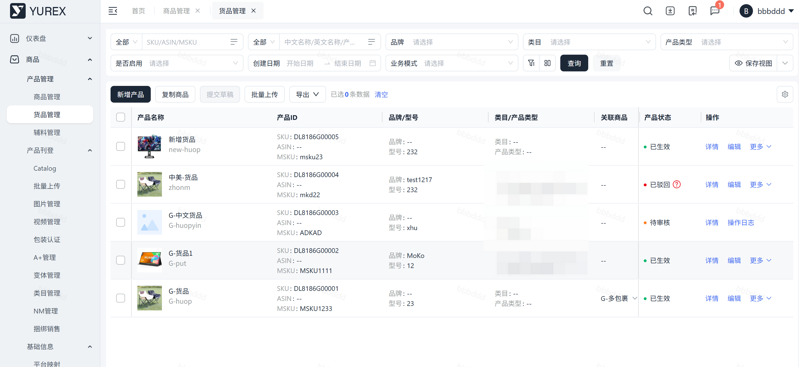

### 新增产品

#### 单个新增

1. 功能描述：手工新增货品信息
2. 操作步骤：说明：支持货品信息必填字段未填写完整时，点击【存为草稿】，退出新增页面

 1. 点击【新增产品】按钮，进入新增页面

 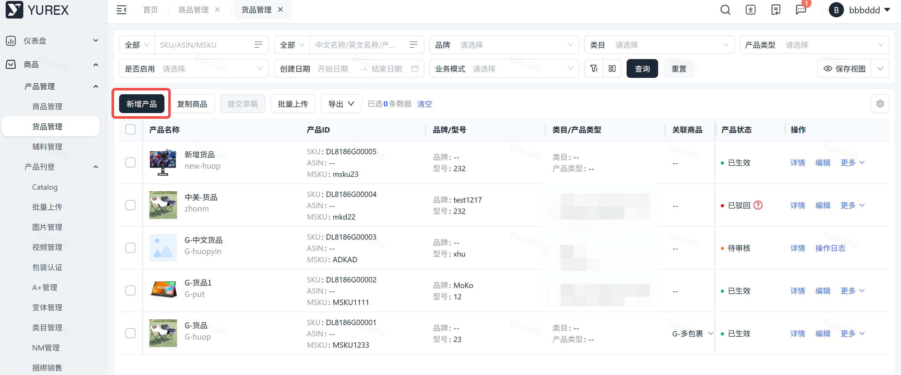

 1. 填写【基础信息、规格信息、图片管理、平台仓附加信息】，标记 \* 字段，为必须填写内容

 1. 【平台仓附加信息】：使用平台仓为 “是” 时，必填

 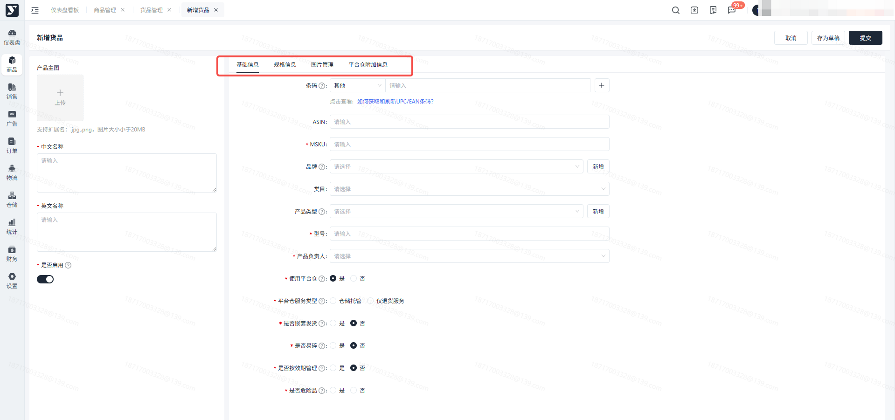
 2. 信息填写完毕，可点击【存为草稿】或【提交】按钮

 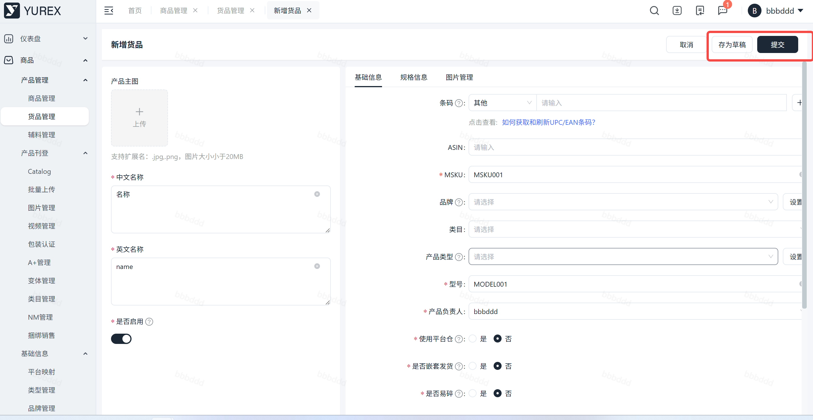

 1. 点击【存为草稿】按钮，退出新增页面，产品状态更新为 “草稿”，可继续编辑

 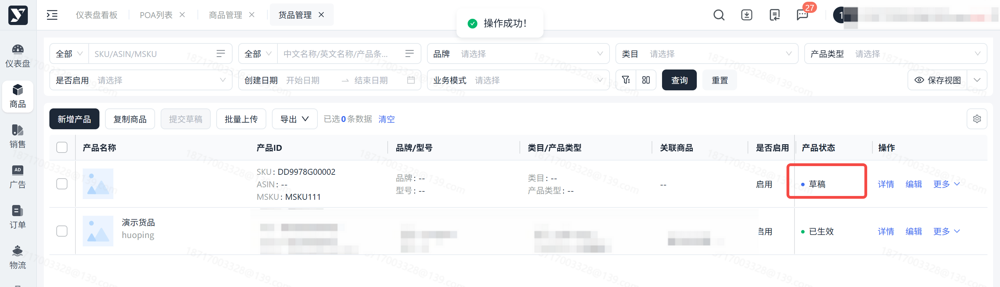

 1. 点击【提交】按钮，提交成功，产品状态更新为 “待审核”，等待客服审核

 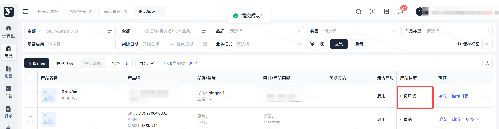

 1. 客服审核通过后，产品状态更新为 “已生效”；客服审核驳回后，产品状态更新为 “已驳回”，可再次编辑

 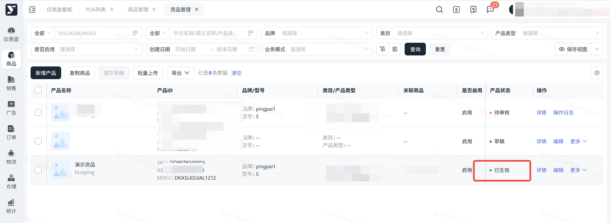

#### 批量上传

1. 功能描述：通过Excel上传方式，快速批量创建货品信息
2. 操作步骤：

 1. 点击【批量上传】按钮，进入批量上传弹窗，点击【下载模版】

 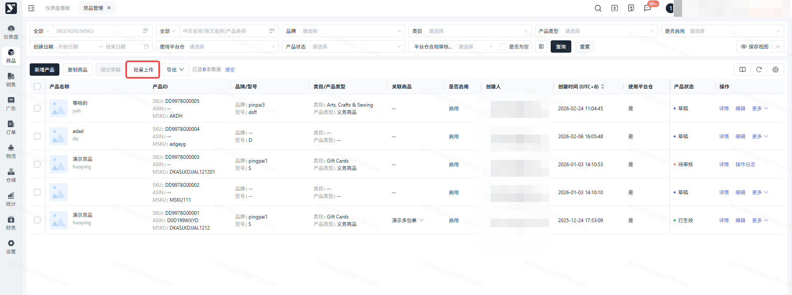

 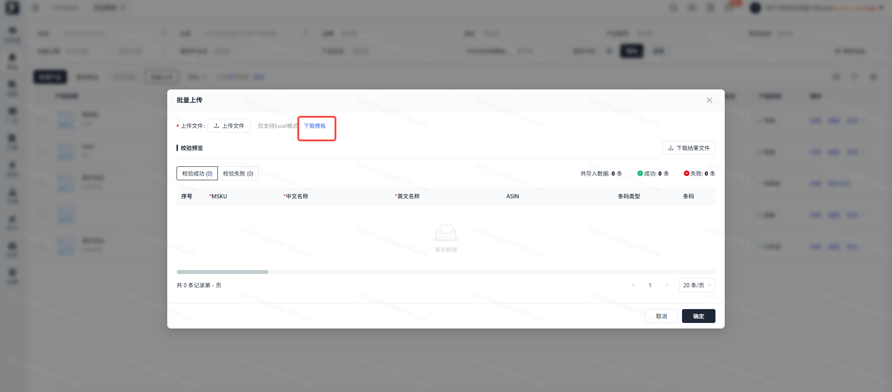

 1. 下载Excel导入模版至本地，将货品信息填入模版中，点击保存

 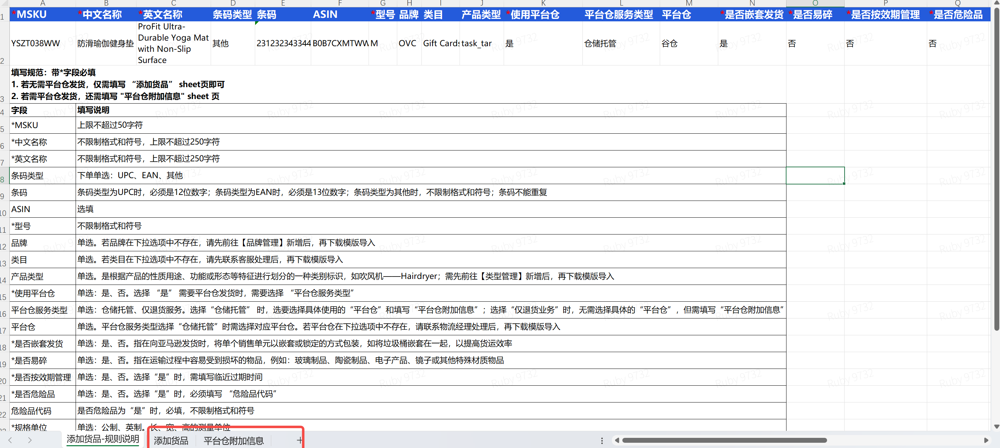

 1. 返回批量上传弹窗，点击【上传文件】，选择保存好的Excel 文档

 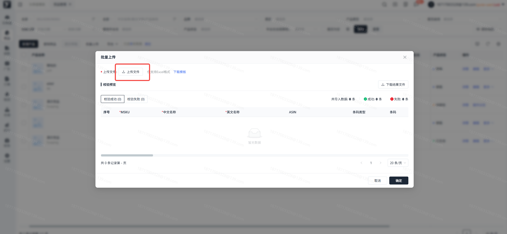

 1. 上传成功，系统自动校验Excel 内容，并在【校验预览】栏位显示校验结果；若Excel内容校验失败，可下载结果文件到本地

 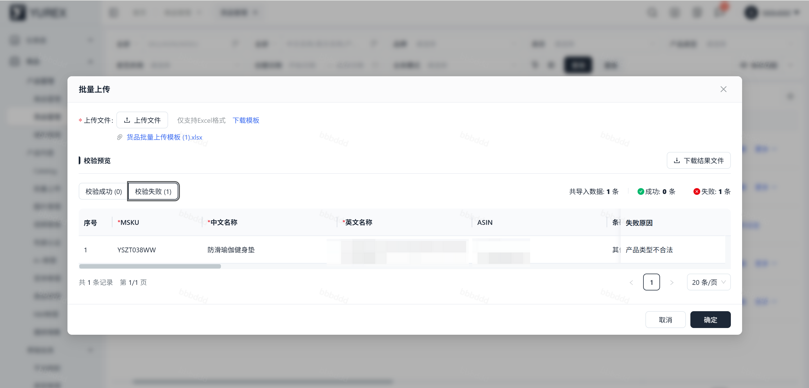

 1. Excel内容校验成功后，点击【确定】按钮，货品创建成功，产品状态更新为 “草稿”

 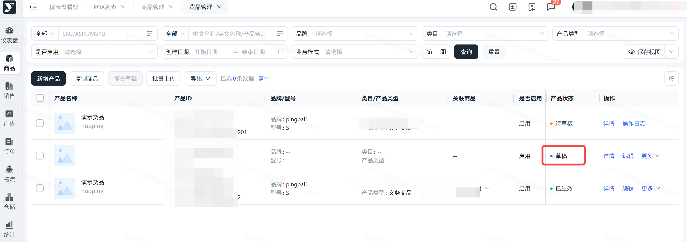

#### 复制

1. 功能描述：货品产品状态为 “已生效” 时，可**复制该货品信息**，快速创建货品
2. 操作步骤：

 1. 选择被复制的产品信息，鼠标悬浮在【更多】上，点击【复制】按钮

 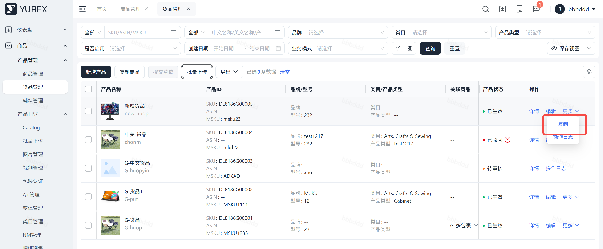

 1. 进入新增货品页面，修改相关信息后，点击【提交】按钮

 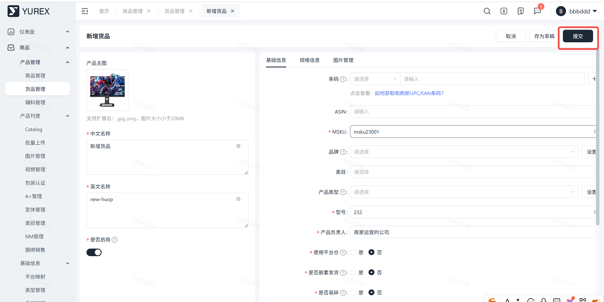

 1. 提交成功，产品状态更新为 “待审核”

 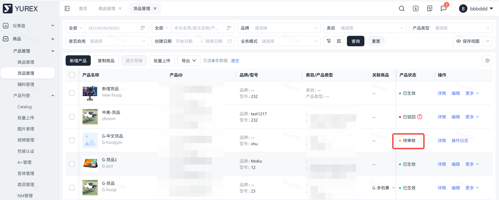

#### 复制商品

1. 功能描述：**复制商品信息**快速创建货品
2. 操作步骤：说明：此页面带出的产品信息数据源为 商品管理的商品数据

 1. 点击【复制商品】按钮，弹窗进入选择商品页面，选择被复制的商品信息，点击【确定】按钮

 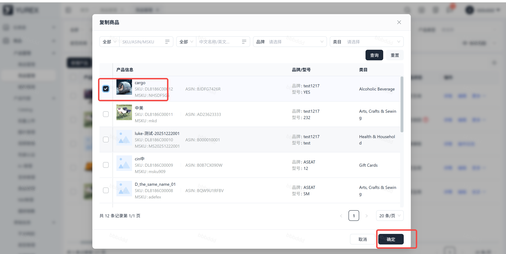

 1. 进入新增货品页面，修改相关信息后，点击【提交】按钮

 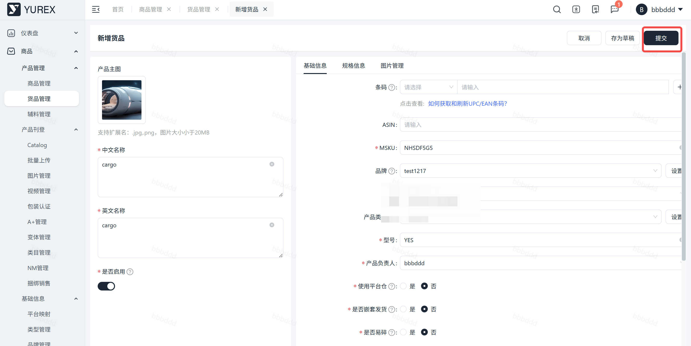

 1. 提交成功，货品产品状态更新为 “待审核”

 

### 提交草稿

1. 功能描述：货品产品状态为 “草稿” 时，可批量提交草稿
2. 操作步骤：

 1. 批量选中需提交的产品信息，点击【提交草稿】按钮，二次弹窗点击【确定】

 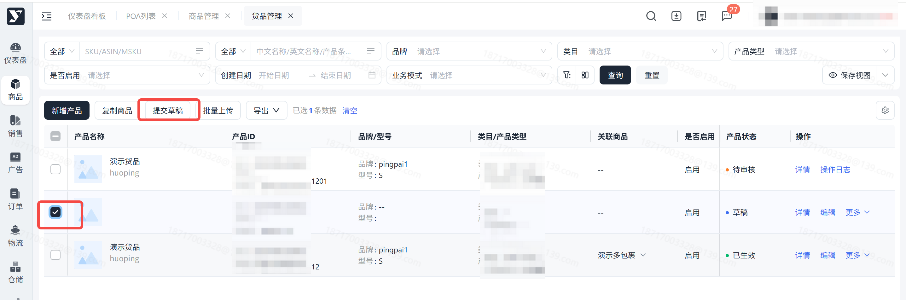

 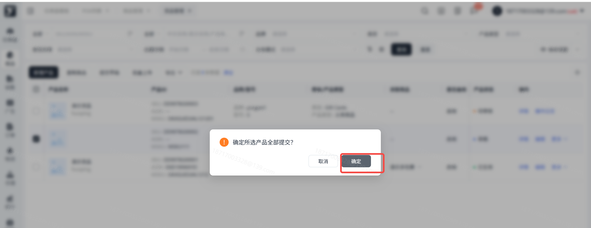

 1. 提交成功，产品状态更新为 “待审核”

 

### 编辑

1. 功能描述：产品状态为 “草稿、已生效、已驳回” 时，可编辑货品产品信息说明：使用平台仓的产品状态为 “已生效” 时，需等待平台仓返回审核结果，才可编辑

 - 产品状态为 “草稿、已驳回” 时，所有字段均可编辑；编辑后提交，产品状态为 “待审核”
 - 产品状态为 “已生效” 时，仅可编辑部分字段，置灰字段不可修改；编辑后提交，产品状态不变
2. 操作步骤：

 1. 选择需编辑的产品信息，点击【编辑】按钮

 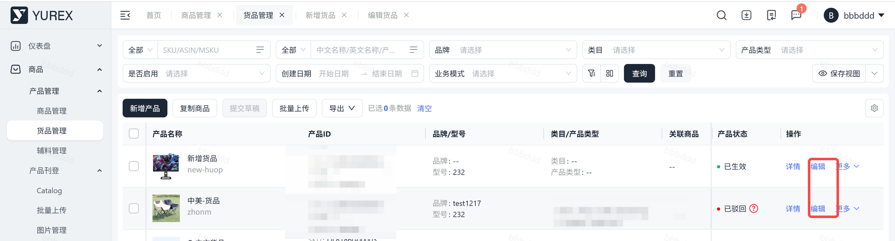

 1. 进入编辑产品页面，修改完毕相关信息后，点击【提交】按钮，页面字段相应更新

 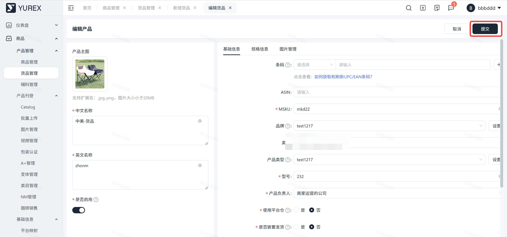

### 删除

1. 功能描述：产品状态为 “草稿” 时，可删除货品产品信息
2. 操作步骤：

 1. 选中需要删除的产品信息，鼠标悬浮在【更多】上，点击【删除】按钮

 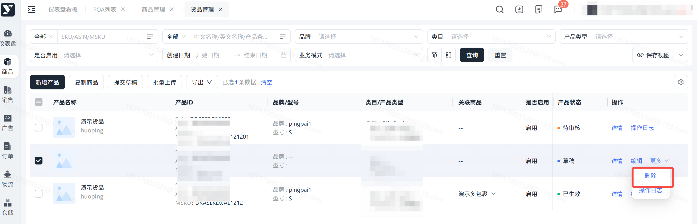

 1. 二次弹窗点击【确定】，删除成功，产品信息从页面上移除

 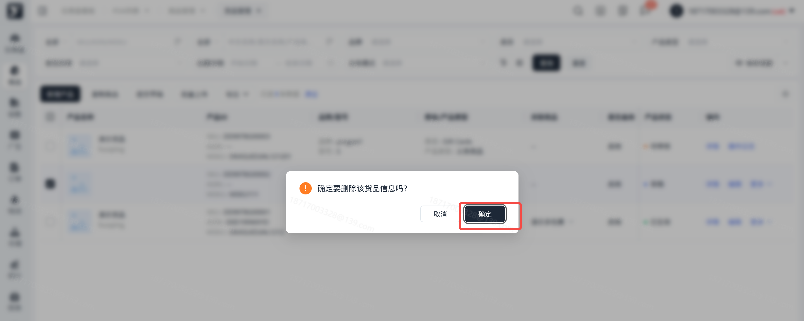

### 导出

1. 功能描述：导出货品列表信息、货品详情信息至Excel文档
2. 操作步骤：

 1. 批量勾选、按条件搜索后，点击【导出列表】按钮，将货品列表信息下载至Excel

 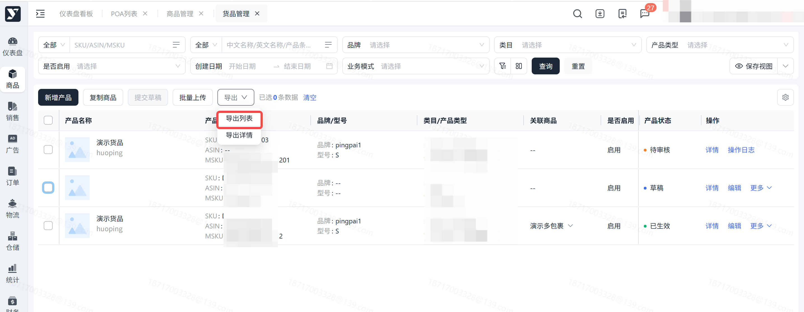

 1. 批量勾选、按条件搜索后，点击【导出详情】按钮，将货品详情信息下载至Excel

 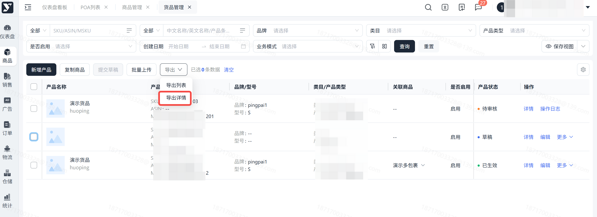

### 操作日志

1. 功能描述：查看货品产品信息的历史更新记录
2. 操作步骤：

 1. 鼠标悬浮在【更多】上，点击【操作日志】按钮，弹窗显示历史更新记录

 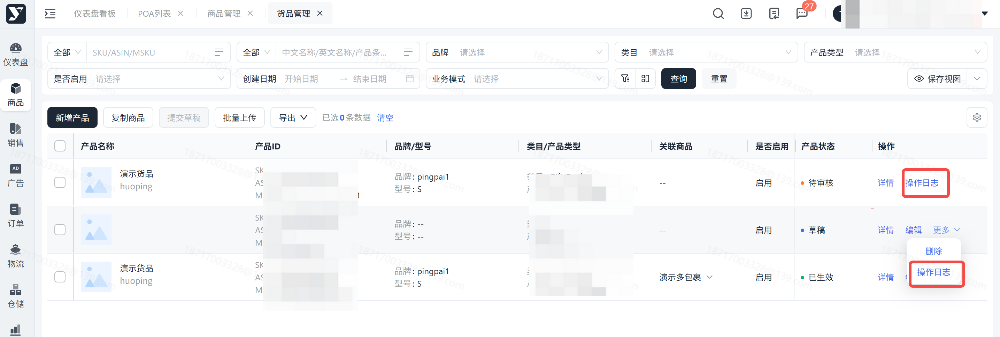

 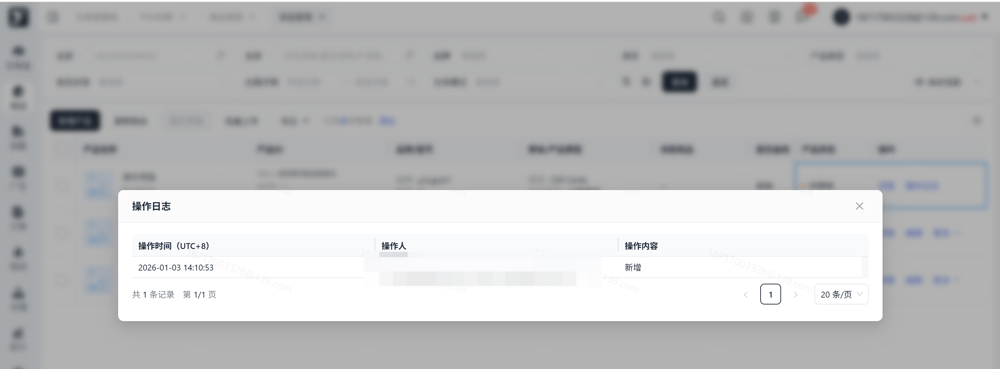

## 常见问题

### 为什么提交后不能继续编辑？

若您刚提交数据，状态为审核中，请不要着急，这时不能编辑，需等待我司审核后才能进行下一步操作，我司将尽快审核；
