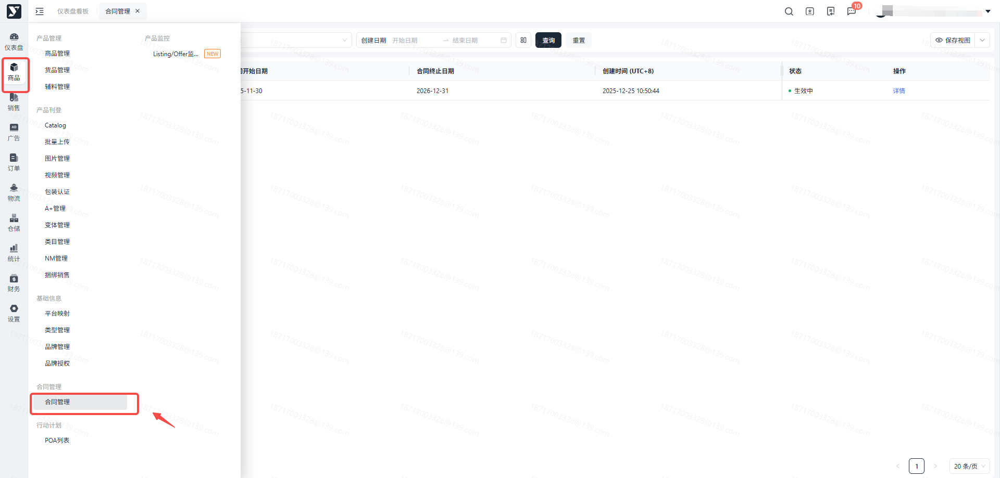
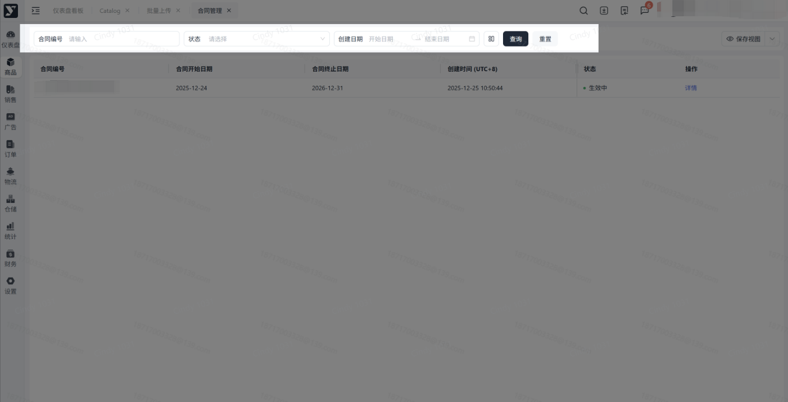
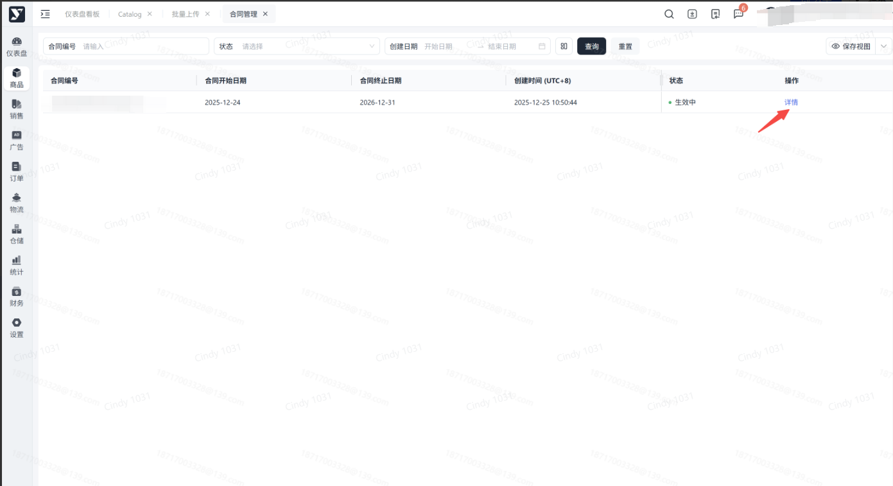
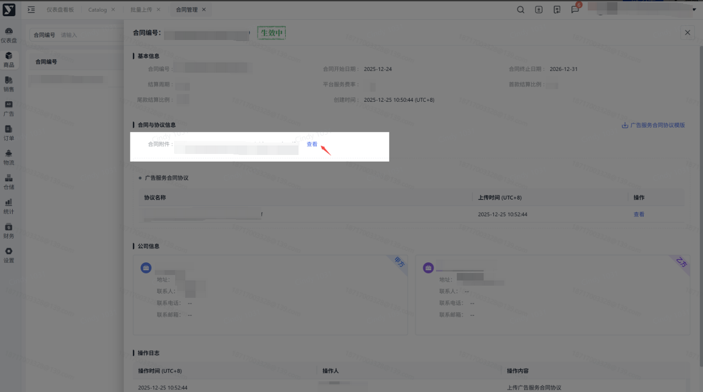
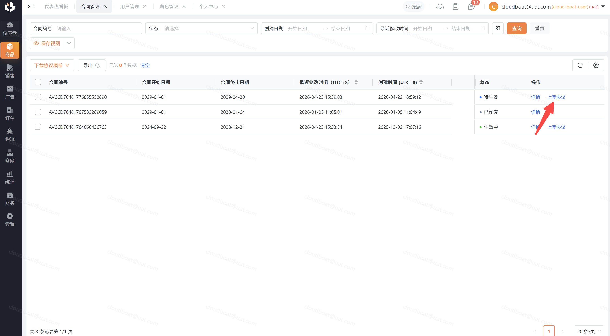
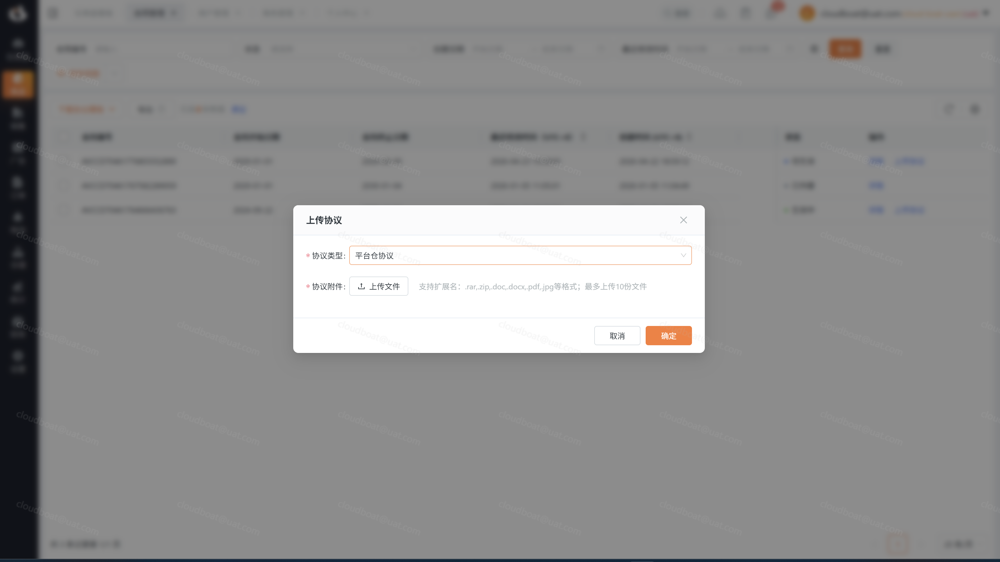

# 飞书文档：合同管理

## 文档信息

| 项 | 内容 |
| --- | --- |
| 远程文档 | https://q1njej8cpab.feishu.cn/wiki/Hrs3wC2ECi00GEk6s3acRNfindd |
| 图片处理 | 本地下载（assets/images） |
| 快照时间 | 2026-08-06 |
| 来源命令 | `lark-cli docs +fetch --api-version v2 --doc https://q1njej8cpab.feishu.cn/wiki/Hrs3wC2ECi00GEk6s3acRNfindd --doc-format markdown --as user --format json --jq .data.document.content` |
| 格式处理 | fd-doc-markdown-sync/scripts/normalize-feishu-doc-markdown.mjs |

---

合同管理

当前版本：v1.0.4

## 功能介绍

合同管理有以下2点核心功能：

（1）电子合同管理。支持将纸质合同转化为电子合同，方便客户查阅和管理；

（2）合同状态管理。通过设定合同状态，提醒客户合同时间节点和到期情况；

## 注意事项

### 上传合同流程

1. 步骤1：线下与客户达成合作协议，签署纸质合同；
2. 步骤2：邀请客户入驻平台；
3. 步骤3：由运营在系统录入合同扫描件；
4. 步骤4：客户在系统查看合同详情；

## 操作流程

##

#### 操作路径

【**商品】-【合同管理】**

#### 搜索区【查询】指定合同

> 通过“合同编号”、“状态”，查询对应的合同信息；

#### 列表区可查看已上传的合同数据

#### 点击【查看】跳转至合同详情页

#### 进入合同详情页

> 包含基本信息、合同与协议信息、公司信息、操作日志

#### 点击【查看合同】下载该合同文件

#### 上传协议

1. 部份协议支持下载，可通过【下载协议模板】进行操作；
2. 【待生效、已生效】状态下合同，支持上传合同协议，需选择【协议类型】，请根据合同协议附件，选择正确的协议类型；

## 常见问题

#### 4.1

**答：**有的。合同过期前30天，列表上方会有横幅展示合同编码，点击编码跳转至合同详情页查看内容。

#### 4.2

**答：**UTC+8是指国际时间八小时，东八区时间，北京时间。

#### 4.3

**答：**可能由于运营上传合同时填写的基本信息有误，导致再次上传合同，而原始合同没有被覆盖，所以出现了列表中2条数据是1份合同的情况。

##

答：若您上传的协议附件不正确，平台暂不支持删除合同，请联系平台运营经理协助删除。
