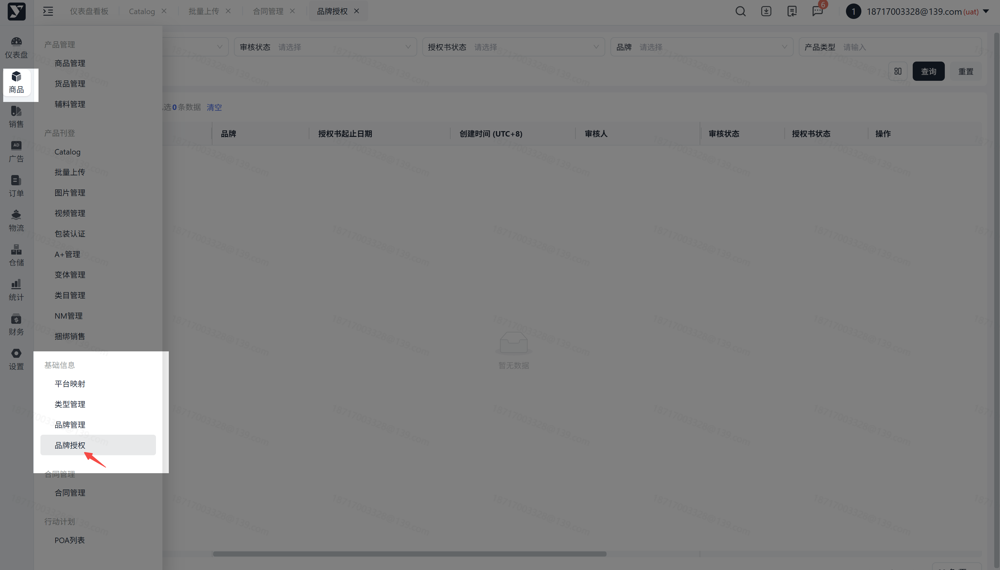
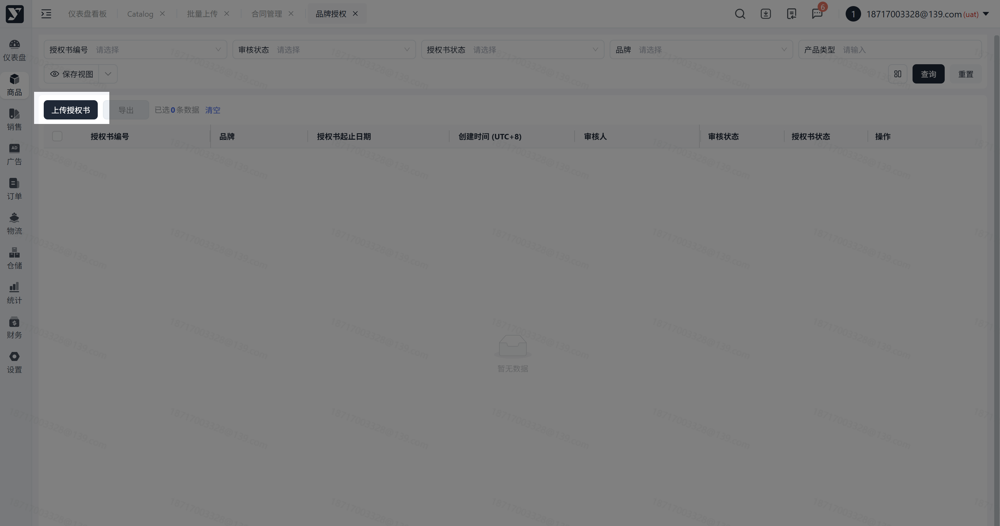
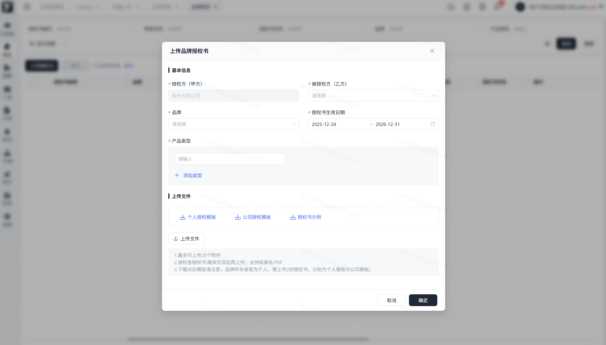
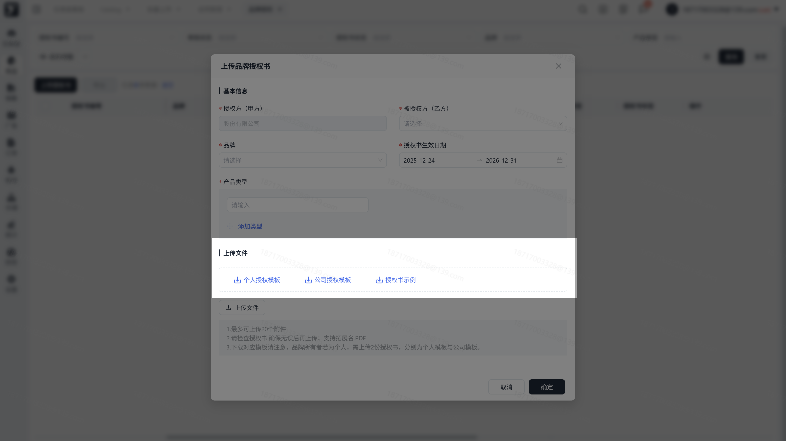
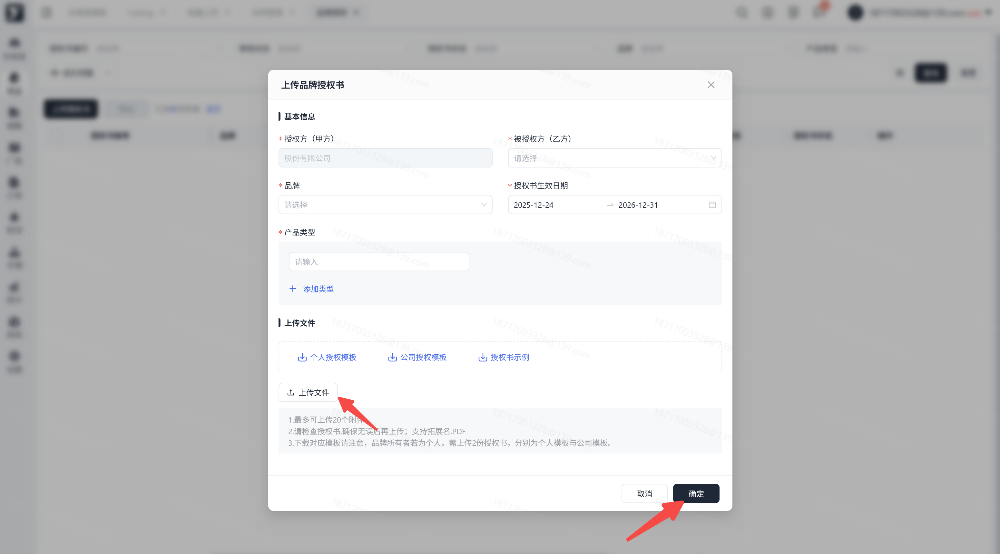
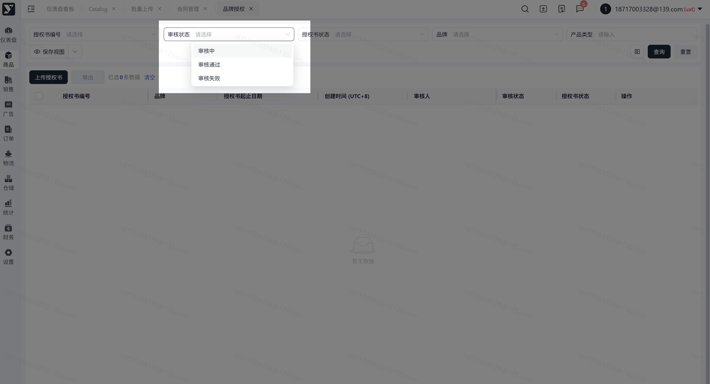
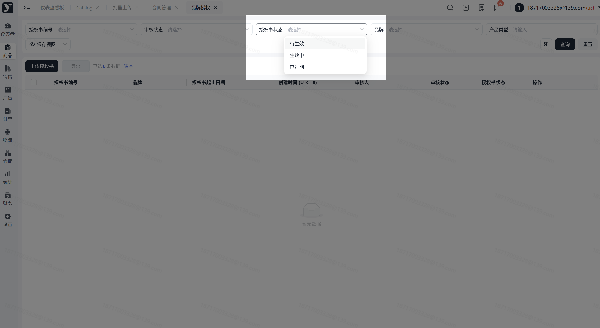

# 飞书文档：品牌授权

## 功能介绍

1. 品牌授权是指品牌所有者将其品牌授权给其他用户或公司，允许其在亚马逊平台上销售该品牌的产品；

> 注：品牌所有者公司可能不为与我司直接签订合作协议的公司主体，可能品牌所有者公司主体为贵公司主体的子公司或关联公司。

1. 品牌方授意一份合法经营品牌的文书（简称“授权书”）；
2. 即我们购买客户的商品，客户给我们供货，货权属于客户。我们作为经销商，帮客户发货至海外仓之前，需要让客户上传授权书，证明我们是合规运营；

## 注意事项

1. 上传授权书时请注意：

 1. 上传授权书时，“授权方（甲方）”字段目前系统限制了填写选项，显示为贵公司主体名称，这一主体可能与您的品牌所有权公司主体不一致。

 > 例如：系统中贵公司名字为A，品牌的所有者公司为B且B是A的关联公司，则系统中显示为A授权给我司，实际品牌授权书文件中显示为B作为品牌拥有者授权给我司，B可能通过其他条款向A公司进行了品牌授权）。
 2. 上传授权书时，“被授权方（乙方）”，若您不确定选择对应的信息，可联系产品负责人，我们将引导您；
 3. 请在表单中填写基本信息，包括“品牌”、“产品类型”、“授权书生效日期”；

 > 1. 若您想新增多个品牌的授权书，可分批次单独上传不同品牌的授权书；
 > 2. 授权书生效日期：请您注意应当与合同起止日期保持一致，您可参考【合同管理】合同开始-终止日期；
 4. 先下载“授权书模版”、“授权书示例”，根据示例，填写模版；
 5. 上传授权书时，请确保授权书内容无误后再上传；仅支持扩展名：PDF；
 6. 基本信息必须与授权书中的信息保持一致；
2. 当您上传授权书后，我们将进行审核，检查您的授权书内容是否正确。若收到“审核通过”，意味着授权书审核通过；若收到“审核失败”的提示，请根据提示内容重新修改后再次上传；
3. 当前仅针对审核通过的授权书能够上传补充协议，补充协议不限制格式；
4. 考虑到兼容性，请使用谷歌浏览器。

## 操作步骤

### 操作路径

【商品】-【基础信息】-【品牌授权】

### 点击页面左上角【上传授权书】

> 进入上传授权书页面

### 填写【基本信息】

> 1. 基本信息的内容需与授权书内容保持一致
> 2. 被授权方为下拉选择框，请选择对应的被授权方
> 3. 产品类型最多可增加20个，每个产品类型需对应一份授权书

### 点击下载【授权书模版】、【授权书示例】

### 上传文件

> 1. 点击可进行文件的上传；
> 2. 最多可上传20份授权书模板附件；
> 3. 上传成功后点击【确定】提交审核；

### 关注审批状态

提交成功后，请您关注审批状态，我们将及时为您审核；

1. 审核中：表示我们正在处理您的授权申请；
2. 审核失败：表示您上传的文件有误，请您根据实际业务下载正确的模板进行上传；
3. 审核通过：表示您的授权申请，已通过审核，请您关注授权书的状态，若授权书为已过期的状态，请您重新提交申请；

### 检查授权书状态

审核通过后，请您关注授权书的状态，若状态有误，请及时提交新的申请；

1. 待生效：表示您的授权申请已通过，但授权书开始时间还没到，当前未待生效的状态；
2. 生效中：表示您的授权申请已通过，且当前授权书起止日期正在进行中，将显示为生效中的状态；
3. 已过期：表示您的授权已通过，但授权书起止日期的最后一天已过当前时间，将显示为该状态；

### 处理即将到期的授权书

横幅提示即将逾期的授权书编号（提前30天提示），点击授权书编号，进入对应详情页

### 站内消息通知

授权书逾期前30天，会收到即将逾期的站内消息通知；

授权书逾期的当天，会收到已过期的站内消息通知；

## 常见问题

**答：**只要提交成功，列表内都会生成一条新的数据，不存在覆盖现象。因此，即便您再次提交相同的文件内容也不会覆盖原数据。
