# 飞书文档：品牌管理

## 文档信息

| 项 | 内容 |
| --- | --- |
| 远程文档 | https://q1njej8cpab.feishu.cn/wiki/SzWywBgBciU58AktXOpcYvbEnec |
| 图片处理 | 本地下载（assets/images） |
| 快照时间 | 2026-08-06 |
| 来源命令 | `lark-cli docs +fetch --api-version v2 --doc https://q1njej8cpab.feishu.cn/wiki/SzWywBgBciU58AktXOpcYvbEnec --doc-format markdown --as user --format json --jq .data.document.content` |
| 格式处理 | fd-doc-markdown-sync/scripts/normalize-feishu-doc-markdown.mjs |

---

品牌管理

## 功能介绍

品牌管理：该模块主要是维护产品基础数据的品牌信息，请您认真完成品牌相关的所有信息补充，合规的品牌信息有助于我们协助您更好的推广产品，避免产品后续上架后被亚马逊抑制等。

## 注意事项

1. 新增品牌时，请按品牌官方命名填写，如：Apple、H&M；
2. 品牌创建分为基础信息与商标信息，可分别进行新增；基础信息无需审核，商标信息需审核，请提交后耐心等待，我们将在12小时左右完成审核；
3. 品牌新增成功后，后续产品上架亚马逊，默认为该品牌，请注意切勿维护成了错误的品牌信息。

## 操作流程

##

#### 操作路径：【商务】-【品牌管理】-【品牌管理】

> 1. 品牌状态：表示您当前品牌的状态，启用状态下新增商品支持选择该品牌；禁用状态下，新增商品时无法选择对应品牌；
> 2. 审核状态：当您完成“商标信息”补充之后，提交的商标信息将由运营经理审核，审核失败旁“？”将展示失败原因；

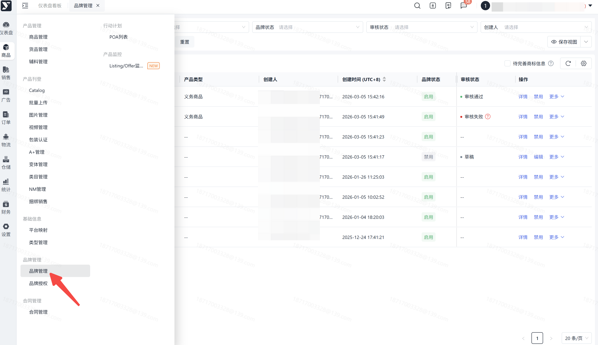

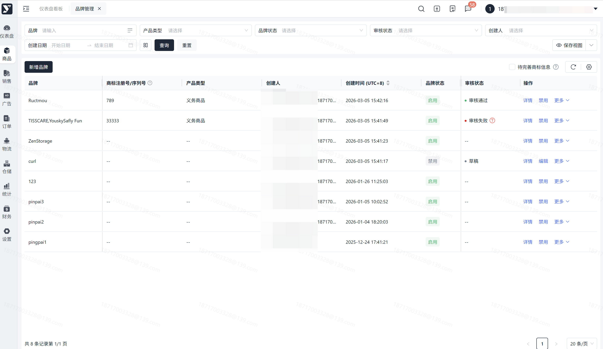

##

#### 操作路径1【商务】-【品牌管理】-【品牌管理】-【新增品牌】

> 1. 支持“存为草稿”，草稿状态下，仅需填写【品牌名称】
> 2. “？”为提示，您可以查看具体定义；
> 3. 新增支持仅需填写【基础信息】，基础信息维护成功后，无需运营经理审核，新增商品均可选择对应品牌；
> 4. 【商标信息】若填写提交，将由运营经理进行审核，商标信息与品牌名称支持多次修改，请您注意，修改均需运营经理审核；
> 5. 【商标信息】默认折叠，点击展开；
> 6. 新增时会校验“品牌相似度”，请你注意报错提示；
> 7. 上传的附件信息，支持在线预览与下载，为您提供快捷操作；

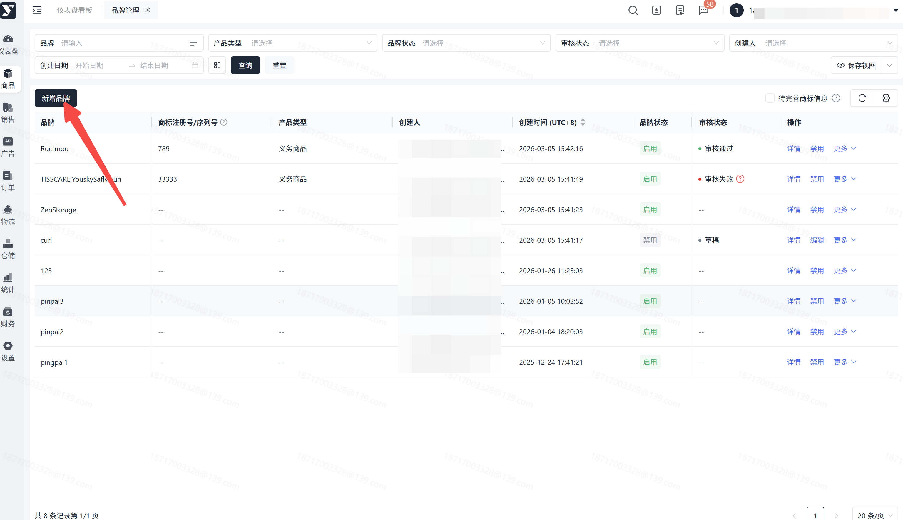

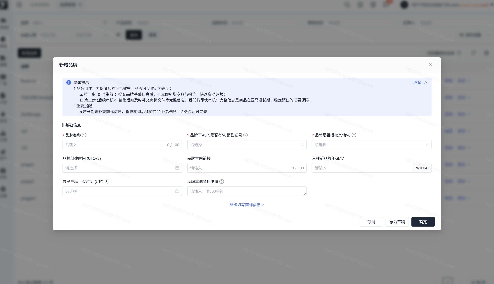

![图片展示的是新增品牌操作界面。界面上方有品牌管理相关提示，下方分为“基础信息”和“商标信息”两部分。基础信息部分包括品牌名称、品牌简称、品牌官网、品牌宣传语、品牌宣传语（英文）、品牌宣传语（英文）（翻译）、品牌宣传语（英文）（翻译）（翻译）、品牌宣传语（英文）（翻译）（翻译）、品牌宣传语（英文）（翻译）（翻译）、品牌宣传语（英文）（翻译）（翻译）、品牌宣传语（英文）（翻译）（翻译）、品牌宣传语（英文）（翻译）（翻译）、品牌宣传语（英文）（翻译）（翻译）、品牌宣传语（英文）（翻译）（翻译）、品牌宣传语（英文）（翻译）（翻译）、品牌宣传语（英文）（翻译）（翻译）、品牌宣传语（英文）（翻译）（翻译）、品牌宣传语（英文）（翻译）（翻译）、品牌宣传语（英文）（翻译）（翻译）、品牌宣传语（英文）（翻译）（翻译）、品牌宣传语（英文）（翻译）（翻译）、品牌宣传语（英文）（翻译）（翻译）、品牌宣传语（英文）（翻译）（翻译）、品牌宣传语（英文）（翻译）（翻译）、品牌宣传语（英文）（翻译）（翻译）、品牌宣传语（英文）（翻译）（翻译）、品牌宣传语（英文）（翻译）（翻译）、品牌宣传语（英文）（翻译）（翻译）、品牌宣传语（英文）（翻译）（翻译）、品牌宣传语（英文）（翻译）（翻译）、品牌宣传语（英文）（翻译）（翻译）、品牌宣传语（英文）（翻译）（翻译）、品牌宣传语（英文）（翻译）（翻译）、品牌宣传语（英文）（翻译）（翻译）、品牌宣传语（英文）（翻译）（翻译）、品牌宣传语（英文）（翻译）（翻译）、品牌宣传语（英文）（翻译）（翻译）、品牌宣传语（英文）（翻译）（翻译）、品牌宣传语（英文）（翻译）（翻译）、品牌宣传语（英文）（翻译）（翻译）、品牌宣传语（英文）（翻译）（翻译）、品牌宣传语（英文）（翻译）（翻译）、品牌宣传语（英文）（翻译）（翻译）、品牌宣传语（英文](./assets/images/图片展示的是新增品牌操作界面-4efb16c5c2a7.png)

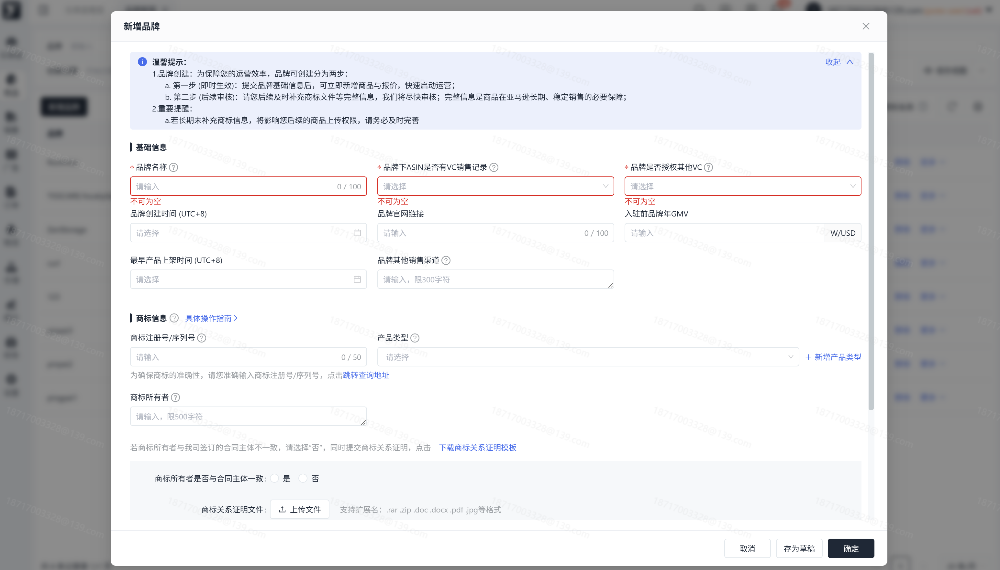

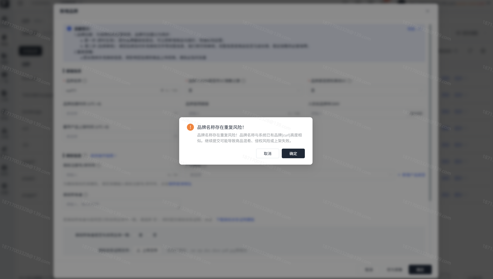

#### 操作路径2【商务】-【商品中心】-【商品列表】-【新增产品】

> 1. 新增商品时，快捷添加品牌信息，仅需填写【品牌基础信息】；
> 2. 新增成功后，商品页面支持选择该品牌；

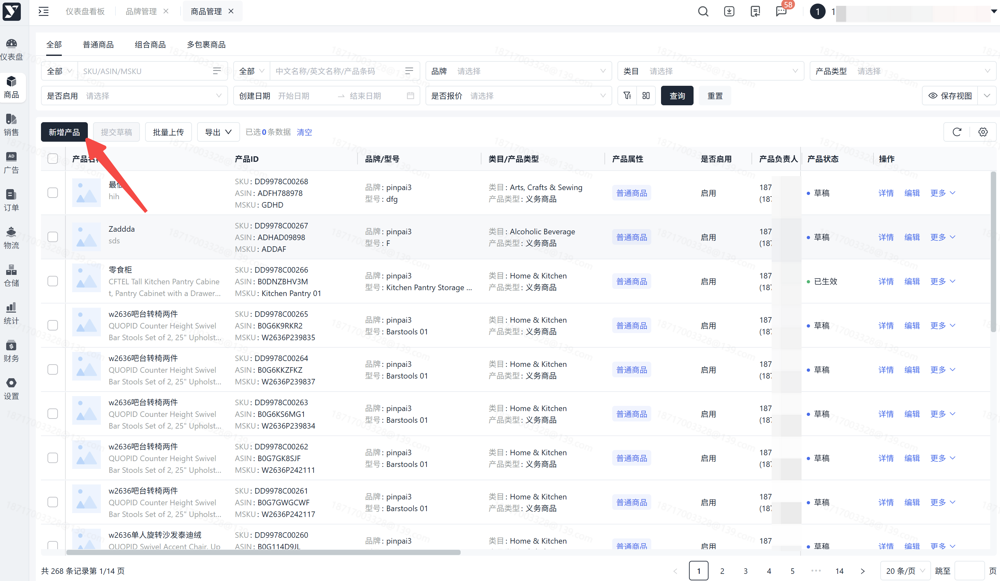

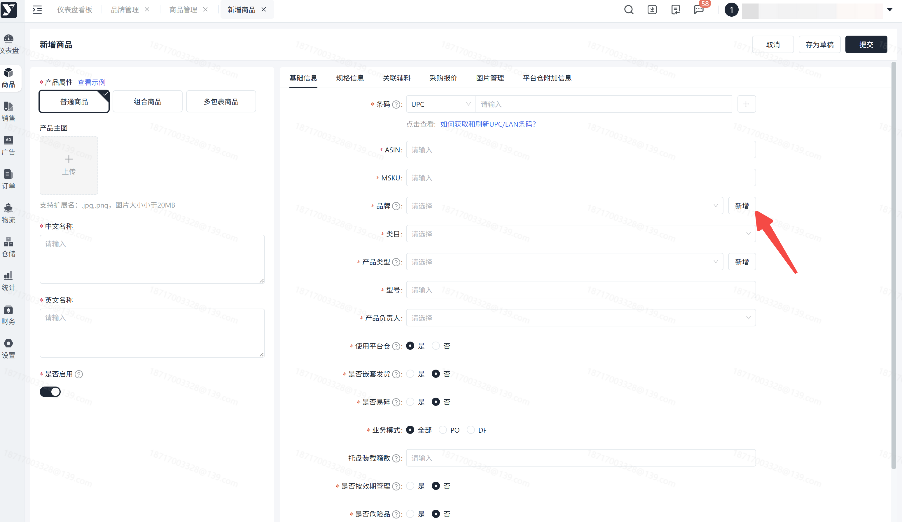

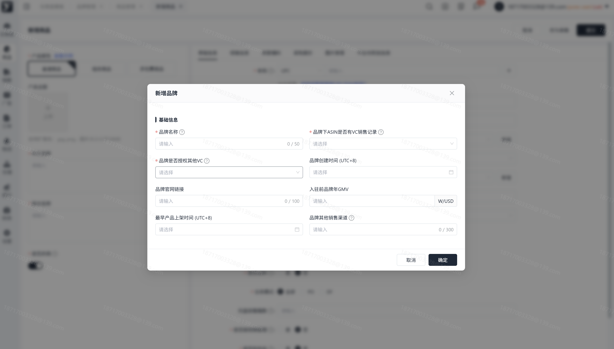

##

#### 操作路径【商务】-【品牌管理】-【品牌管理】-【操作】-【更多】-【编辑】

> 1. 编辑品牌，支持编辑所有信息，但请您注意，针对审核通过的品牌，编辑【品牌名称与商标信息】将重新审核；
> 2. 审核中状态下暂不支持编辑品牌，支持启用与禁用；
> 3. 上传的附件信息，支持在线预览与下载，为您提供快捷操作；

![图片展示的是“编辑品牌”界面。界面上方有“编辑品牌”标题及“取消”“确定”按钮。界面分为“基本信息”“其他信息”“具体指引”等板块，包含品牌名称、品牌官网链接、品牌官网链接是否为PC端、品牌官网链接是否为移动端、品牌官网链接是否为PC端、品牌官网链接是否为移动端、品牌官网链接是否为PC端、品牌官网链接是否为移动端、品牌官网链接是否为PC端、品牌官网链接是否为移动端、品牌官网链接是否为PC端、品牌官网链接是否为移动端、品牌官网链接是否为PC端、品牌官网链接是否为移动端、品牌官网链接是否为PC端、品牌官网链接是否为移动端、品牌官网链接是否为PC端、品牌官网链接是否为移动端、品牌官网链接是否为PC端、品牌官网链接是否为移动端、品牌官网链接是否为PC端、品牌官网链接是否为移动端、品牌官网链接是否为PC端、品牌官网链接是否为移动端、品牌官网链接是否为PC端、品牌官网链接是否为移动端、品牌官网链接是否为PC端、品牌官网链接是否为移动端、品牌官网链接是否为PC端、品牌官网链接是否为移动端、品牌官网链接是否为PC端、品牌官网链接是否为移动端、品牌官网链接是否为PC端、品牌官网链接是否为移动端、品牌官网链接是否为PC端、品牌官网链接是否为移动端、品牌官网链接是否为PC端、品牌官网链接是否为移动端、品牌官网链接是否为PC端、品牌官网链接是否为移动端、品牌官网链接是否为PC端、品牌官网链接是否为移动端、品牌官网链接是否为PC端、品牌官网链接是否为移动端、品牌官网链接是否为PC端、品牌官网链接是否为移动端、品牌官网链接是否为PC端、品牌官网链接是否为移动端、品牌官网链接是否为PC端、品牌官网链接是否为移动端、品牌官网链接是否为PC端、品牌官网链接是否为移动端、品牌官网链接是否为PC端、品牌官网链接是否为移动端、品牌官网链接是否为PC端、品牌官网链接是否为移动端、品牌官网链接是否为PC端、品牌官网链接是否为移动端、品牌官网链接是否为PC端、品牌官网链接是否为移动端、品牌官网链接是否为PC端、品牌官网链接是否为移动端、品牌官网链接是否为PC端、品牌官网链接](./assets/images/图片展示的是“编辑品牌”界面-44f16b47b7fa.png)

##

#### 操作路径【商务】-【品牌管理】-【品牌管理】-【操作】-【启用/禁用】

> 1. 可禁用/启用品牌，禁用后不影响已开展的业务，但禁用后该品牌，不能被新添加产品关联；
> 2. 草稿状态默认禁用，同时不支持启用；

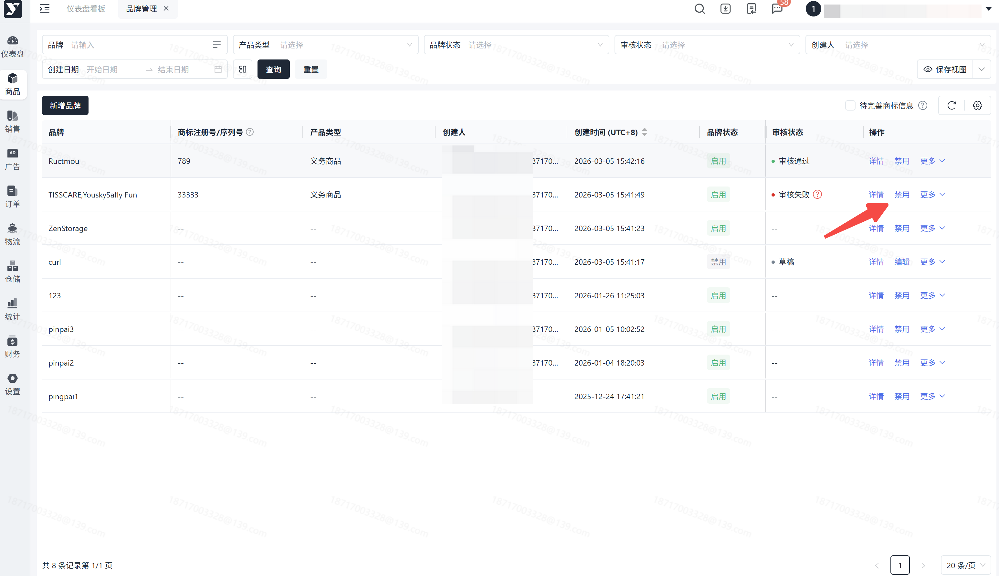

##

#### 操作路径【商务】-【品牌管理】-【品牌管理】-【操作】-【更多】-【删除】

> 1. 仅草稿状态下支持删除；

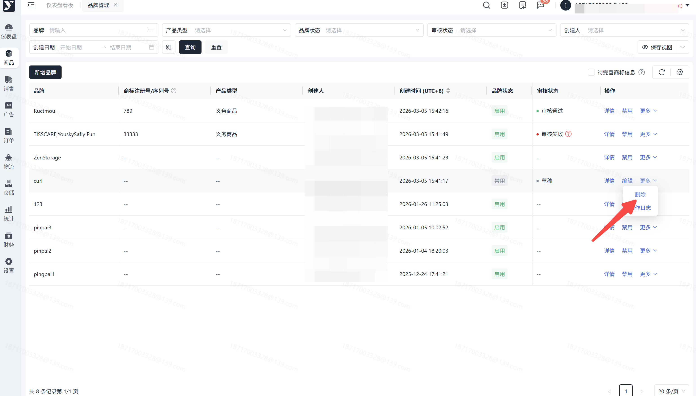

##

#### 操作路径【商务】-【品牌管理】-【品牌管理】-【操作】-【更多】-【重新提交】

> 1. 仅审核失败支持重新提交；

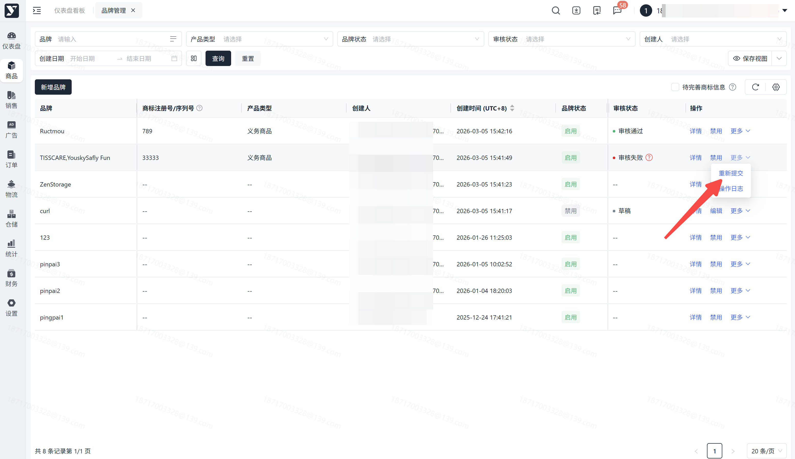

##

#### 操作路径【商务】-【品牌管理】-【品牌管理】-【操作】-【详情】

> 1. 支持在线预览与下载对应附件

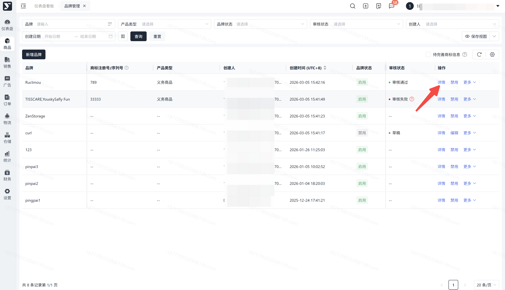

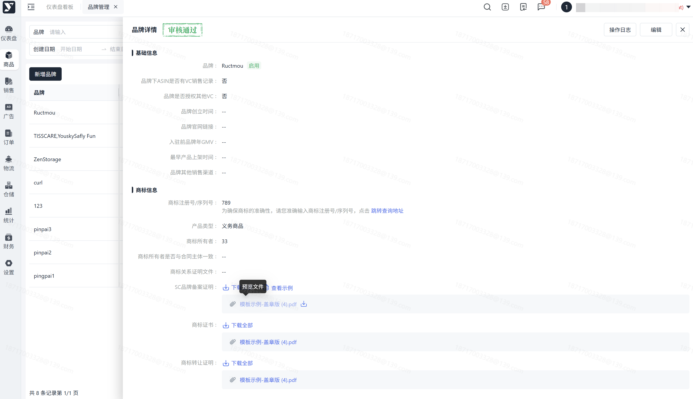

## 常见问题

###

若您已创建该品牌信息，不允许重复创建。

###

相似度较高仍可以新增成功，我们是给到您相似度建议，但请您注意，品牌名称未错误，一旦错误将影响后续产品上架。
