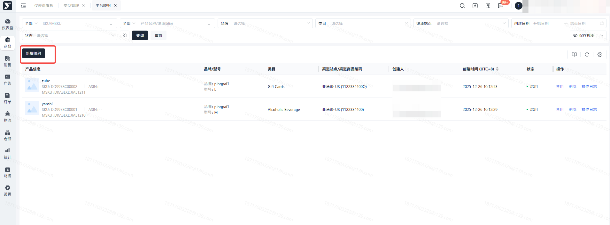
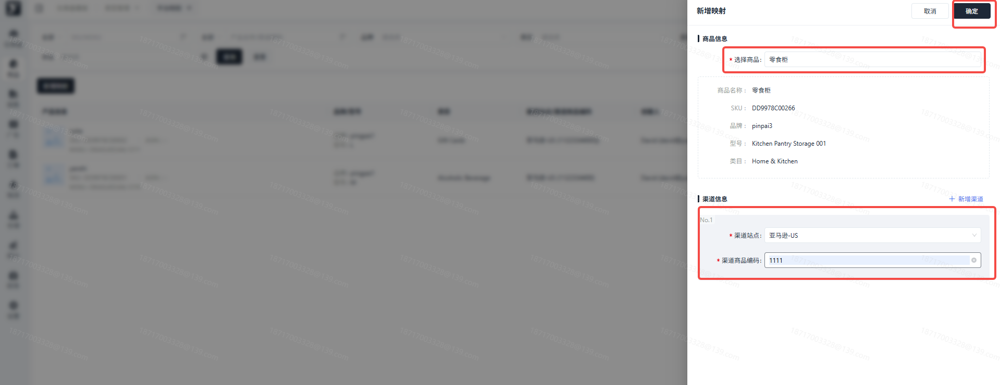
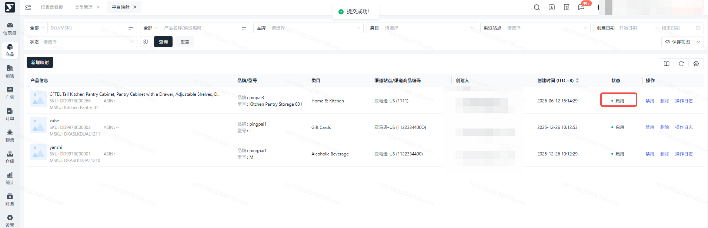
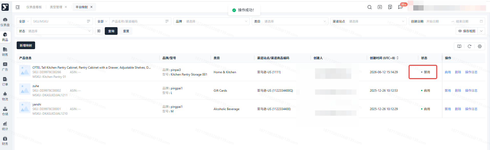
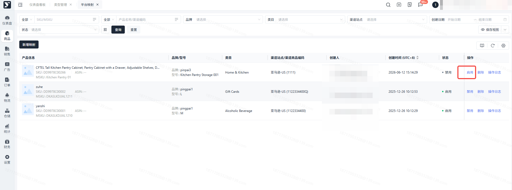
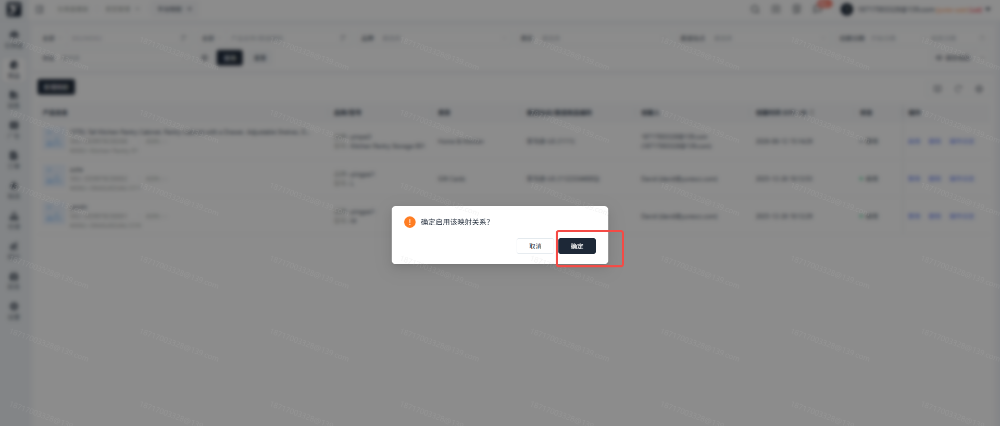
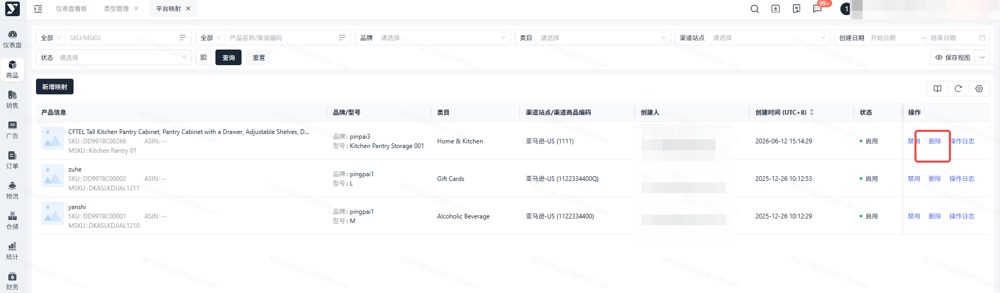
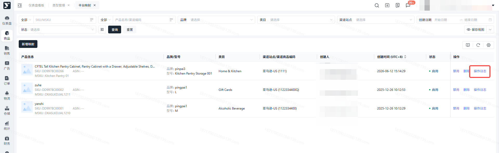
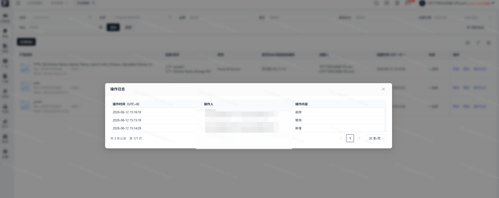

# 飞书文档：平台映射

## 文档信息

| 项 | 内容 |
| --- | --- |
| 远程文档 | https://q1njej8cpab.feishu.cn/wiki/VaDbwDP6Bi6yU1kMJNect3kWnjf |
| 图片处理 | 本地下载（assets/images） |
| 快照时间 | 2026-08-06 |
| 来源命令 | `lark-cli docs +fetch --api-version v2 --doc https://q1njej8cpab.feishu.cn/wiki/VaDbwDP6Bi6yU1kMJNect3kWnjf --doc-format markdown --as user --format json --jq .data.document.content` |
| 格式处理 | fd-doc-markdown-sync/scripts/normalize-feishu-doc-markdown.mjs |

---

平台映射

## 功能介绍

平台映射：该模块主要是维护产品基础数据与其他渠道站点的数据关系映射、便于开展其他渠道业务；

## 页面路径

【商品】-【基础信息】-【平台映射】

## 注意事项

1. 新增平台映射时，请如实填写渠道商品编码

## 操作指南

### 查看平台映射列表

1. 功能描述：新增、禁用、启用平台映射

### 新增映射

1. 功能描述：手工新增平台映射数据
2. 操作步骤：

 1. 点击【新增映射】按钮

 

 1. 进入新增页面，选择【商品名称、渠道站点】，输入【渠道商品编码】，点击【确定】按钮

 

 1. 提交成功，新增的平台映射数据状态默认为 “启用”

 

### 禁用

1. 功能描述：禁用 “启用” 状态的平台映射数据
2. 操作步骤：说明：禁用后不影响已使用该数据改映射的单据，但该映射数据将不能被新单据关联

 1. 选中需禁用的映射数据，点击【禁用】按钮，二次弹窗点击【确定】，状态更新为【禁用】

 

 

 

### 启用

1. 功能描述：启用 “禁用” 状态的平台映射数据
2. 操作步骤：

 1. 选中需启用的映射数据，点击【启用】按钮，二次弹窗点击【确定】，状态更新为【启用】

 

 

 

### 删除

1. 功能描述：删除平台映射数据说明：映射数据若被单据关联，不可删除；若未被单据关联，可删除
2. 操作步骤：

 1. 点击【删除】按钮，二次弹窗点击【确定】
 2. 删除成功，映射数据从页面上移除

 

 

### 操作日志

1. 功能描述：查看平台映射数据的历史更新记录
2. 操作步骤：

 1. 点击【操作日志】按钮，弹窗显示历史更新记录

 

 

## 常见问题

### 渠道商品编码不能重复

若您已创建产品与渠道的映射关系，则再次创建其他产品与渠道的映射关系时，所录入的渠道商品编码，不能重复，如重复（则不能关联正常产品，影响业务）；
