# 飞书文档：类型管理

## 文档信息

| 项 | 内容 |
| --- | --- |
| 远程文档 | https://q1njej8cpab.feishu.cn/wiki/NZK7wBUSiikNFSk3ygLcNT8vnJg |
| 图片处理 | 本地下载（assets/images） |
| 快照时间 | 2026-08-06 |
| 来源命令 | `lark-cli docs +fetch --api-version v2 --doc https://q1njej8cpab.feishu.cn/wiki/NZK7wBUSiikNFSk3ygLcNT8vnJg --doc-format markdown --as user --format json --jq .data.document.content` |
| 格式处理 | fd-doc-markdown-sync/scripts/normalize-feishu-doc-markdown.mjs |

---

类型管理

## 功能介绍

新增产品类型选项，用于新增商品数据时使用

## 页面路径

【商品】-【基础信息】-【类型管理】

## 注意事项

1. 新增产品类型时，请正确填写；

## 操作指南

### 查看类型列表

1. 功能描述：新增、编辑、禁用、启用产品类型

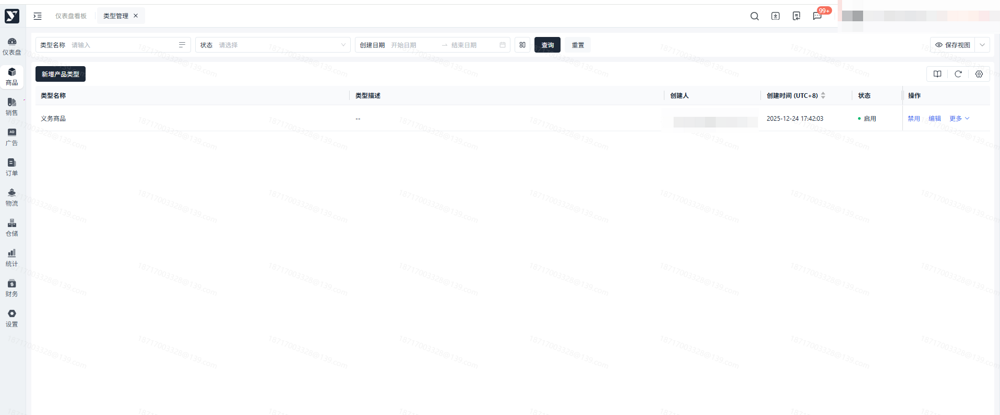

### 新增产品类型

1. 功能描述：手工新增产品类型
2. 操作步骤：

 1. 点击【新增产品类型】按钮

 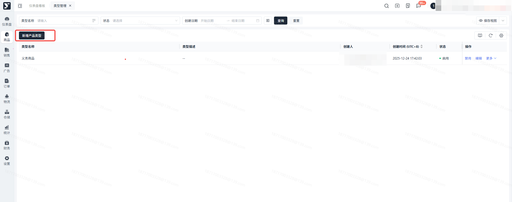

 1. 进入新增产品类型弹窗，输入【类型名称、描述】，点击【确定】按钮

 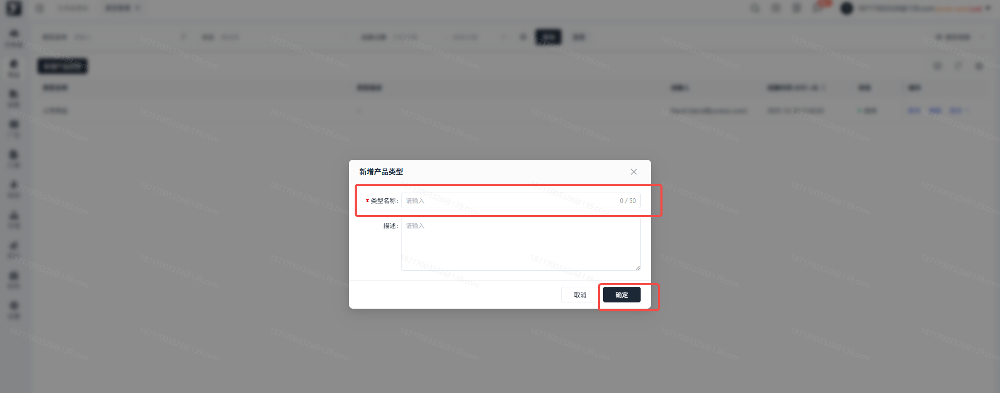

 1. 产品类型新增成功，状态默认为 “启用”

 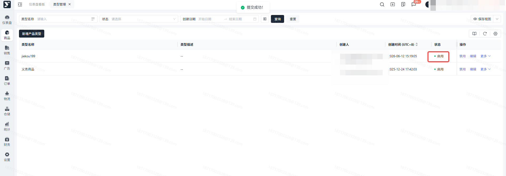

### 编辑

1. 功能描述：修改产品类型名称、描述；类型名称更新后，已使用该类型的产品，会同步更新
2. 操作步骤：

 1. 选中需要修改的产品类目，点击【编辑】按钮

 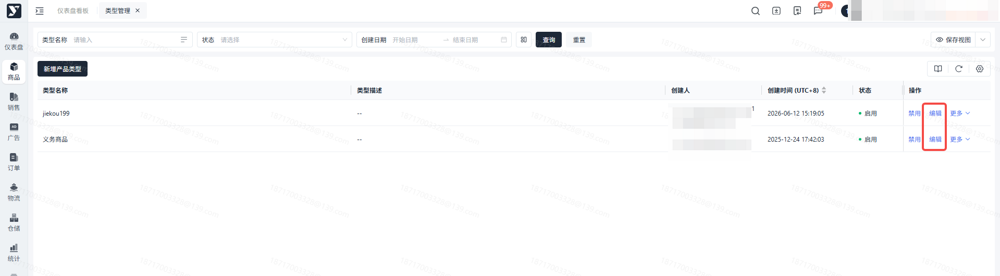

 1. 在弹窗中修改，修改完成，点击【确定】按钮，列表至同步更新

 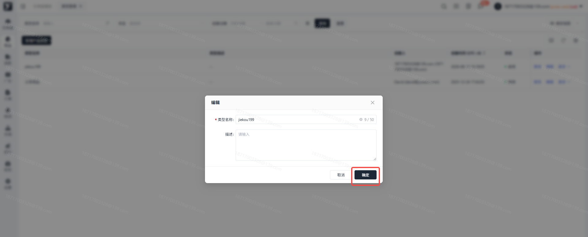

### 禁用

1. 功能描述：禁用 “启用” 状态的产品类型
2. 操作步骤：说明：禁用后不影响已使用该类型的产品数据，但该类型将不能被新产品关联

 1. 选中需禁用的产品类型，点击【禁用】按钮，二次弹窗点击【确定】，状态更新为【禁用】

 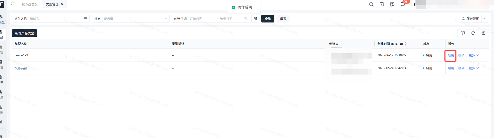

 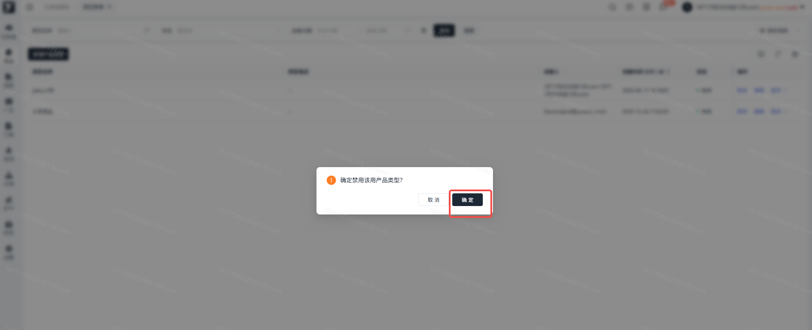

 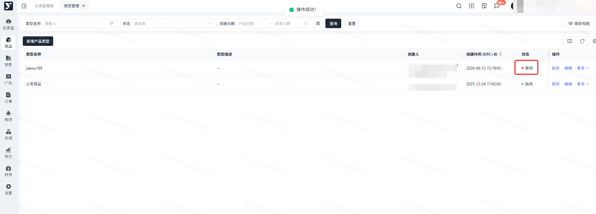

### 启用

1. 功能描述：启用 “禁用” 状态的产品类型
2. 操作步骤：

 1. 选中需启用的产品类型，点击【启用】按钮，二次弹窗点击【确定】，状态更新为【启用】

 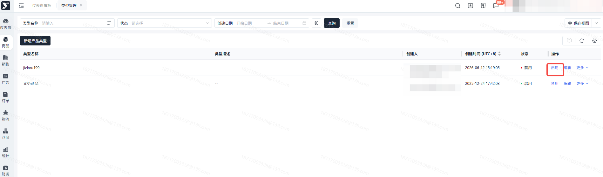

 

 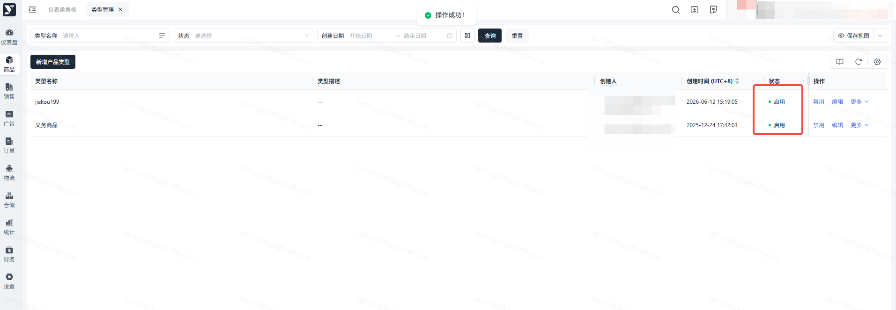

### 删除

1. 功能描述：删除产品类型说明：产品类型若被商品关联，不可删除；若未被商品关联，可删除
2. 操作步骤：

 1. 鼠标悬浮在【更多】上，点击【删除】按钮，二次弹窗点击【确定】
 2. 删除成功，产品类型从页面上移除

 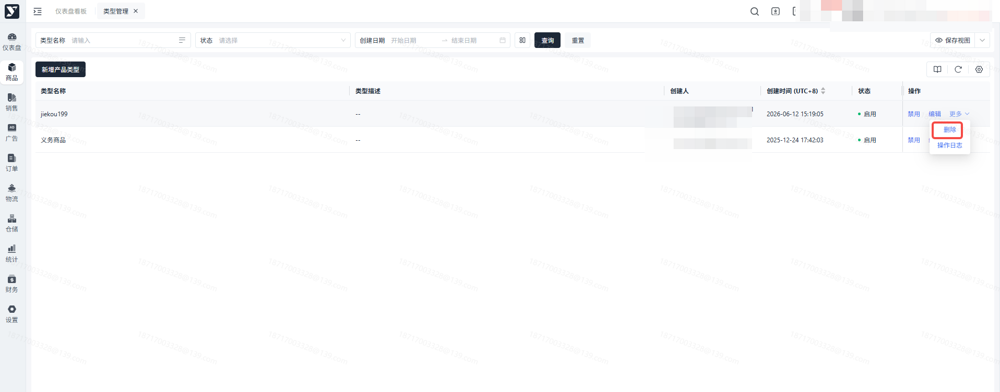

 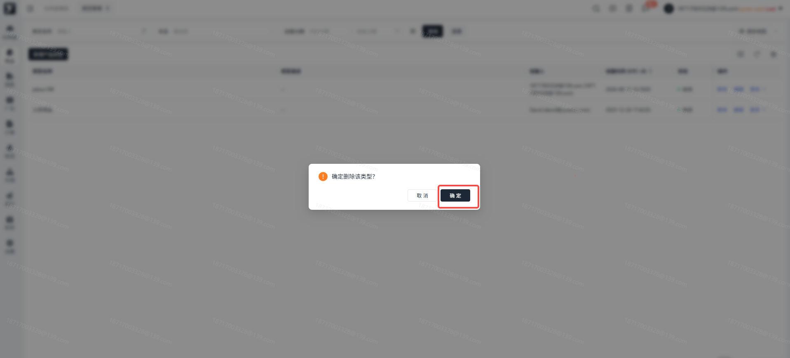

### 操作日志

1. 功能描述：查看产品类型的历史更新记录
2. 操作步骤：若您已创建该类型信息，不允许重复创建；

 1. 鼠标悬浮在【更多】上，点击【操作日志】按钮，弹窗显示历史更新记录

 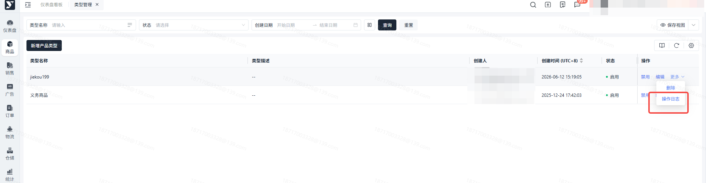

 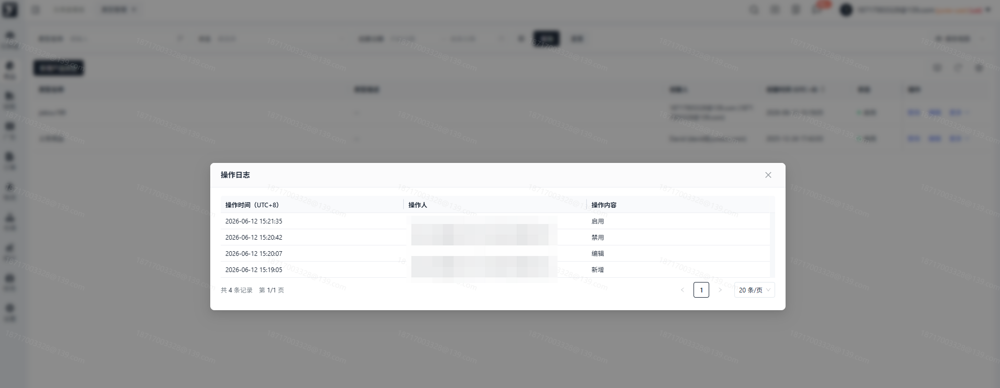

 # 常见问题

 ## 类型名称不能重复
