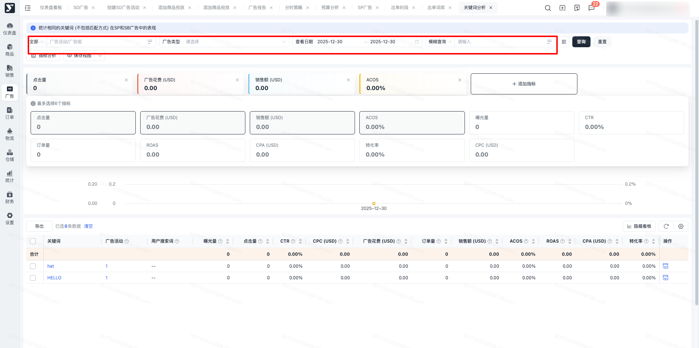
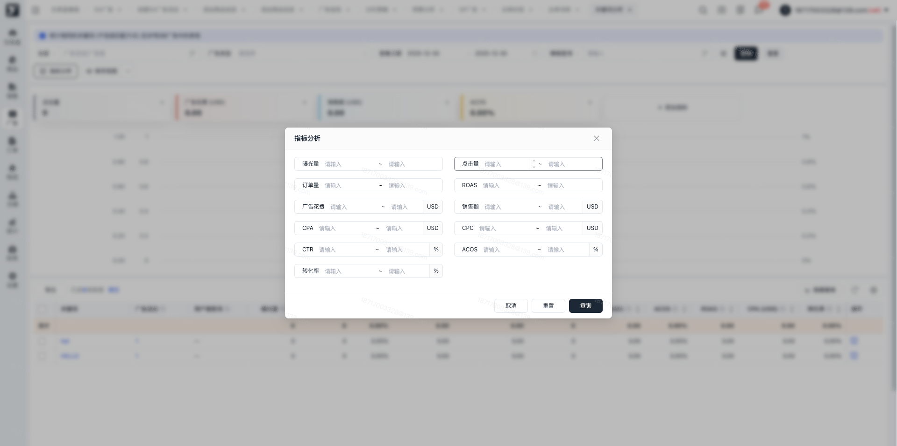
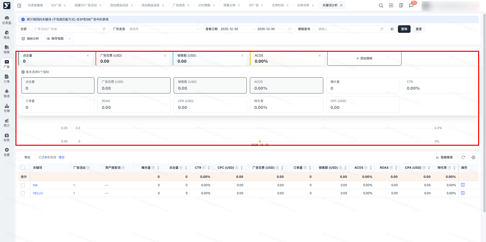
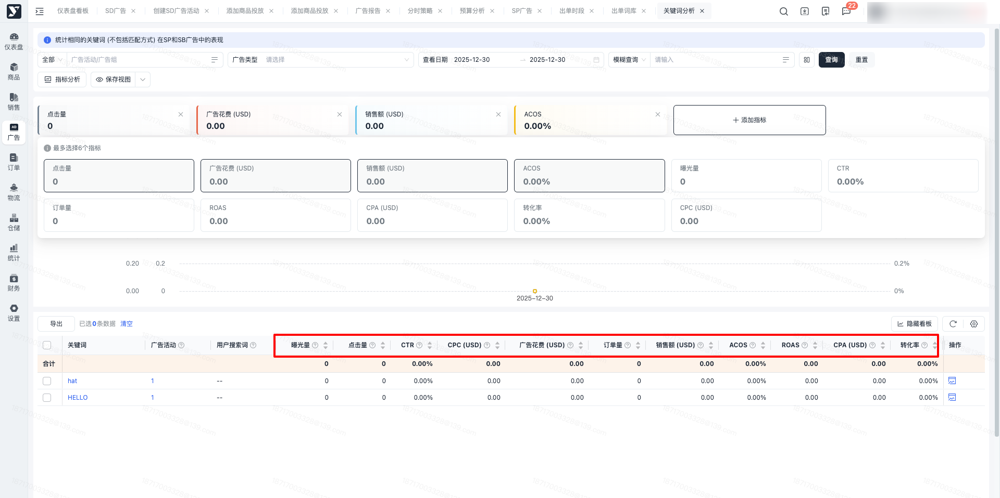
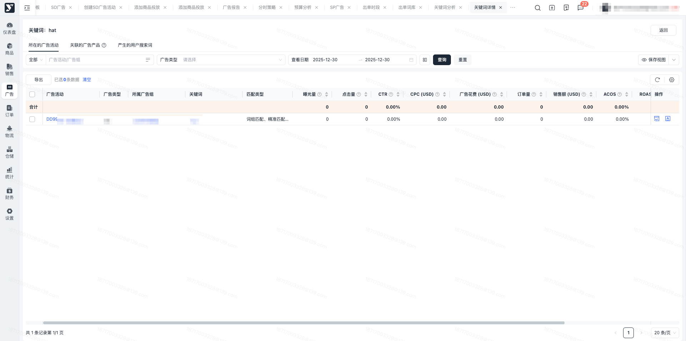
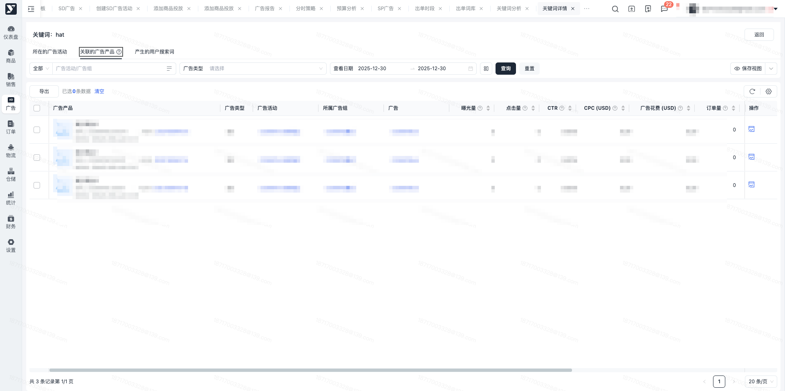
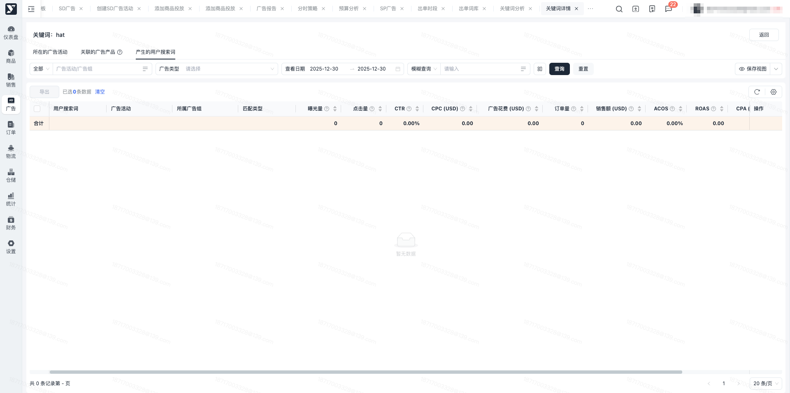

# 飞书文档：关键词分析

## 功能介绍

平台提供关键词分析，基于用户在SP和SB广告中的关键词投放，展示关键词相关的合计数据及明细数据看板。

## 操作说明

### 关键词分析

1. 数据筛选

进入【广告】-【广告分析】-【关键词分析】，可以对关键词分析数据进行查看，支持筛选广告活动及广告组，支持根据关键词进行查询。

1. 指标分析

点击筛选栏下方的指标分析按钮，可唤起指标分析弹窗，支持根据曝光量、订单量、点击量等指标进行区间值设置，设置后筛选查看指标区间的结果数据。

1. 数据图表查看

展示筛选结果下的对应指标的趋势图表，支持进行指标添加或者查看部分指标。

1. 数据明细查看

展示筛选结果下的关键词明细数据，根据关键词对其下的所有投放数据进行汇总。点击操作栏的关键词表现图标，支持按小时/日/周/月进行关键词汇总明细查看，支持查看指定日期下的同比和环比数据。

### 关键词详情

#### 所在的广告活动

展示对应关键词所在的广告活动数据，根据活动进行汇总展示。支持进行广告活动、广告组等内容筛选，可查看指定日期下的活动数据。点击操作栏的关键词投放表现弹窗，唤起表现看板，支持按小时/日/周/月进行关键词汇总明细查看，支持查看指定日期下的同比和环比数据。

#### 关联的广告产品

展示对应关键词所在广告活动的广告产品信息的数据统计，包括SP的推广商品和SB广告中的推广商品。注意：因亚马逊在SB广告中最小数据颗粒度为广告维度，则如果该广告下含有多条推广商品信息，其数据表现一致。

#### 产生的用户搜索词

展示对应关键词所在广告组中产生的用户搜索词数据统计，支持进行广告活动/广告组等维度的数据筛选，支持查看搜索词明细，并提供搜索词表现看板，支持按小时/日/周/月进行关键词汇总明细查看，支持查看指定日期下的同比和环比数据。

## 常见问题

### **Q1：为什么列表查询日期大于一年，点击操作列的看板后，两边的数据不一致？**

A1：各表现看板有最大1年的查询时长限制，当查询日期大于1年时，表现看板中的结束日期会被强制变更。列表和表现看板中日期范围不一致，会出现数据不一致的情况。可调整日期范围为一致后，进行数据查看。另对比分析看板中同比分析最大支持单次查询时长为90天，如查询时间过长，也请进行日期核对。

### **Q2：关联的广告产品中，为什么有的列表数据一样？**

A1：关联的广告产品包括SP的推广商品和SB广告中的推广商品。因亚马逊在SB广告中最小的数据颗粒度为广告维度，则当广告下含有多条推广商品时，数据并不会拆分到广告产品中展示，均展示该商品对应的广告的数据。其对应的表现弹窗也会以广告维度进行呈现。
