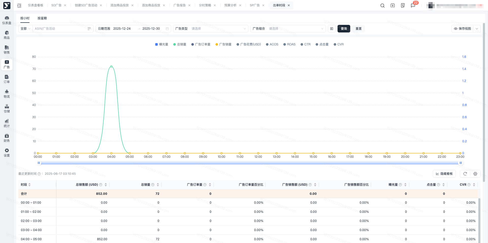
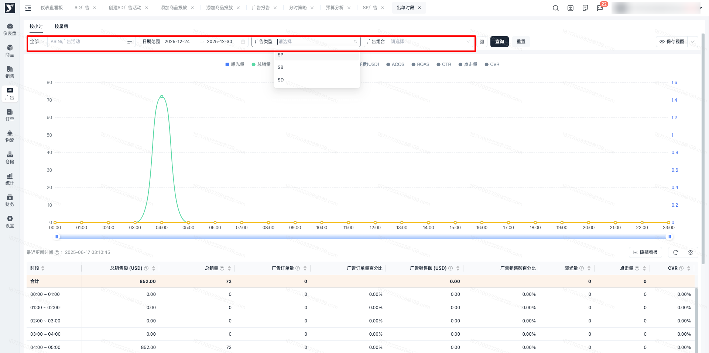
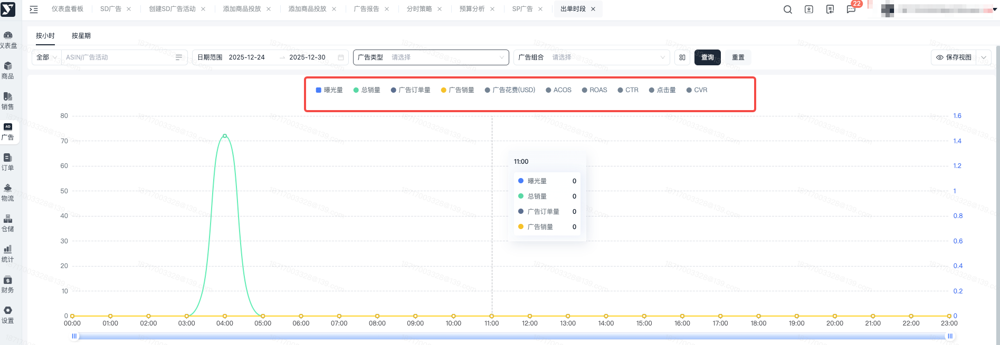
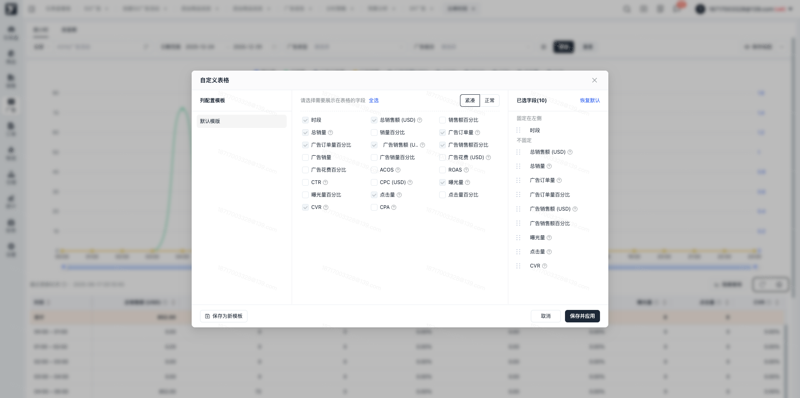
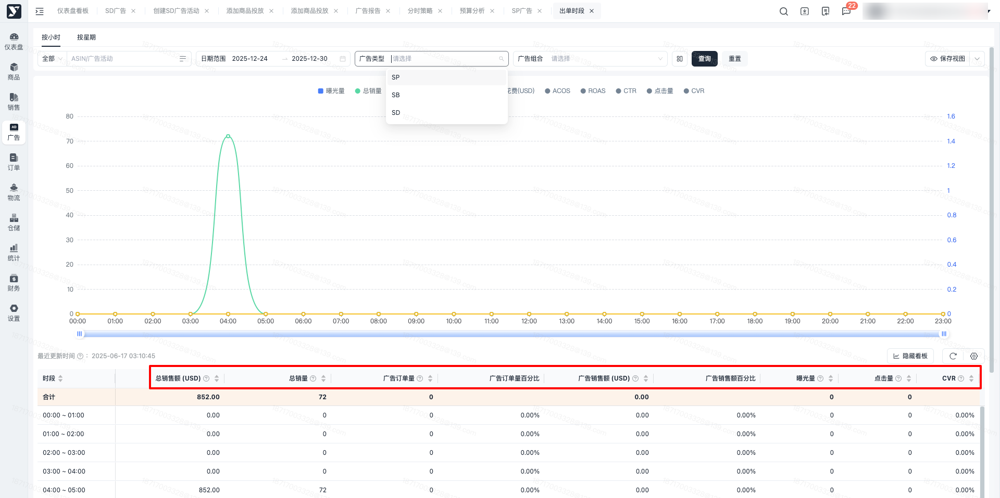
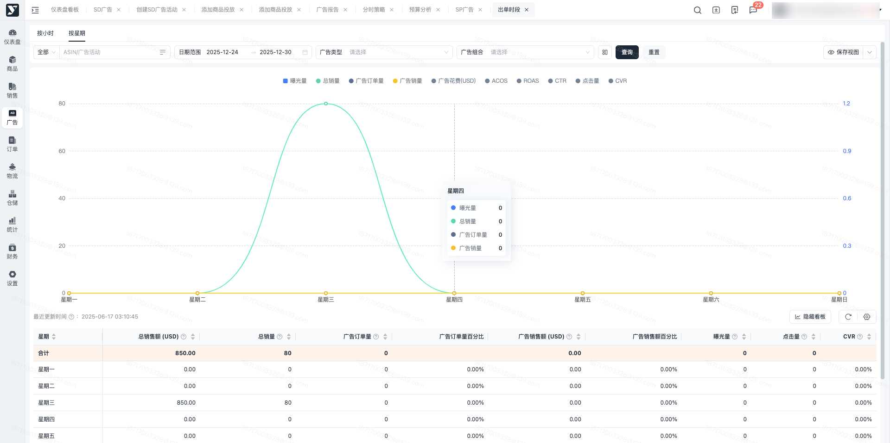
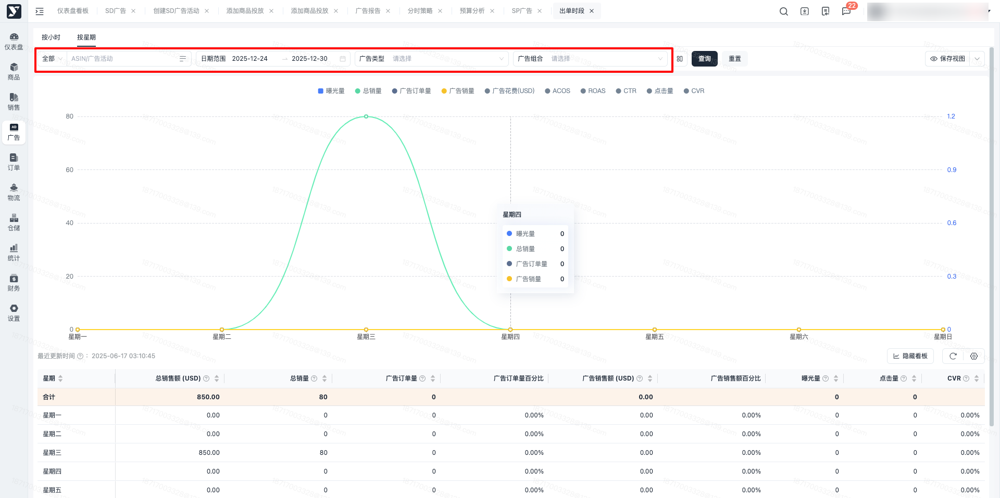
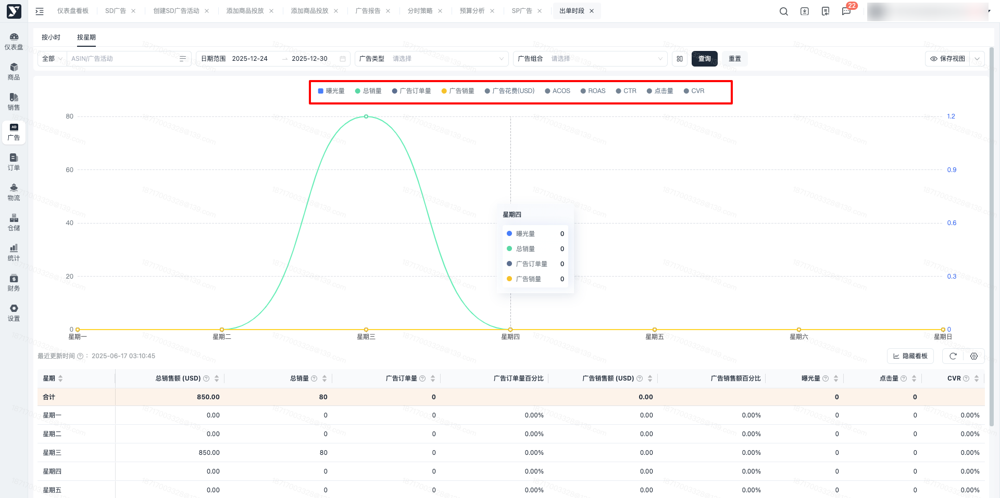
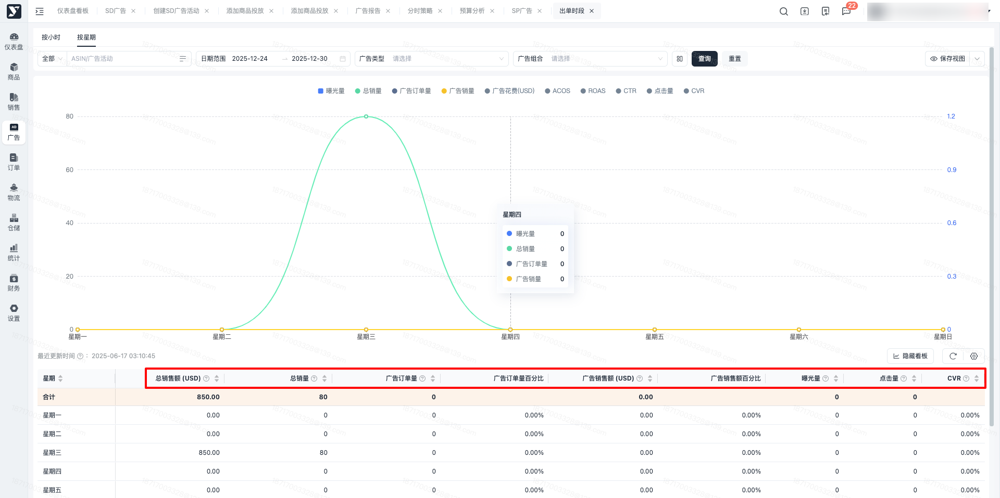

# 飞书文档：出单时段

## 功能介绍

平台提供出单时段分析，基于亚马逊数据，展示出单的高峰期和低谷期，为广告进行分时策略调整提供数据支持。

## 操作说明

### 按小时查看

1. 进入【广告管理】-【广告分析】-【出单时段分析】，可以查看出单时段分析的面板数据，默认展示按小时维度的数据表现。

1. 出单时段分析小时面板，支持多种筛选条件，筛选后展示数据为当前筛选条件下对应时间段的汇总数据。

- 按日期查询可筛选今日、昨日、本周、上周、本月、上月、近7天、近30天、自定义日期范围内的数据指标，帮助您分析广告表现，日期筛选为洛杉矶日期。
- 按广告类型查询可对广告类型进行筛选查询，包括SP、SB、SD。没有进行广告类型筛选时，默认展示全部类型下的数据。
- 按广告内容查询需要查询具体的广告信息时，可根据广告活动名称或者ASIN来进行广告筛选，输入内容后，可在下拉框选择对应的广告活动进行数据查看。需要查询广告对应的组合时，可进行广告组合筛选，输入组合名称后，可在下拉框选择到对应的广告组合进行内容查看，支持多选。

 

1. 出单时段图表，展示按小时维度的变化趋势，默认点亮总销量、广告订单量、广告销量、曝光量，可以点击图例进行点亮或者取消，取消后该字段趋势在图表上消失，点亮后，展示按小时维度的变化趋势。

1. 数据列表展示当前筛选内容时段下的汇总数据，点击自定义表格按钮，可以勾选想要展示的字段进列表中。部分字段支持自定义升降序，部分字段说明如下：

 

 1. 总销售额：该供应商下所有销售额合计，销售额=零售价\*销量
 2. 销售额百分比：每一行的销售额占总销售额的百分比
 3. 总销量：该供应商下所有销量合计，订单销售数量
 4. 广告订单量：是指购物者在点击或浏览你的广告之后提交的亚马逊订单的数量
 5. 广告销售额(USD)：广告销售额是在广告活动投放期间的指定时间范围内，因广告被点击而向顾客售出的商品的价值总额。
 6. 广告销量：指通过广告成交的销售件数
 7. 广告花费：广告活动的点击或展示的总费用
 8. CPA：平均到每笔广告订单上的花费金额。每笔订单花费=Spend/Orders

 

### 按星期查看

1. 进入【广告管理】-【广告分析】-【出单时段分析】，可以查看出单时段分析的面板数据，切换到按星期，展示星期维度的数据表现。

1. 出单时段分析星期面板，支持多种筛选条件，筛选后展示数据为当前筛选条件下对应星期的汇总数据。

- 按日期查询可筛选今日、昨日、本周、上周、本月、上月、近7天、近30天、自定义日期范围内的数据指标，帮助您分析广告表现，日期筛选为洛杉矶日期。
- 按广告类型查询可对广告类型进行筛选查询，包括SP、SB、SD。没有进行广告类型筛选时，默认展示全部类型下的数据。
- 按广告内容查询需要查询具体的广告信息时，可根据广告活动名称或者ASIN来进行广告筛选，输入内容后，可在下拉框选择对应的广告活动进行数据查看。需要查询广告对应的组合时，可进行广告组合筛选，输入组合名称后，可在下拉框选择到对应的广告组合进行内容查看，支持多选。

 

1. 出单时段图表，展示按星期维度的变化趋势，默认点亮总销量、广告订单量、广告销量、曝光量，可以点击图例进行点亮或者取消，取消后该字段趋势在图表上消失，点亮后，展示按星期维度的变化趋势。

1. 数据列表展示当前筛选内容按星期统计的汇总数据，点击自定义表格按钮，可以勾选想要展示的字段进列表中。

### SP-列表字段新增

在SP广告活动列表/广告组列表/商品列表/投放列表/广告位列表/用户搜索词列表中，新增9个统计字段，部分字段支持自定义升降序，点击自定义表格，可以进行字段添加。字段说明如下：

1. 销售额百分比：指单条记录的广告销售额占查询结果总广告销售额的百分比
2. 曝光量百分比：指单条记录的曝光量占查询结果总曝光量的百分比
3. 点击百分比：指单条记录的点击次数占查询结果总点击次数的百分比
4. 花费百分比：指单条记录的花费占查询结果总花费的百分比
5. CPA：平均到每笔广告订单上的花费金额。每笔订单花费=Spend/Orders
6. 广告订单百分比：指单个对象的广告订单占本次查询结果总广告订单的百分比
7. 广告笔单价：广告笔单价=广告销售额/广告订单
8. 销量：指通过广告成交的销售件数
9. 销量百分比：指当前广告活动的广告销量占全部广告销量的百分比

## 常见问题

### **Q1：为什么有的字段无数据展示？**

A1：列表中字段根据亚马逊返回的数据结果实时更新数据，如当前无数据，则可能是亚马逊未进行数据结果返回。

### **Q2：出单时段分析中的时间统计数据是北京时间还是洛杉矶时间？**

A1：出单时段分析的数据展示的时间维度均为洛杉矶时间。
