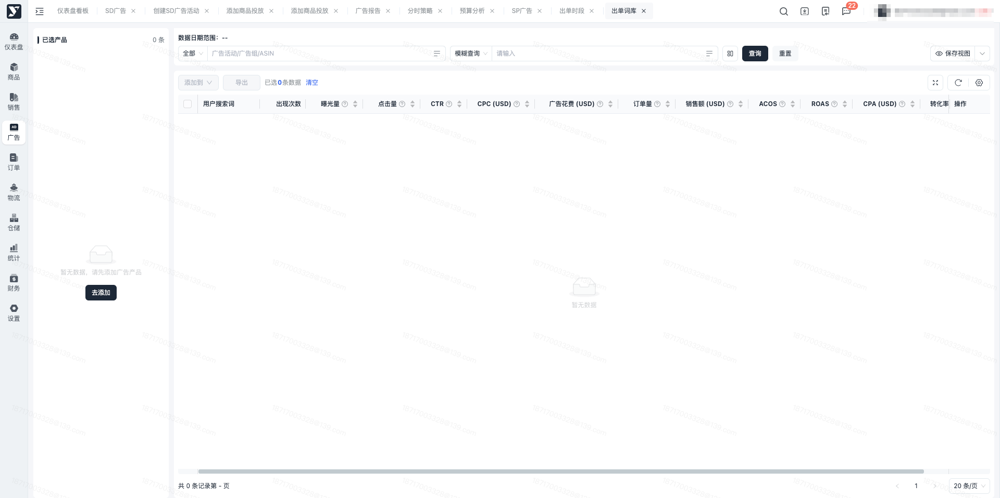
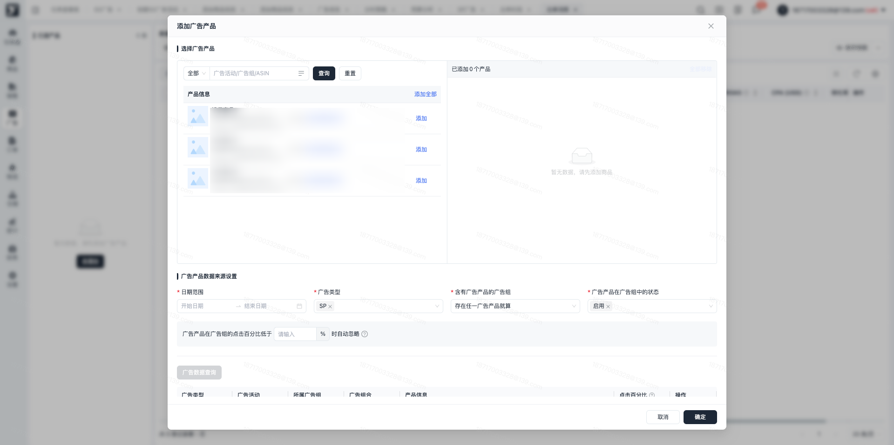
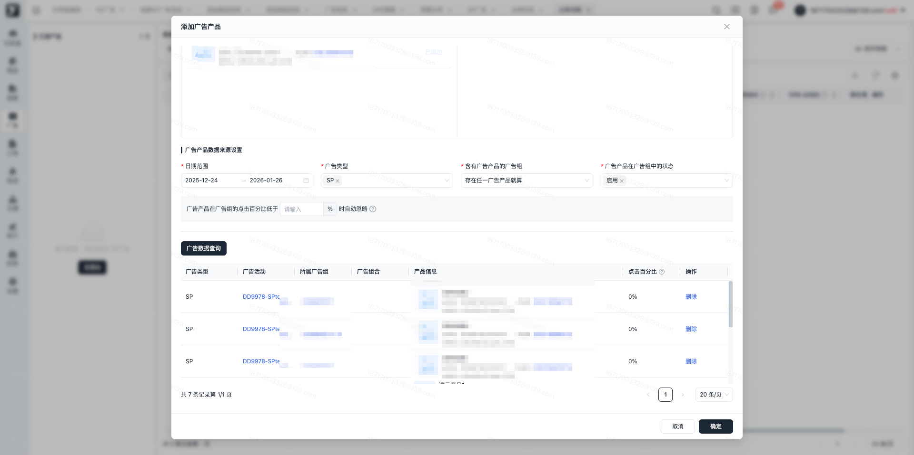
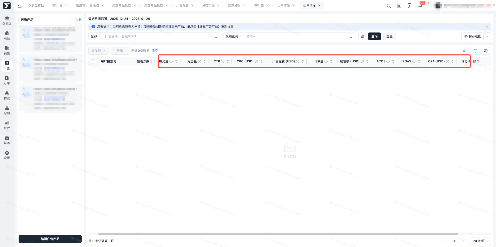
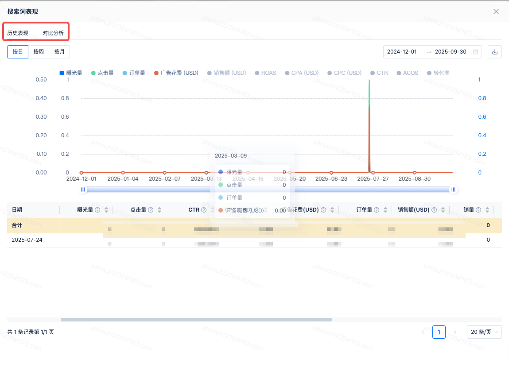
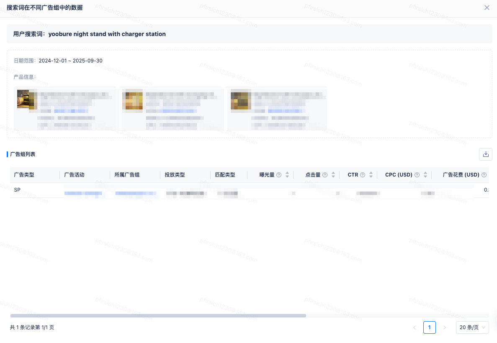
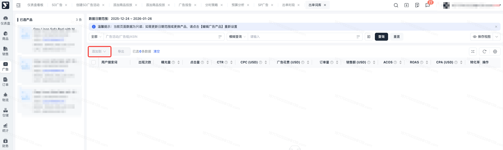
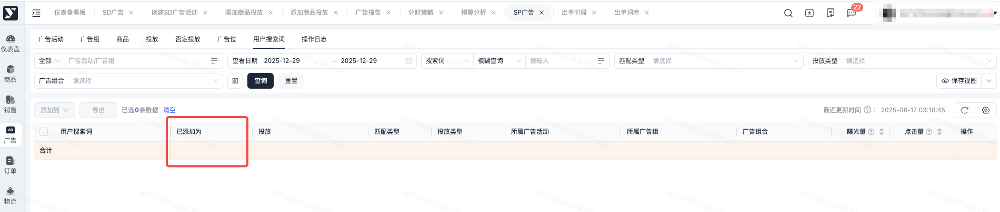
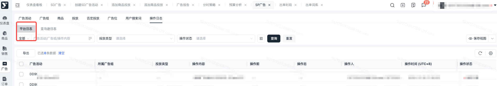

# 飞书文档：出单词库

## 文档信息

| 项 | 内容 |
| --- | --- |
| 远程文档 | https://q1njej8cpab.feishu.cn/wiki/KWjhwEbEviur7Okn95icsUZmnUQ |
| 图片处理 | 本地下载（assets/images） |
| 快照时间 | 2026-08-06 |
| 来源命令 | `lark-cli docs +fetch --api-version v2 --doc https://q1njej8cpab.feishu.cn/wiki/KWjhwEbEviur7Okn95icsUZmnUQ --doc-format markdown --as user --format json --jq .data.document.content` |
| 格式处理 | fd-doc-markdown-sync/scripts/normalize-feishu-doc-markdown.mjs |

---

出单词库

## 功能介绍

平台提供出单词库分析，基于亚马逊的用户搜索词数据，展示用户搜索词的合计数据及明细数据看板。

## 操作说明

### 选择广告产品

1. 进入【广告管理】-【广告分析】-【出单词库】，可以查看出单词库的默认页面，点击去添加，进行广告产品添加

1. 唤起添加广告产品弹窗，进行广告产品及广告数据来源设置支持根据广告活动、广告组、asin进行数据筛选，点击添加按钮，可以添加到右侧，支持批量添加或者批量移除

 1. 选择广告产品

 

 1. 进行广告数据产品来源设置

 1. 选择了广告产品后，可以设置广告产品关联的广告活动的数据信息。

 1. 日期范围：必填，支持快捷筛选今日、昨日、本周、上周、本月、上月、近7天、近30天、自定义。
 2. 广告类型：必填，多选，默认选中SP，可选择广告类型包括SP广告、SB广告
 3. 含有广告产品的广告组：必填，单选，默认选中存在任一广告产品就算。

 1. 存在任一广告产品就算，选中后，筛选的广告活动数据包含以上某一个选择的广告产品asin即被命中
 2. 全部广告产品都存在才算，选中后，筛选的广告活动数据必须包含以上所有asin才能被命中
 4. 广告产品在广告组中的状态：必填，多选，默认选中启用，可切换为启用、暂停、归档。
 5. 广告产品在广告组的点击百分比低于\${数字}%时，自动忽略：非必填，选择广告类型为SP广告时出现，设置后列表中的数据为筛选日期范围的该广告产品的点击量 / 它所属广告组在该日期范围内的总点击量) × 100%
 2. 数据查询：设置了广告数据信息后，需要点击广告数据查询按钮，数据被筛选至列表中。支持进行广告活动的确认，可删除部分不需要的活动数据，点击确认进行数据分析查询

 

### 出单词库列表数据查看

设置了广告活动及产品信息后，可以在列表中进行产品及搜索词数据查看，支持查看用户搜索词的统计数据及出现次数查看。支持进行广告产品编辑，支持进行数据明细查询。

#### 搜索词表现

1. 历史表现：点击用户搜索词操作栏的搜索词表现图标，唤起搜索词表现看板，支持进行天/周/月的历史表现数据查询，展示图表及列表明细
2. 对比分析：点击用户搜索词操作栏的搜索词表现图标，唤起搜索词表现看板，切换到对比分析，可以查看对比分析的数据，支持进行日期及汇总方式切换。

#### 查看搜索词在不同广告组中的数据

点击用户搜索词操作栏的查看搜索词在不同广告组中的数据图标，唤起明细看板，支持查看当前用户搜索词对应的筛选数据的产品信息和广告活动明细。

#### 添加到

在出单词库列表中，选中具体的用户搜索词后，点击添加到按钮，可添加选中搜索词至词库、商品库、关键词投放、否定关键词、商品投放、否定商品。

## 操作行为记录

#### 已添加为

用户搜索词列表的已添加为字段增加出单词库的来源记录，当在出单词库中点击添加到关键词投放、商品投放、否定关键词、否定商品时，记录对应的添加记录。

#### 操作日志

操作日志记录添加行为，记录添加时间及具体的添加内容。

## 常见问题

#### **Q1：出单词库列表中的数据为什么和搜索词列表中数据不一致？**

A1：出单词库列表中的数据为当前用户搜索词在不同广告组中的合计数据，用户搜索词列表仅展示的为某一个广告组数据。在出单词库列表中唤起明细弹窗“查看搜索词在不同广告组中的表现”，该弹窗明细中的数据和用户搜索词列表一致。

#### **Q2：为什么有用户搜索词，列表中没有数据？**

A1：列表中展示的数据为在广告产品弹窗中设置的符合设置内容的数据，如列表中没有数据，可唤起编辑广告产品弹窗核实查询的日期或者其他设置是否和已有数据的内容不匹配。
