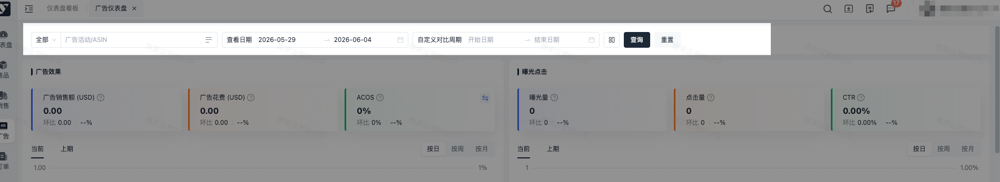
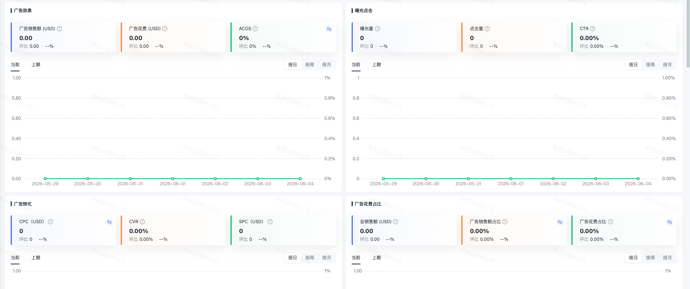
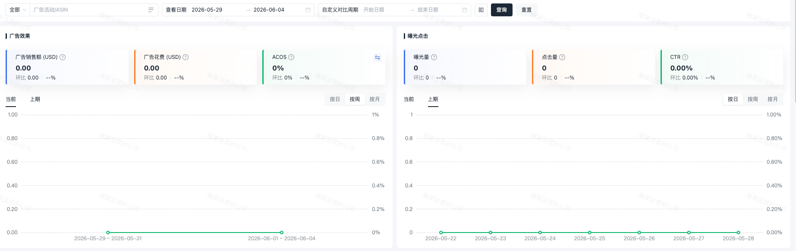
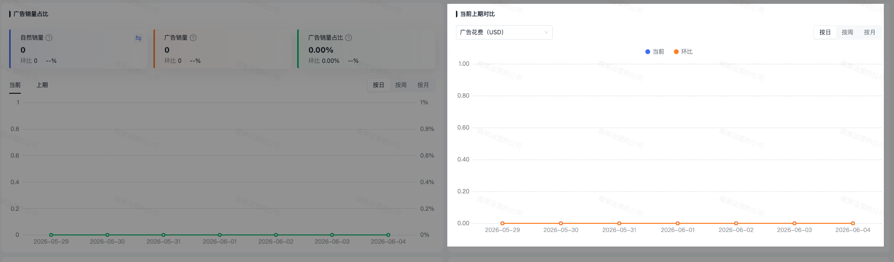
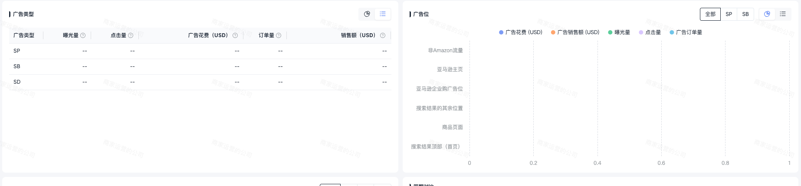
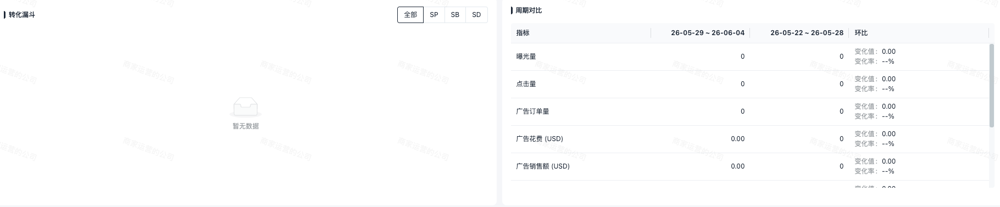
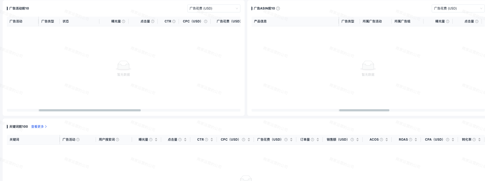

# 飞书文档：广告仪表盘

## 文档信息

| 项 | 内容 |
| --- | --- |
| 远程文档 | https://q1njej8cpab.feishu.cn/wiki/Pu28woqh6ikUJbkI9OMcCgE4nOd |
| 图片处理 | 本地下载（assets/images） |
| 快照时间 | 2026-08-06 |
| 来源命令 | `lark-cli docs +fetch --api-version v2 --doc https://q1njej8cpab.feishu.cn/wiki/Pu28woqh6ikUJbkI9OMcCgE4nOd --doc-format markdown --as user --format json --jq .data.document.content` |
| 格式处理 | fd-doc-markdown-sync/scripts/normalize-feishu-doc-markdown.mjs |

---

广告仪表盘

## 功能介绍

平台提供广告仪表盘，依托多维度筛选与自定义周期对比能力，聚合广告流量、成本、转化、关键词等经营数据可视化，落地全链路投放量化分析，实现投放成本精细化与投放决策数字化。

## 操作说明

### 数据筛选

支持可按广告活动、ASIN 筛选数据，默认查询日期为近7天，支持进行查询日期更换，最大可查询时间范围一年内的数据。提供环比查看，环比周期为与查看周期时长相同的上一个自然周期。支持自定义对比日期，可对比时长在一年内的自定义数据。

### 核心指标卡

提供广告效果、曝光点击、广告转化、广告花费 & 销量占比，支持展示当前查看日期下的指标汇总数据，默认展示环比数值及环比变化率。选择了自定义日期后，可提供对比数据值和对比变化率数据查询。

指标卡支持颜色标记，根据指标不同提供不同的颜色展示。

1. 正向指标 ：越高越好，变化率为正上涨↑ 变好-绿色，变化率为负下跌↓ 变差-红色

 1. 指标包含：曝光量、点击量、销售额（广告销售额/总销售额）、转化率/ CVR、CTR、销量（自然销量/总销量/广告销量）、ROAS
2. 反向指标 ：越低越好，变化率为正上涨↑ 变差-红色，变化率为负下跌↓ 变好-绿色

 1. 指标包含：ACoS、 CPC、SPC、CPA
3. 中性指标：未提及的指标均为中性指标，不进行好坏判定。颜色均为灰色

趋势查询：支持同期或者上期趋势图查询，支持按日 / 周 / 月三种时间粒度查看趋势，提供当前查看日期下的数据趋势，也可以切换为上期查看对比/环比日期下的数据，均支持按照日/周/月时间粒度进行趋势查询。

### 当前上期对比

提供当前上线对比，合并当前和上期趋势至同一个图表中。当查看日期时长≥对比日期时长时，横坐标按照查看日期展示，以开始日期对齐趋势图。当对比日期筛选时长长度大于查看日期时，横坐标按照对比日期展示，数据标签可查看同一个对比节点下当前和上期的数据时间及数据值。

### 投放结构分析

支持广告类型、广告位的数据查询，可查看图表趋势数据及占比，支持切换表单列表查看详情。

### 转化漏斗及周期对比

提供转化漏斗，支持切换广告类型，提供查看各类型转化漏斗。并可在周期对比中，查看各指标的数据明细。

### TOP 榜单

按指标排序查看广告活动 TOP10、ASIN TOP10。支持 TOP100 关键词查询，支持跳转关键词详情页。

## 常见问题

#### **Q1：当前查询ASIN仅有SB的广告活动，为什么数据和广告列表数据不一致？**

A1：当同一个SB的广告下含有多个ASIN时，根据广告中含有的ASIN个数进行了数据分摊，查询单个ASIN时，展示的是分摊后的数据，广告列表展示的是整体数据，所以会存在不一致。

#### **Q1：广告ASIN前10中，同一个广告下SB的数据为什么只有1个？**

A1：榜单中含 SP/SB/SD 的ASIN 数据，因SB 按广告聚合无单品数据，数据按广告中的ASIN个数分摊折算，同 SB 广告中含多 个ASIN 时，仅展示首条，分摊数据仅供参考。
