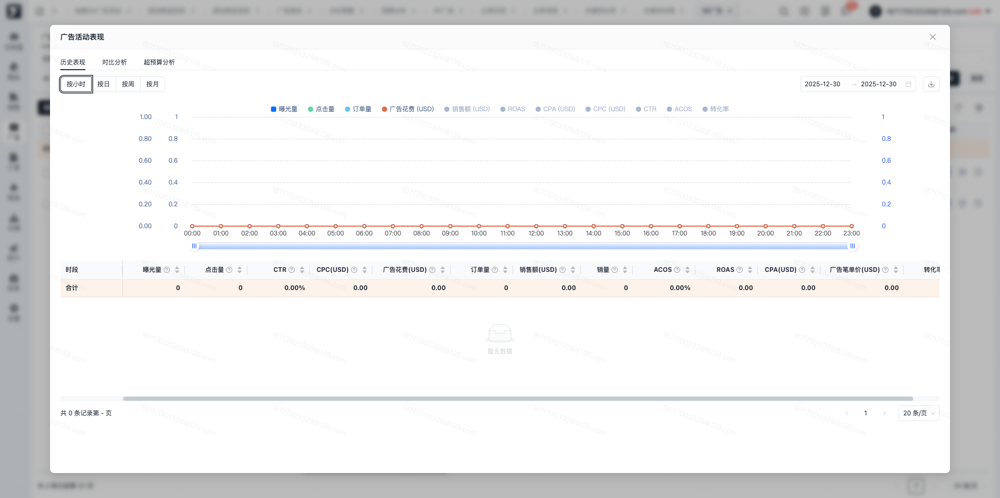
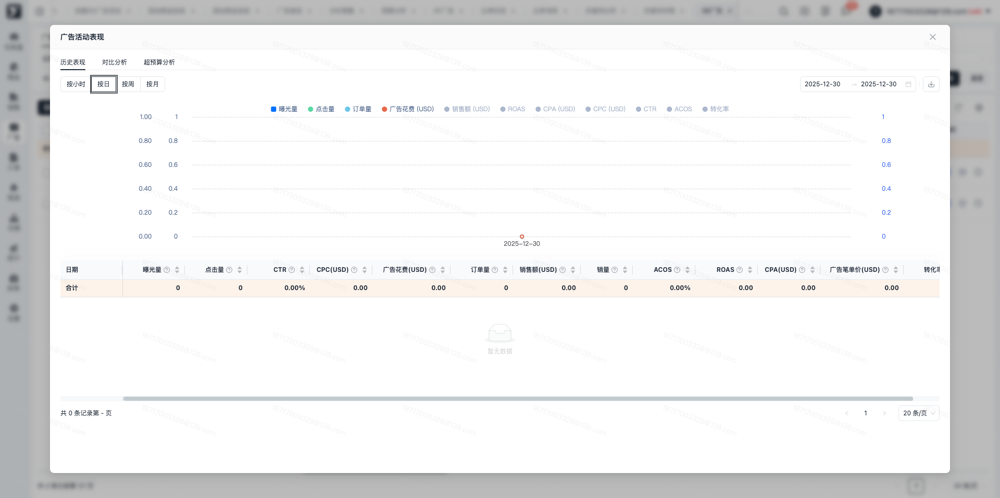
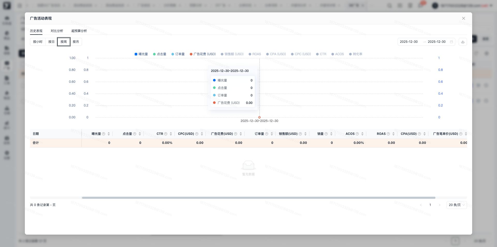
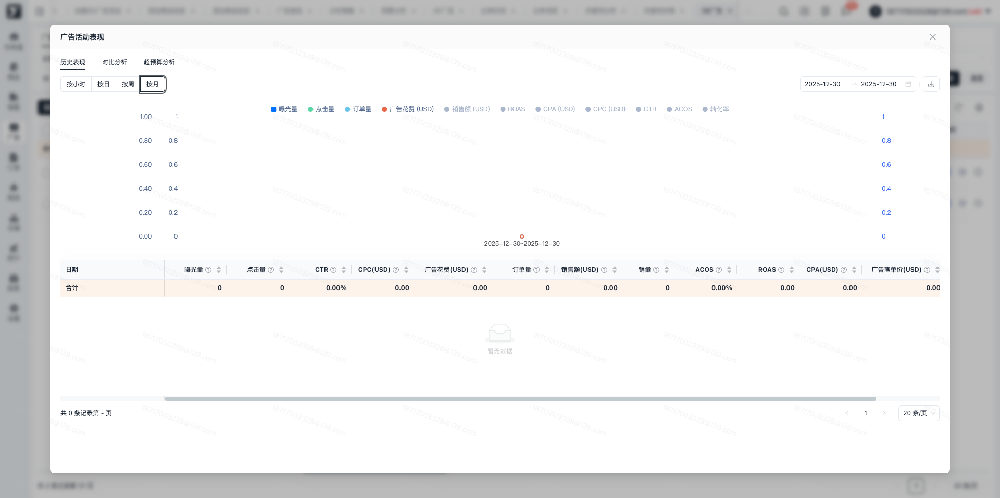
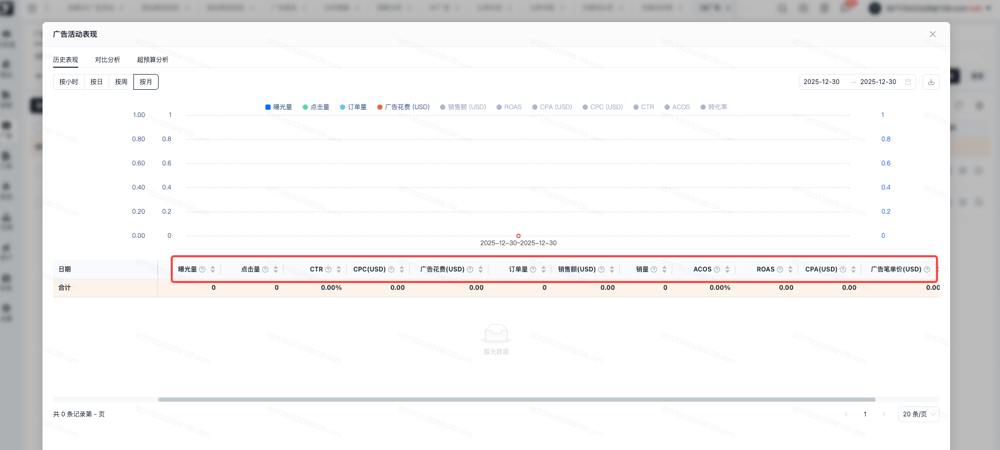
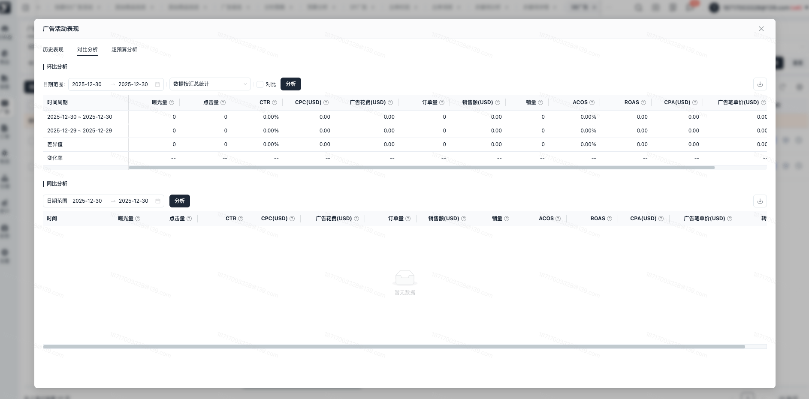

# 飞书文档：数据表现分析

## 功能介绍

平台提供数据表现分析，基于亚马逊数据，展示按小时/天/周/月的可切换数据看板，展示环比和同比分析，支持调整数据汇总方式，展示对比分析。

## 操作说明

### 历史表现

1. 在对应页面的操作栏，有历史表现图标，点击历史表现图标，可以唤起历史表现弹窗，按小时/日/周/月进行数据明细及图表查看。图表默认点亮4个指标值，可以点击指标名称进行点亮/取消点亮，点亮后图表展示该折线图，取消点亮后折线图隐藏。
2. 数据区间：历史表现最大支持查询数据区间为一年，大于一年默认会按照开始时间填充限制时间内的最大结束日期
3. 面板展示的数据范围：

 1. 展示小时/日/周/月面板，包括列表为：广告组合列表、广告组合详情、SP-广告活动、SP-广告组、SP-投放-自动投放、SP-投放-关键词投放、SP-广告-商品投放、SB-广告活动、SB-广告组、SB-投放-关键词投放、SB-投放-商品投放、SD-广告活动、SD-广告组、SD-商品投放、SD-受众投放
 2. 展示日/周/月面板，包括列表为：SP-商品、SP-用户搜索词、SB-广告、SB-用户搜索词、SD-商品
4. 历史表现看板

- 按小时查看数据可进行日期筛选，筛选后数据为所有筛选日期内按小时的数据汇总。以24小时维度，对每小时进行拆分，整点数据展示为该区间的统计数据，如14:00查询的数据为14:00～15:00的区间数据。支持进行小时数据下载

 
- 按日查看数据可进行日期筛选，筛选后数据为所有筛选日期内每日的数据明细，支持进行按日数据下载

 
- 按周查看数据可进行日期筛选，筛选后为当前时间段内以自然周展示的数据汇总（每周一展示至周日，当筛选日期不满足一个自然周时，会进行气泡提示）

 
- 按月查看数据可进行日期筛选，筛选后展示数据为当前筛选周期内一个自然月的数据（展示为月初到月末，当不足一个自然月时，会进行气泡提示）仅展示有数据的内容

 

1. 看板字段及定义部分字段支持自定义升降序，部分字段说明如下：

 1. 曝光量：广告被展示的次数
 2. 点击量：您广告被点击的总次数。注意：一旦识别出无效点击，系统最多会在 3 天内从您的支出统计数据中删除这些点击记录。
 3. CTR：点击率=点击量/曝光量\*100%
 4. CPC(USD)：平均单次点击价格=花费/点击量
 5. 广告花费：广告活动的点击或展示的总费用
 6. 订单量：订单量是指购物者在点击或浏览你的广告之后提交的亚马逊订单的数量
 7. 销售额：销售额是在广告活动投放期间的指定时间范围内，因广告被点击而向顾客售出的商品的价值总额
 8. 销量：指通过广告成交的销售件数
 9. ACOS：广告投入产出比 = 广告花费 / 广告销售额 \* 100%
 10. ROAS：广告支出回报率 = 广告销售额 / 广告花费
 11. CPA(USD)：平均到每笔广告订单上的花费金额。每笔订单花费=Spend/Orders
 12. 广告笔单价：广告笔单价=广告销售额/广告订单
 13. 转化率：广告转化率 (Conversion rate) =广告订单量/广告点击量 \* 100%

 

### 对比分析

1. 环比分析

 1. 支持进行时间筛选，默认带上页面查询的日期，默认数据计算方式为按数据汇总统计，支持进行切换，可更换为按日均统计或者按有曝光天数的平均统计。支持进行列表数据下载。
 2. 支持进行对比数据查看，默认展示筛选日期的上一个环比日期，可查看当前日期和环比日期的具体值、差异值和变化率。勾选对比，可以进行自定义对比日期，点击分析后，可以查看自定义对比日期的值、变化值和变化率。

 
2. 同比分析

 1. 支持日期筛选，筛选后可查询筛选日期范围内按周一～周日的有数据的天数据，最大可筛选的日期区间时段为90天。
 2. 默认按星期数据进行折叠，展开后可看对应星期数据下的日期明细数据，支持数据下载。

## 常见问题

### **Q1：为什么有的历史表现无小时面板？**

A1：受基础数据源的限制，部分数据类型暂不支持小时级别维度的查看。目前不提供小时粒度数据的历史表现包括：SP-商品、SP-用户搜索词、SB-广告、SB-用户搜索词、SD-商品。

### **Q2：历史表现和对比分析中统计数据是北京时间还是洛杉矶时间？**

A1：所有数据看板中的数据展示的时间维度均为洛杉矶时间。
