# 飞书文档：预算分析

## 功能介绍

平台提供预算分析功能，基于亚马逊数据，展示广告活动的预算关联结果，提供建议预算、最近一次超预算时间、预计错过的数值预估等数据，支持快速识别您的超预算的广告活动，支持您快速的进行预算调整。支持精细化数据呈现及快捷筛选功能，展示预算详情和超预算记录的数据。

## 操作说明

### 查看预算分析

1. 进入【广告管理】-【广告分析】-【预算分析】，可以查看预算分析页面，提供广告活动的多种维度的数据呈现，包括平均预算内的活跃时间、建议预算、预计错过的销售额、预计错过的展示、预计错过的点击等。图表默认展示4个指标，点击添加指标，可唤起指标选择面板（鼠标移除面板区域点击时，面板隐藏），在指标面板可以选择需要查看的指标项，一次最大可查看5个指标，如需更换指标，点击指标上的x按钮可以关闭指标趋势图。

 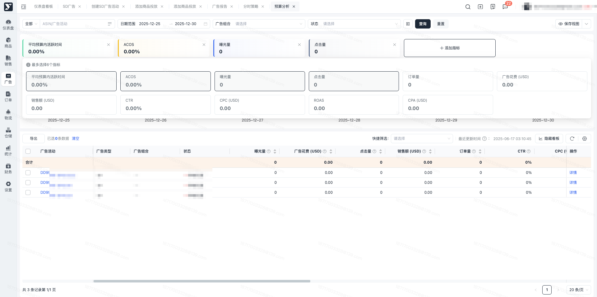
2. 预算分析页面支持多种筛选条件

- 按日期查询可筛选本周、上周、本月、上月、近7天、近30天、近90天等日期范围内的数据指标，帮助您分析广告表现，日期筛选为洛杉矶日期。

 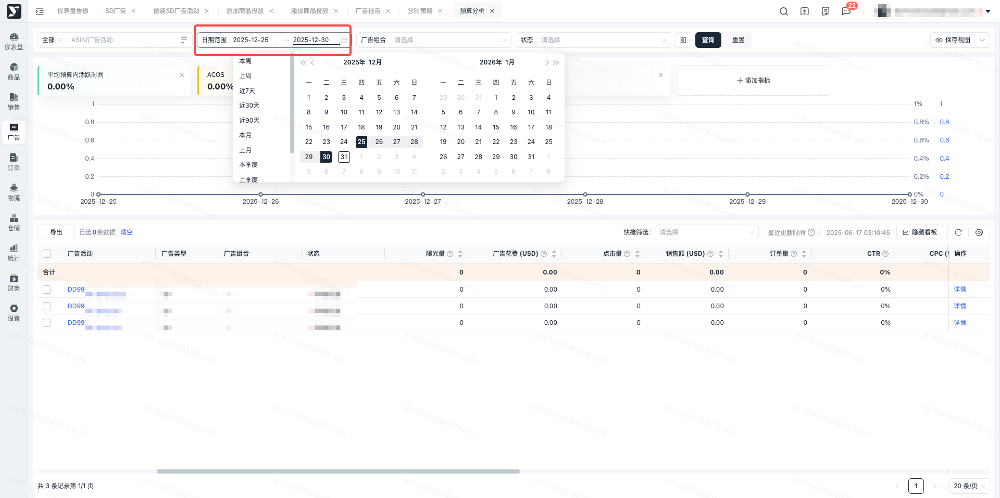
- 按广告状态查询需要按照状态查询广告内容时，可进行广告状态筛选。为了方便了解您的全量广告信息，列表展示了SP的全量状态数据，如只需要查询超预算状态，建议此时筛选状态为“超出预算”，帮助您快速定位超出预算的广告。

 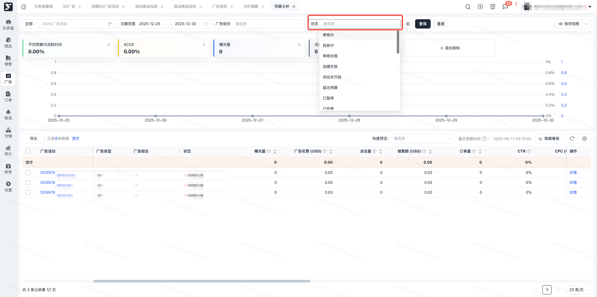
- 按广告内容查询需要查询广告对应的组合时，可进行广告组合筛选，输入组合名称后，可在下拉框选择到对应的广告组合进行内容查看，支持多选。需要查询具体的广告信息时，可根据广告活动名称或者ASIN来进行广告筛选，输入内容后，可在下拉框选择对应的广告活动进行数据查看。

 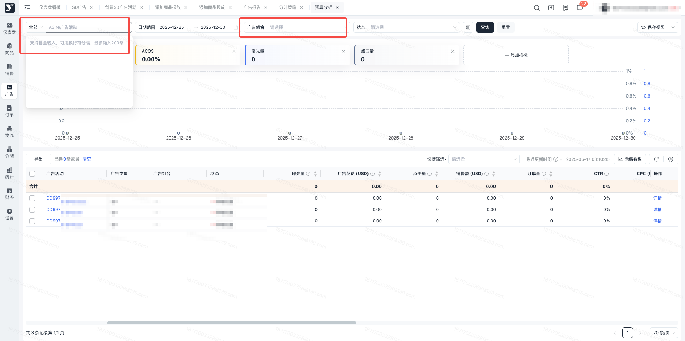

1. 预算分析页面支持导出及自定义列配置勾选广告活动可以导出Excel，支持部分导出或者全部导出。点击自定义列配置，可以自定义选择列表字段。

 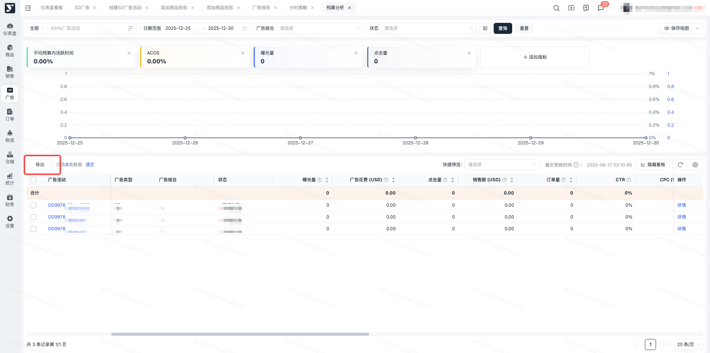

 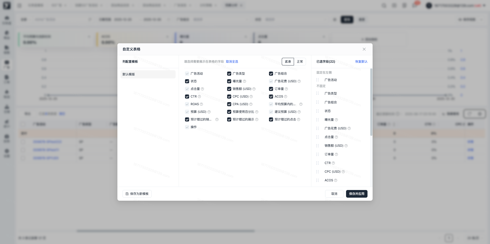
2. 预算分析列表支持快捷筛选列表增加快速筛选项，可快速筛选广告活动，点击x可关闭快捷筛选。仅针对列表生效

 1. 即将超出或已超出预算：点击后筛选内容为预算使用百分比≥90%的广告活动
 2. 已超出了预算并且错过了机会：点击后筛选内容为状态=超出预算的广告活动

 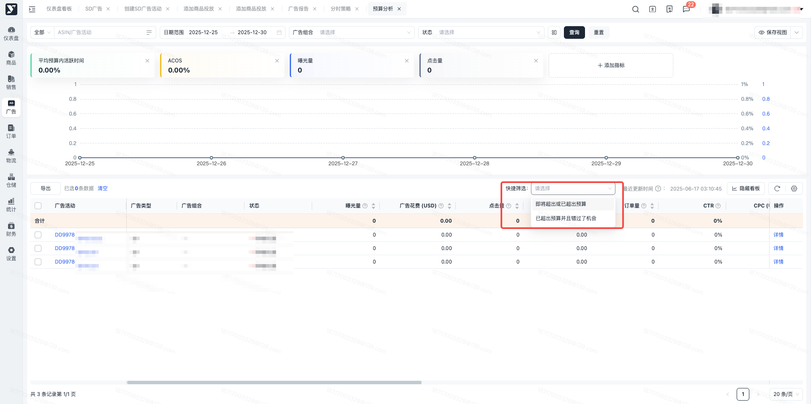

### 查看预算分析详情

进入【广告管理】-【广告分析】-【预算分析】，可查看预算详情和超预算记录面板，根据筛选日期不同展示不同的内容。

1. 预算详情：趋势图表展示时间范围内的广告花费、预算使用百分比、预算调整次数、超预算次数的每天的指标变化。并在图表下方展示按天维度的数据明细，包括广告花费、预算使用百分比、预算调整次数、超预算时间点、超预算次数、当天最大预算、超预算时间段的展示。

 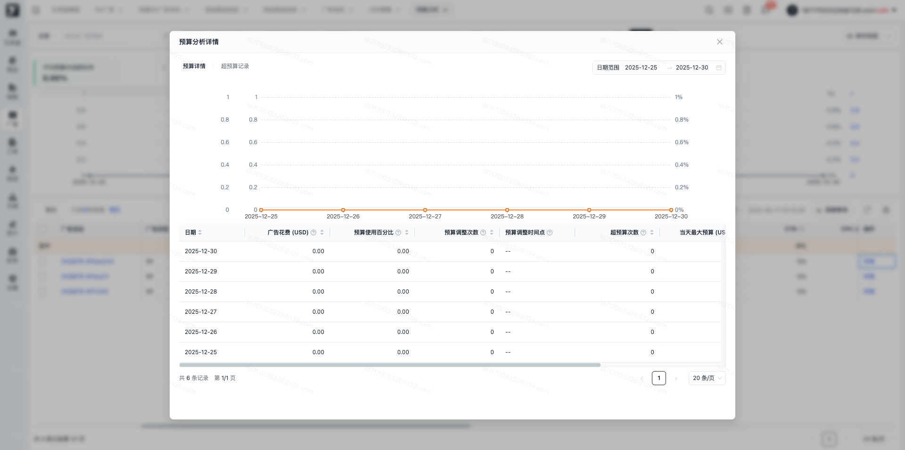
2. 超预算记录：列表记录超预算的详细日志，在一个时间点从预算内到超预算则当前活动的状态为超预算，如从超预算到预算内，则当前时间点的状态为投放中。图表记录当前时间周期的统计结果，展示同一个时间段内超预算的天数信息。

 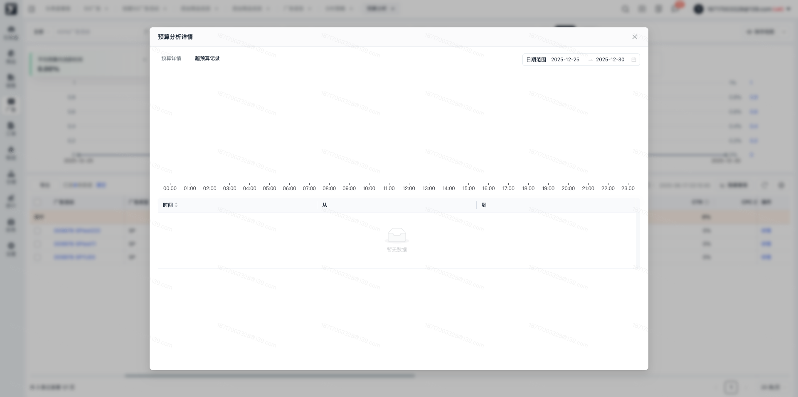

预算详情除在预算分析列表唤起，还可以在广告列表唤起，在广告活动列表（SP/SB/SD）的分析操作栏，展示分析图标，点击图标唤起超预算分析，可查看预算详情和超预算记录。

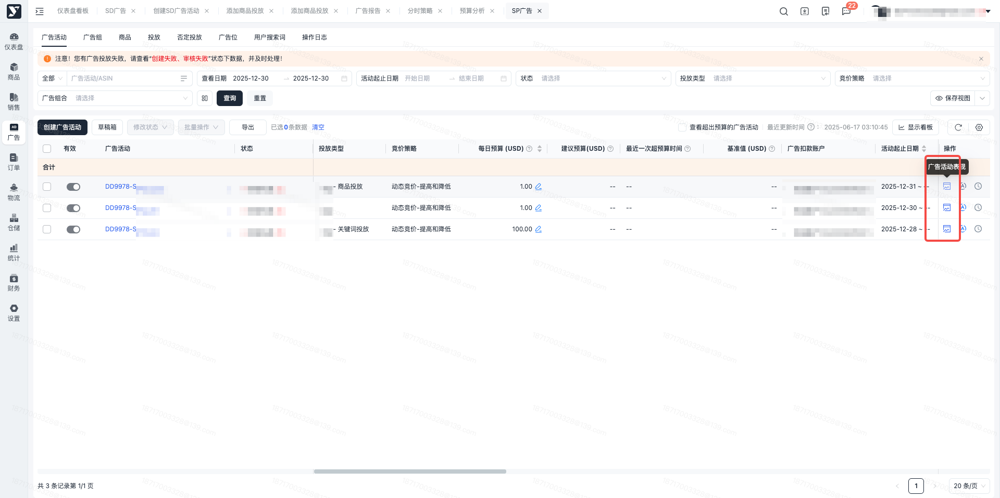

### 快捷筛选超预算广告活动

- 进入【广告业务】 -【 广告列表】，包括SP广告、SB广告、SD广告列表；也可以直接从预算分析页面，通过点击广告活动名称，快捷进入对应的广告活动筛选列表。均可以通过对该快捷操作项的勾选，来筛选超出预算的广告活动。

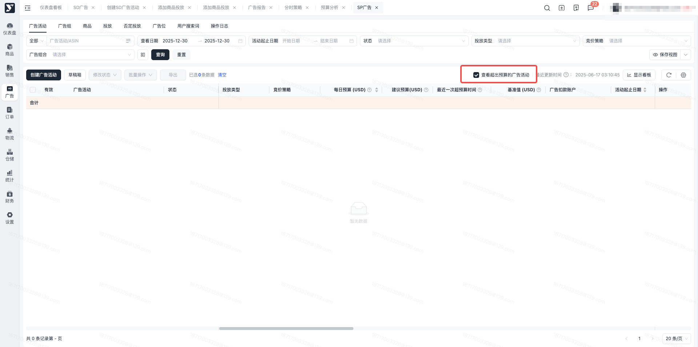

### 修改预算

- 在广告活动列表中，可以查看建议预算和最近一次超预算时间，广告状态为超出预算时，可以根据建议预算的值和最近一次超预算时间，初步评估出需增加的广告预算，在修改预算列中进行预算调整。

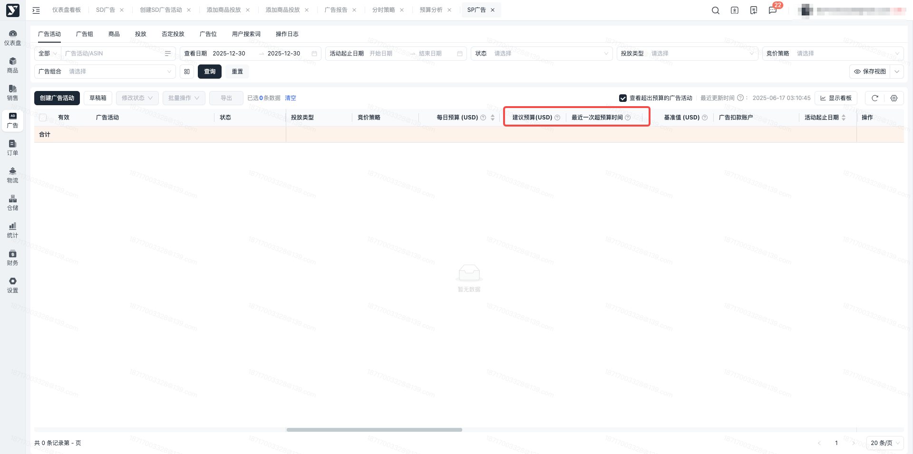

## 数据指标定义

曝光量：广告被展示的次数

广告花费（USD）：广告活动被点击的总费用

点击量：您的广告被点击的总次数。注意：一旦识别出无效点击，系统最多会在 3 天内从您的支出统计数据中删除这些点击记录。

销售额（USD）：销售额是指在特定的广告活动类型下，因广告被点击或浏览，在规定时间范围内售出给予购物者的产品总价值。

订单量：订单量是指购物者在点击或浏览你的广告之后提交的亚马逊订单的数量

CTR：点击率=点击量/曝光量

CPC：平均单次点击价格=花费/点击量

ACOS：广告投资回报率 = 广告花费 / 广告销售额 \* 100%

ROAS：广告投入产出比 = 广告销售额 / 广告花费

平均预算内活跃时间：广告活动在预算中的时间百分比

预算（USD）：该广告活动的最大预算

预算使用百分比：展示为预算的使用情况，为支出/预算\*100%

建议预算（USD）：预算预估值，以便最大程度地避免因广告活动超出预算而错过展示、点击和销售。

预计错过的销售：在预算未耗尽情况下，预计广告活动可能带来的额外销量。取决于多种因素，可能包括预计错过的点击量和历史销量。只是估计值，并非实际销量保证。部分广告活动可能没有足够的数据计算估计值。

预计错过的展示：如果预算未耗尽，预计广告活动可能获得的额外曝光量。取决于多种因素，可能包括预计错过的点击量和历史点击率 (CTR)。只是估计值，并非实际曝光量保证。部分广告活动可能没有足够的数据计算估计值。

预计错过的点击：如果预算未耗尽，预计广告活动可能获得的额外点击量。取决于多种因素，可能包括未耗尽预算的类似广告活动的历史绩效。只是估计值，并非实际点击量保证。部分广告活动可能没有足够的数据计算估计值。

最近一次超预算时间：14天内该广告活动最近一次超预算的时间。

## 常见问题

### **Q1：为什么有的字段无数据展示？**

A1：列表中字段根据亚马逊返回的数据结果实时更新数据，如当前无数据，则可能是亚马逊未进行数据结果返回。

特别说明：列表中预计错过的销售、预计错过的展示、预计错过的点击，这三个字段数据来源于亚马逊报告，报告均展示t-1（昨日）的数据结果。每日早上6：00进行数据更新。

### **Q2：预算分析支持哪些类型的广告活动？**

A1：亚马逊报告暂未提供更多类型的预估数据结果，目前仅支持对类型为SP的广告活动进行预算分析。

### **Q3：预算详情中超预算时间段为什么比实际时间大？**

A1：超预算时间段是根据超预算的时间点取的整点数值，预算时间段包含超预算时间点。则当前时段内只要有超预算，则整点都会被记录。
