# 飞书文档：分时策略

## 一、功能介绍

1. 分时策略，可以帮助您分时自动调整广告投放，做到广告投入效益最大化。
2. 分时策略支持分时调价、分时预算；分时调广告组合预算、SP顶级预算、分时状态和分时调广告位竞价正在建设中，敬请期待。

| **分时策略** | **广告类型** | **广告对象** |
|-|-|-|
| 分时竞价 | SP | 自动投放、关键词投放、商品投放 |
| 分时竞价 | SP、SB、SD | 广告活动 |

**具体使用方法如下：**

1. 分时策略的设置一共分2步：创建策略 和 应用策略。
2. 先创建好对应分时策略，然后将策略应用到对应的广告对象，系统再按照设置的规则来进行调整，且调整数据实时同步至亚马逊VC后台。

## 二、操作说明

接下来为大家详细讲解如何创建和应用分时竞价策略\~

### 添加模板

首次使用，需要先创建分时策略的模板，点击【添加模板】按钮选择需要添加的模板类型，进行添加模板；

点击【分时调价】、【分时预算】，进入创建模板页面。

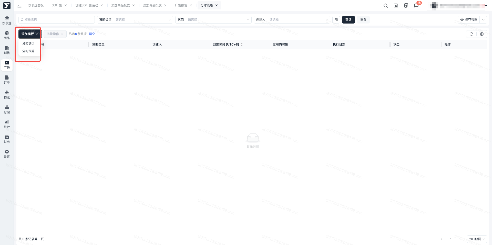

### 创建模版

#### 分时调价

1. 注意提示：页面顶部是竞价策略的注意事项，在创建前，建议先仔细阅读并了解；
2. 模板名称：填写一个易于识别的模板名称
3. 模板状态：启用或暂停
4. 生效日期：执行该策略的起止时间点，都是指当地时间（站点时间）；
5. 基准价：指分时的基准出价，选择使用每个广告对象应用分时模板时的出价；分时的调整都将会使用此基准价进行上浮和下调；在广告系统中对竞价做修改时，会提示是否更新基准价。
6. 分时设置：最后，设置竞价调整值。如果调整方式是提高或降低，需要设置对应调整后的最大值或最小值，以免调整超出预期。

 1. 自定义分时时间段，在所设置的分时时段，系统会自动结合每个广告对象的出价基准价进行上浮和下调；
 2. 对没有设置分时时段的时间点，系统将自动恢复基准价；
 3. 可设置一周 7 天，每天最多可设置 24 条调整策略；

 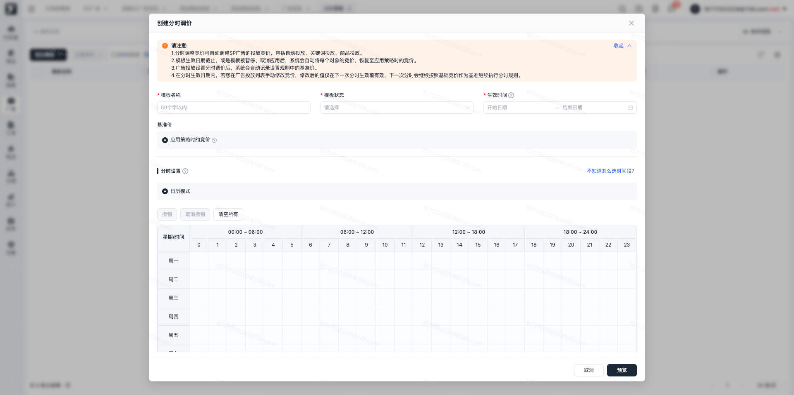
 4. 分时竞价策略的调整方式共有 5 种，可以根据自己的需求选择对应的调整方式；

 1. 调整方式：按固定值提高或降低、按百分比提高或降低、直接竞价；
 2. 前4种调整方式都是在分时计算基准值上提高和降低；

 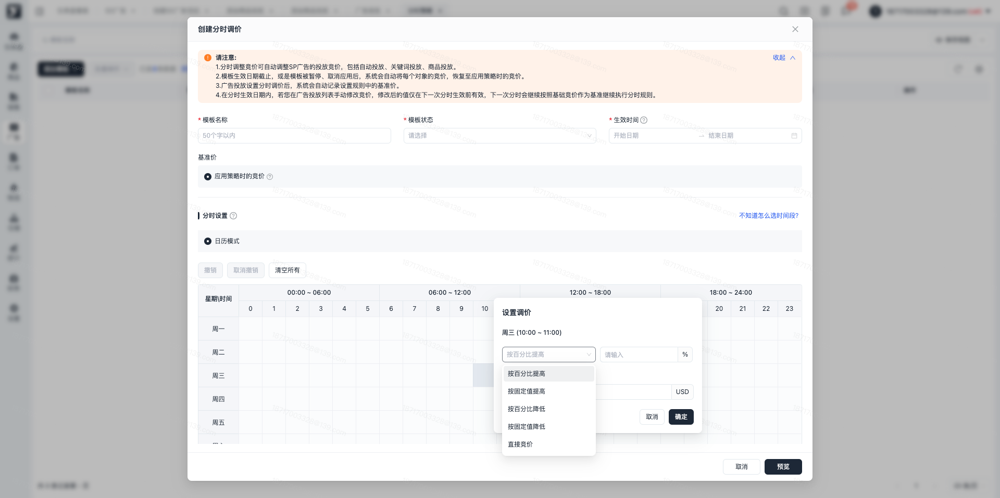

 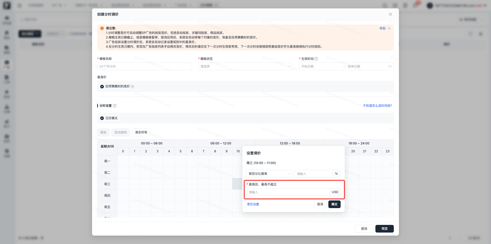

#### 分时预算

1. 注意提示：页面顶部是策略应用的注意事项，在创建前，建议先仔细阅读并了解；
2. 模板名称：填写一个易于识别的模板名称
3. 模板状态：启用或暂停
4. 生效日期：执行该策略的起止时间点，都是指当地时间（站点时间）；
5. 基准值：在应用模板时，取每个应用对象(广告活动)在本系统内的预算做为基准值，以后的预算调整都在此基准值的基础上进行变更；应用对象的策略生效中，在本系统内修改预算，会提示是否更新基准值。
6. 分时设置：可选择设置方式，设置完成后，在您设置的时段开始时，系统会将广告活动的预算调整为设定值，未设置时间段则按照基准值运行。

 1. 按固定值调整：如果调整方式是提高或降低，需要设置对应调整后的最大值或最小值，以免调整超出预期。

 1. 自定义分时时间段，在所设置的分时时段，系统会自动结合每个应用对象的基准值进行上浮和下调；
 2. 对没有设置分时时段的时间点，系统将自动恢复基准值；
 3. 可设置一周 7 天，每天最多可设置 24 条调整策略；

 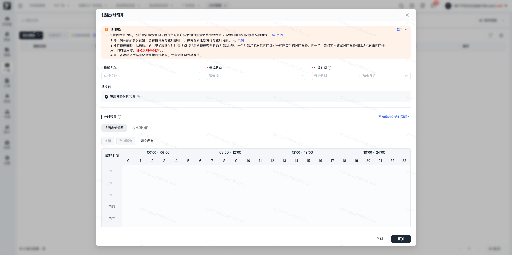
 4. 按固定值调整的方式共有 5 种，可以根据自己的需求选择对应的调整方式；

 1. 调整方式：按固定值提高或降低、按百分比提高或降低、固定预算；
 2. 前4种调整方式都是在分时计算基准值上提高和降低；

 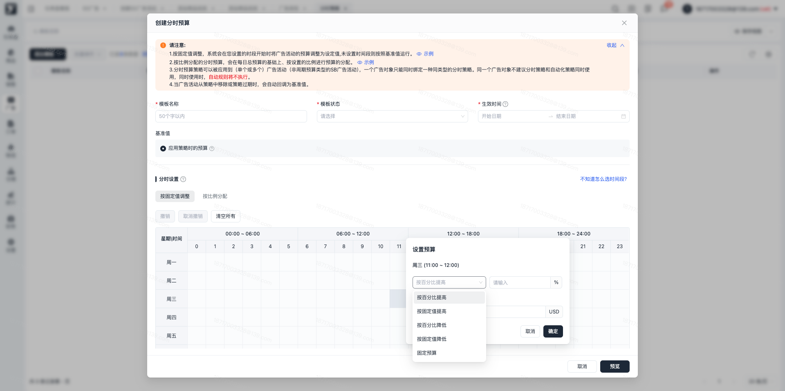

 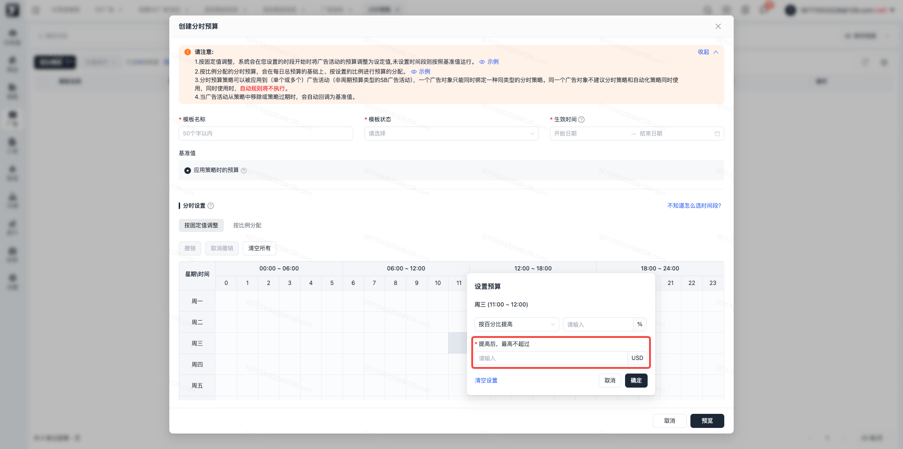

### 预览模版

设置好了调整规则，点击右下角【预览】，我们可以提前查看对应的分时调整效果，来确认当前调整规则是否符合我们的预期。

预览界面中字段说明如下：

1. 基准价：基准价=应用策略时的竞价，这里默认示例为0.2（分时调价模版展示）
2. 基准值：基准值=应用策略时的预算，默认展示为2.00（分时预算模版展示）
3. 执行的站点时间：

 1. 根据模板的设置，系统执行的调价时间；
 2. 起时间点负责执行调整，止时间点负责恢复到基准价；（举例：某竞价策略是3:00\~7:00降低20%竞价，7:00\~10:00降低10%，那么在3点时执行竞价调整降低20%，7点时不执行恢复到基准价）
4. 需要做的调整：根据模板的日历设置进行显示；
5. 调整后：根据设置的竞价调整规则，展示竞价的调整后效果；
6. 预览的时间段：

（1）您可预览一个完整周周期内，分时策略的开始执行时间及其对应的调整后竞价/预算，同时也能预览”非分时时间段“开始恢复基准价/基准值的时间点。

（2）如果模板生效周期超过一周，系统仅支持预览首个完整周的策略（后续周次策略与首周完全一致）。

（3）当预览无结果时，说明您选择的分时周期不在模板生效范围内（例如模板生效日期为周一至周三，则无法预览周四的策略）

（4）如果当前时间已超过您所选分时策略的有效时段（例如当前时间为周四 04:00，您所选分时时段为周四 02:00\~04:00）则也无法预览执行效果。

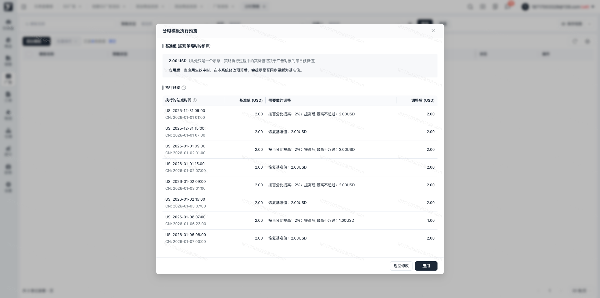

确认完预览信息后，点击【应用】，完成分时模版的创建。

### 应用分时模板

创建分时模板后，点击应用，自动打开该模板的应用模板页面；

您也能在分时策略页面点击【应用】，打开应用模板页面；

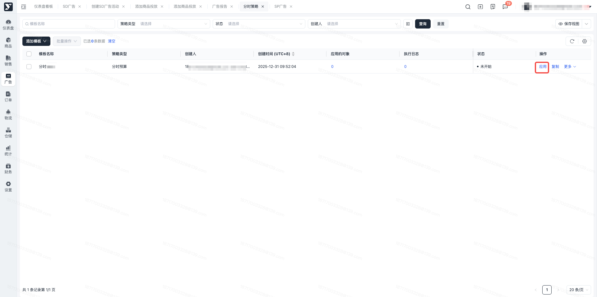

#### 应用分时调价模版

分时竞价策略，可分时段调整单个或多个关键词、商品和自动投放的竞价(Bid)，但一个广告对象只能同时绑定一个分时竞价策略。

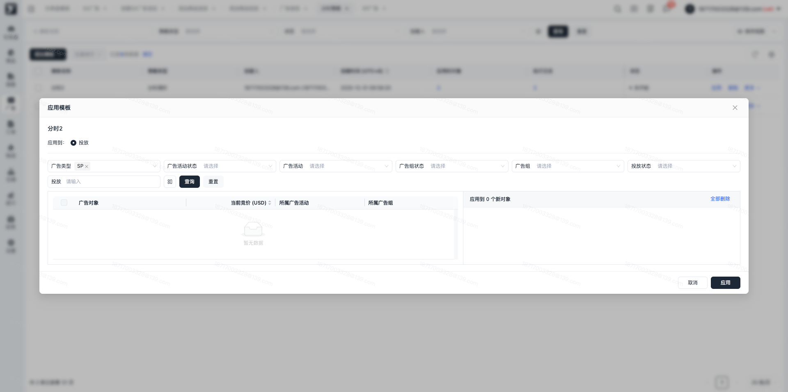

待选择的广告投放对象有应用过其他分时调价的策略，会提示：

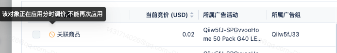

点击【预览】，可查看应用于该模板时，调整后的竞价。

#### 应用分时预算模版

分时预算策略，可分时段调整广告活动的预算金额，一个广告活动只能绑定一个分时预算策略。

已被应用的广告活动，鼠标悬停时，会进行气泡提示，不能被重复应用。

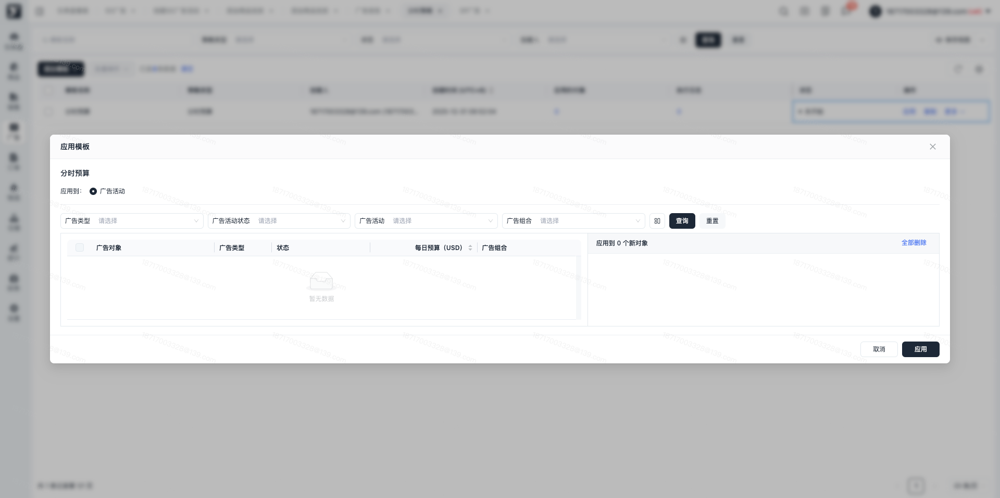

### 为广告对象应用模板

#### 投放应用策略

在广告投放页面：点击操作列的分时策略图标，即可管理该广告对象的分时策略设置；

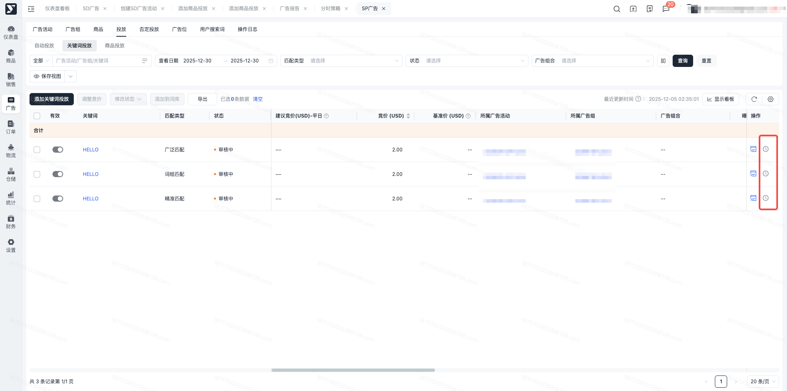

点击分时策略图标，选择模板，点击【应用】，投放对象成功应用该模板；

注意：当投放状态为审核中、创建失败、审核失败、已结束、已归档时，无法启用分时策略功能

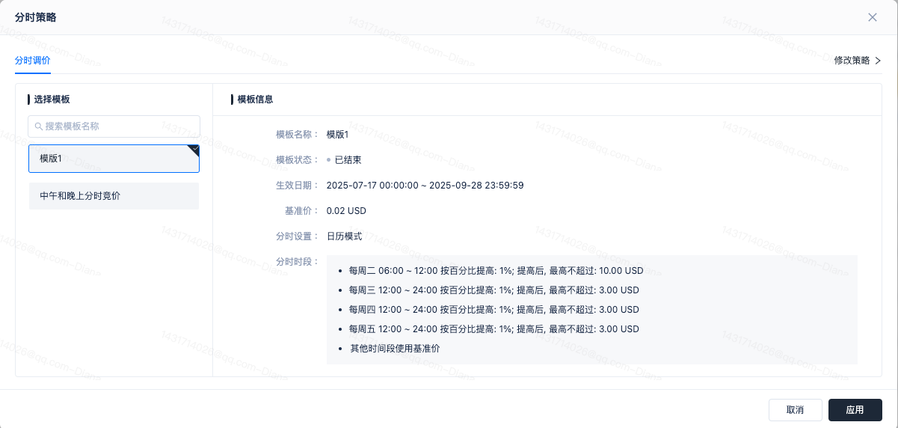

#### 广告活动应用策略

在广告活动页面点击策略图标，可以对广告活动进行策略应用。

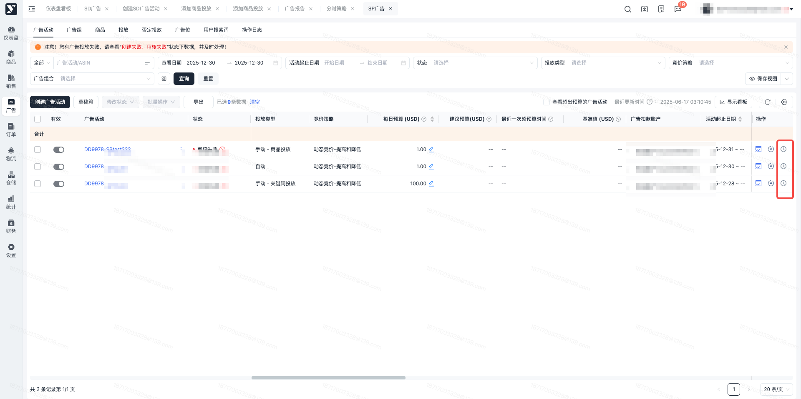

唤起应用弹窗后，切换策略名称，可以查看对应的策略详情，选中策略后，点击应用，即可对广告活动进行策略应用。

### 管理分时模板

#### 应用对象明细

您可以在分时策略页面，查看当前已使用模板策略的对象数量，以合理的调整自己的分时策略应用配置。

点击列表内数字，进入应用对象页面；

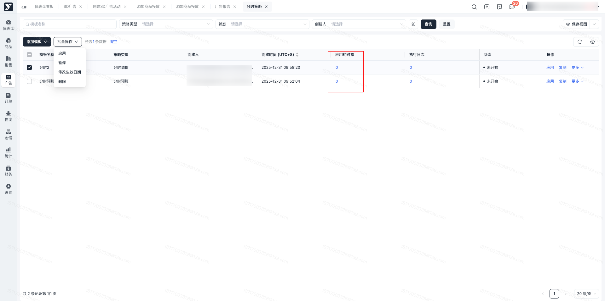

在应用对象页面，点击【预览】，可查看针对该广告对象执行的分时规则；

点击【日志】，跳转至执行日志页面；

支持单个/批量【删除】广告对象；删除后，投放竞价将立即恢复基准价、预算恢复基准值。

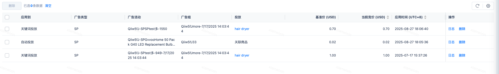

#### 启停分时模板

您可以选择启用或暂停某些分时模板，以合理地进行广告投放。

启用：模板若在生效日期范围内，则正常执行；

暂停：暂时停止执行，可恢复至启用；

批量操作启停位置如下：

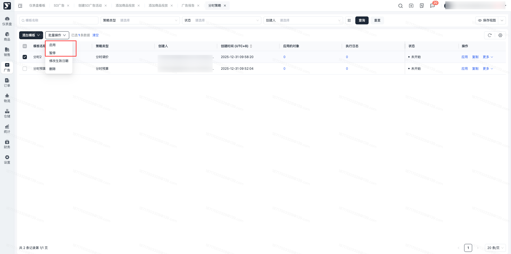

#### 复制分时模板

在分时策略页面点击【复制】，输入模板名称，即可复制相同的模板信息；注意：不会复制已应用该模板的广告对象

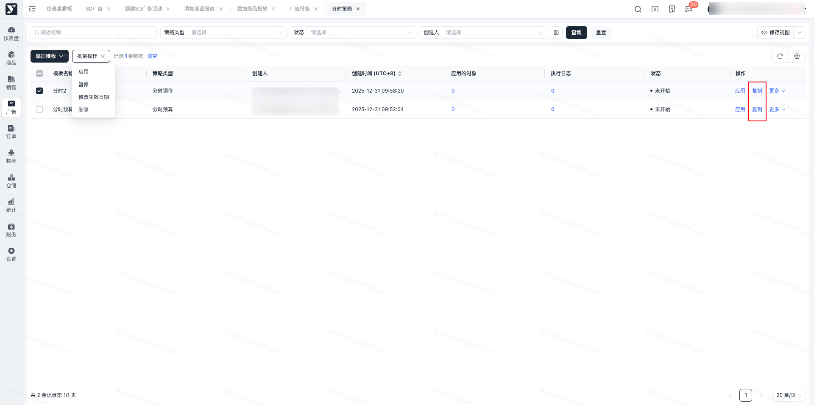

#### 修改生效日期

支持批量修改生效日期；可任意修改其中一个日期

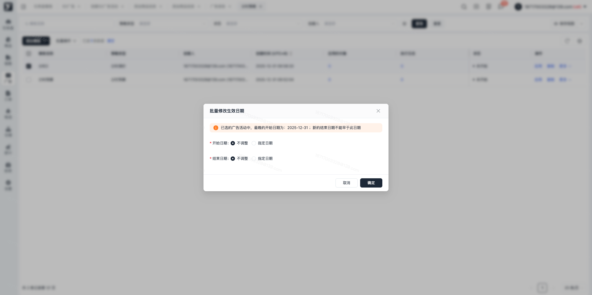

#### 修改分时模板

当您创建好了一个策略模板后，您可以再次修改其调整规则；

注意：尽量不要在策略临近执行时调整计划，以免因时间差造成错误调整。

在分时策略页面点击【修改】，修改分时策略的设置；

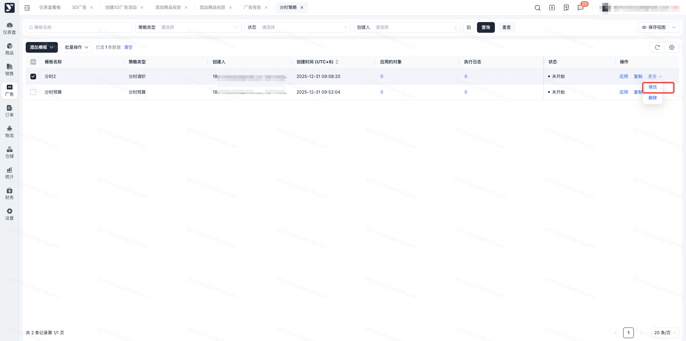

在原来模板内容的基础上进行修改；

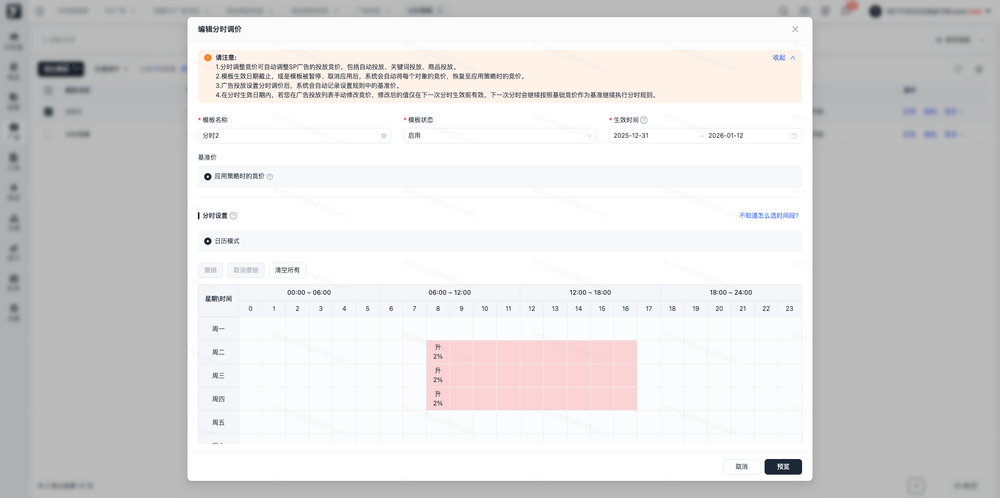

#### 删除分时模板

在分时策略页面点击【删除】，二次确认您是否要删除当前模板；

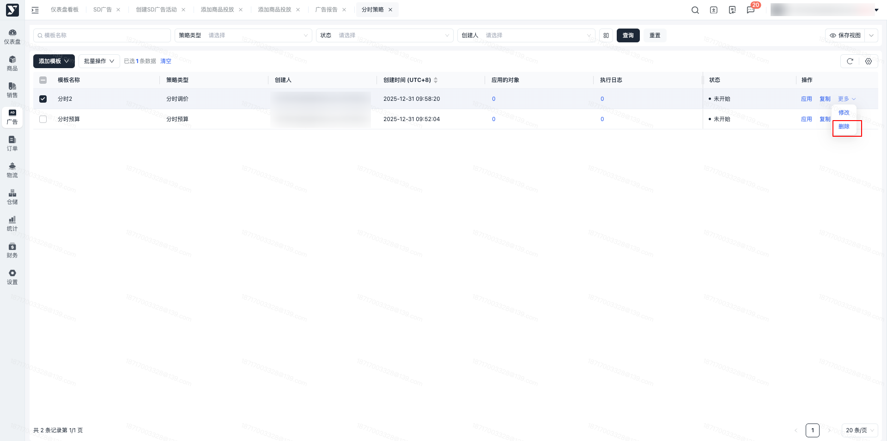

若当前模板正在启用且处于生效日期范围内，则会提示会将已经应用的广告对象恢复至基准价/基准值；

### 执行日志

执行日志记录每一次执行分时任务以及恢复基准价/基准值的日志；

分时策略页面，点击蓝色数字，进入执行日志页面；

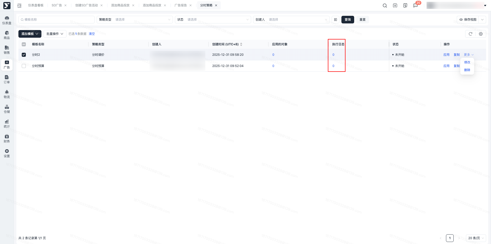

### 操作日志

操作日志记录分时模板调整变化及操作详情；

分时策略页面，点击蓝色数字，进入执行日志页面，再切换至操作日志Tab；

在操作日志页面，支持切换其他分时模板的操作日志；

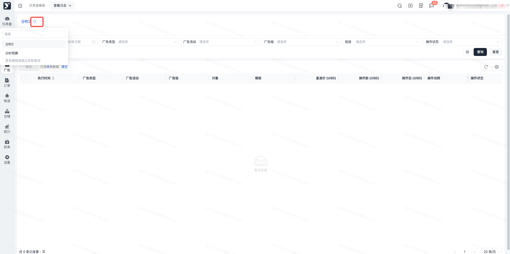

### 分时途中调整竞价

在分时途中，修改投放竞价时，会提示是否将当前修改后的竞价更新为下一个分时策略的基准价。

### 分时途中调整预算

在分时图中，修改广告活动的预算时，会提示是否更新基准值，若更新为基准值,新预算将作为后续分时策略的基准值,下一个分时时段开始生效。若不更新为基准值,新预算仅在下一次分时生效前有效,下一个分时时段仍在原来的基准值上执行分时策略。

## 三、常见问题

### Q1：分时策略启用后，什么时候执行？

A1：新设置分时策略，若当前时间（站点时间）在生效时段内，则立即生效；若当前时间（站点时间）不在生效时段内，到了时间开始生效，（即离当前时间最近的一个生效时间开始生效）

### Q2：在分时策略生效期内，手动修改竞价/预算，后续分时策略如何执行？

A2：1.未在分时时间段：下一个分时时段按照修改后的最新竞价/预算作为基准执行；

2.处在分时时间段：正在分时途中，按照修改后的竞价执行，并提示是否更新基准价/基准值。若更新，则下一个分时按照新的作为基准执行；若不更新，则下一个分时仍在原来的基准价/基准值上执行分时调整。

### Q3：同一个关键词/商品投放，是否能同时使用不同的策略规则？

A3：不能，同一个自动投放或关键词或商品投放只能使用一个分时调价的模板策略。

### Q4：策略模板在生效过程中，删除、暂停模板，或模板失效，竞价会变动吗？

Q4： 删除、暂停模板，模板失效，投放竞价会立即恢复基准价/基准值。

### Q5：策略模板生效过程中，编辑模板规则，什么时候执行分时？

Q5：若当前时间，正在新规则的分时时段内，则立即执行；若当前时间，还不在新规则分时时段内，则到了时间开始执行。

### Q6：为什么分时执行失败？

Q6：原因1：执行任务时系统发现竞价大于预算，则会停止执行分时

原因2：亚马逊接口波动，无法同步给亚马逊竞价，所以系统未正常更改调整后竞价。若发现异常，请联系您的运营经理。

### Q7：调整广告投放状态会影响竞价吗？

Q7：不会，保持当前竞价。

### Q8：广告活动可以同时添加分时策略和自动化策略吗，预算怎么调整？

Q7：广告活动可以同时添加分时策略和自动化策略，当在同一个时间点内既有分时策略又有自动化策略时，分时策略优先，自动化策略执行失败。
