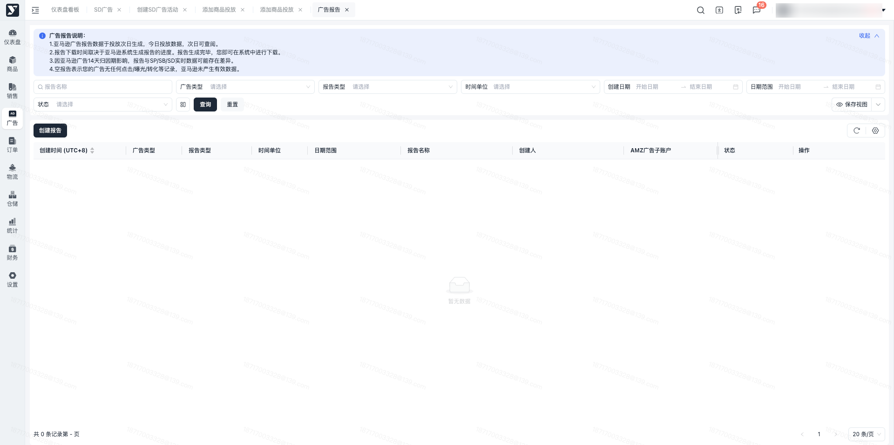
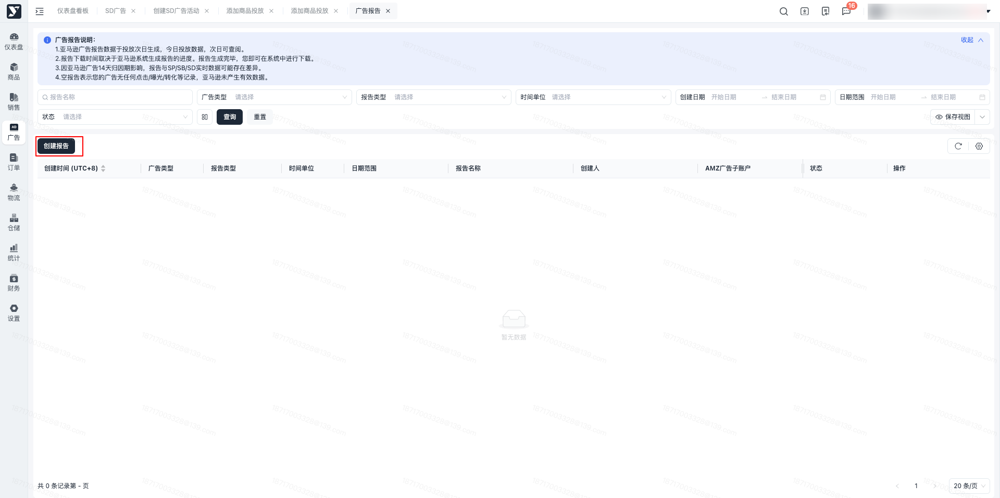
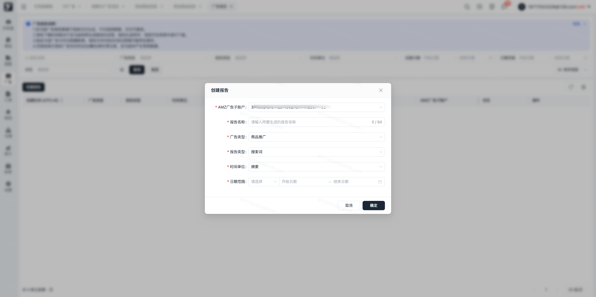
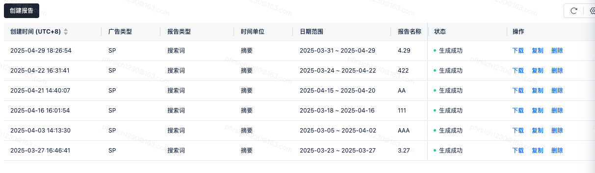
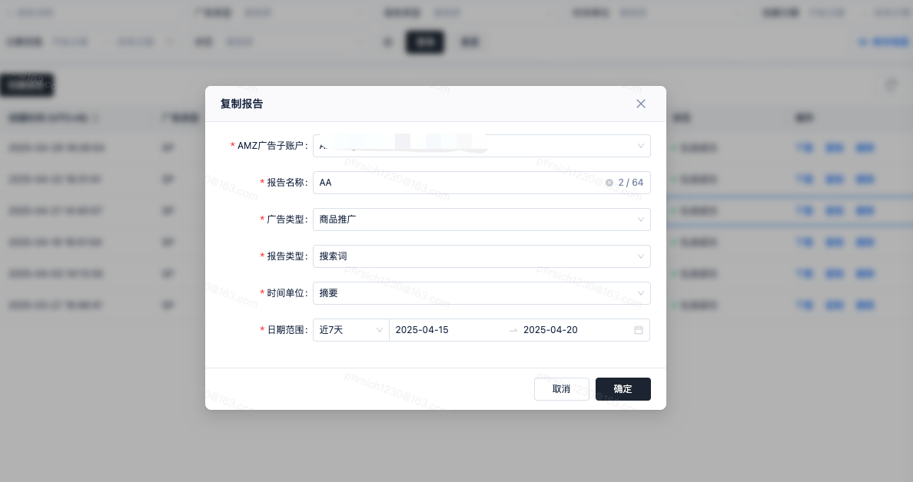
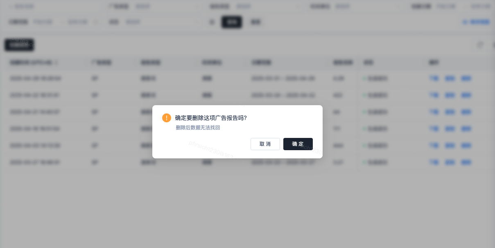

# 飞书文档：广告报告

广告报告

当前版本：v1.0.0

## 功能介绍

1. 广告系统基于亚马逊广告报告功能，支持卖家创建广告报告、一键下载亚马逊VC广告报告。

## 报告说明

### 类型汇总

> 3种广告类型对应的报告类型汇总表（SP 8类报告、SB 9类报告、SD 5类报告）

| 广告类型 | 报告类型 |
| --- | --- |
| 商品推广 | 1. 搜索词 2. 投放 3. 推广的商品 4. 广告活动 5. 预算 6. 广告位 7. 搜索词展示量份额 8. 总流量和无效流量 |
| 品牌推广 | 1. 关键词 2. 关键词广告位 3. 广告活动 4. 广告活动广告位 5. 搜索词 6. 搜索词展示量份额 7. 品类基准 8. 归因于广告的购买 9. 总流量和无效流量 |
| 展示型推广 | 1. 广告活动 2. 投放 3. 推广的商品 4. 匹配的目标 5. 总流量和无效流量 |

### 日期范围

| 广告类型 | 报告类型 | 时间单位 | 日期范围 |
| --- | --- | --- | --- |
| SP | 搜索词 | 摘要/每日 | 90天 |
| SP | 投放 | 摘要/每日 | 90天 |
| SP | 推广的商品 | 摘要/每日 | 90天 |
| SP | 广告活动 | 摘要/每日/每周/每月/每季度 | 回溯期5年 |
| SP | 预算 | 摘要/每日/每周/每月/每季度 | 回溯期4年 |
| SP | 广告位 | 摘要/每日 | 90天 |
| SP | 搜索词展示量份额 | 摘要/每日 | 65天 |
| SP | 总流量和无效流量 | 摘要/每日 | 回溯期1年 |
| SB | 关键词 | 摘要/每日 | 90天 |
| SB | 关键词广告位 | 摘要/每日 | 90天 |
| SB | 广告活动 | 摘要/每日 | 90天 |
| SB | 广告活动广告位 | 摘要/每日 | 90天 |
| SB | 搜索词 | 摘要/每日 | 65天 |
| SB | 搜索词展示量份额 | 摘要/每日 | 65天 |
| SB | 品类基准 | 摘要/每日 | 90天 |
| SB | 归因于广告的购买 | 摘要/每日 | 2511天 |
| SB | 总流量和无效流量 | 摘要/每日 | 回溯期1年 |
| SD | 广告活动 | 摘要/每日 | 90天 |
| SD | 投放 | 摘要/每日 | 90天 |
| SD | 推广的商品 | 摘要/每日 | 90天 |
| SD | 匹配的目标 | 摘要/每日 | 90天 |
| SD | 总流量和无效流量 | 摘要/每日 | 回溯期1年 |

## 操作流程

### 广告报告菜单

【广告管理】-【广告工具】-【广告报告】

### 创建广告报告

- 点击【创建报告】，进入创建页面

- 进入【创建报告】页面，填写报告名称，选择广告类型（SP/SB/SD），以及对应的报告类型、时间单位、报告的日期范围。

### 广告报告列表

- 创建报告成功后，列表会生成一条“生成中”的数据；
- **此时正在亚马逊下载广告报告，具体在内可下载报告的时间，依据亚马逊系统生成该报告的时间而定。**

### 报告生成成功

- 广告报告的状态为“生成成功”后，您可【下载】、【复制】、【删除】该份报告；
- 点击【下载】，自动将报告excel文档下载到本地；

- 点击【复制】，可快捷复制该份报告；复制成功后，列表也会生成一条数据

- 点击【删除】，该条广告报告删除后不可再恢复；

### 报告生成失败

- 若报告生成失败，您可重新修改报告后，等待再次生成报告，或删除报告；

## 常见问题

#### **Q1：为什么广告报告生成失败？**

A1：一般情况下，由于亚马逊接口波动，导致报告未能正常生成；若多次生成失败，请联系您的运营经理。

#### **Q2：为什么要选AMZ广告子账户？**

A2： AMZ广告子账户是用于投放和管理亚马逊广告的独立账户，报告也是独立的。

#### **Q3：创建了广告报告后，多久能下载报告？**

A3：创建后，具体在内可下载报告的时间，依据亚马逊系统生成该报告的时间而定。

#### Q4：为什么下载的广告报告有时是中文，有时是英文？

A4：因为报告的语言版本是依据当前亚马逊平台语言而定；后续会统一为中文报告。
