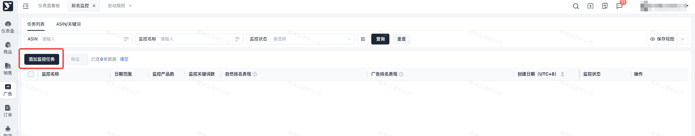
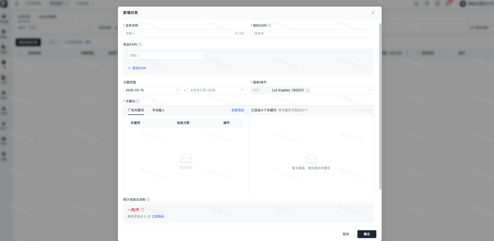
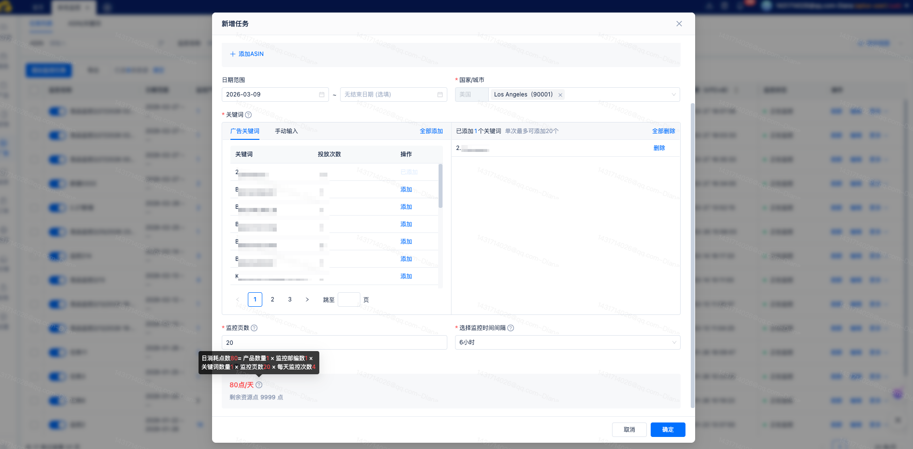
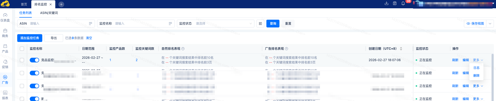
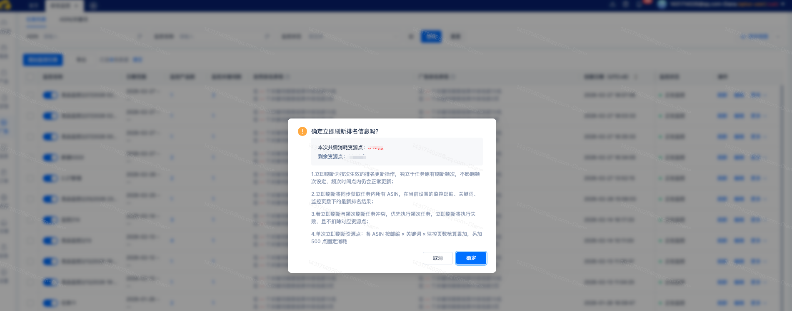
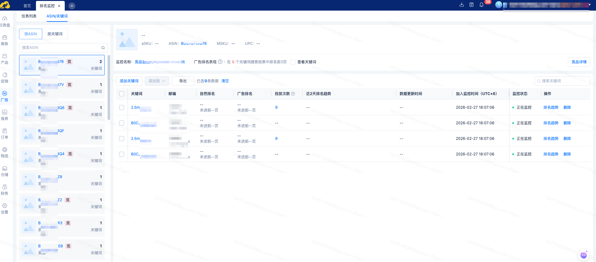
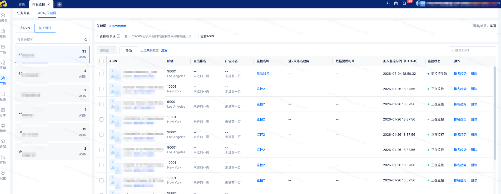
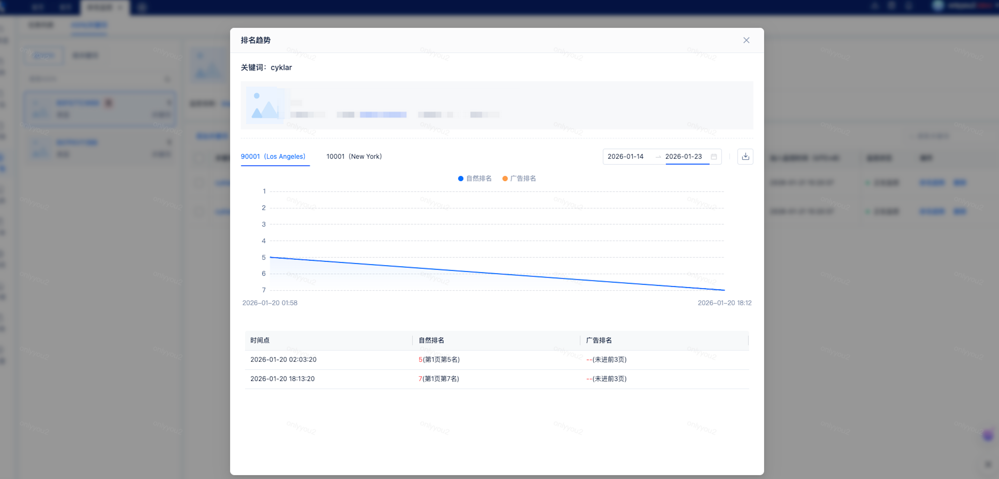
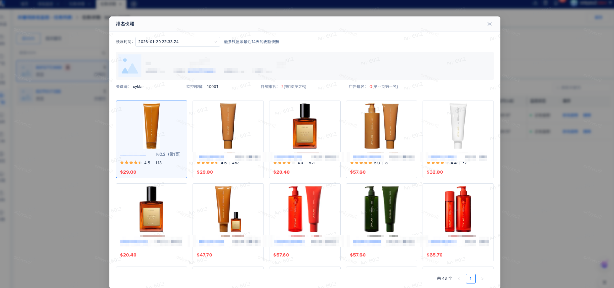

# 飞书文档：排名监控

## 文档信息

| 项 | 内容 |
| --- | --- |
| 远程文档 | https://q1njej8cpab.feishu.cn/wiki/RExLwOsgyiLtnZkbEYgc5OtSnYe |
| 图片处理 | 本地下载（assets/images） |
| 快照时间 | 2026-08-06 |
| 来源命令 | `lark-cli docs +fetch --as user --doc "<remote>" --jq ".data.markdown"` |
| 格式处理 | fd-doc-markdown-sync/scripts/normalize-feishu-doc-markdown.mjs |

---

排名监控

当前版本：v1.0.2

## 一、功能介绍

排名监控支持监控指定 ASIN 在目标关键词下的亚马逊搜索结果排位，支持按城市精准监控、查看排名快照、接收排名波动预警，帮助用户高效获取与沉淀排名数据，为精细化运营提供稳定的数据支撑。

## 二、操作说明

### 添加监控任务

首次进入排名监控列表时，页面默认展示为空，需先创建监控任务，系统将根据任务状态同步更新数据；点击【添加监控任务】按钮，即可弹出添加监控弹窗。

- 请输入监控名称与您的ASIN，同一个ASIN只能存在一个监控任务中。
- 可按需添加竞品 ASIN，系统将同步为所选竞品 ASIN 创建对应的竞品监控任务。
- 可设置日期范围，选择监控任务的生效开始日期与结束日期；不在生效日期内的任务将自动停止排名监控。结束日期非必填，不填结束日期为任务长期有效。
- 需设置邮编，默认展示美国区域，支持选择美国境内邮编，最多可选择5 个。
- 需设置监控关键词，支持添加广告关键词或手动输入关键词，单次最多可添加20 个。

- 需设置监控页数，默认选择3页，可增加设置页数，最大可添加至20页
- 需设置监控时间间隔，默认间隔6小时，可更改间隔时长，如设置间隔6小时，则表示每6小时触发一次监控任务。

进行完以上设置后，会展示预估资源点的消耗情况，资源点的计费规则为：日消耗点数= 产品数量 × 监控邮编数 × 关键词数量 × 监控页数 × 每天监控次数，示例：1个ASIN，配置3个邮编，监控10个关键词，监控5页，每2小时监控一次，则日消耗点数=1 × 3 × 10 × 5 × (24/2)=1800点，展示为1800点/天。

### 任务列表

创建完监控任务，会在列表中生成监控数据，可通过任务维度或者ASIN/关键词维度进行数据查看。

任务列表以任务维度展示监控详情，统计展示监控任务的日期、状态、监控产品数、监控关键词数、最近一次的自然排名表现统计、最近一次的广告排名表现统计、任务的创建日期。可查询任务的监控状态，并进行监控状态操作。可编辑、删除、查看任务日志。

点击刷新，手动增加任务消耗，单次刷新即刻触发监控任务，不计算监控间隔，各 ASIN 按邮编 × 关键词 × 监控页数核算累加，另加 500 点固定消耗。

### ASIN/关键词列表

- ASIN列表：以ASIN维度进行数据展示，可查看对应ASIN在具体关键词下的排名情况，包括自然排名和广告排名、所属邮编、排名趋势等数据。如当前ASIN为竞品ASIN，还可以在列表中查看独立图标。勾选顶部的查看关键词，还可以快速筛选出广告排名表现在搜索结果页中排名前3的数据。

 
- 关键词列表：以关键词维度查看数据，可查看对应关键词下所有ASIN的排名情况。支持查看所属监控任务、广告排名、自然排名、排名趋势等数据，点击顶部的查看ASIN，可快捷筛选广告排名表现在搜索结果页前3的ASIN数据。

 
- 排名趋势：ASIN列表及关键词列表均可以唤起对应数据的排名趋势，排名趋势可查看指定日期下的广告排名趋势和自然排名趋势。可根据具体的邮编查询指定邮编下的趋势图。

- 排名快照：当在ASIN列表或关键词列表中有具体排名数据时，会在排名数据旁边展示相机图标，点击图标，可唤起排名快照弹窗，排名快照记录每次监控时间点下，页面的相关ASIN数据。

## 三、常见问题

### Q1：为什么列表中找不到排名快照入口？

A1：排名快照需要产生具体排名数据后，才会生成快照，所以当列表中存在近2天的排名数据时，才展示该快照入口。如无最新数据展示，不能进入排名快照进行数据查看。

### Q2：为什么竞品ASIN数据展示不全？

A2：竞品ASIN数据需要在有监控数据后，才能填充完整，如当前无数据，则为任务没有拉取到有效数据，会展示为空。
