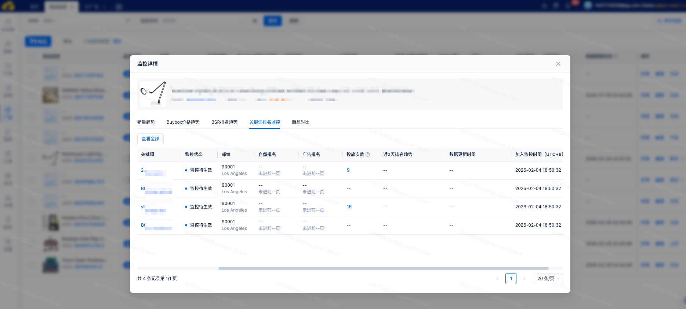

# 飞书文档：竞品监控

竞品监控

当前版本：v1.0.0

## 一、功能介绍

竞品监控可有效解决传统排名监控中无法关联竞品投放、竞品数据需逐个手动搜索、操作繁琐且数据无法有效留存的问题。用户可通过本功能创建监控任务，实现排名监控与竞品的关联绑定，快速浏览竞品历史信息，精准定位自身商品的竞争短板与差异，为广告投放策略提供数据支撑；同时支持添加竞品 ASIN，由系统自动获取其排名、评论数、价格等核心运营信息，方便用户分析竞品运营动作、优化自身商品策略。

## 二、操作说明

### 添加监控

首次进入竞品监控列表时，页面默认展示为空，需先创建监控任务，系统将根据任务状态同步更新数据；点击【添加监控】按钮，即可弹出添加监控弹窗。

在弹出的监控弹窗中，可输入竞品ASIN，一行一个ASIN，单次最大可添加20个ASIN。可选择关联我的ASIN，选择了关联我的ASIN后，会在对比商品模块中展示关联的数据，最大可关联20个我的ASIN。

如需对竞品ASIN进行排名监控，可开启排名监控开关，完成排名监控设置，包括设置日期范围、监控邮编、关键词、监控页数、监控时间间隔。

确认设置内容后，提交则完成监控任务创建，开启排名监控时，还会同步创建排名监控任务。

### 查看监控列表

创建完监控任务，会在列表中生成一条监控数据，可查看当前监控竞品的品牌、销量、Buybox价格 (USD)、大类排名、小类排名、是否入围BS榜单、Rating数、评分、对比商品、上架时间。均展示最新结果数据，监控状态为启用中的ASIN每日进行一次数据更新。

### 查看监控详情

30天销量、Buybox价格 (USD)、大类排名、小类排名均可唤起对应的趋势弹窗，点击详情可查看完整的趋势弹窗。

- 销量趋势：进入销量趋势弹窗，可查询近12个月的销量表现，最早可查询上月销量。列表展示的30天销量，为上月销量。

- Buybox价格趋势：进入Buybox价格价格趋势弹窗，可查询日期组件指定日期下的价格趋势表现，按天呈现每天的价格数据

- BSR排名趋势：点击大类排名或者小类排名字段均可唤起BSR排名趋势，可查看指定日期下的排名趋势，展示排名所在的类目名称，最大支持展示6个类目。

- 关键词排名趋势：当该竞品ASIN有创建排名监控任务时，在关键词排名监控TAB会展示当前ASIN的排名详情。无排名监控任务时，会进行任务创建提示。

排名监控任务点击查看全部，可跳转至对应的排名详情页面。

- 商品对比：当前ASIN有关联我的ASIN时，在商品对比可查看按日维度的对比明细，支持查看近30天的数据。如未进行我的ASIN关联时，不展示商品对比数据。

## 三、常见问题

### Q1：创建竞品监控后，什么时候开始执行？

A1：新建的竞品监控会立即执行，之后每日自动更新一次。监控状态为停用的竞品，会停止自动更新。

### Q2：为什么日志里的扣费时间和列表中的数据更新时间不一致？

A2：日志中的扣费时间为任务发起时间，任务发起成功后即扣费。列表中数据更新时间为数据返回成功时间，二者记录节点不同，因此会存在差异。
