# 飞书文档：自动规则

自动规则

当前版本：v1.0.0

## 一、功能介绍

1. 自动化策略，可以帮助您根据广告效果调整广告投放，做到广告投入效益最大化。
2. 自动化策略支持按照效果进行预算调整；更多模块的自动化策略正在建设中，敬请期待。

| **自动化策略** | **广告类型** | **预算类型** |
|-|-|-|
| 自动化预算 | SP、SB、SD | 每日预算 |

**具体使用方法如下：**

1. 自动化策略的设置一共分2步：创建策略 和 应用策略。
2. 先创建好对应自动化策略，然后将策略应用到对应的广告对象，系统会按照设置的规则去匹配数据，命中数据规则的内容会按照设置进行调整，调整成功的数据会同步至亚马逊VC后台。

## 二、操作说明

### 创建策略

首次使用，需要先创建策略内容，进入广告管理-广告工具-自动化策略，点击【创建策略】按钮，唤起创建弹窗，填写策略规则。创建策略时，选择广告类型及策略规则，并设置执行数据范围和命中条件，系统会按照设置的执行频次去拉取应用策略的广告活动，执行策略规则。创建时规则可详细阅读温馨提示。

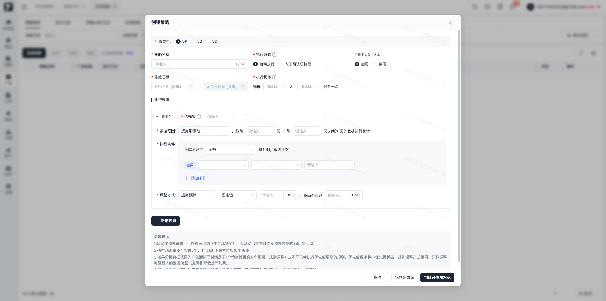

### 应用对象

1. 路径：创建完策略后，可直接点击创建并应用对象唤起应用对象弹窗，或者在策略管理列表，点击应用，唤起应用对象弹窗。

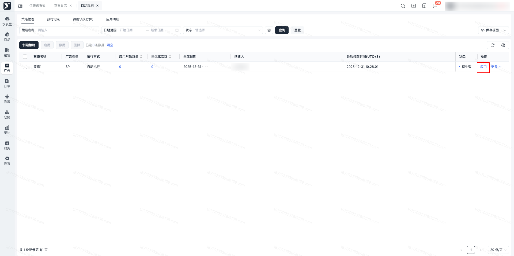

1. 添加应用对象

设置好策略后，可以进行应用对象添加，可选择应用对象为当前策略对应的广告类型下的对象明细。预算策略，只能选择广告活动，且预算类型均为每日预算。

勾选对应的广告活动，会展示在右侧的应用明细中，确认后添加成功。

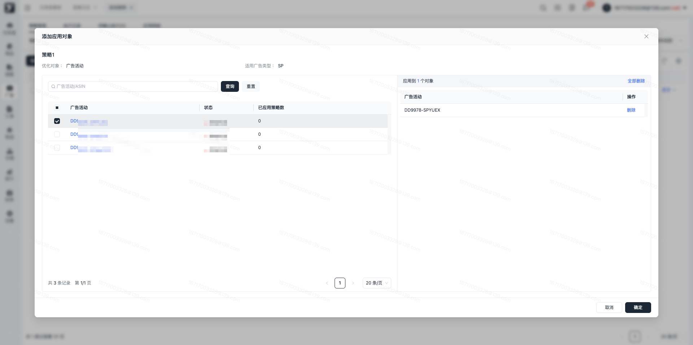

### 查看应用对象明细

应用对象后，在策略管理点击应用对象数量，可以查看应用对象明细。可以对应用对象进行开关和移除操作。关闭后策略不会执行该广告活动，移除后，该活动从列表中删除

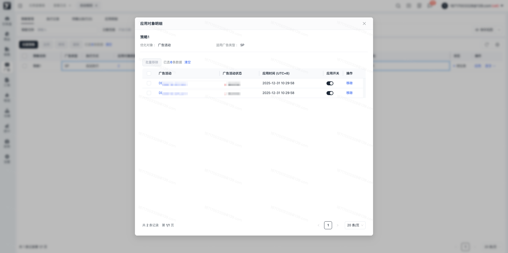

### 操作日志

操作日志记录策略的调整变化及操作详情；

在策略管理列表点击具体的策略内容，在更多的下拉菜单中可点击操作日志，点击后唤起该策略的操作日志弹窗，记录在每个操作类型下，操作前和操作后的内容变化。

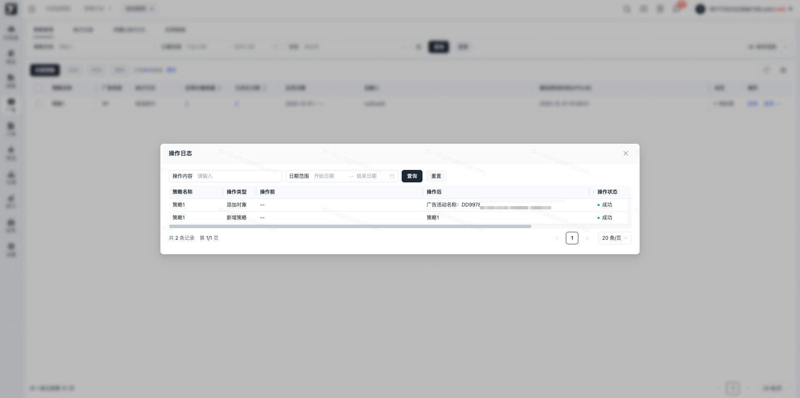

### 执行记录

点击执行记录tab或者在策略管理列表中的已优化次数蓝色字，可以进入执行记录列表。

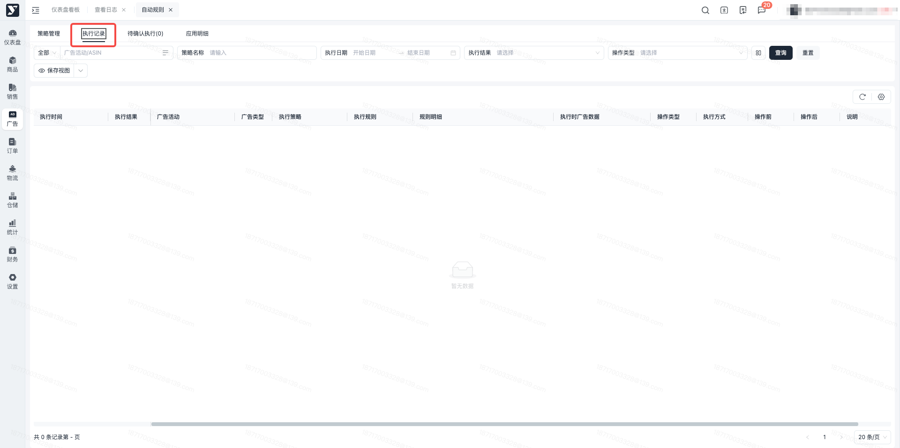

进入执行记录列表可查看策略执行的具体情况，记录执行时间（洛杉矶时间）下的广告活动的数据变化，执行成功会发起预算调整，执行失败，不会发起预算调整。

### 待确认执行

创建策略时，策略的执行方式为“人工确认后执行”，则广告活动满足策略执行规则时，需要确认后，才能进行策略执行，可操作立即执行或者忽略，立即执行策略会按照设置规则进行策略执行，忽略则当前活动不会继续执行该策略。支持进行批量执行和批量忽略。

注意：如有历史待确认执行被点击立即执行，也会根据当前预算数据去对比调整，待确认执行时需确认数据是否需要被执行。

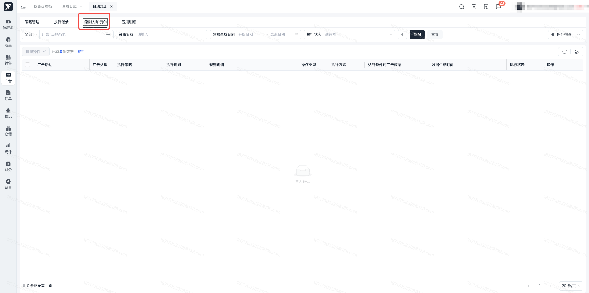

### 应用明细

广告活动有关联策略时，在应用明细列表能查询到广告活动内容，可查看上次执行的策略和执行策略的明细内容。注意：当广告活动未关联任何策略时，当前列表中不会展示该广告活动。

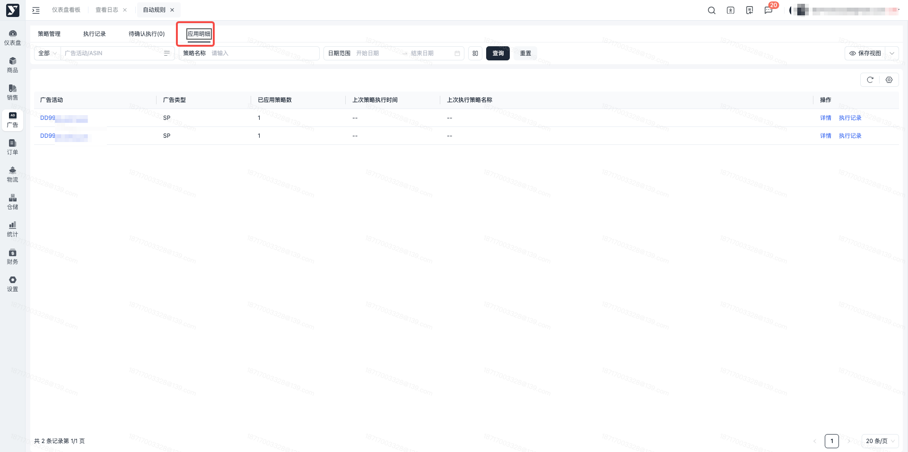

1. 查看执行明细详情

点击应用明细的详情时，可唤起活动关联详情弹窗。可以查看每个关联策略的明细，可进行策略应用开关操作，可直接移除策略，移除后广告活动不再应用该策略。

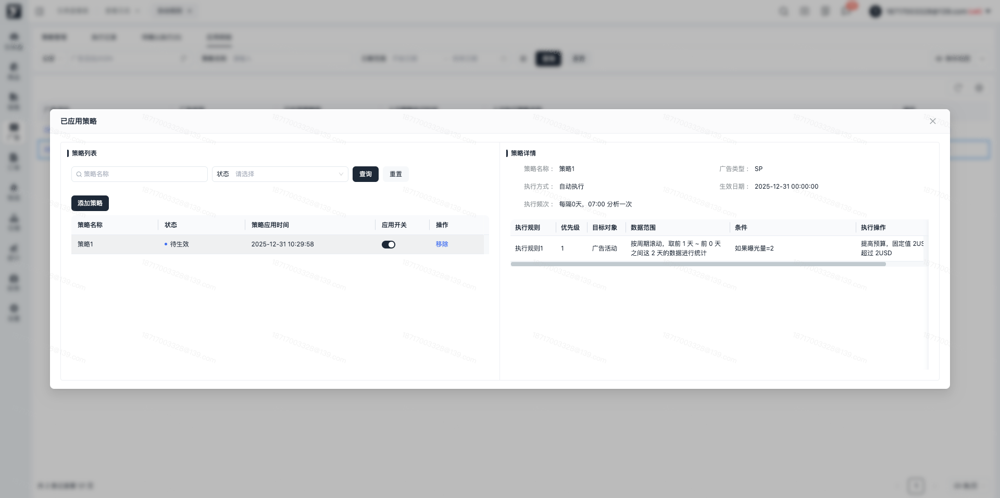

1. 查看执行记录

点击策略明细的执行记录可以跳转执行记录列表，快捷查询该广告活动的具体执行明细。

### 广告活动列表应用策略

#### 未应用策略

当广告活动未应用策略时，广告活动列表的分析策略应用图标为灰色，点击后唤起选择应用策略弹窗。说明：当广告活动的类型为审核中、创建失败、审核失败、已结束、已归档时，无法应用自动化策略。且SB广告活动预算类型为生命周期预算时，无法应用自动化预算策略。

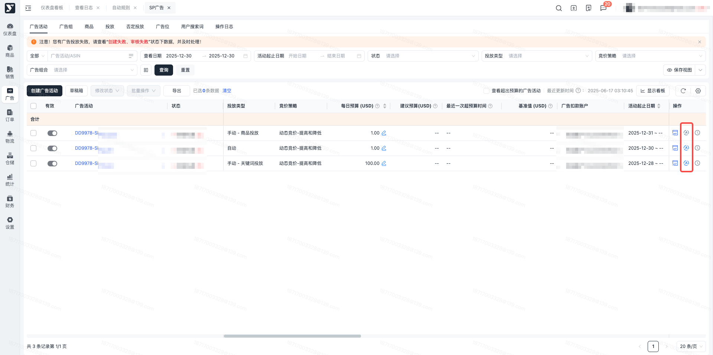

#### 添加策略

广告活动有关联策略时，列表图标为蓝色，点击图标可唤起已应用策略弹窗，展示已应用策略的列表信息，切换不同的内容，右侧展示不同的详情信息。可以进行活动和策略的关联操作，可进行开关控制或者进行策略移除。

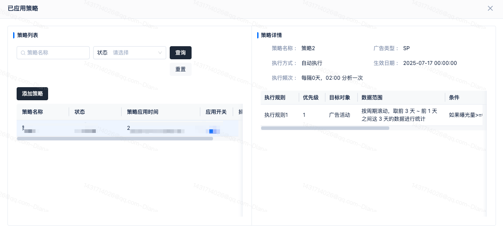

#### 消息通知

当有待确认的策略时，会进行站内信消息通知，可以关注站内信提醒，并点击站内信内容进行内容查看，也可以进入待确认执行列表，tab名称旁边也会展示待确认的条数统计。

## 三、常见问题

### Q1：自动化策略什么时候才会生效？

A1：自动化策略会按照设置的生效周期进行生效，状态为启用时，未到开始时间，策略为未生效，未生效不会执行策略；在生效时间内，策略为生效中，策略执行。生效时间已过期，策略为已结束，已结束策略不再执行。

### Q2：在自动化策略生效期内，手动修改策略，后续的策略还会被执行吗？

A2：在策略执行周期内，修改的策略，未执行的策略会按照修改后的策略去执行。

### Q3：一个活动被添加到多个策略中，同一时间点执行哪一个？

A3：一个活动被添加到多个策略中，且都满足了策略的规则条件，则执行时，在同一个执行时间点，只会执行应用策略时间最新的策略内容。

### Q4：活动在执行时，命中同一个策略的多个规则，执行哪一个规则？

Q4： 活动在执行策略时，命中了同一个策略的多个规则，当调整方式相同时，取执行绝对值最大的规则执行。当调整方式不同时，按照填写的优先级进行执行。

### Q5：执行记录明细中显示执行成功，为什么广告活动的预算调整失败了？

Q5： 执行记录中的执行成功和失败，是针对策略的执行状态进行的反馈，指发起预算调整。最终广告活动预算是否调整成功，要在具体的广告活动操作日志中查询。
