# 飞书文档：词库管理

## 功能介绍

词库/商品库，提供投放内容管理功能，可以创建属于自己的词库、商品库，可添加在广告中出现的词/商品进入库中，比如：用户搜索词、关键词投放等，丰富自己的词库商品库，拓宽商品的流量来源。可直接从词库商品库进行广告投放，帮助我们更便捷的进行广告管理。

## 操作说明

### 词库

#### 新增关键词

1. 从来源页面添加：在入口页面，点击【添加到词库】，选择分类和标签后，添加成功。来源页面包括如下：

 - 关键词：在SP、SB投放的关键词投放列表中添加的关键词
 - 否定关键词：在SP、SB广告的否定投放列表中添加的关键词
 - 用户搜索词：在SP、SB广告的用户搜索词列表中添加的关键词
 - ABA搜索词：在数据报表的亚马逊ABA搜索词报告列表中添加的关键词

 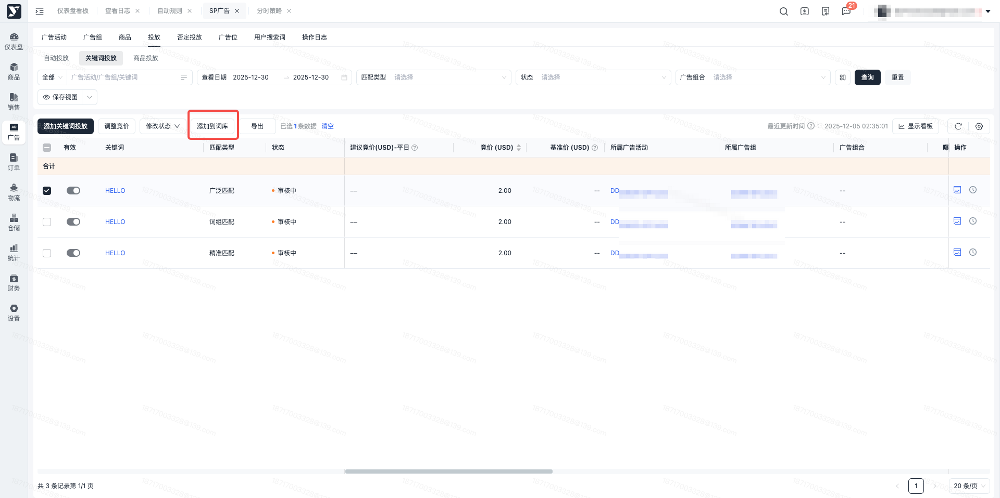

 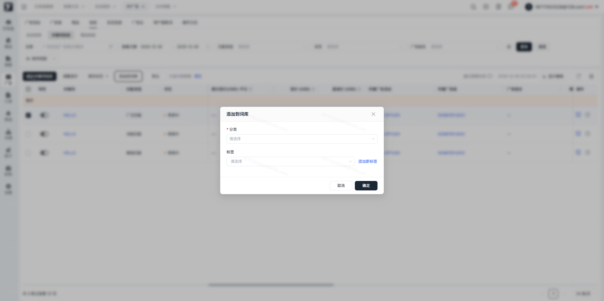
2. 手动添加：从词库添加进入“词库”功能页，点击【手动添加】，唤起添加弹窗，选择分类，录入关键词后，可进行词库添加。添加来源记录为手动添加。

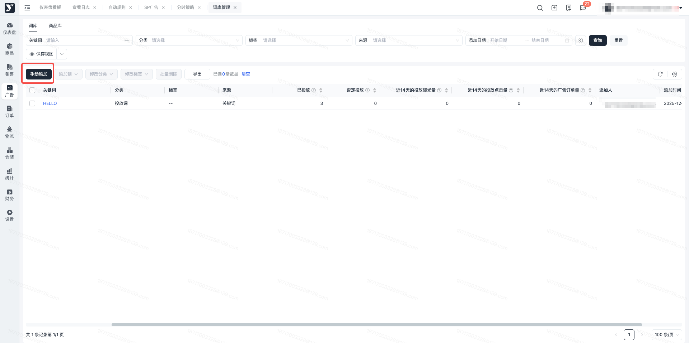

#### 管理关键词

##### 添加到关键词投放

在词库中选中关键词后，点击【添加到】下拉框中的【关键词投放】唤起投放弹窗。确认选择广告类型、广告内容、竞价方式、匹配方式后，点击【应用到下方关键词】后列表内容生效，确认列表内容无误后，可确认提交。

说明：在对竞价进行价格设置时，如价格不符合每日预算设置及默认值设置时，会自动变更为限制值。

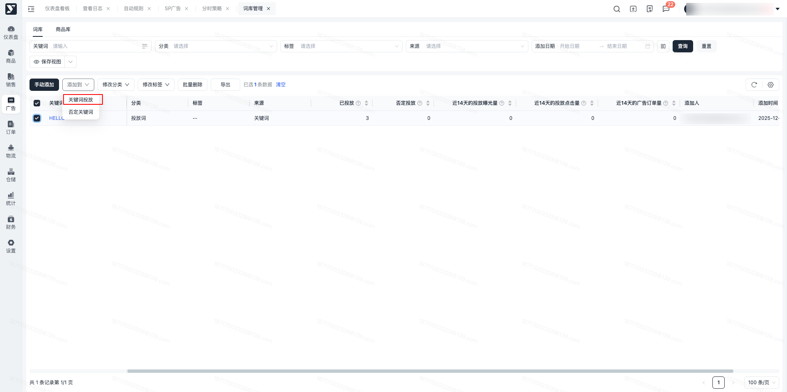

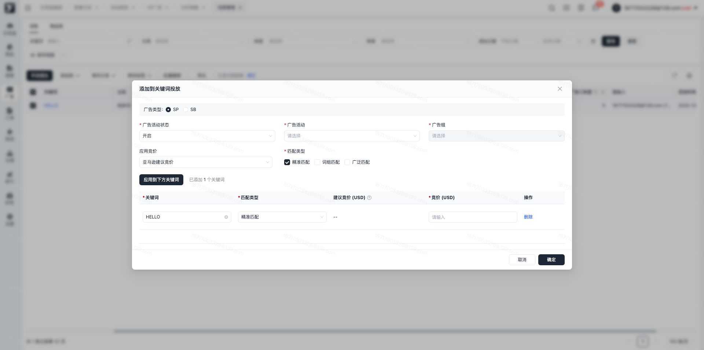

##### 添加到否定关键词

在词库中选中关键词后，点击【添加到】下拉框中的【否定关键词】唤起投放弹窗。选择广告类型、广告内容、匹配类型后，点击【应用到下方关键词】后列表内容生效，确认列表内容无误后，可确认提交。

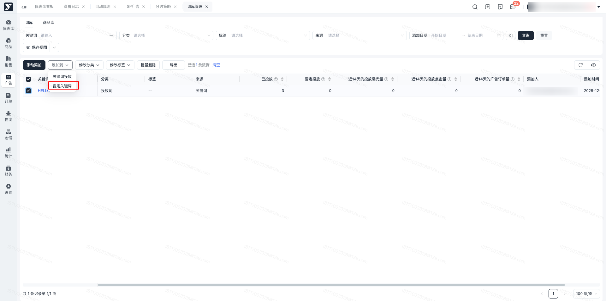

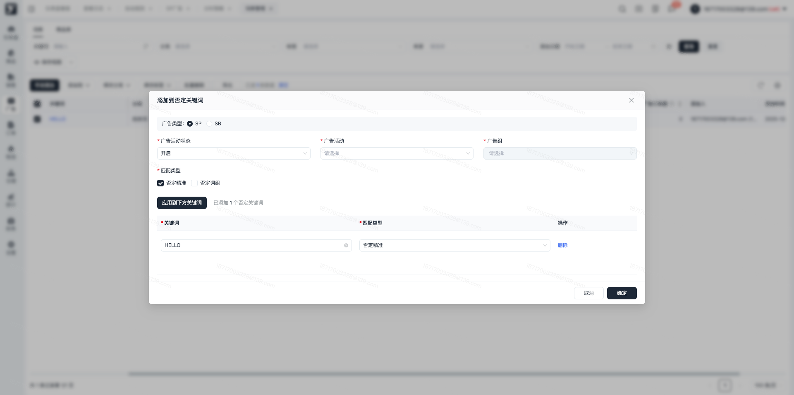

##### 修改分类

在词库中选中关键词后，点击【修改分类】可以在下拉框中选择类型，可以批量修改为否定词或投放词。当前分类仅用于词的筛选分类，不做投放限制。

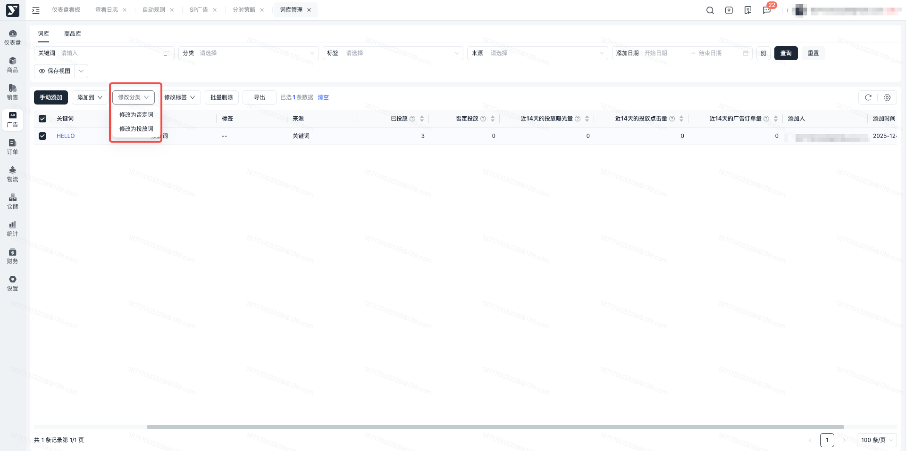

##### 修改标签

在词库中选中关键词后，点击【修改标签】，可对选中关键词进行标签应用或者移除。

- 应用标签：可以直接下拉选择已有标签（词库和商品库共同一个标签内容），无匹配的标签则可以点击【添加新标签】进行内容新增，添加新标签时，单个标签最大10个字符。

 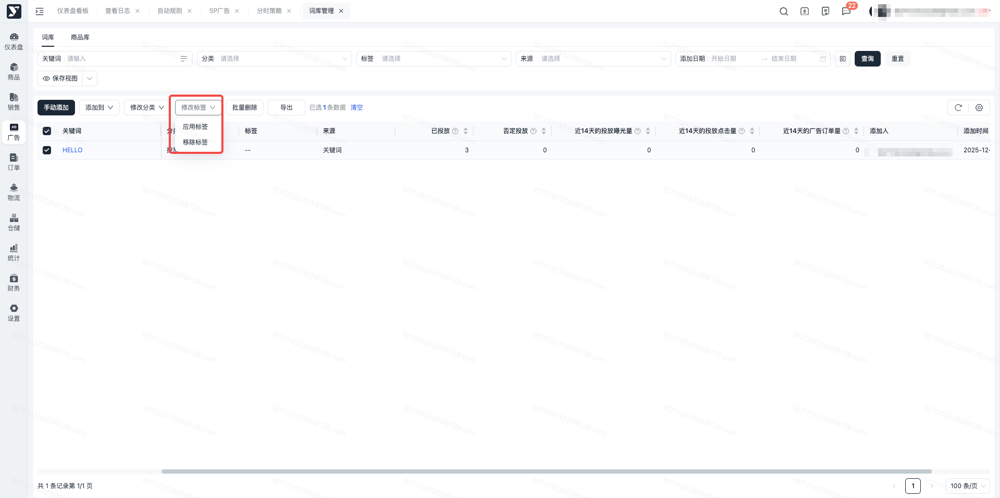

 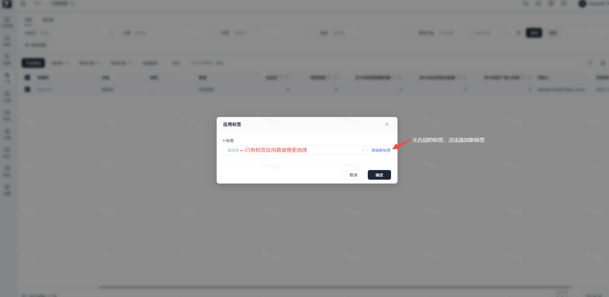
- 移除标签：选中关键词后，在修改标签的下拉框中选中【移除标签】，唤起移除标签弹窗，搜索或选中需要移除的标签，确认内容无误后，点击按钮【移除标签】，则选中关键词上不再展示被移除的标签。

 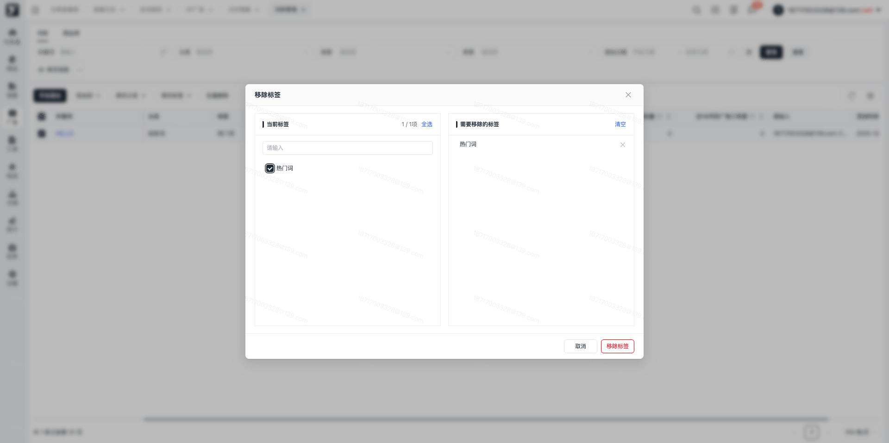

##### 批量删除

选中关键词后，点击【批量删除】按钮，唤起二次确认弹窗，确认后关键词删除，删除的关键词仅在词库中删除，不影响已投放的广告数据。

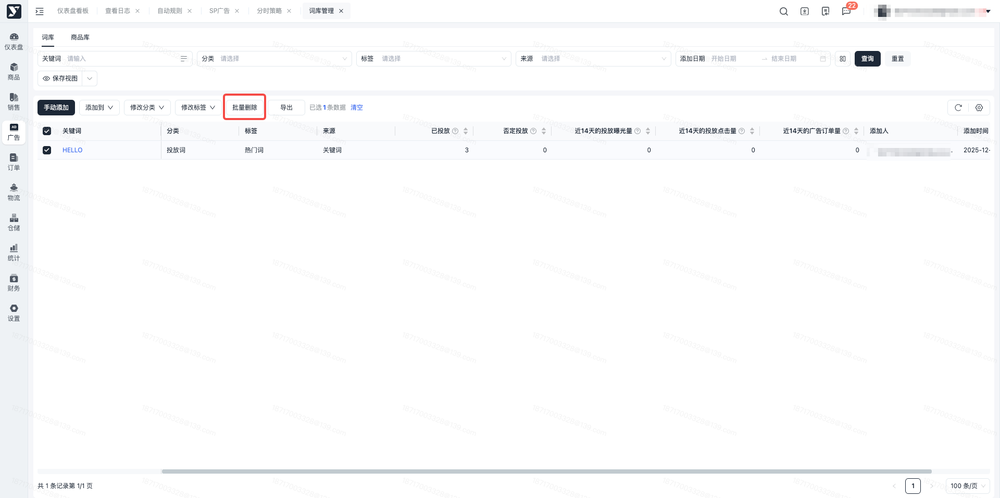

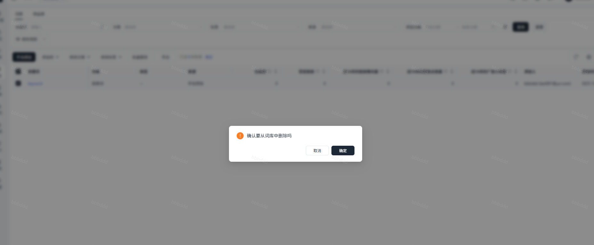

##### 导出excel

导出excel，支持导出部分和导出全部。先勾选再导出则表示导出勾选内容；直接按导出按钮，则表示导出全部内容；可以根据实际导出需求，进行选择。

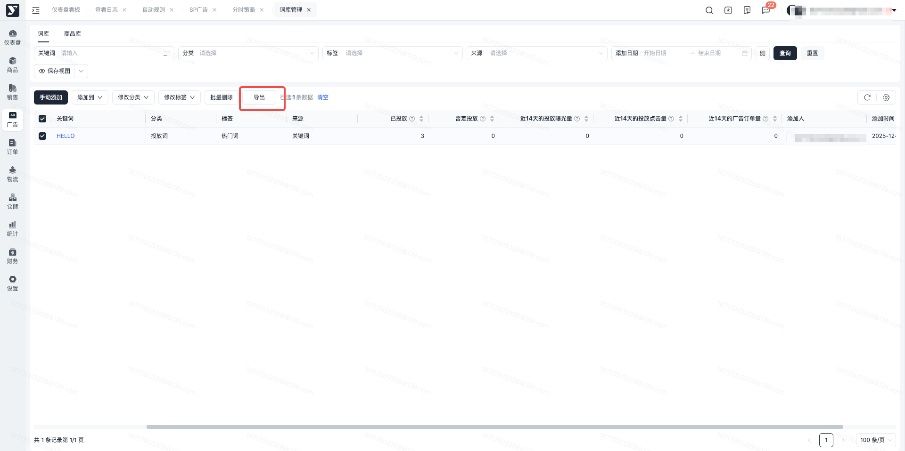

#### 词库应用

##### 添加关键词

在SP广告、SB广告中新增广告活动或者创建关键词投放时，点击【从词库选择】可以选择词库的关键词进行投放。支持匹配类型勾选和关键词搜索，可以根据搜索条件进行关键词筛选查看。点击【添加】，在列表中确认无误后，点击提交进行投放。

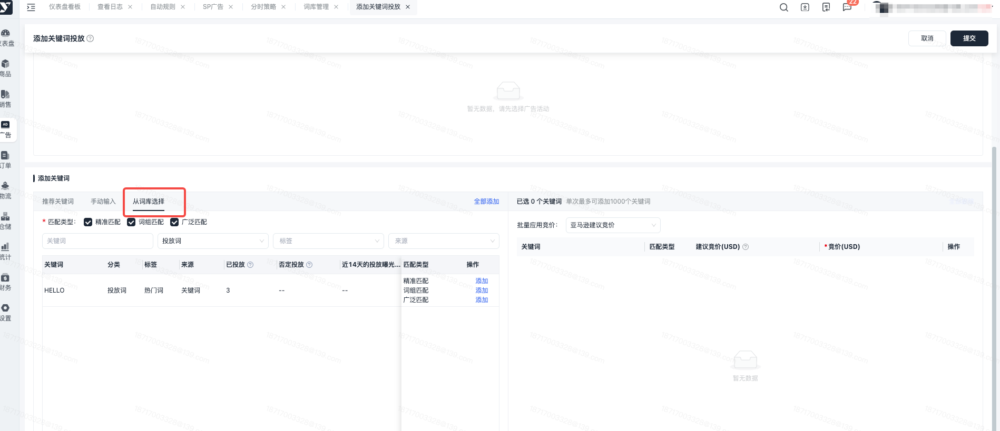

##### 添加否定关键词

在SP广告、SB广告中新增广告活动或者创建否定关键词时，点击【从词库选择】可以选择词库的关键词进行直接投放。

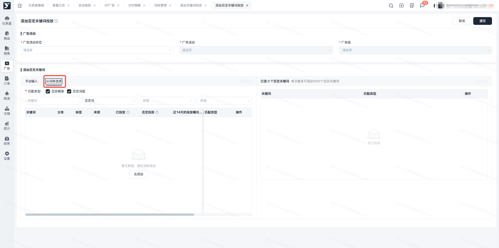

### 商品库

#### 新增商品

1. 从来源页面添加：在入口页面，点击【添加到商品库】，选择分类或标签后，添加成功。入口页面不同，在商品库展示不同的来源名称，来源包括内容如下：

 1. 广告MSKU：在SP、SD广告的商品列表添加的商品
 2. 商品投放：在SP、SB、SD广告的商品投放列表中添加的商品
 3. 否定投放：在SP、SB否定投放列表中添加的商品
 4. 用户搜索词：在SP、SB的用户搜索词列表中添加的商品

 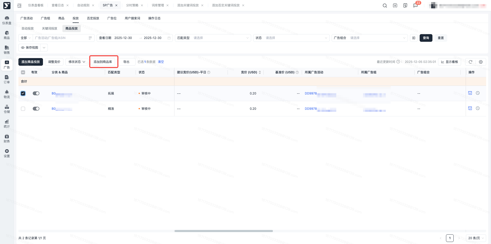
2. 手动添加：在商品库列表，点击【手动添加】，选择分类或标签，确认商品信息后，添加成功。添加时需确认添加ASIN是有效的。

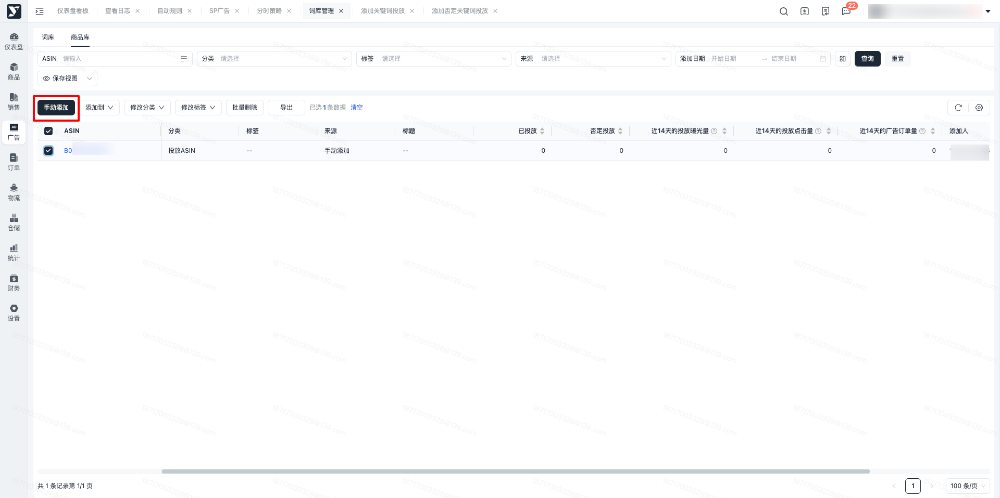

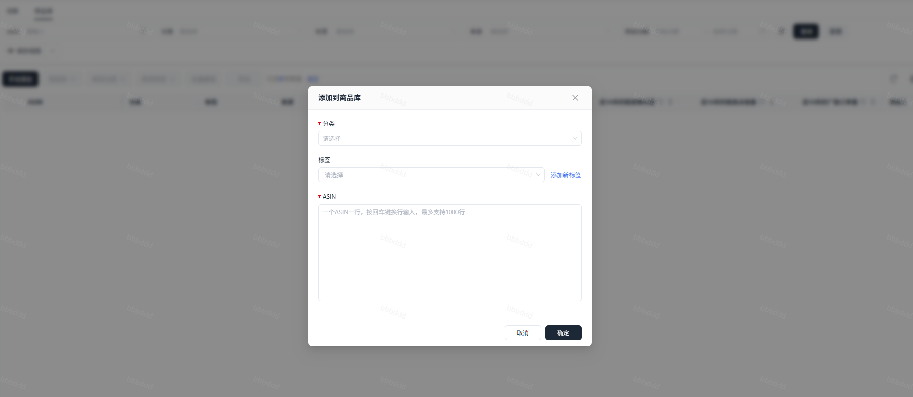

#### 管理商品库

##### 添加到商品投放

选中商品后，点击【添加到】下拉中的【商品投放】，唤起弹窗，确认广告内容后，投放成功。注意：每次投放设置内容更改后，均需要点击【应用到下方商品】。

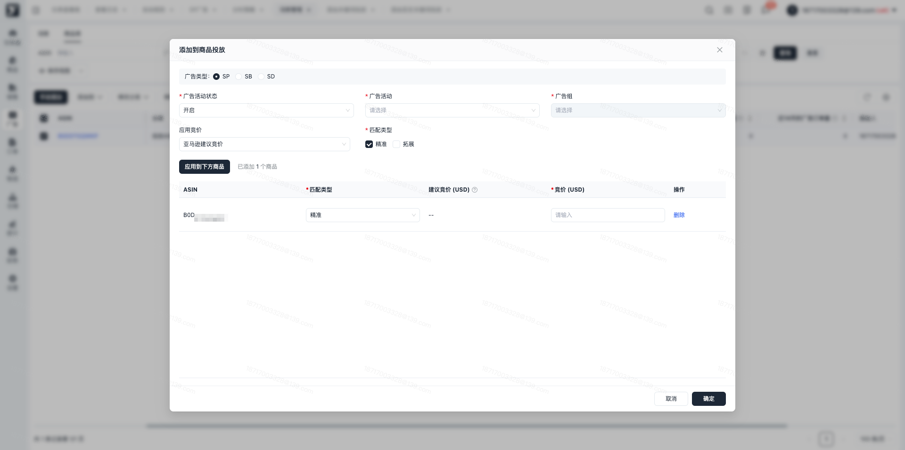

##### 添加到否定商品

选中商品后，点击【添加到】下拉中的【否定商品】，唤起弹窗，确认广告内容后，投放成功。说明：目前否定投放仅能基于广告组否定。

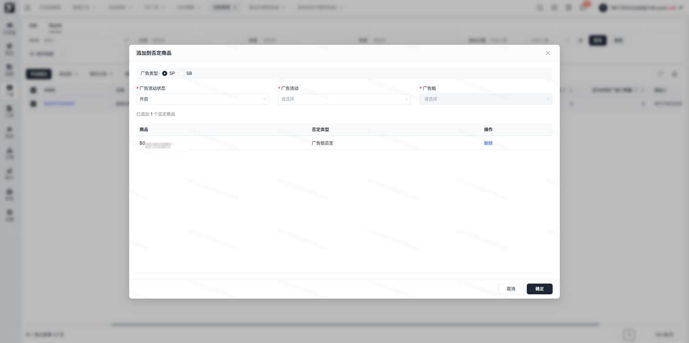

##### 其他操作

1. 修改分类：选中商品后，点击【修改分类】，可以把分类修改为投放ASIN或者否定ASIN。
2. 修改标签：选中商品后，点击【修改标签】，可以应用标签或者移除标签，应用标签为商品增加新的标签，移除标签则在商品上去掉该标签。
3. 批量删除：选中商品后，点击【批量删除】，可以删除商品信息，从商品库中删除商品，不影响已投放的广告。
4. 导出Excel：支持导出所选商品或导出全部。

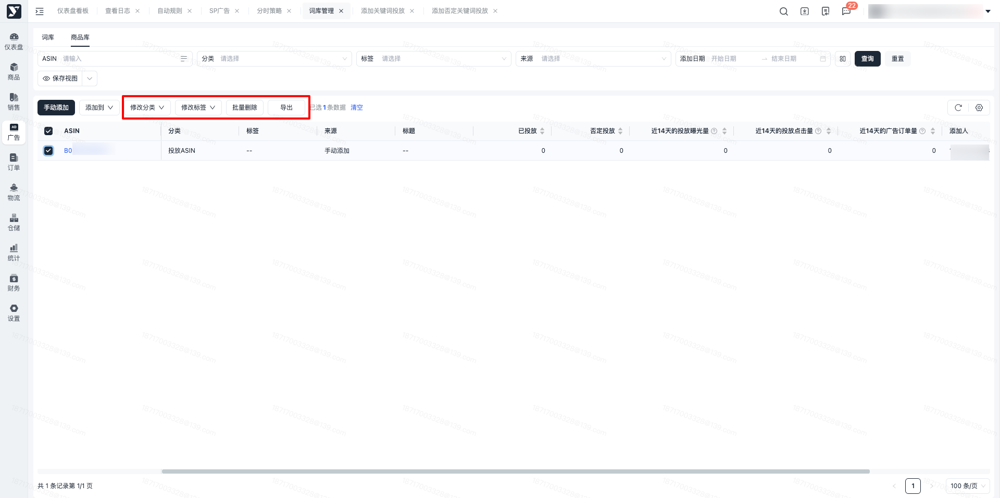

#### 商品库应用

##### 从商品库添加商品

在SP广告、SB广告、SD广告的创建或者商品投放列表，进行商品投放时，点击【从商品库选择】，进行匹配类型勾选和商品筛选后，选择对应的商品进行【添加】，添加确认且出价完成后，可投放成功。说明：已添加的商品不能再次重复添加。

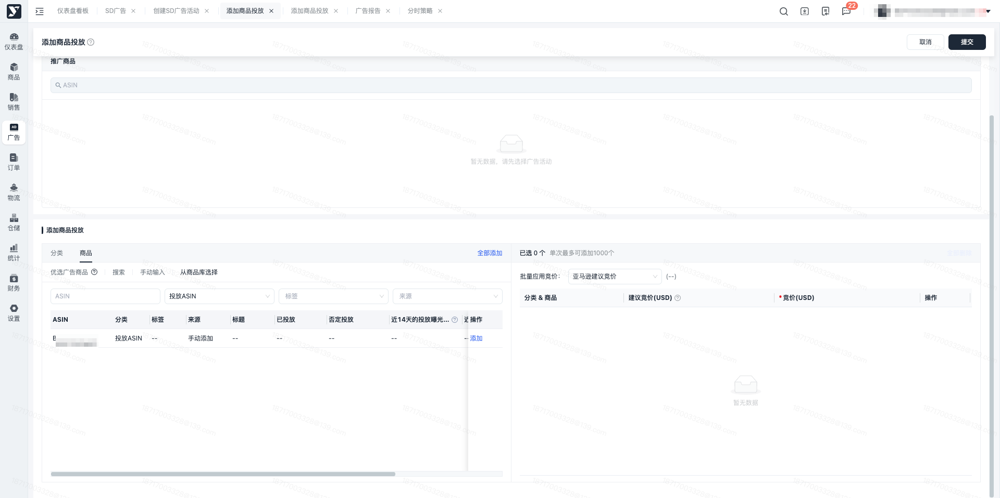

##### 从商品库添加否定商品

在SP广告、SB广告的创建或者否定商品投放列表中，进行否定商品投放时，点击【从商品库选择】，筛选出商品后，点击【添加】，进行确认后可提交成功。

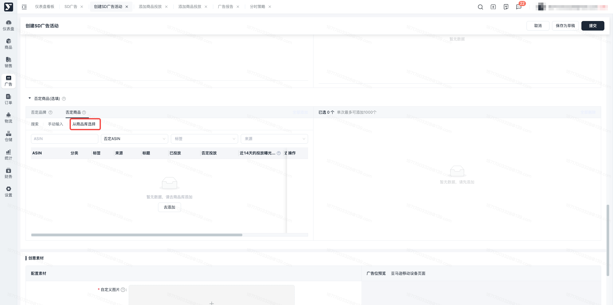

## 常见问题

#### **Q1：为什么有的内容无法获取到亚马逊建议竞价？**

A1：若亚马逊官方提供的建议出价中,针对部分商品未给出建议竞价,这意味着亚马逊对于这些特定商品没有提供竞价建议。

#### **Q2：词库/商品库中的分类和投放什么关系？**

A1：词库/商品库中的分类和投放没有直接关系，仅作为词库/商品库的内容分组。
