# 飞书文档：SB广告

## 文档信息

| 项 | 内容 |
| --- | --- |
| 远程文档 | https://q1njej8cpab.feishu.cn/wiki/SaQpwO6W0ihPHakkHNscr1j7nqj |
| 图片处理 | 本地下载（assets/images） |
| 快照时间 | 2026-08-06 |
| 来源命令 | `lark-cli docs +fetch --as user --doc "<remote>" --jq ".data.markdown"` |
| 格式处理 | fd-doc-markdown-sync/scripts/normalize-feishu-doc-markdown.mjs |

---

SB广告

当前版本：v1.1.2

## 功能介绍

1. SB广告，即品牌推广广告（Sponsored Brands）

 - 品牌推广广告的产品逻辑：能通过关键词或商品投放两种方法触达消费者，也可通过品牌信息（商标、标语等）、自定义图片或视频吸引消费者注意力。
 - 顾客点击品牌广告进入到您的旗舰店指定页面或者商品详情页中，加深对您品牌的了解，达到提高**品牌认知度**和**客户忠诚度**的目的。
2. 广告业务基于亚马逊广告活动功能，支持卖家创建广告活动、调整广告，所有数据实时同步亚马逊后台。
3. 通过广告系统，卖家可以完全脱离亚马逊后台，直接在系统中，完成与广告活动相关的所有分析与维护操作，并通过各个增益功能，实现精细化的广告投放，提高广告收益。

## 数据更新频率

1. **结构数据（曝光量前面的字段数据）更新频率：**

- 广告活动、广告组、广告、投放、否定投放：每10分钟一次

1. **报表数据（曝光量及之后的字段数据）的更新频率：**

- 广告活动、广告组、广告、投放、广告位：实时更新
- 用户搜索词：每1小时一次

PS：不同于亚马逊只保留65天(daily)的广告报告数据，会保留所有同步回来的广告数据，供卖家分析参考（1.0版本仅支持导出当前列表数据，按天数导出的功能正在建设中）

## 创建条件

**创建前**：当您初次打开SB广告页面，会出现如下页面提示。

（当广告账户被冻结后，也会出现该页面，且无法再看到广告活动历史记录）

📢 此时，请先前往【广告管理】-【广告财务】-【广告账户】开通账户，随后前往【广告充值】进行充值操作。当您的账户**可用余额大于0**时，可开始创建广告活动。

**创建时**：当您选择的广告账号可用余额≤0时，系统会提示余额不足，请点击【账号充值】，完成充值操作后再创建广告活动。

**创建后**：

当您的广告活动所关联的广告账号可用余额≤0时，或部分广告账号可用余额≤0时，正在投放的广告活动将自动被系统暂停，且无法开启广告活动。

因此，为确保广告活动的持续有效及权重不受影响，请务必维持账户内有足够的可用余额。

## 操作流程

- 品牌推广广告的创建步骤一共分4步：设置广告活动基础信息 -> 设置广告组基础信息 -> 设置广告信息 -> 提交广告活动**其中，品牌广告组的设置，根据选择的广告格式不同，设置会略有区别。具体流程如下：**

 > 注意：当前版本的广告格式仅支持商品集和视频格式

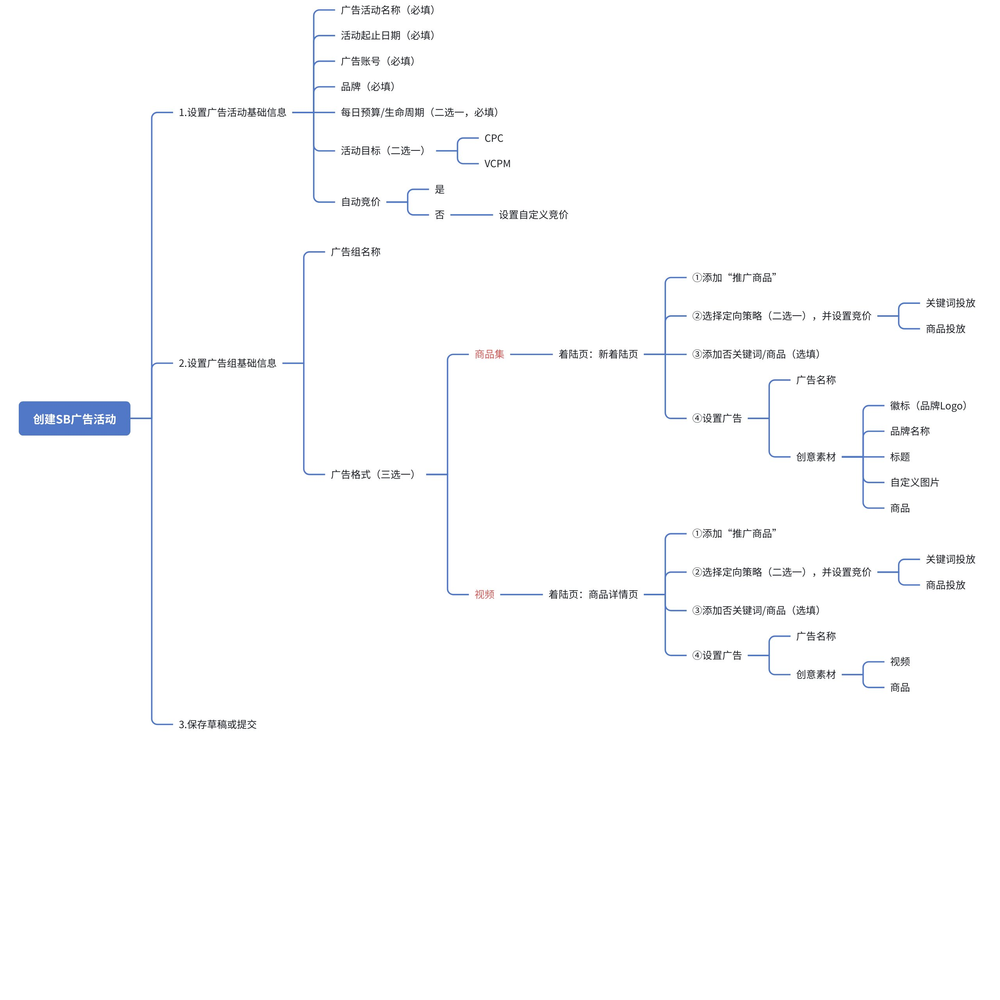

> 画板来源：token=`TCBtwNMmrhC3S4bzY2zccv3znBh`

### 设置广告活动基本信息

点击【创建广告活动】，进入创建页面

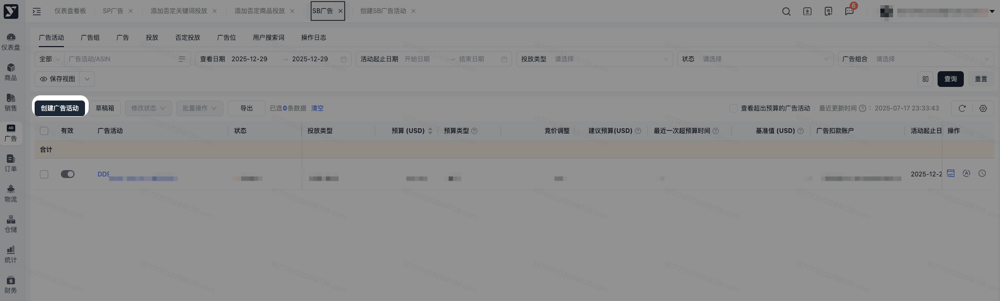

进入【创建SB广告活动】页面，需设置3个结构信息：广告活动信息+广告组信息+广告信息

**首先，填写广告活动信息：**

1. 广告活动名称：必填
2. 广告组合：非必填；
3. 广告账号：必填；选择与该广告活动绑定的广告账号；**绑定后不可切换**
4. 品牌：必填；单条SB广告活动中的推广商品必须是同一品牌
5. 活动起止日期：必填
6. 预算：必填。“每日预算”与“生命周期预算”，二选一。其中“生命周期预算”是指您愿意在一个广告活动的开展期内为其花费的总金额。生命周期预算需要设置结束日期。
7. 目标：品牌广告，有2个推广目标：增加页面访问次数、提升品牌展示量份额。

【增加页面访问次数】：将流量引导至落地页和商品详情页。也就是主要获取点击量，以点击收费(CPC)。

【提升品牌展示量份额】：在搜索结果首页首位的广告位，向搜索本品牌或本品牌所属品类的顾客展示该广告。也就是主要获取曝光量，以每千次可见展示量收费(VCPM)。

1. 自动竞价：必选。如果选择不开启自动竞价，则需要设置“自定义竞价调整”，比例值可设置为“0”。

*特别说明：*

1. 如果开启自动竞价，即表示允许亚马逊针对搜索结果顶部以外的广告位优化竞价，以提高广告活动效果。
2. 如果关闭自动竞价，可设置自定义竞价调整，您可降低或提高竞价，但该设置只适用于搜索结果顶部以外的广告位。
3. 如果不想调整广告位的竞价高低，可取消选择自定义竞价调整，表示调整0%
4. 若您选择广告目标为【提升品牌展示量份额】，则无需填写自动竞价

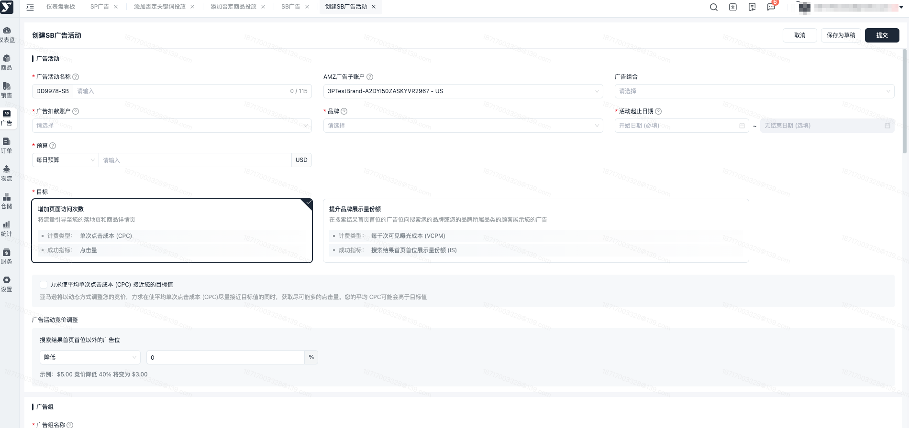

1. 成本控制：非必填，当广告活动目标为增加页面访问次数（预算类型为每日预算）时，在活动创建或者设置页面中展示成本控制模块。如果您选中此功能，亚马逊将进行竞价，以帮助您达到期望的目标值。这将取代您的手动竞价。如果您未选中此功能，亚马逊将不再针对您期望的目标值进行优化。您可以自行手动控制竞价。

 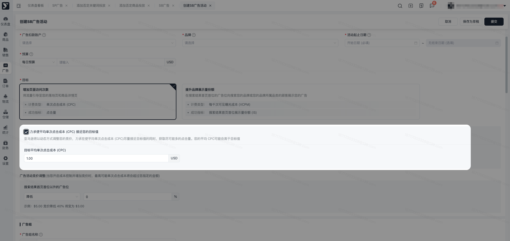

### 设置广告组基本信息

设置好广告活动信息后，就可以开始创建品牌广告组了。

**首先，设置广告组名称**

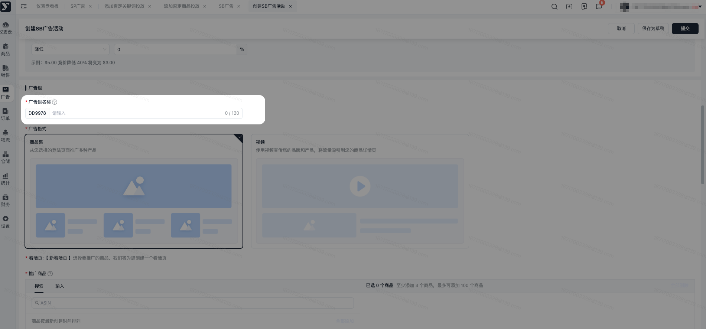

**接着，选择广告格式，二选一**

\***特别说明\***

1. 根据不同的广告格式，着陆页会不一样。（当前版本只有一种着陆方式）

 1. 商品集格式-着陆页：新着陆页
 2. 视频格式-着陆页：商品详情页
2. 若目标选择【增加页面访问次数】，则广告格式可选【商品集（着陆页：新着陆页）】或【视频（着陆页：商品详情页】；
3. 若目标选择【提升品牌展示量份额】，则广告格式只可选【商品集（着陆页：新着陆页）】

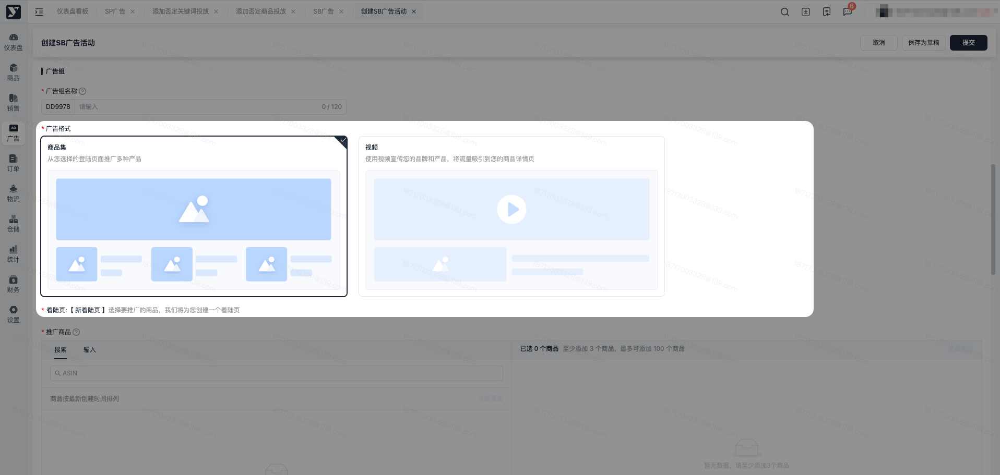

#### **广告格式1：商品集**

如果我们想要展示品牌徽标以及所选商品，则选择使用此格式。它主要是使用图片将流量引导至您的新着陆页，以推广多件商品。

当顾客点击品牌徽标或标题或自定义图片后，将进入我们指定的新着陆页。新着陆页，一般是商品合集。

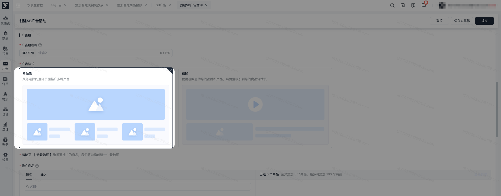

选择“商品集”后，我们默认着陆页是“新着陆页”；

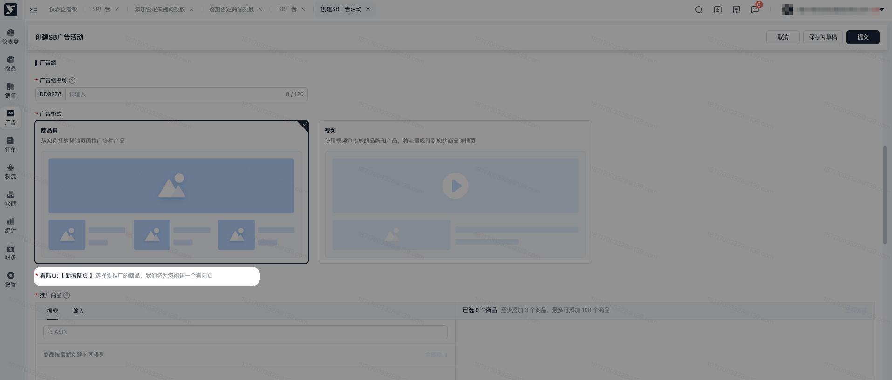

**下一步，添加推广商品**

推广商品是根据您在广告活动中所选品牌旗下的商品

支持搜索和批量输入ASIN添加推广商品，至少添加3个ASIN，一次性最多添加100个ASIN

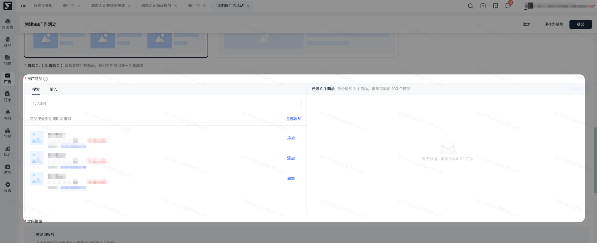

**添加完成后，需要选择定向策略，并设置竞价**

品牌广告的“定向策略”，共2种：关键词投放 + 商品投放，它们和SP手动投放广告的“定向策略”设置基本一致。

##### 关键词投放

特别说明：

1. 若目标选择【增加页面访问次数】，广告格式为【商品集（着陆页：新着陆页）】可选择关键词投放或商品投放
2. 若目标选择【提升品牌展示量份额】，广告格式为【商品集（着陆页：新着陆页）】，则只能进行关键词投放

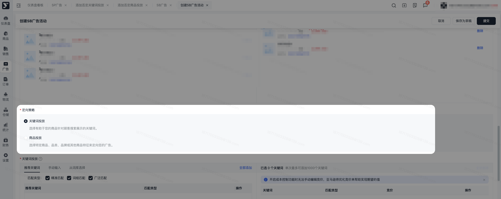

①设置自定义竞价

添加关键词投放之前，我们需要设置自定义竞价。

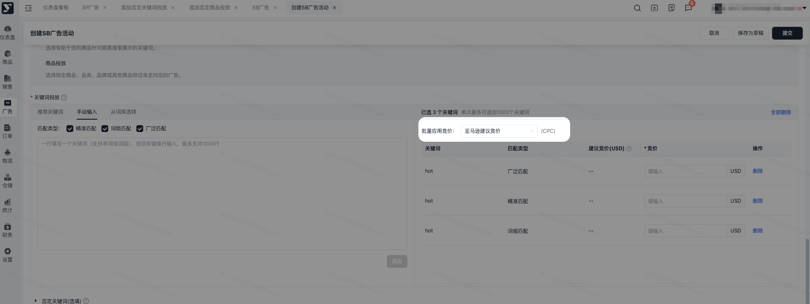

②添加关键词

支持通过输入添加关键词

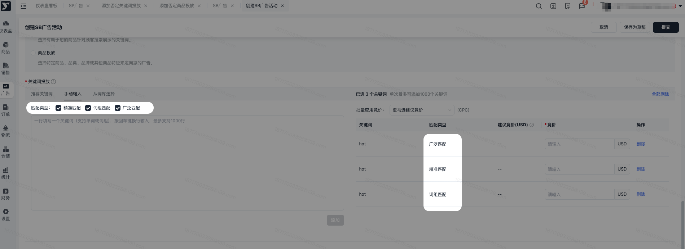

③确认关键词并设置竞价

*注意：商品集格式下CPC计费模式，竞价范围是0.10 \~ 49.00USD；VCPM计费模式，竞价范围是8.00\~5000.00USD*

如果发现有不需要投放的关键词，点击右侧的【删除】按钮，即可一键移除。

或者点击上方【全部删除】，删除当前已添加的所有关键词。

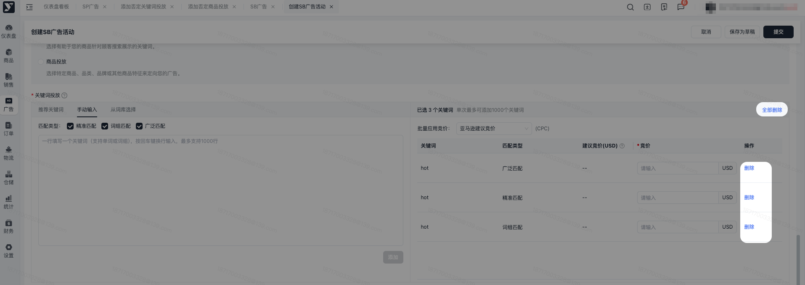

单独设置竞价：每个关键词，为其设置对应的竞价。

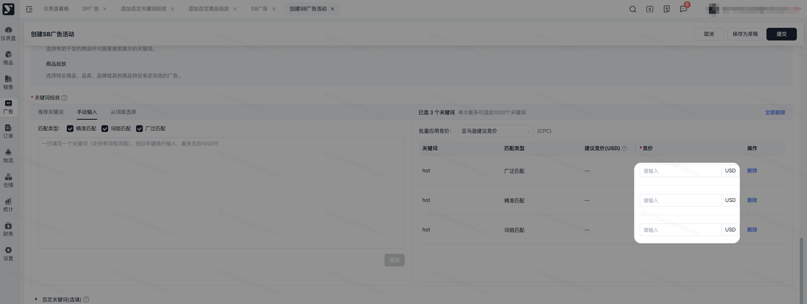

设置好定向策略后，**进入下一步：添加否定关键词（选填）**

这一步为可选项，如果您有不想让消费者搜索到您商品的关键词，那么可以直接在这里提前否定掉，如果没有，则不填，等后期有了再添加。

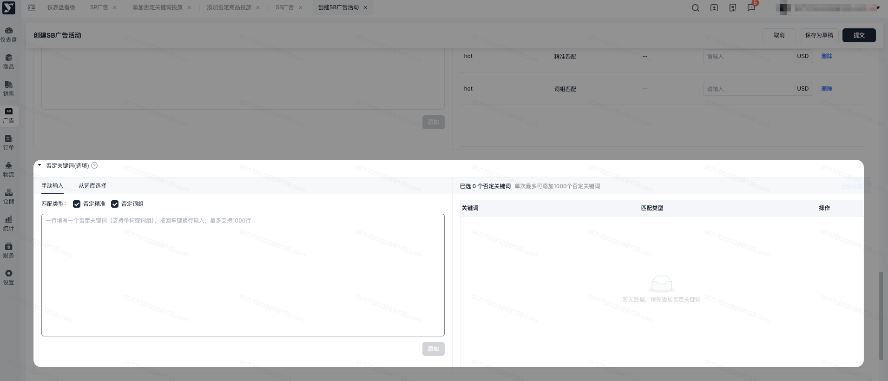

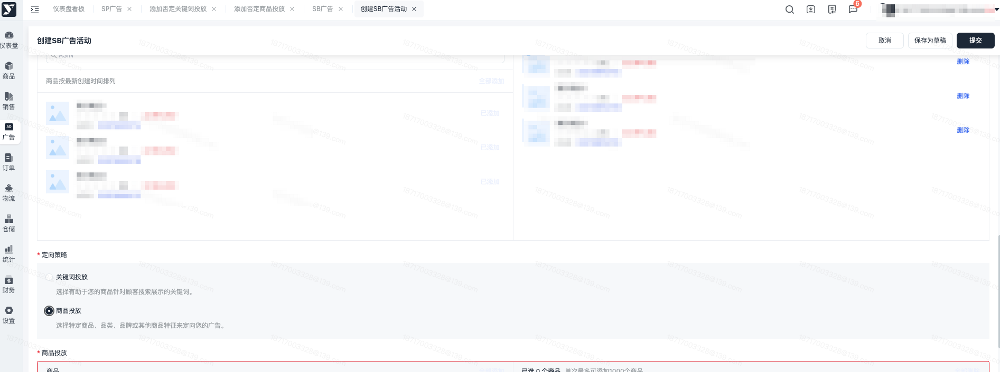

##### 商品投放

若目标选择【增加页面访问次数】，广告格式为【商品集（着陆页：新着陆页）】才支持商品投放

商品投放，是指将我们的产品，投放至某个商品ASIN的详情页、品类、品牌，或含有其他商品特征的分类中。

①设置自定义竞价

同关键词投放一致，添加商品投放之前，我们也需要设置自定义竞价。

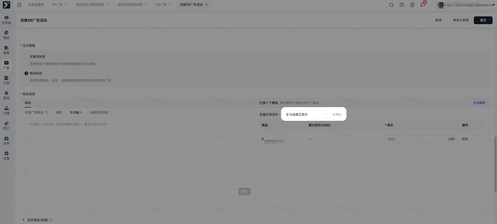

②添加商品

支持通过输入ASIN添加商品；

注意与SP商品投放不同的是，SB商品集的商品投放为精准投放、没有拓展匹配的功能。

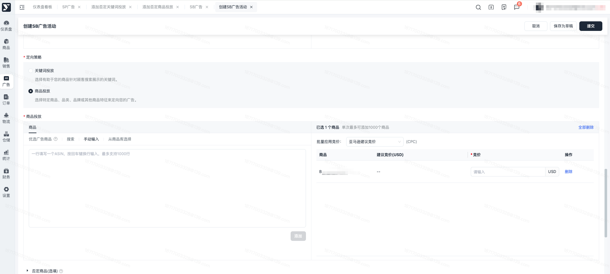

③确认商品并设置竞价

如果发现有不需要投放的商品，点击右侧的【删除】按钮，即可一键移除。

或者点击上方【全部删除】，删除当前已添加的商品。

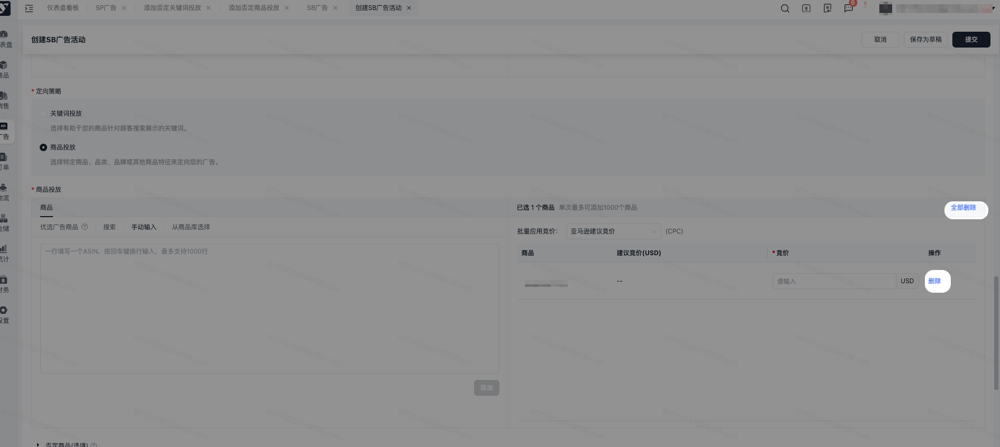

单独设置竞价：为每个ASIN设置对应的竞价。

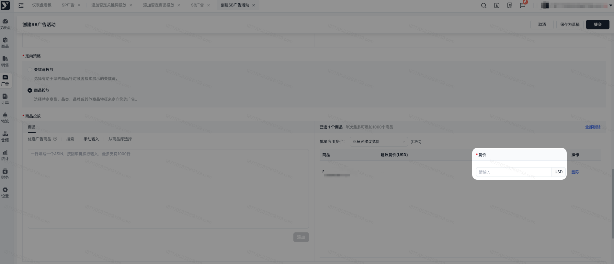

④添加否定商品

同关键词投放一样，该步骤为选填项，我们可以在设置否定商品，支持输入ASIN进行否定。

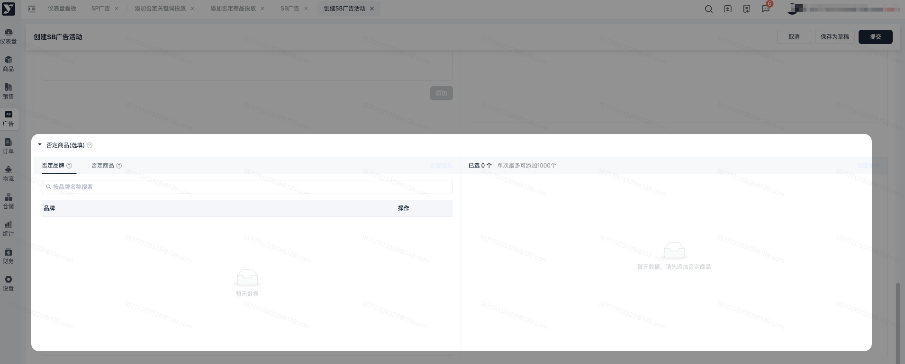

设置好否定投放后，进入最后一步设置：

##### **广告设置（创意素材）**

广告信息包含 6 个部分：广告名称、徽标(品牌logo)、品牌名称、标题、自定义图片、商品。

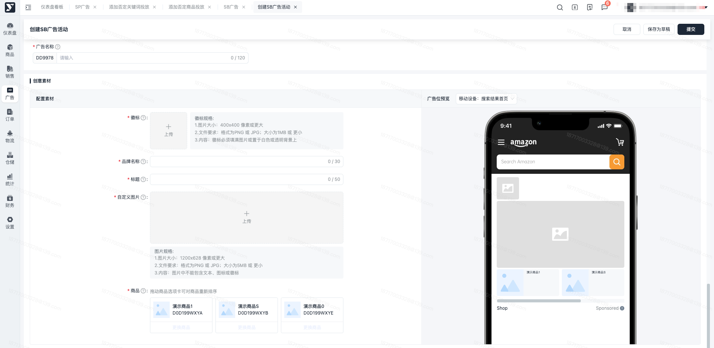

① **广告名称**：这里的广告名称，主要针对广告创意，填写一个易于分辨的即可。

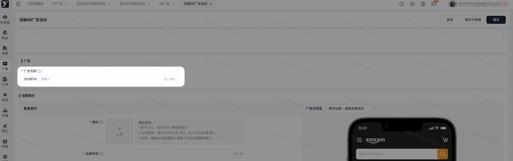

② **徽标**：这个其实就是我们的品牌logo。品牌徽标的上传要求，和亚马逊后台一致。

徽标规格：

- 图片大小400x400像素或更大
- 文件大小1MB或更小
- 文件格式PNG或JPG
- 内容徽标必须填满图片或置于白色或透明背景上

点击【上传】，可以直接上传我们的品牌logo。

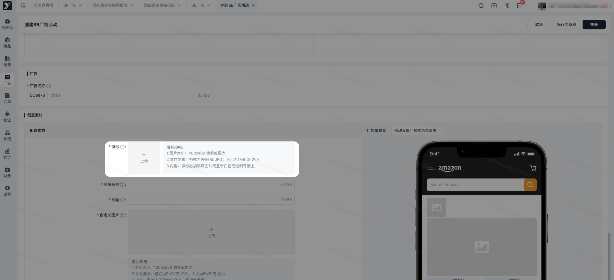

上传后，会显示在右侧广告预览的对应位置，方便我们把握整体效果。

③ **品牌名称**：使用您的品牌名称来帮助消费者识别并与之建立联系。品牌名称上传最长不超过30字符。

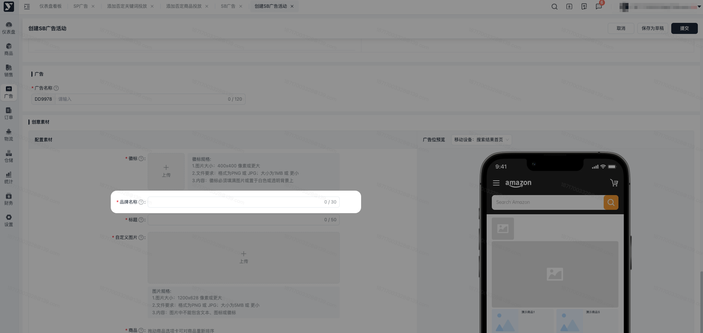

上传后，显示在右侧品牌徽标旁边。

④ **标题**：是指显示给买家的广告标题；建议使用与您的品牌风格一致的标题

填写标题时，需注意：

- 检查错别字、拼写错误和语法错误
- 避免使用过多的标点符号，如"!!!"或"?!"
- 避免乱用标点符号，如"Your.headline."
- 建议句首字母大写(即"Thisis a new headline")

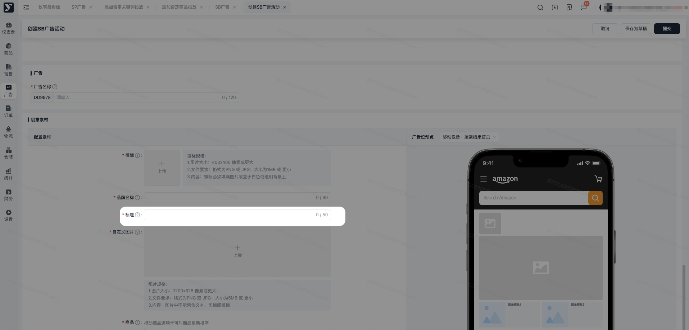

填写后，同步展示于广告预览的上方标题处。

⑤ **自定义图片**：并非商品主图，需要我们另外制作一张，以真实的环境或有吸引力的背景来展示我们的商品。

图片要求如下：

- 图片大小1200x628像素或更大
- 文件大小5MB或更小
- 文件格式PNG或JPG
- 内容图片中未添加文本、图形或徽标

自定义图片的上传与修改方式，与品牌徽标一致。

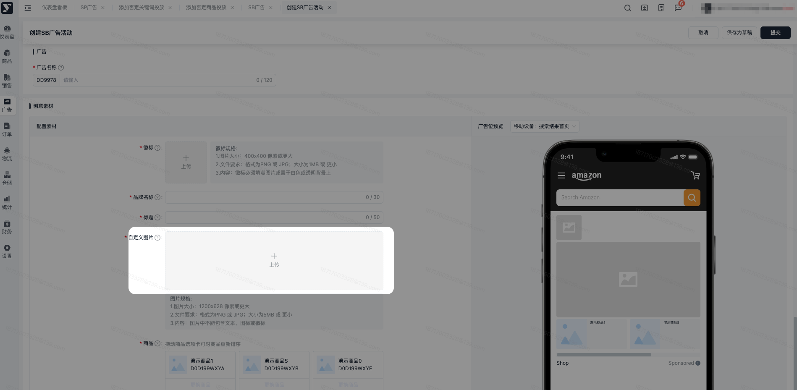

上传后，显示在广告预览的正中部。

⑥ **商品**：这里的商品，是来自于前面推广商品中您选择的前3个商品。

我们可以拖动商品，调整其显示顺序。

若您添加了3件以上商品，则可以更换商品。

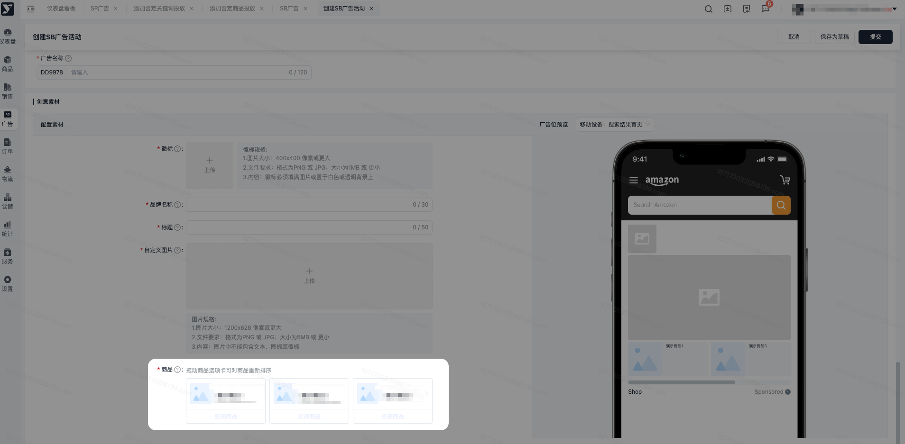

当我们设置好之后，还可以在右侧的预览，点击【广告预览】，可切换查看我们的广告，在不同终端的展现位置和形式。

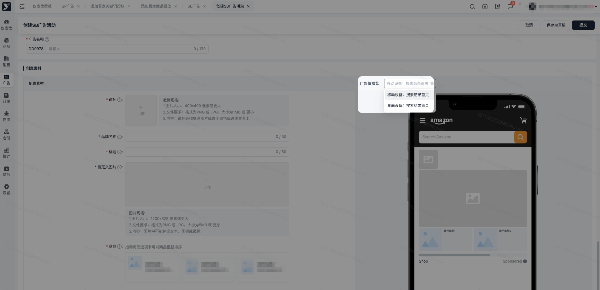

**确认信息，提交广告活动**

确认所有信息无误，点击【提交】，即可完成品牌广告的创建。

品牌广告提交后，亚马逊可能需要至少24小时对您的广告素材进行审核，最长可能需要3个工作日进行审核。请密切关注您的广告活动状态。

若您当前暂不想投放广告，也可点击【保存草稿】，您填写的广告活动信息将保存至草稿箱。

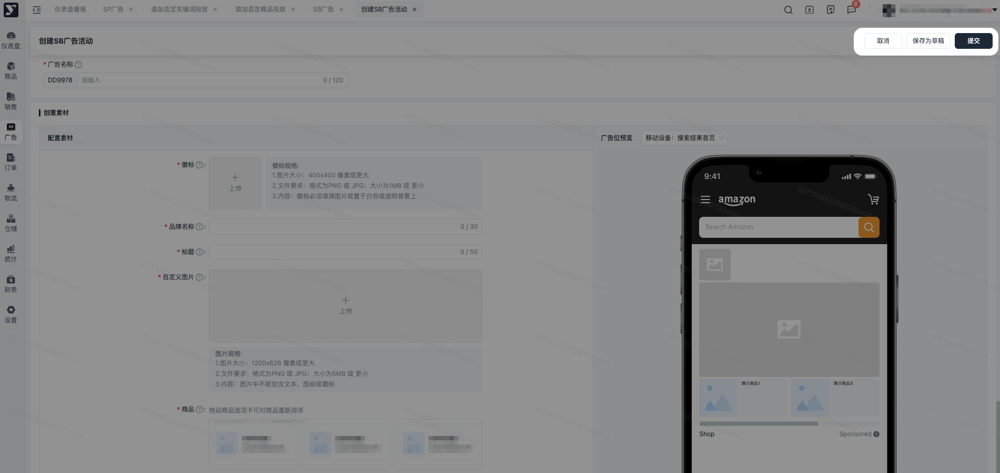

#### **广告格式2：视频（SBV）**

视频广告，是指通过产品视频来展示我们的产品。

我们可以选择想要推广的单件商品。当亚马逊顾客点击我们的视频时，他们将被重定向到商品详情页。

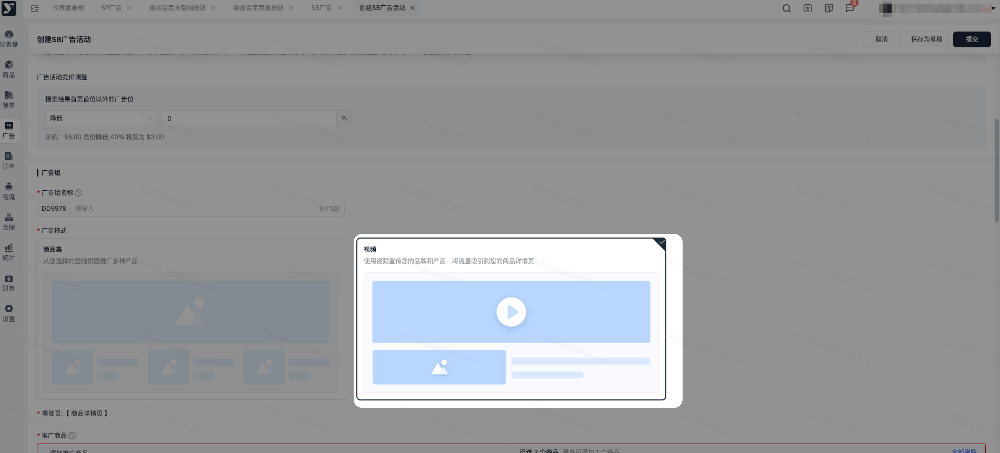

选择“视频”后，我们默认着陆页是“商品详情页”；（当前版本的着陆页尚未支持品牌旗舰店，正在建设中）

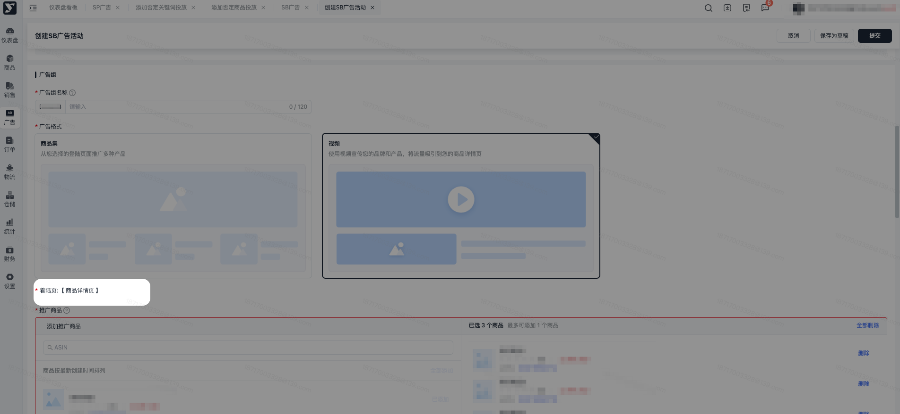

**下一步，添加推广商品**

支持通过搜索ASIN添加推广商品，最多添加1件商品

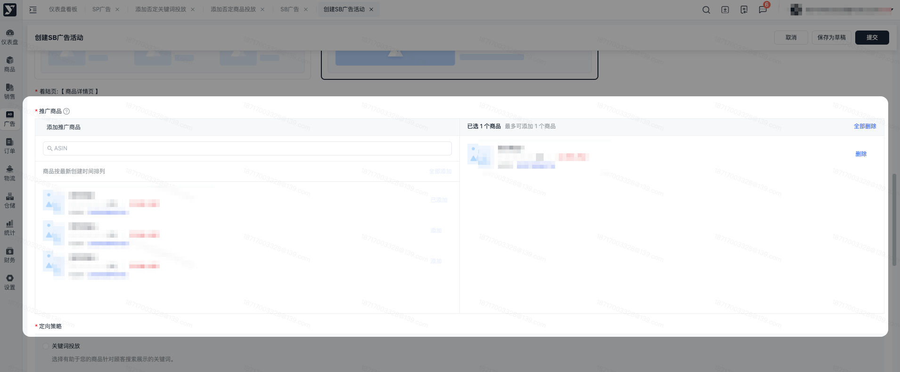

选择完推广商品后，我们依次设置：定向策略 > 关键词/商品投放 > 添加否定(选填) > 广告设置(创意)

*注意：视频格式下CPC计费模式，竞价范围是0.25 \~ 49.00USD*

它们的**设置方式，与广告格式 1：商品集格式 基本一致**，只是在配置创意素材时仅需上传视频；因此接下来我们直接看创意素材的上传方式。

设置好否定投放后，进入最后一步设置：

##### 广告设置（创意素材）

广告信息包含 3 个部分：广告名称、视频、商品。（广告名称同商品集格式）

① **视频**：视频上传要求，和亚马逊后台一致（详见下图或系统页面提示）。

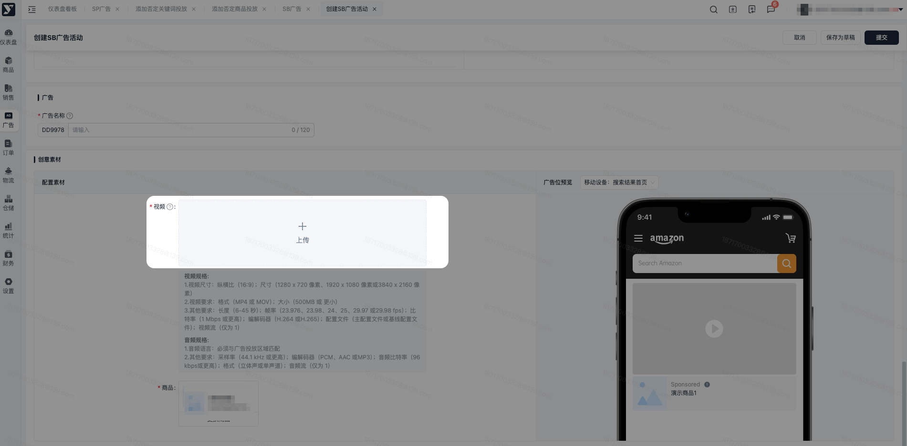

上传后，左侧默认展示第一帧，右侧广告预览支持播放视频。

② **商品**：这里的商品，是来自于前面推广商品中您添加的1个推广的商品。

视频格式同样支持更换商品，但是要注意的是，只能在前面推广商品中更换商品。因此，当您点击【更换商品】时，页面会自动滚动到上方的推广商品。

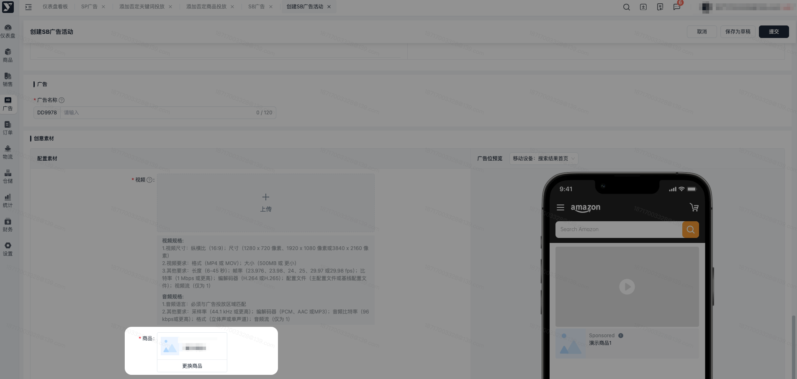

当我们设置好之后，还可以在右侧的预览，点击【广告预览】，可切换查看我们的广告，在不同终端的展现位置和形式。

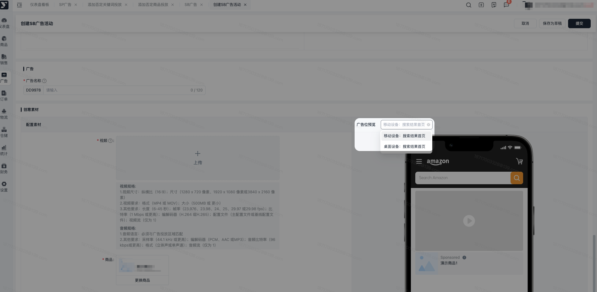

**确认信息，提交广告活动**

确认所有信息无误，点击【提交】，即可完成品牌广告的创建。

品牌广告提交后，亚马逊可能需要至少24小时对您的广告素材进行审核，最长可能需要3个工作日进行审核。请密切关注您的广告活动状态。

若您当前暂不想投放广告，也可点击【保存草稿】，您填写的广告活动信息将保存至草稿箱。

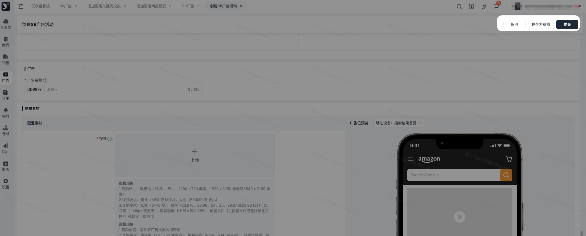

### SB广告-广告活动

###### 查看广告活动列表数据

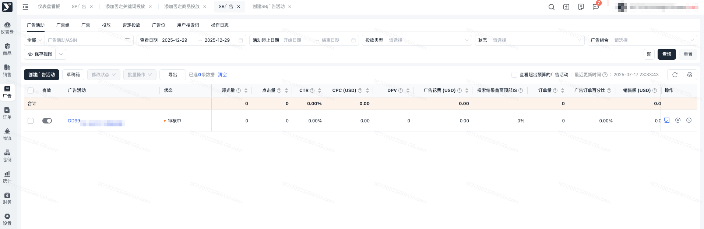

###### 调整预算

我们可以直接调整广告活动的预算。

调整方式分2种：单个调整 + 批量调整

① 单个调整

点击预算金额右侧的图标，可以直接调整预算。

②：批量调整

选中要批量调整预算的广告活动，点击【调整预算】，进入设置页面。

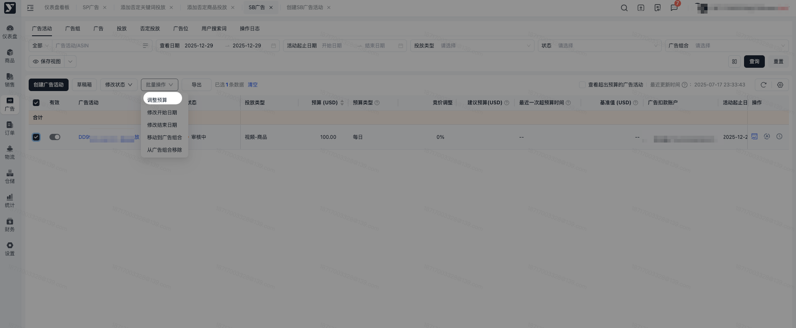

###### 修改广告活动名称

鼠标悬停在广告活动名称右侧的图标，可以单个广告活动名称进行编辑。

（当前版本广告活动名称仅支持单个修改。）

进入设置页面，重新修改广告活动名称，点击【确定】即可。

###### 复制广告活动

鼠标悬停在广告活动名称右侧的图标，可选择复制广告活动，可以带源广告活动信息进行新广告活动创建。默认勾选暂停，如需复制成功后立即启用，则需手动取消勾选。

###### 修改自动竞价

点击自动竞价右侧的图标，可以对单个自动竞价进行编辑。注意：CPC计费模式下才有自动竞价

（当前版本自动竞价仅支持单个修改。）

进入设置页面，重新修改自动竞价，点击【确定】即可。

###### 修改开始日期

选中要批量修改结束日期的广告活动，点击【修改开始日期】，进入设置页面。

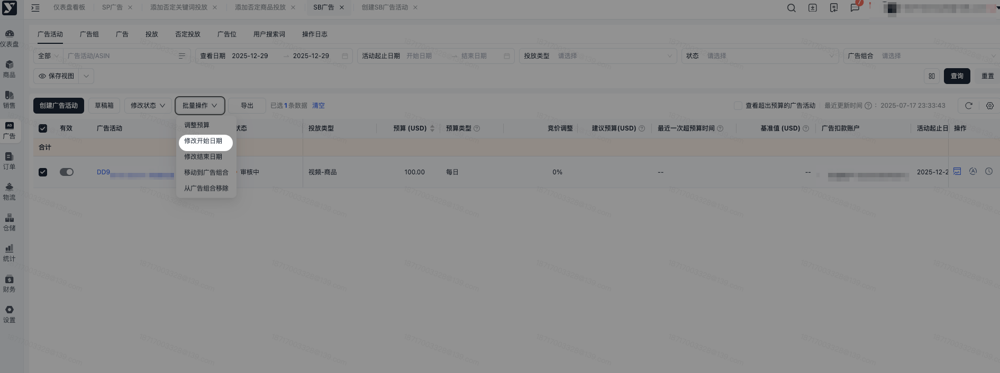

###### 修改结束日期

选中要批量修改结束日期的广告活动，点击【修改结束日期】，进入设置页面。

（当前版本不支持在列表页针对单个广告活动修改结束日期，只能选中目标数据后在批量操作中执行）

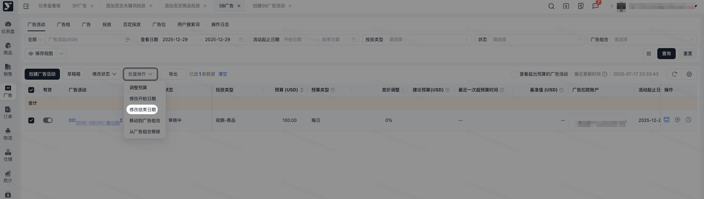

进入设置页面，可选择无结束日期或自定义结束日期，点击【确定】即可。

###### 修改状态（暂停/启动/归档）

同亚马逊后台一样，我们也同样支持启用、暂停和归档广告活动。

“启用”和“暂停”的操作方式有2种：单个操作 + 批量操作，而“归档”只支持批量操作。

**① 单个操作**

找到要启用或暂停的广告活动，点击启停按钮，即可一键启用或暂停。

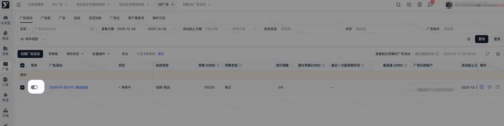

**② 批量操作**

勾选要批量启停或归档的广告活动，点击对应启停或归档的按钮即可。

注意：归档后的数据不可恢复。

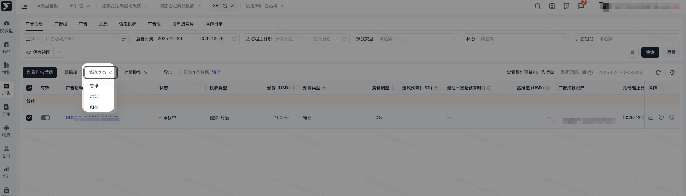

###### 查看草稿箱

在创建SB广告活动页面中，支持保存草稿；点击【草稿箱】，进入草稿箱页面

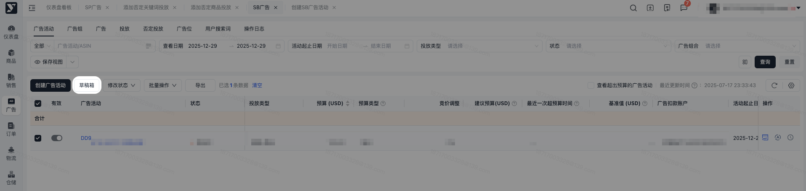

点击【编辑】，进入编辑广告活动页面；点击【删除】即可删除草稿。

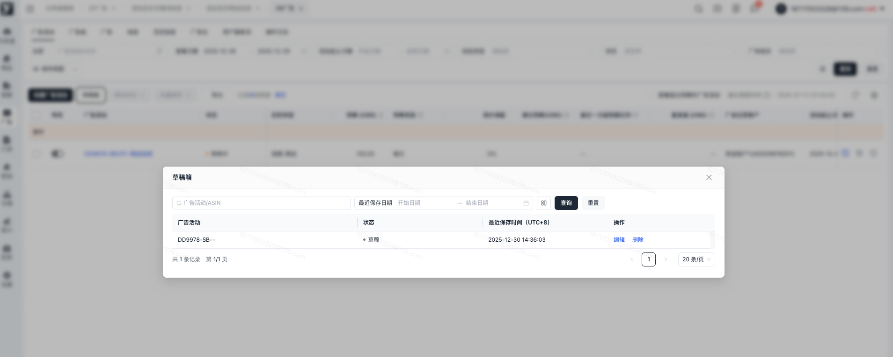

### SB广告-广告组

###### 查看广告组列表数据

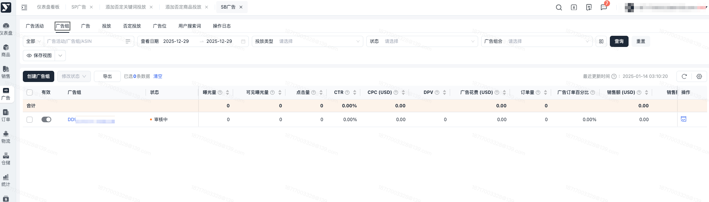

###### 修改广告组名称

鼠标悬停在广告组名称的右侧的图标上，可选择修改广告组名称，可以唤起修改弹窗进行名称修改。

###### 复制广告组

鼠标悬停在广告组名称的右侧的图标上，选择复制广告组，可以带源广告组信息进行新广告组创建。默认勾选暂停，如需复制成功后立即启用，则需手动取消勾选。

###### 修改状态（暂停/启动/归档）

同亚马逊后台一样，我们也同样支持启用、暂停和归档广告组。

“启用”和“暂停”的操作方式有2种：单个操作 + 批量操作，而“归档”只支持批量操作。

**① 单个操作**

找到要启用或暂停的广告组，点击启停按钮，即可一键启用或暂停。

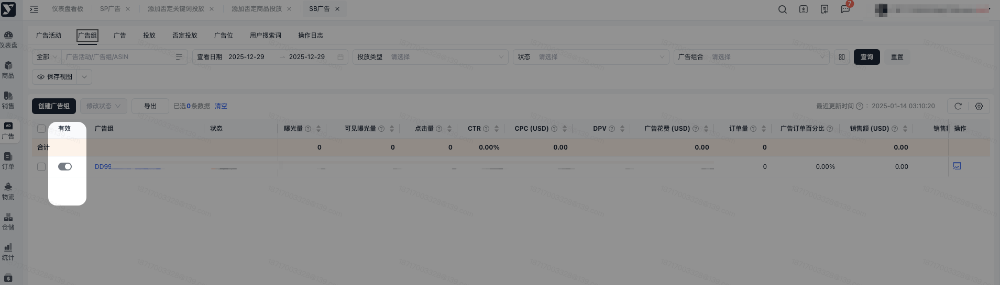

**② 批量操作**

勾选要批量启停或归档的广告活动，点击对应启停或归档的按钮即可。

注意：归档后的数据不可恢复。

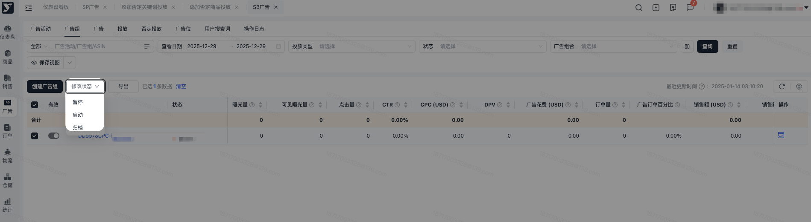

### SB广告-广告

###### 查看广告列表数据

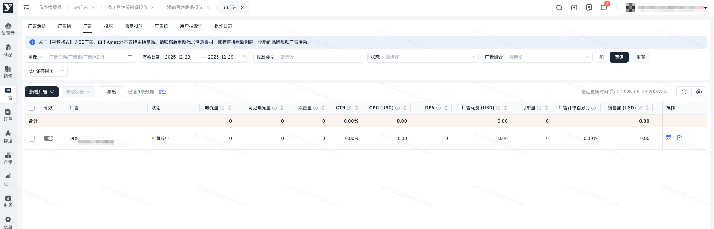

特殊情况：“投放中、超出预算、已暂停、活动未开始”的广告，出现问号提示“亚马逊正在以审核通过的素材投放广告，但是您最新版本的创意素材审核不通过，请进入编辑页面修改错误信息”。

这是因为该条广告活动正在以审核通过的旧素材跑广告，但是新素材审核不通过，此时您可以去编辑页面处理新素材。

###### 新增广告-视频格式

和亚马逊后台一样，系统支持新增广告。当前版本仅支持新增视频格式，商品集格式、品牌旗舰店焦点格式正在建设中。

请注意：针对视频格式广告，亚马逊不支持更换其ASIN，因此您只能重新新增一个视频格式的广告。

点击【视频格式】，进入新增页面

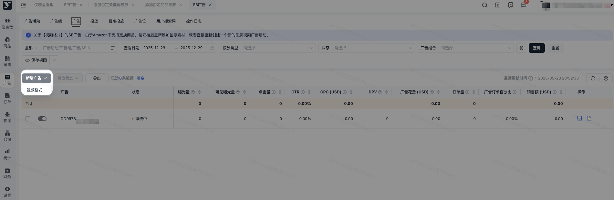

在该页面中，您需要选择添加至哪个广告活动，以及其对应的广告组；然后再选择推广商品，上传视频

另外，由于单条SB广告活动中的推广商品必须在同一个品牌下，因此选择完广告活动后，会自动带出其所属品牌，以及其品牌下可推广的商品。（一个广告下的商品，可每次重复添加）

上传视频素材

###### 编辑创意素材

广告“审核失败”，即创意素材审核未通过，您可进入编辑页面，根据错误信息重新上传素材。

点击【编辑创意素材】，进入编辑页面

进入编辑页面，仅可编辑创意素材

**1⃣️编辑商品集格式广告**
针对商品集格式的单条广告，亚马逊接口不支持更换推广商品；如需更换，当前版本建议您创建一条新的广告活动。

2⃣️**编辑视频格式广告**

针对视频格式的单条广告，亚马逊不允许更换推广商品；如需更换，建议您新增一条视频广告。

###### 修改广告名称

点击广告右侧的图标，可以对单个广告名称进行编辑。（当前版本广告名称仅支持单个修改）

进入设置页面，重新修改广告名称，点击【确定】即可。

###### 修改状态（暂停/启动/归档）

同亚马逊后台一样，我们也同样支持启用、暂停和归档商品。

“启用”和“暂停”的操作方式有2种：单个操作 + 批量操作，而“归档”只支持批量操作。

**① 单个操作**

找到要启用或暂停的商品，点击启停按钮，即可一键启用或暂停。

**② 批量操作**

勾选要批量启停或归档的广告活动，点击对应启停或归档的按钮即可。

注意：归档后的数据不可恢复。亚马逊规定：审核失败的广告不可归档。

### SB广告-关键词投放

###### 查看关键词投放列表数据

###### 添加关键词

创建广告活动后，可再次添加关键词，优化广告投放策略。

选择广告活动状态后，筛选出广告活动，再筛选出广告活动下能够添加关键词的广告组。

一个广告组下的关键词+匹配类型不可重复添加。

###### 调整竞价

调整方式分2种：单个调整 + 批量调整

**① 单个调整**

点击竞价数值右侧的图标，可以直接调整竞价。

**② 批量调整**

选中要批量调整竞价的投放，点击【调整竞价】，进入设置页面。

###### 修改状态（暂停/启动/归档）

同亚马逊后台一样，我们也同样支持启用、暂停和归档关键词投放。

“启用”和“暂停”的操作方式有2种：单个操作 + 批量操作，而“归档”只支持批量操作。

**① 单个操作**

找到要启用或暂停的关键词投放，点击启停按钮，即可一键启用或暂停。

**② 批量操作**

勾选要批量启停或归档的广告活动，点击对应启停或归档的按钮即可。

注意：归档后的数据不可恢复。

###### 获取建议竞价

1. 建议竞价获取

点击【获取最新建议竞价】，可实时获取亚马逊建议竞价；（仅刷新当前页竞价）

1. 建议竞价应用

获取建议竞价后，在价格旁边展示应用按钮，鼠标悬停可展示应用方式，包括应用建议竞价、应用最低建议竞价、应用最高建议竞价，点击后，竞价根据选择的建议竞价进行调整。

### SB广告-商品投放

###### 查看商品投放列表数据

###### 添加商品

创建广告活动后，可再次添加商品投放，优化广告投放策略。

选择广告活动状态后，筛选出广告活动，再筛选出广告活动下能够添加商品的广告组。

一个广告组下的商品+匹配类型不可重复添加。

###### 调整竞价

点击竞价数值右侧的图标，或者点击顶部的调整竞价，可以直接调整竞价。

###### 修改状态（暂停/启动/归档）

同亚马逊后台一样，我们也同样支持启用、暂停和归档商品投放。

“启用”和“暂停”的操作方式有2种：单个操作 + 批量操作，而“归档”只支持批量操作。

**① 单个操作**

找到要启用或暂停的商品投放，点击启停按钮，即可一键启用或暂停。

**② 批量操作**

勾选要批量启停或归档的广告活动，点击对应启停或归档的按钮即可。

注意：归档后数据不可恢复

###### 获取建议竞价

1. 建议竞价获取

点击【获取最新建议竞价】，可实时获取亚马逊建议竞价；（仅刷新当前页竞价）

1. 建议竞价应用

获取建议竞价后，在价格旁边展示应用按钮，鼠标悬停可展示应用方式，包括应用建议竞价、应用最低建议竞价、应用最高建议竞价，点击后，竞价根据选择的建议竞价进行调整。

### SB广告-否定投放

否定投放功能，整合了所有广告活动下的否定投放，我们可以通过上方的筛选栏，查看某些广告活动或广告组的否定投放。

###### 查看否定投放列表数据

###### 创建否定关键词

创建广告活动后，可再次添加否定关键词；注意：不可重复添加同一个匹配类型的否定关键词

点击【否定关键词】，进入创建否定投放页面

进入“添加否定关键词”页面，选择广告活动、广告组后添加关键词；支持将否定词添加到多个广告组

###### 创建否定商品

点击【否定商品】，进入创建否定投放页面

进入“添加否定商品”页面，选择广告活动、广告组后添加商品，支持添加否定品牌或者添加单个商品。添加单个商品，支持进行单个商品搜索、输入或者从商品库选择添加。

###### 归档

否定投放的内容只可归档；归档后的数据可再次添加

### SB广告-广告位

的【广告位】功能，我们会根据广告报告提供的广告位数据，让您看到SB广告活动在“搜索结果顶部”、“搜索结果的其余位置”、“商品页面”、“亚马逊首页”位置的曝光、点击量等数据情况。

###### 查看广告位列表数据

### SB广告-用户搜索词

- 用户搜索词，是顾客在亚马逊购物时，输入搜索框的，或浏览的，与我们广告匹配到的词，它们可以是关键词，也可以是商品ASIN，基本上都是与我们的产品相关度较高的词。它反映了买家的真实搜索习惯和购物需求，是我们优化广告关键词、listing埋词和竞品关联投放的重要数据来源。
- 当我们投了一段时间的广告后，亚马逊会提供SB广告不同时间段的搜索词报告。
- 的【用户搜索词】功能，通过亚马逊官方接口，自动整合SB广告的搜索词报告数据，帮助卖家高效分析搜索词数据，了解广告投放效果，同时卖家可筛选出优质的关键词，进行产品Listing优化和广告再投放，获取更多精准出单。

### SB广告-操作日志

操作日志功能，同步记录在系统中所有的广告操作轨迹，可以帮助您快速分析您的广告优化效果。同时，也可以看到对应操作人、操作结果，帮助您更好地维护您的广告。

### 查看日期

广告活动、广告组、广告、投放、广告位、用户搜索词可筛选今日、昨日、本周、上周、本月、上月、近7天、近30天、自定义日期范围内的数据指标，帮助您分析广告表现

- 广告活动、广告组、广告：默认展示当前洛杉矶日期
- 投放、广告位、用户搜索词：由于是取的广告报告数据，因此默认展示当前洛杉矶日期-1

### 自定义列

每个卖家都有自己的分析模式，看重的指标也不尽相同。因此，为了匹配每位卖家的分析习惯，我们上线了【自定义列】功能，卖家可以根据自己的分析习惯，自定义排序广告活动的指标。

点击【自定义列】，进入设置页面。

进入“自定义列”设置页面，我们可以鼠标按住指标，上下拖动，以进行排序；

当指标过多，还可以开启或取消展示某个指标，勾选或取消复选框即可；

如果设置错误，点击【重置】，可以回到设置时的状态，重新设置；

设置完成后，点击【确定】，保存自定义列的设置。

### 导出

支持导出所有列表数据，以方便卖家进行二次分析。

当筛选出想要的结果后，点击【导出】，即可导出当前查询结果。同时，导出的历史文件可以在“下载中心”查看。

### 消息通知

当您的广告活动超出预算时，我们会发送站内通知提醒，因此，请关注系统右上角的消息通知。

## 常见问题

#### **Q1：创建了SB广告活动后，多久能更新审核结果？**

A1：提交SB广告活动后，5分钟后可查询到广告活动审核结果（广告的创意素材需要1～3个工作日出审核结果）。

请注意：亚马逊出现过先审核失败，过5～10分钟后，又更新成投放中，因此建议您创建完后等20分钟，亚马逊状态稳定后再对广告活动进行下一步操作。

若超过3个工作日仍处于“审核中”，请联系运营人员。

#### **Q2：广告层级的创意素材是否能看到上传过的素材版本？**

A2： 当前版本创意素材只能查看最新上传的素材，展现旧素材版本的功能已经在建设中；

您需要关注的是广告状态，我们会每10分钟同步亚马逊最新数据。

若状态是投放中，表示您的广告正常在跑；但若出现投放中带红色问号的提示，表示该条广告是在正常跑，但最新的素材审核失败，您可进入创意素材编辑页面查看错误信息并重新上传素材。

#### **Q3：广告报错：当前广告内容不符合亚马逊规则，素材也没报错信息？**

A3：这是因为您的上传的素材不符合亚马逊规则，例如图片比例、视频质量问题，亚马逊审核不通过。若出现素材没报错信息的问题，当前版本您需要联系指定的运营人员，询问具体素材问题。

#### **Q4：创建失败的情况下，我该怎么操作？**

A4：若广告活动、广告组、广告、投放、否定投放中存在数据创建失败，那是因为亚马逊接口不稳定导致未能访问亚马逊，此时您可尝试一键重新提交。若多次提交不成功，可联系客服。

#### **Q5：为什么副状态一直处于“处理中”？**

Q5：这是因为系统正在将您编辑后的数据提交给亚马逊的过程中；如果超过30分钟一直处于该状态，请联系指定运营负责人。

#### **Q6：为什么我在系统操作后（修改状态等），数据又变了呢？**

A6：因为亚马逊对数据存在波动，我们每10分钟会同步亚马逊数据，最终数据以亚马逊为准。

#### **Q7：添加否定关键词不成功，审核失败**

A7：原因：亚马逊否定关键词的单词数量和字符串长度需要符合以下要求：① 词组否定:最多4个单词；② 精准否定:最多10个单词，且不要超过80个字符；③ 还有其他方面的原因：如含有/ 和\等特殊字符。

#### **Q8：广告组的有效开关和状态为什么会不一致，广告组的有效开关是启用，但是状态显示已暂停?**

A8：因为广告活动暂停后，相应的广告组状态也会变成已暂停；而有效开关按钮是人为操控的，并不会随之变化。若您想保持一致，可手动关闭开关。

#### **Q9：广告活动状态是投放中，但是广告活动没产生曝光、点击量等数据？**

A9：原因一：SB广告会对您的广告创意素材进行审核，建议您投放广告后，及时检查广告状态是否处于投放中。

原因二：请检查您的出价是否过低，若出价过低也会造成广告活动未形成流量转化。

原因三：建议您不要经常关闭和打开有效开关，这会影响广告权重（您原来累计的自然排名不再有效）。

原因四：投放的关键词不精准，如果选择的关键词与用户的搜索意图不相符，广告就不会被展示。

原因五：如果使用了过于严格的关键词匹配类型（如精准匹配），可能会错过很多潜在的展示机会。而过于宽泛的匹配类型（如广泛匹配）可能会导致广告展示给不相关的用户，浪费预算。

原因六：创建广告活动后，亚马逊可能需要至少12个小时的时间同步指标数据，最长可能需要72小时。如果超过72小时您的广告数据依旧为空，请优先检查您的竞价和预算设置，然后再联系运营进一步确认具体原因。

#### **Q10：SB广告位报告中的亚马逊首页是指什么？**

A10：SB广告位报告中的亚马逊首页（Home page on Amazon）是指该广告活动投放到亚马逊首页的广告位表现，这种广告位通常能让品牌获得很高的曝光率，有助于提升品牌知名度以及产品的流量和销量。

#### Q11：“投放中、超出预算、已暂停、活动未开始”的广告，为什么状态会出现提示：亚马逊正在以审核通过的素材投放广告，但是您最新版本的创意素材审核不通过，请进入编辑页面修改错误信息？

A11：因为该条广告活动正在以审核通过的旧素材跑广告，但是新素材审核不通过，此时您可以去编辑页面处理新素材。

#### Q12：为什么无法批量调整SB广告活动的预算？

A12：由于SB广告计费模式可能存在差异，您的预算设置容易跟您的广告投放竞价校验冲突、导致预算调整失败。建议您针对单一的广告活动调整预算。（SB广告竞价无法批量调整的原因同理。）

#### Q13：Ads处于“广告异常”状态是什么情况？

A13：您的广告被亚马逊抑制，暂无法正常投放广告，请您联系运营经理帮助您处理。
