# 飞书文档：SP广告

## 文档信息

| 项 | 内容 |
| --- | --- |
| 远程文档 | https://q1njej8cpab.feishu.cn/wiki/D7YGwhv81iw9XckNuycclCjFnDb |
| 图片处理 | 本地下载（assets/images） |
| 快照时间 | 2026-08-06 |
| 来源命令 | `lark-cli docs +fetch --as user --doc "<remote>" --jq ".data.markdown"` |
| 格式处理 | fd-doc-markdown-sync/scripts/normalize-feishu-doc-markdown.mjs |

---

SP广告

当前版本：v1.0.1

## 功能介绍

1. SP广告，即商品推广广告。它可以吸引在搜索类似商品的消费者并将他们引导至您的商品详情页面，从而帮助您增加在亚马逊上的销售额。
2. 广告业务基于亚马逊广告活动功能，支持卖家创建广告活动、调整广告，所有数据实时同步亚马逊后台。
3. 通过广告系统，卖家可以完全脱离亚马逊后台，直接在系统中，完成与广告活动相关的所有分析与维护操作，并通过各个增益功能，实现精细化的广告投放，提高广告收益。

## 数据更新频率

1. **结构数据（曝光量前面的字段数据）更新频率：**

- 广告活动、广告组、商品、投放、否定投放、广告位：每10分钟一次

1. **报表数据（曝光量及之后的字段数据）的更新频率：**

- 广告活动、广告组、商品、投放、广告位：实时更新
- 用户搜索词：每小时更新1次

PS：不同于亚马逊只保留65天(daily)的广告报告数据，会保留所有同步回来的广告数据，供卖家分析参考

## 创建条件

**创建前**：当您初次打开SP广告页面，会出现如下页面提示。

（当广告账户被冻结后，也会出现该页面，且无法再看到广告活动历史记录）

📢 此时，请先前往【广告管理】-【广告财务】-【广告账户】开通账户，随后前往【广告充值】进行充值操作。当您的账户可用余额大于0时，可开始创建广告活动。

**创建时**：当您选择的广告账号可用余额≤0时，系统会提示余额不足，请点击【账号充值】，完成充值操作后再创建广告活动。

**创建后**：

当您的广告活动所关联的广告账号可用余额≤0时，或部分广告账号可用余额≤0时，正在投放的广告活动将自动被系统暂停，且无法开启广告活动。

因此，为确保广告活动的持续有效及权重不受影响，请务必维持账户内有足够的余额。

## 操作流程

- 商品推广是一种按点击付费的广告解决方案，能够通过广告来推广销售的商品，并且这种广告有可能出现在亚马逊上非常显眼的广告位中。
- 商品推广广告，分【自动投放】与【手动投放】2种，根据其不同的投放方式，设置也不一样。
- 自动投放，直接通过4种自动匹配方式：紧密匹配与宽泛匹配(关键词)、同类商品与关联商品(ASIN)，来投放推广的商品。
- 手动投放，通过设置的关键词或商品，与对应的匹配方式，来投放推广的商品。

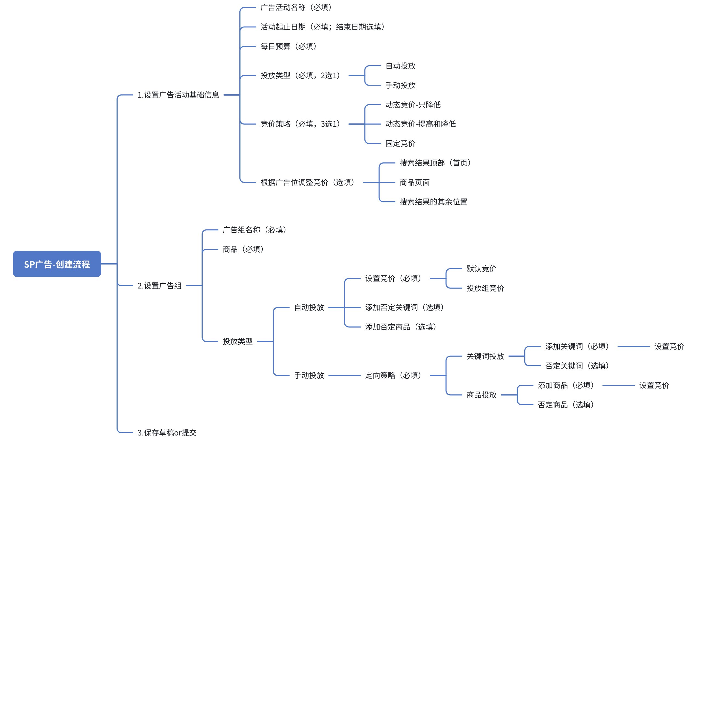

> 画板来源：token=`TPbhwALkUhWoahbo1xscbKTxnab`

### 创建【自动投放】广告活动

点击【创建广告活动】，进入创建页面

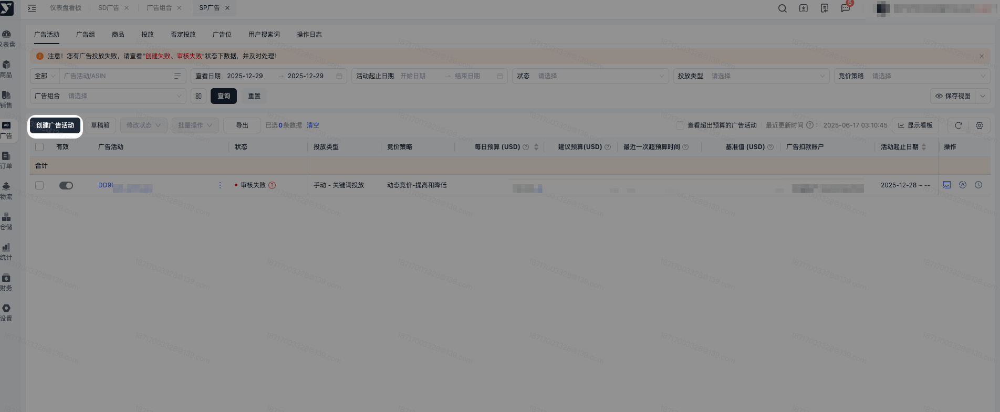

进入【创建SP广告活动】页面，需设置2个结构信息：广告活动信息+广告组信息

**首先，填写广告活动信息**；按自身实际情况填写即可

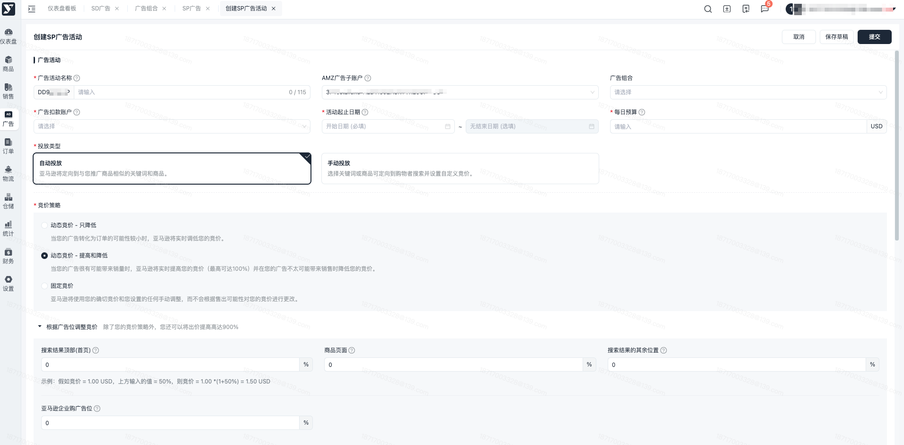

**其次，填写广告组信息**

【自动投放】的广告组信息，共分成5部分：广告组名称、推广商品、自动投放匹配类型+竞价、否定关键词（选填）、否定商品（选填）

步骤一：填写广告组名称

广告组名称不可重名

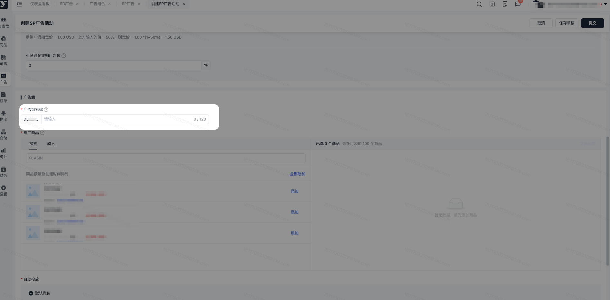

步骤二：选择推广商品

支持搜索和批量输入ASIN添加推广商品，最多添加100个ASIN，已添加的商品展示在右侧。

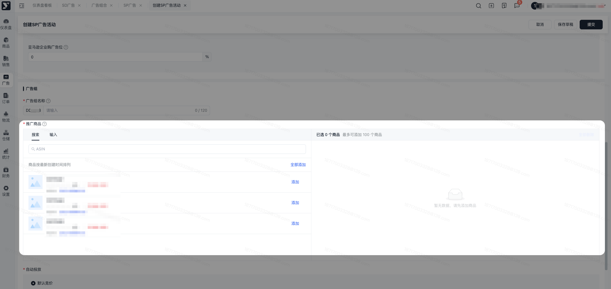

步骤三：设置自动投放的竞价

自动投放的竞价设置，同亚马逊后台一样，分2种情况：设置默认竞价，或按投放组设置竞价。

设置默认竞价：自动投放的4种匹配方式，按同一个竞价投放

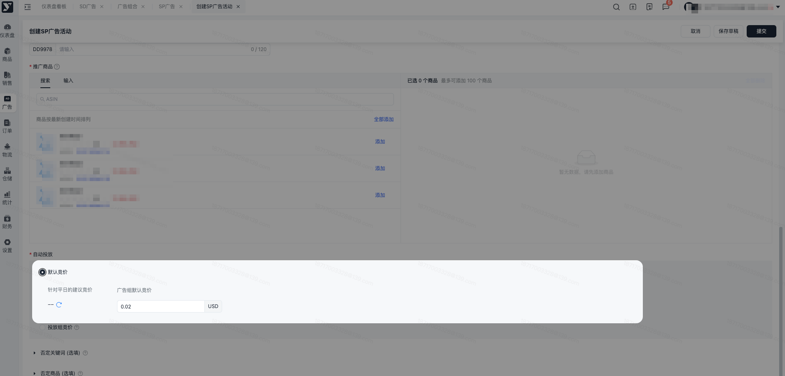

按投放组设置竞价：自动投放的4种匹配方式，分别设置不同的竞价投放

自动投放的4种匹配方式：紧密匹配、宽泛匹配、同类商品、关联商品。

【紧密匹配】与【宽泛匹配】，是投放的关键词，词来源于构成listing的文案、图片、视频、评论等与listing产品的功能、适用场景、受众人群等方面的相关词

【同类商品】和【关联商品】，是投放的商品，投放在与推广的商品相似或互补的商品展示位附近（包括搜索结果页、商品详情页和其他可能展示商品的位置）

为了使自动投放的广告更有侧重点，预算花费更合理，我们一般选择【投放组竞价】，分别设置竞价。

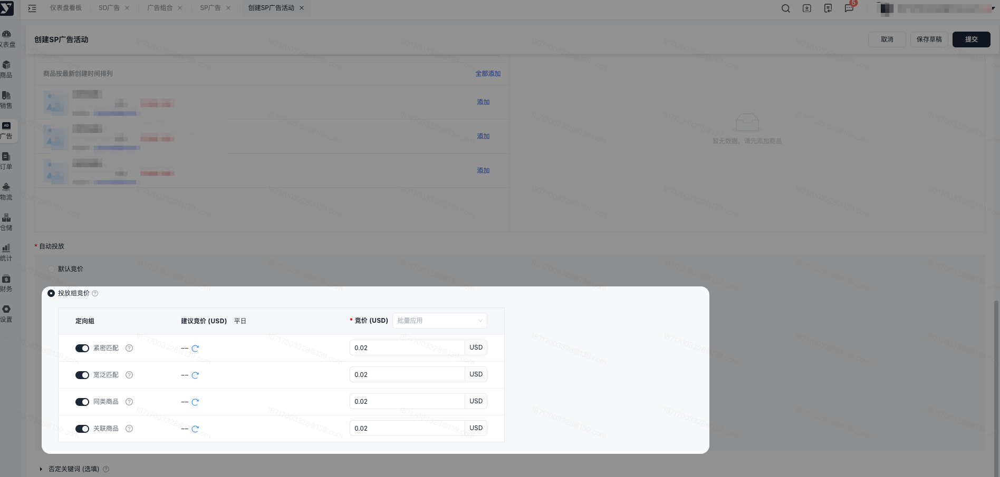

步骤四：设置否定关键词（可选）

这一步为可选项，如果我们有排除一些自动匹配的关键词，那么可以直接在这里提前否定掉，如果没有，则不填，后期有了再添加。

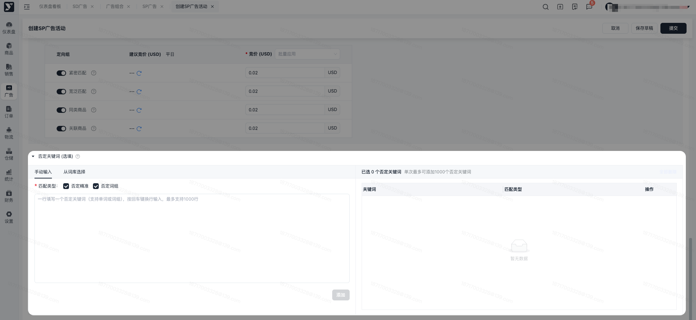

步骤五：设置否定商品（可选）

同否定关键词一样，否定商品也为可选项，支持在创建的时候，提前添加要否定的商品。

添加方式与否定关键词基本一致。

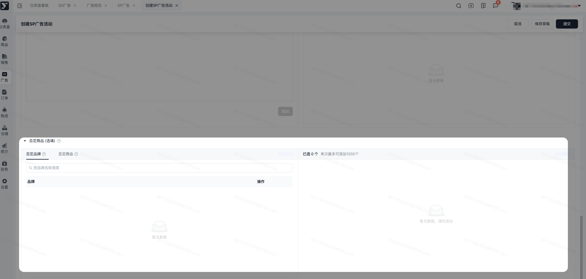

步骤六：提交SP广告活动

最后，确认所有信息无误后，点击【提交】，完成自动广告的创建。

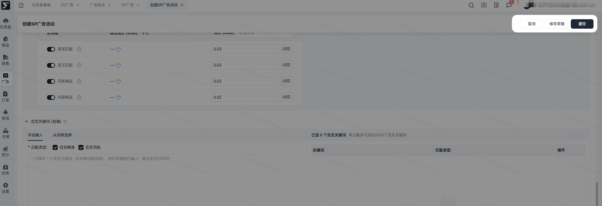

### 创建【手动投放】广告活动

手动投放，是通过设置的“关键词”或“商品”，与对应的匹配方式，来投放推广的商品。

共包含两种定向策略：关键词投放 + 商品投放

手动投放的设置，也是设置广告活动信息与广告组信息。

广告活动前2步设置和自动投放基本一致，只是在选择定向策略时，选【手动投放】。

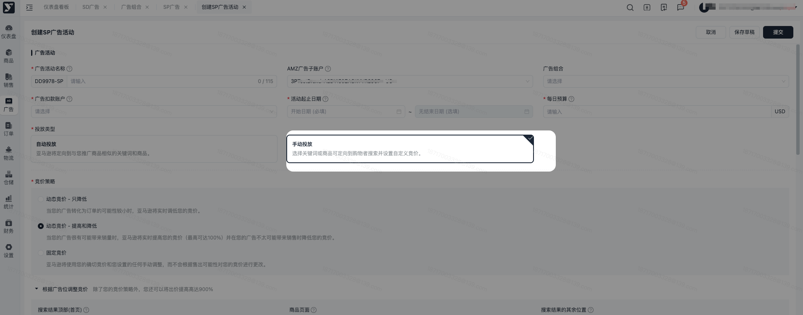

步骤一：填写广告组名称

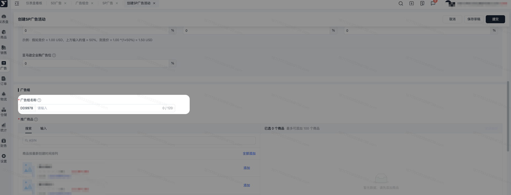

步骤二：选择推广商品

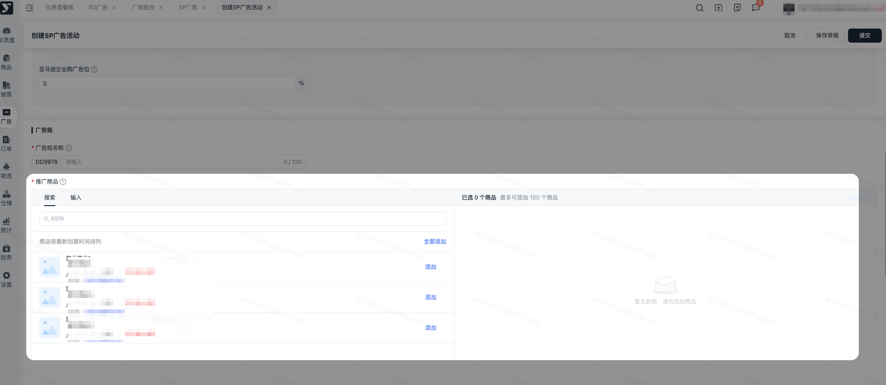

步骤三：选择定向策略，设置对应投放

###### **定向策略 - 关键词投放**

关键词投放，是指将广告商品，投放至该关键词的搜索结果页的广告位中。

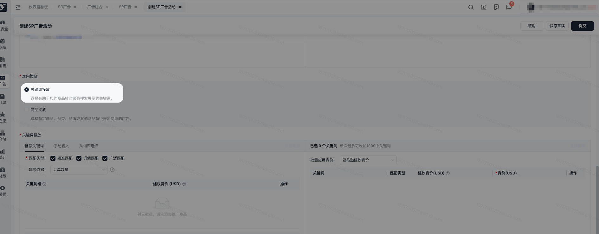

步骤四：设置关键词投放

设置步骤：添加关键词 -> 确认关键词并设置竞价 -> 添加否定关键词(选填)

①添加关键词

关键词的添加来源，共有3个：推荐关键词、手动输入、从词库选择

推荐关键词是指，亚马逊会根据您选择投放广告的商品，匹配综合表现前200的关键词，这些关键词对您的投放参考性极大，您可以选择投放这些关键词，来提升您的广告收益。

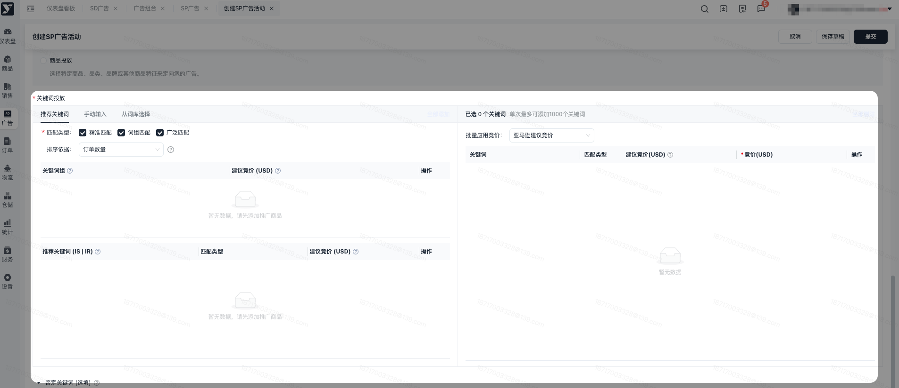

手动输入：支持通过输入添加关键词，一行一个词

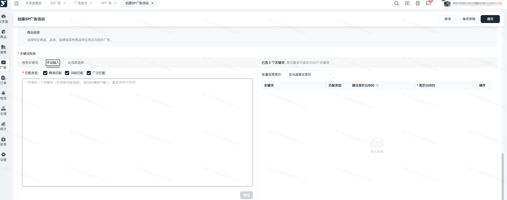

②确认关键词并设置竞价

如果发现有不需要投放的匹配类型的关键词，点击右侧的【删除】按钮，即可一键移除。

或者点击上方【全部删除】，删除当前已添加的所有关键词。

单独设置竞价：每个关键词，为其设置对应的竞价。

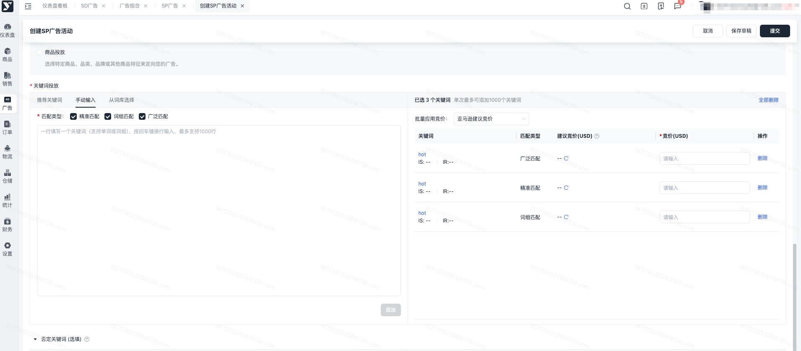

③添加否定关键词

同创建【自动投放】一样，否定关键词为可选项，如果有提前准备好否定的词，也可以在此提前否定，没有就不填。

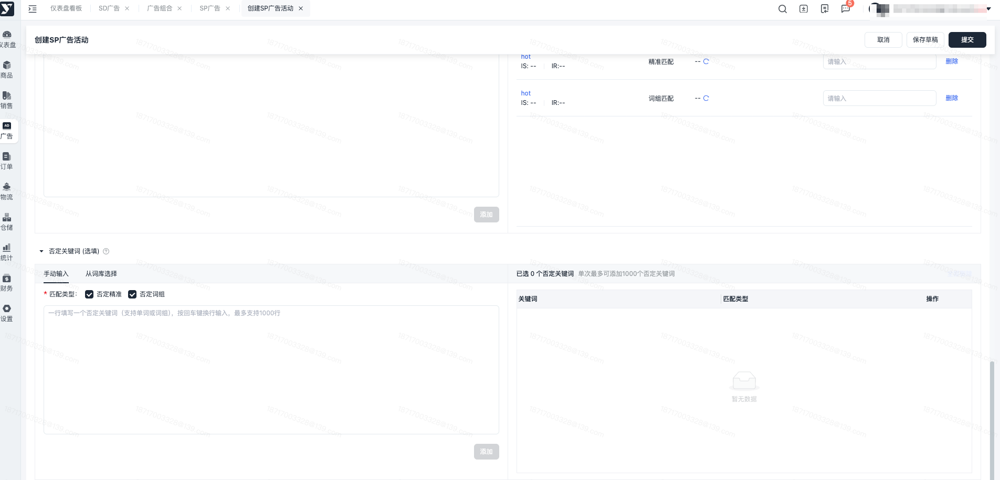

步骤五：提交SP广告活动

确认信息无误，点击【提交】，完成创建。

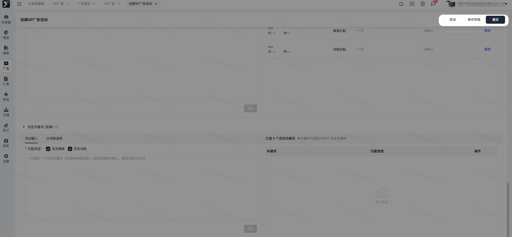

###### **定向策略 - 商品投放**

商品投放，是指将我们的产品，投放至某个商品ASIN的详情页、品类、品牌，或含有其他商品特征的分类中。

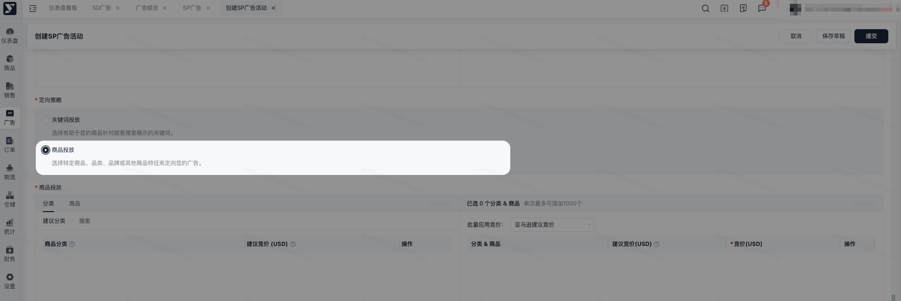

步骤四：设置商品投放

商品投放分为2类投放形式：分类投放(类目) + 商品投放(ASIN)

设置步骤：选择分类或ASIN -> 确认分类或ASIN，并设置竞价 -> 添加否定商品(选填)

商品投放的添加来源有2种：亚马逊推荐的优选广告商品 + 手动输入

①选择分类或ASIN

**投放形式1：分类投放**

分类投放，是指将我们的广告，投放到商品分类中，共有两种投放方式：整个类目 + 细化类目。

其中，细化是指限定该类目的特征，如：品牌、商品价格、评论星级、配送方式等。

添加整个类目：

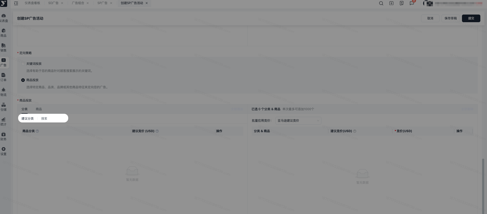

添加细化后的类目：

找到目标类目，点击【细化】，进入限定设置页面。

进入“细化商品分类：xxxx”页面，根据自己的需求，选择对应的分类商品范围，之后点击【确定】，直接添加该分类投放。

**投放形式2：商品投放**

商品投放，是指将广告投放到目标商品的详情页中。

商品投放的添加来源有2种：亚马逊建议 + 手动输入。

添加优选广告商品：

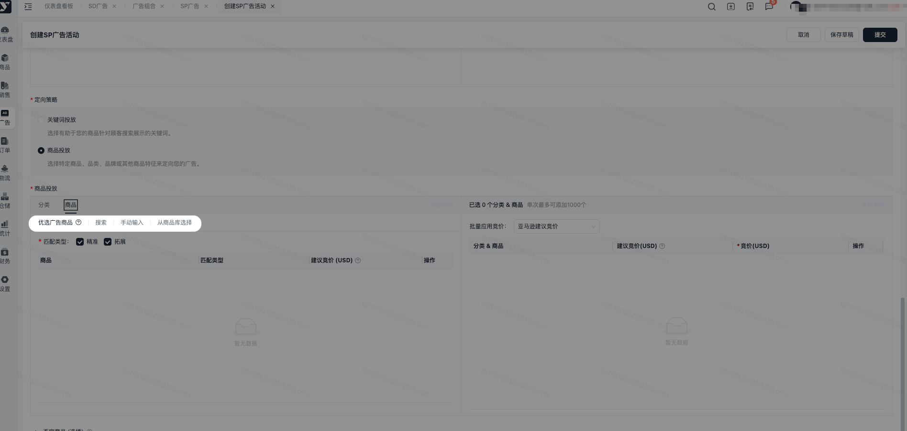

手动输入商品：支持通过输入ASIN添加商品，一行一个ASIN

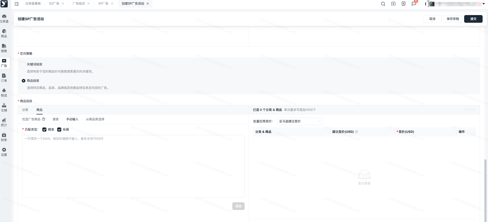

②确认商品并设置竞价

如果发现有不需要投放的匹配类型的ASIN，点击右侧的【删除】按钮，即可一键移除。

或者点击上方【全部删除】，删除当前已添加的所有商品。

单独设置竞价：每个商品，为其设置对应的竞价。

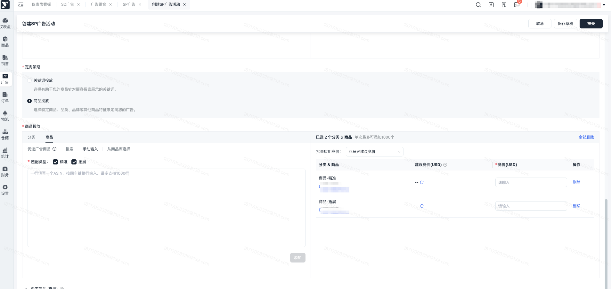

③添加否定商品

同关键词投放一样，我们也可以在创建时，提前为商品投放广告组，设置否定商品，设置方式与创建自动投放时设置否定商品一致。

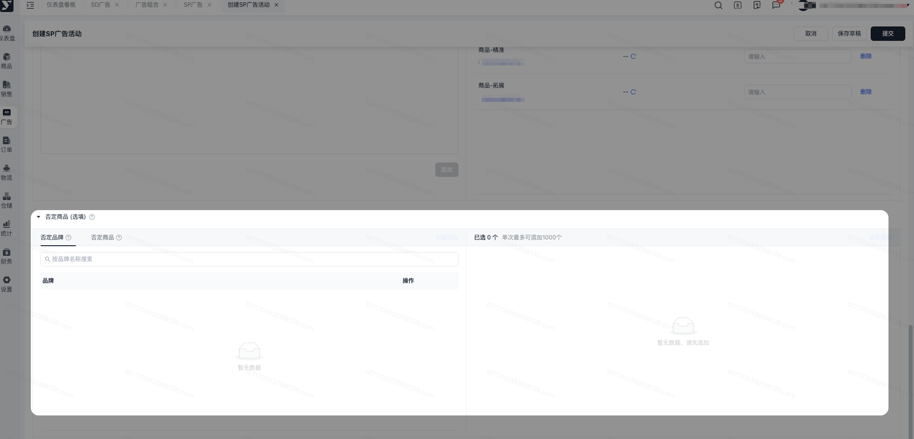

步骤五：提交SP广告活动

确认信息无误，点击【提交】，完成创建。

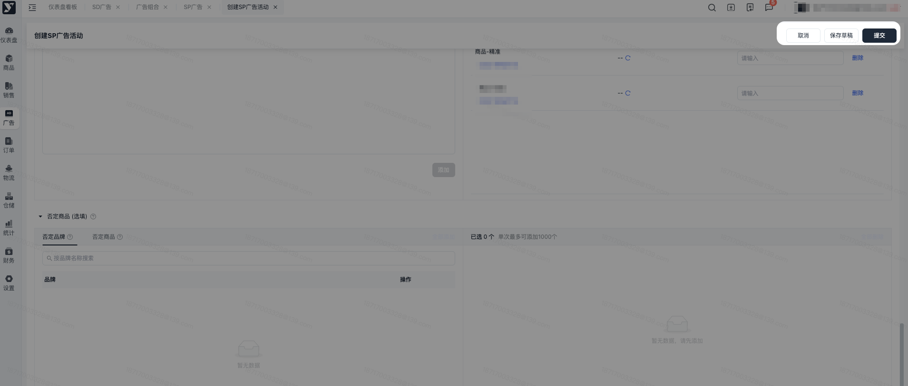

### SP广告-广告活动

###### 查看广告活动列表数据

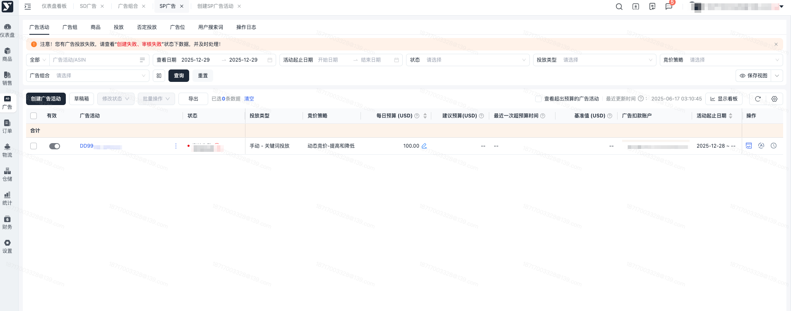

###### 调整预算

我们可以直接调整广告活动的预算。

调整方式分2种：单个调整 + 批量调整

**① 单个调整**

点击预算金额右侧的图标，可以直接调整预算。

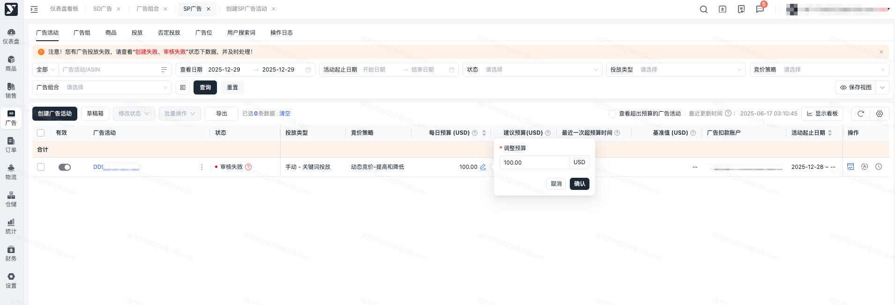

**② 批量调整**

选中要批量调整预算的广告活动，点击【调整预算】，进入设置页面。

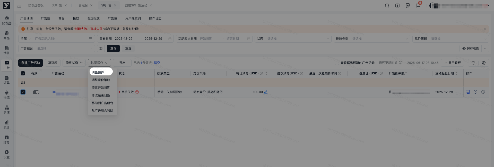

进入设置页面，输入对应金额，点击【确定】即可。

###### 修改广告活动名称

点击广告活动名称右侧的图标，可以单个广告活动名称进行编辑。

（当前版本广告活动名称仅支持单个修改。）

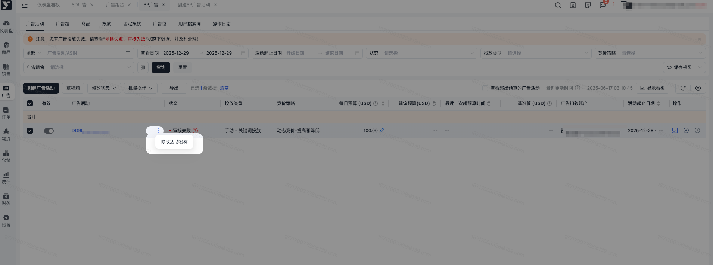

###### 复制广告活动

点击广告活动名称右侧的图标，选择复制广告活动，可以带源广告活动信息进行活动创建。默认勾选暂停，如需复制成功后立即启用，则需手动取消勾选。

###### 修改开始日期

选中要批量修改结束日期的广告活动，点击【修改开始日期】，进入设置页面。

广告活动的开始日期为未来时间，方可调整开始日期。

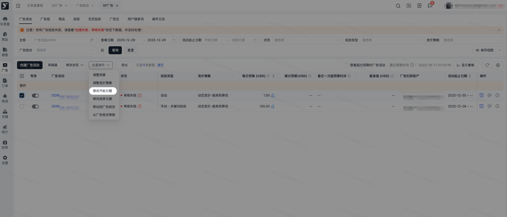

###### 修改结束日期

选中要批量修改结束日期的广告活动，点击【修改结束日期】，进入设置页面。

（当前版本不支持在列表页针对单个广告活动修改结束日期，只能选中目标数据后在批量操作中执行）

![图片展示的是SP广告广告活动列表页面。页面上方有“广告活动”“广告商品”“商品”“广告位”“推广商品”“操作日志”等导航栏。下方列表显示了广告活动的相关信息，如广告活动ID、状态、投放类型、每日预算、开始日期、结束日期、投放区域、投放时间、投放类型、投放商品、投放商品ID、投放商品名称、投放商品类型、投放商品ID类型、投放商品ID、投放商品ID类型、投放商品ID类型、投放商品ID类型、投放商品ID类型、投放商品ID类型、投放商品ID类型、投放商品ID类型、投放商品ID类型、投放商品ID类型、投放商品ID类型、投放商品ID类型、投放商品ID类型、投放商品ID类型、投放商品ID类型、投放商品ID类型、投放商品ID类型、投放商品ID类型、投放商品ID类型、投放商品ID类型、投放商品ID类型、投放商品ID类型、投放商品ID类型、投放商品ID类型、投放商品ID类型、投放商品ID类型、投放商品ID类型、投放商品ID类型、投放商品ID类型、投放商品ID类型、投放商品ID类型、投放商品ID类型、投放商品ID类型、投放商品ID类型、投放商品ID类型、投放商品ID类型、投放商品ID类型、投放商品ID类型、投放商品ID类型、投放商品ID类型、投放商品ID类型、投放商品ID类型、投放商品ID类型、投放商品ID类型、投放商品ID类型、投放商品ID类型、投放商品ID类型、投放商品ID类型、投放商品ID类型、投放商品ID类型、投放商品ID类型、投放商品ID类型、投放商品ID类型、投放商品ID类型、投放商品ID类型、投放商品ID类型、投放商品ID类型、投放商品ID类型、投放商品ID类型、投放商品ID类型、投放商品ID类型、投放商品ID类型、投放商品ID类型、投放商品ID类型、投放商品ID类型、投放商品ID类型、投放商品ID类型、投放商品ID类型、投放商品ID类型、投放商品ID类型、投放商品ID类型、投放商品ID类型、投放商品ID类型、投放商品ID类型、投放商品ID类型、投放商品ID类型、投放商品ID类型、投放商品ID类型、投放商品ID类型、投放商品ID类型、投放商品ID类型、投放商品ID类型、投放商品ID类型、](./assets/images/图片展示的是SP广告广告活动列表页面-633ee638278f.png)

进入设置页面，可选择无结束日期或自定义结束日期，点击【确定】即可。

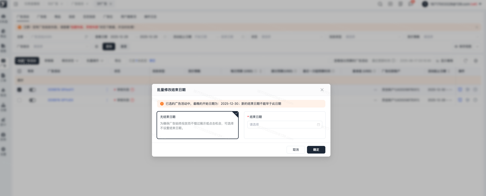

###### 调整竞价策略

竞价策略：动态竞价-只降低、动态竞价-提高和降低、固定竞价。

勾选要调整竞价策略的广告活动，点击【调整竞价策略】，进入修改页面。

（当前版本不支持在列表页针对单个广告活动调整竞价策略，只能选中目标数据后在批量操作中执行）

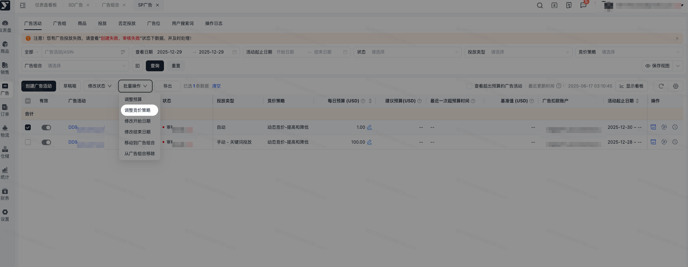

进入“批量调整竞价策略”页面，选择要投放的竞价策略，点击【确定】即可。

###### 修改状态（暂停/启动/归档）

同亚马逊后台一样，我们也同样支持启用、暂停和归档广告活动。

“启用”和“暂停”的操作方式有2种：单个操作 + 批量操作，而“归档”只支持批量操作。

**① 单个操作**

找到要启用或暂停的广告活动，点击启停按钮，即可一键启用或暂停。

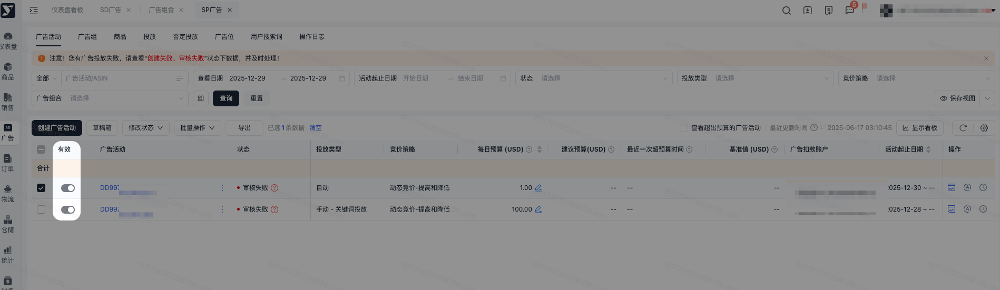

**② 批量操作**

勾选要批量启停或归档的广告活动，点击对应启停或归档的按钮即可。

注意：归档后的数据不可恢复。

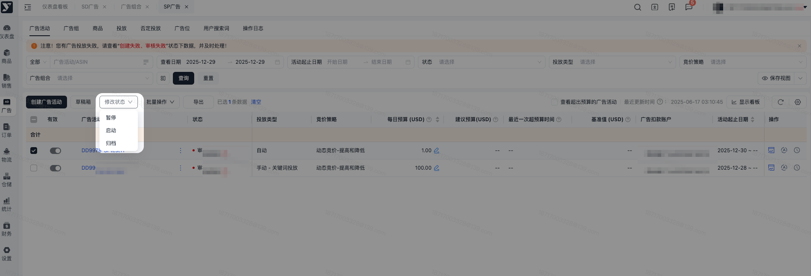

###### 查看草稿箱

在创建SP广告活动页面中，支持保存草稿；点击【草稿箱】，进入草稿箱页面

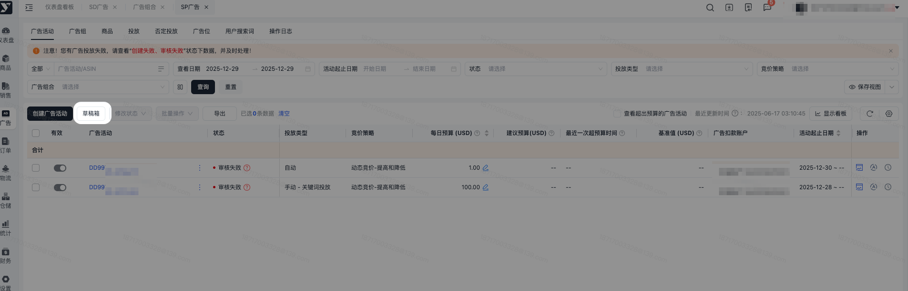

点击【编辑】，进入编辑广告活动页面；点击【删除】即可删除草稿。

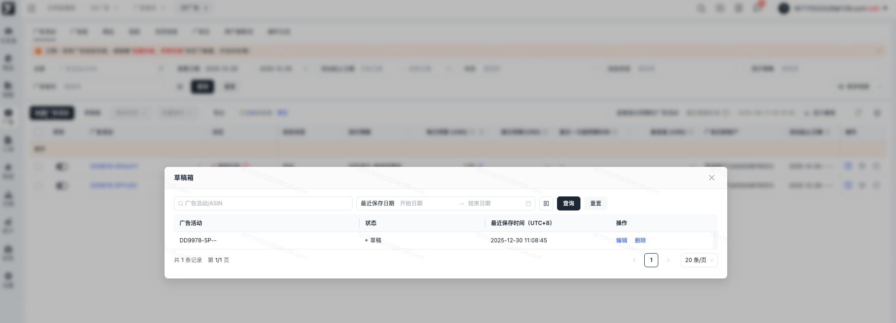

### SP广告-广告组

###### 查看广告组列表数据

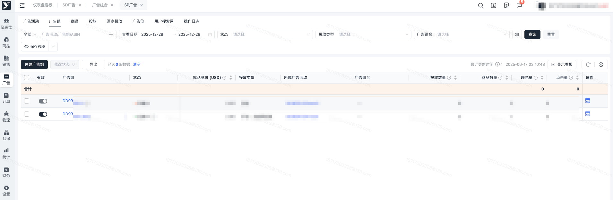

###### 修改广告组名称

点击广告活动名称右侧的图标，可以直接编辑名称。

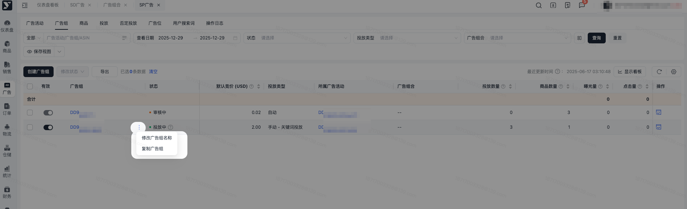

###### 复制广告组

点击复制广告组按钮，带源广告组信息创建一条新的广告组

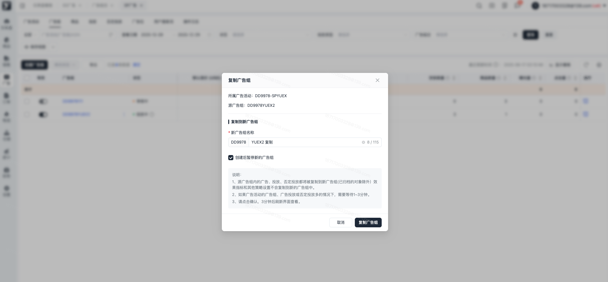

###### 修改状态（暂停/启动/归档）

同亚马逊后台一样，我们也同样支持启用、暂停和归档广告组。

“启用”和“暂停”的操作方式有2种：单个操作 + 批量操作，而“归档”只支持批量操作。

**① 单个操作**

找到要启用或暂停的广告组，点击启停按钮，即可一键启用或暂停。

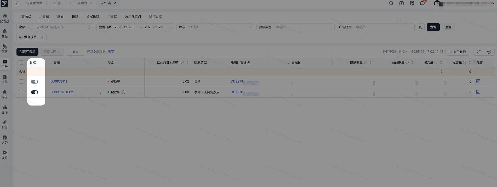

**② 批量操作**

勾选要批量启停或归档的广告活动，点击对应启停或归档的按钮即可。

注意：归档后的数据不可恢复。

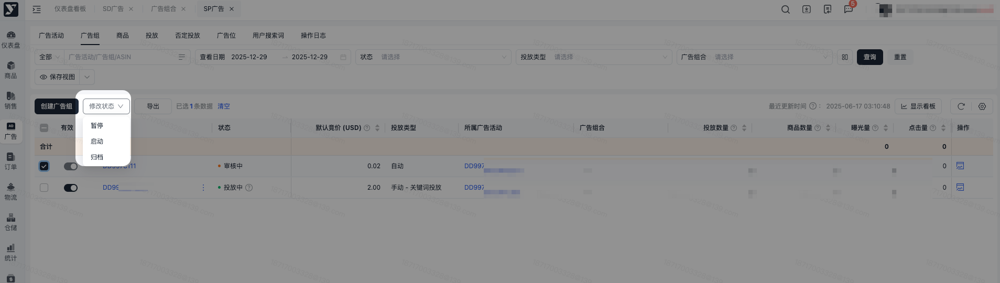

### SP广告-商品

###### 查看商品列表数据

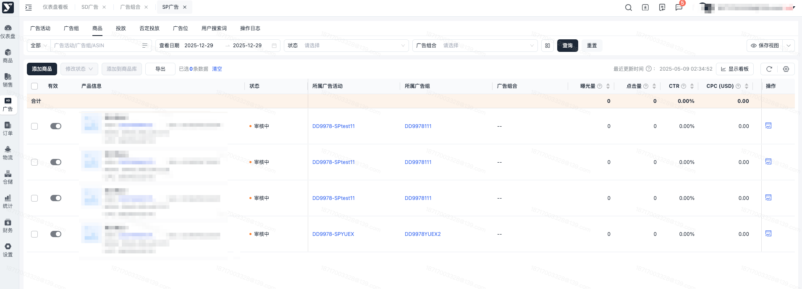

###### 添加商品

和亚马逊后台一样，支持在广告组下添加商品。

若商品审核失败，暂无法投放广告活动，建议先解决当前商品的异常状态以实现投放，或者添加新的推广商品。

注意：同一个广告组下的推广商品不可重复。

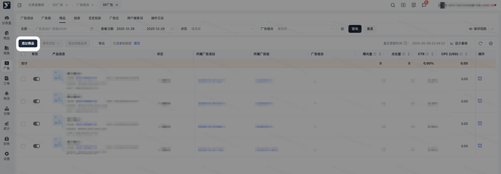

选择广告活动状态后，筛选出广告活动，再筛选出广告活动下能够添加推广商品的广告组。

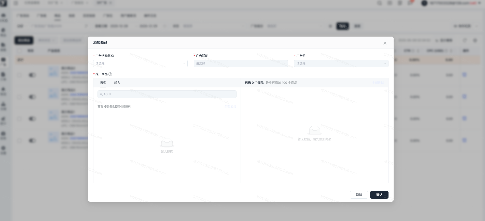

###### 修改状态（暂停/启动/归档）

同亚马逊后台一样，我们也同样支持启用、暂停和归档商品。

“启用”和“暂停”的操作方式有2种：单个操作 + 批量操作，而“归档”只支持批量操作。

**① 单个操作**

找到要启用或暂停的商品，点击启停按钮，即可一键启用或暂停。

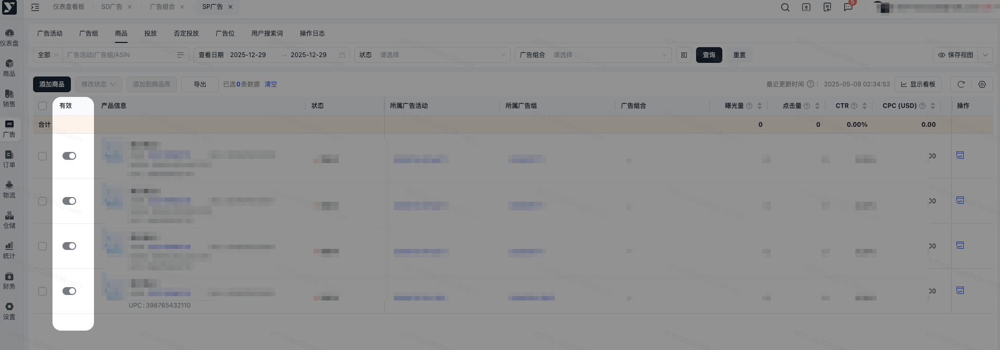

**② 批量操作**

勾选要批量启停或归档的广告活动，点击对应启停或归档的按钮即可。

注意：归档后的数据不可恢复。

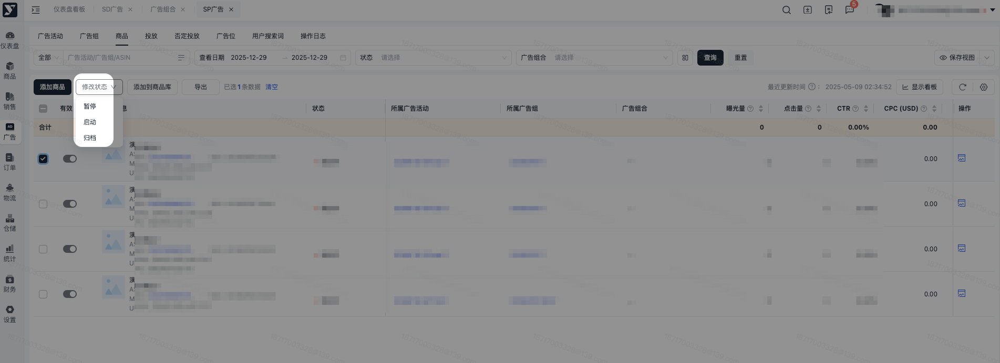

### SP广告-自动投放

###### 查看自动投放列表数据

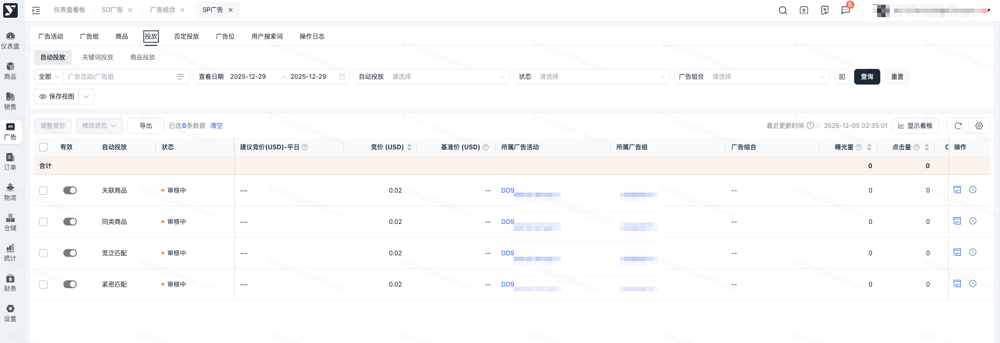

###### 调整竞价

我们可以直接调整自动投放的竞价。

调整方式分2种：单个调整 + 批量调整

**① 单个调整**

点击竞价数值右侧的图标，可以直接调整竞价。

**② 批量调整**

选中要批量调整竞价的投放，点击【调整竞价】，进入设置页面。

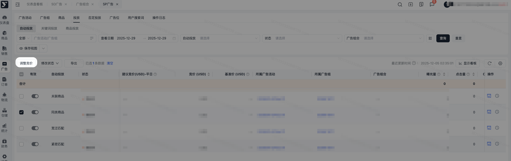

> 工具基准价更新：仅针对正在进行分时调价的投放数据有效

###### 修改状态（暂停/启动/归档）

同亚马逊后台一样，我们也同样支持启用、暂停和归档自动投放。

“启用”和“暂停”的操作方式有2种：单个操作 + 批量操作，而“归档”只支持批量操作。

**① 单个操作**

找到要启用或暂停的自动投放数据，点击启停按钮，即可一键启用或暂停。

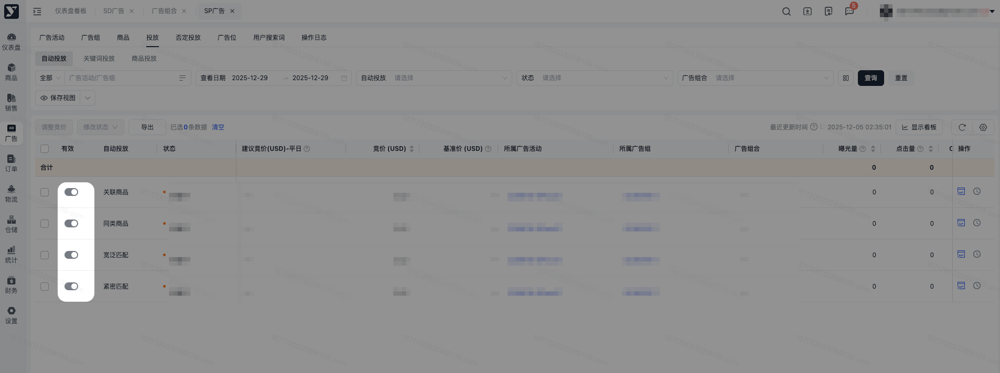

**② 批量操作**

勾选要批量启停或归档的广告活动，点击对应启停或归档的按钮即可。

注意：自动投放不可归档

### SP广告-关键词投放

###### 查看关键词投放列表数据

###### 添加关键词

创建广告活动后，可再次添加关键词，优化广告投放策略。

选择广告活动状态后，筛选出广告活动，再筛选出广告活动下能够添加关键词的广告组。

一个广告组下的关键词+匹配类型不可重复添加。

###### 调整竞价

我们可以直接调整关键词竞价。

调整方式分2种：单个调整 + 批量调整

**① 单个调整**

点击竞价数值右侧的图标，可以直接调整竞价。

**② 批量调整**

选中要批量调整竞价的投放，点击【调整竞价】，进入设置页面。

###### 修改状态（暂停/启动/归档）

同亚马逊后台一样，我们也同样支持启用、暂停和归档关键词投放。

“启用”和“暂停”的操作方式有2种：单个操作 + 批量操作，而“归档”只支持批量操作。

**① 单个操作**

找到要启用或暂停的关键词投放，点击启停按钮，即可一键启用或暂停。

**② 批量操作**

勾选要批量启停或归档的广告活动，点击对应启停或归档的按钮即可。

注意：归档后的数据不可恢复。

### SP广告-商品投放

###### 查看商品投放列表数据

###### 添加商品

创建广告活动后，可再次添加商品投放，优化广告投放策略。

选择广告活动状态后，筛选出广告活动，再筛选出广告活动下能够添加商品的广告组。

一个广告组下的商品+匹配类型不可重复添加。

###### 调整竞价

我们可以直接调整关键词竞价。

调整方式分2种：单个调整 + 批量调整

**① 单个调整**

点击竞价数值右侧的图标，可以直接调整竞价。

**② 批量调整**

选中要批量调整竞价的投放，点击【调整竞价】，进入设置页面。

###### 修改状态（暂停/启动/归档）

同亚马逊后台一样，我们也同样支持启用、暂停和归档商品投放。

“启用”和“暂停”的操作方式有2种：单个操作 + 批量操作，而“归档”只支持批量操作。

**① 单个操作**

找到要启用或暂停的商品投放，点击启停按钮，即可一键启用或暂停。

**② 批量操作**

勾选要批量启停或归档的广告活动，点击对应启停或归档的按钮即可。

注意：归档后数据不可恢复

### SP广告-否定投放

否定投放功能，整合了所有广告活动下的否定投放，我们可以通过上方的筛选栏，查看某些广告活动或广告组的否定投放。

###### 查看否定投放列表数据

###### 创建否定关键词

创建广告活动后，可再次添加否定关键词；注意：不可重复添加同一个匹配类型的否定关键词

点击【否定关键词】，进入创建否定投放页面

进入“添加否定关键词”页面，选择广告活动、广告组后添加关键词；支持批量应用于多个广告组

###### 创建否定商品

点击【否定商品】，进入创建否定投放页面

进入“添加否定商品”页面，选择广告活动、广告组后添加商品；支持批量应用于多个广告组

###### 归档

否定投放的内容只可归档；归档后的数据可再次添加

### SP广告-广告位/受众

【广告位/受众】功能，您不仅能看到每个SP广告活动在“搜索结果顶部”、“搜索结果的其余位置”、“商品页面”位置的曝光、点击量等数据，还可以看到SP广告在站外流量的数据转化情况，可切换广告位或者单独查看亚马逊企业购广告位，可切换受众列表并进行受众调整。

###### 查看广告位列表数据

###### 查看亚马逊企业购广告位列表数据

###### 查看受众列表数据

###### 调整竞价

点击竞价数值右侧的图标，支持对单个广告活动调整竞价。需注意该竞价不可超过对应广告活动的每日预算。

###### 更改受众

对于已创建受众投放的广告活动，系统将在列表中展示对应受众数据。点击**更改受众**，可切换受众类型或取消受众投放：若选择**不提高受众的竞价**，即表示取消受众投放，取消后该广告活动将不再在受众列表中展示；若调整为**提高亚马逊创建的受众的竞价**，并选择相应的受众百分比，列表中将重新展示该广告活动的受众数据。

### SP广告-用户搜索词

- 用户搜索词，是顾客在亚马逊购物时，输入搜索框的，或浏览的，与我们广告匹配到的词，它们可以是关键词，也可以是商品ASIN，基本上都是与我们的产品相关度较高的词。它反映了买家的真实搜索习惯，是我们优化广告关键词、listing埋词和竞品关联投放的重要数据来源。
- 当我们投了一段时间的广告后，亚马逊会提供商品推广(SP)广告不同时间段的搜索词报告，通过Excel表格，筛选出与产品相关的优质关键词。
- 的【用户搜索词】功能，它通过亚马逊官方接口，自动整合商品推广(SP)广告的搜索词报告数据，帮助卖家高效分析搜索词数据，了解广告投放效果，同时卖家可筛选出优质的关键词，进行产品Listing优化和广告再投放，获取更多精准出单。

### SP广告-操作日志

操作日志功能，同步记录在系统中所有的广告操作轨迹，可以帮助您快速分析您的广告优化效果。同时，也可以看到对应操作人、操作结果，帮助您更好地维护您的广告。

### 广告活动设置

点击广告活动列表的活动名称可进入下钻页面，点击右上角的广告活动设置，可以在下钻页面进行活动设置

可进行活动名称修改，广告组合编辑、活动起止日期调整、每日预算调整、活动竞价策略调整。可设置展示广告位出价，并限制亚马逊的站外广告投放，可进行站外广告投放选择：

- 【扩大受众触达】： 利用您广告活动的投放设置，提升亚马逊站外展示量及销售机会
- 【限制在亚马逊站外的花费】： 通过限制亚马逊站外广告投放来管控花费，减少在亚马逊站外效果不佳的广告位上的花费，不过这可能会减少展示量及销售机会。

### 数据分析

#### 指标分析

点击指标分析按钮，可唤起指标分析弹窗，支持根据各指标的最大或者最小值设置，筛选列表数据。

#### 显示/隐藏看板

点击显示看板，可以查看列表的汇总数据，看板包括趋势面板和透视面板。

趋势面板：支持查看列表内容的按日、按周、按星期、按月的数据汇总。按日展示具体日期维度下的数据；按周展示筛选周期内周一到周日的分段汇总数据；按星期以星期数进行汇总统计（如筛选日期下的全部星期一）；按月展示月初到月末的分段汇总数据。

透视面板：透视面板可以自定义x轴、y轴、面积值，根据选择指标的不同，查看各面积趋势

#### 查看列表数据表现

各列表支持数据表现查看功能。点击操作栏中的【表现】图标，即可打开对应列表的数据表现看板。

在表现看板内，可查看**历史表现**与**对比分析**：

- 历史表现：支持按小时 / 日 / 周 / 月维度，查看指定日期范围内的数据趋势；
- 对比分析：支持在指定日期范围内，查看数据的环比与同比分析。

### 查看日期

广告活动、广告组、商品、投放、广告位、用户搜索词可筛选今日、昨日、本周、上周、本月、上月、近7天、近30天、自定义日期范围内的数据指标，帮助您分析广告表现

- 广告活动、投放：默认展示当前洛杉矶日期
- 广告组、商品、广告位、用户搜索词：由于是取的广告报告数据，因此默认展示当前洛杉矶日期-1

- 由于需要拉取亚马逊广告活动、投放的“top of search IS”数据，当您点击“查询”时，页面顶部会提示“正在获取Top of search IS数据中，请稍等”；一般1s内可成功获取，若但选择日期范围较大，最多需要等待10s左右
- 获取成功后会提示“数据获取成功”

### 自定义列

每个卖家，都有自己的分析模式，看重的指标也不尽相同。因此，为了匹配每位卖家的分析习惯，我们上线了【自定义列】功能，卖家可以根据自己的分析习惯，自定义排序广告活动的指标。

点击【自定义列】，进入设置页面。

进入“自定义列”设置页面，我们可以鼠标按住指标，上下拖动，以进行排序；

当指标过多，还可以开启或取消展示某个指标，勾选或取消复选框即可；

如果设置错误，点击【重置】，可以回到设置时的状态，重新设置；

设置完成后，点击【确定】，保存自定义列的设置。

### 导出

支持导出所有列表数据，以方便卖家进行二次分析。

当筛选出想要的结果后，点击【导出】，即可导出当前查询结果。同时，导出的历史文件可以在“下载中心”查看。

### 消息通知

当您的广告活动超出预算时，我们会发送站内通知提醒，因此，请关注系统右上角的消息通知。

## 常见问题

#### **Q1：SP广告位报告中的OFF Amazon是指什么？**

A1：SP广告位报告中的OFF Amazon是指该广告活动投放到亚马逊站外时的广告位表现，目前美国站SP广告默认都会投放到亚马逊站外，在站外的曝光、点击等数据目前是通过广告位报告中的 OFF Amazon 这一项体现出来的。

#### **Q2：为什么我在系统操作后（修改状态等），数据又变了呢？**

A2：因为亚马逊对数据存在波动，我们每半小时会同步亚马逊数据，最终数据以亚马逊为准。

#### **Q3：添加否定关键词不成功，审核失败**

A3：原因：亚马逊否定关键词的单词数量和字符串长度需要符合以下要求：① 词组否定:最多4个单词；② 精准否定:最多10个单词，且不要超过80个字符；③ 还有其他方面的原因：如含有/ 和\等特殊字符。

#### **Q4：广告商品投放页面、用户搜索词页面上，ASIN没有对应图片，是怎么回事？**

A4： 当前版本在商品投放页面、用户搜索词页面上没有采集ASIN图片，后续会加入ASIN图片，方便预览。

#### **Q5：广告组的有效开关和状态为什么会不一致，广告组的有效开关是启用，但是状态显示已暂停?**

A5：因为广告活动暂停后，相应的广告组状态也会变成已暂停；而有效开关按钮是人为操控的，并不会随之变化。若您想保持一致，可手动关闭开关。

#### **Q6：创建了SP广告活动后，多久能更新审核结果？**

A6：提交SP广告活动后，5分钟内可查询到广告活动审核结果。若超过3个工作日请联系运营人员。

#### **Q7：广告活动状态是投放中，但是广告活动没产生曝光、点击量等数据？**

A7：原因一：SP广告会对您的推广商品进行审核，所以建议您投放广告后，及时检查商品状态是否处于投放中。

原因二：请检查您的出价是否过低，若出价过低也会造成广告活动未形成流量转化。

原因三：建议您不要经常关闭和打开有效开关，这会影响广告权重（您原来累计的自然排名不再有效）。

原因四：投放的关键词不精准，如果选择的关键词与用户的搜索意图不相符，广告就不会被展示。

原因五：如果使用了过于严格的关键词匹配类型（如精准匹配），可能会错过很多潜在的展示机会。而过于宽泛的匹配类型（如广泛匹配）可能会导致广告展示给不相关的用户，浪费预算。

原因六：创建广告活动后，亚马逊可能需要至少12个小时的时间同步指标数据，最长可能需要72小时。如果超过72小时您的广告数据依旧为空，请优先检查您的竞价和预算设置，然后再联系运营进一步确认具体原因。

#### **Q8：商品报错：当前商品暂无法投放广告活动**

A8：可能是由于您的商品库存不足、Offer未生效成功、销量过低、商品类别不符合亚马逊投放广告规则。建议您在该广告组下重新添加推广商品。

#### **Q9：创建失败的情况下，我该怎么操作？**

A9：若广告活动、广告组、商品、投放、否定投放中存在数据创建失败，那是因为亚马逊接口不稳定导致未能访问亚马逊，此时您可尝试一键重新提交。若多次提交不成功，可联系客服。

#### **Q10：广告活动投放中，为什么商品没有曝光等数据？**

A10：因为商品是通过广告报告拿的数据，所以会延迟一天更新数据。

#### Q11：Ads处于“广告异常”状态是什么情况？

A11：您的ASIN被亚马逊抑制，暂无法正常投放广告，请您联系运营经理帮助您处理。
