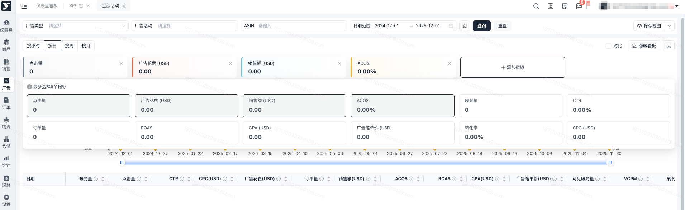
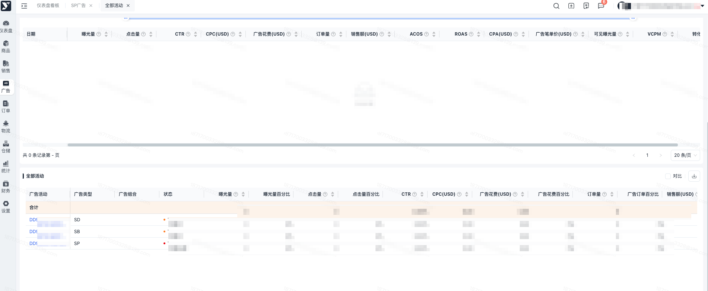
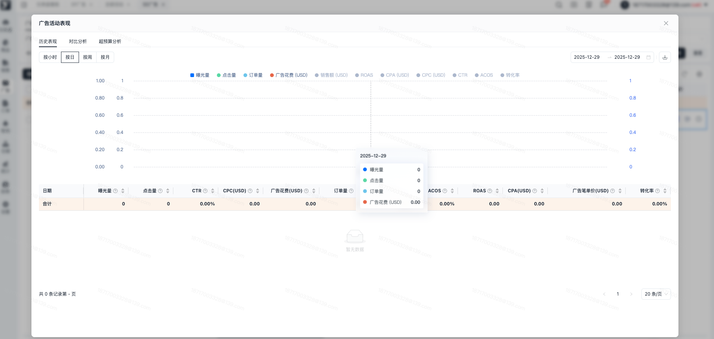
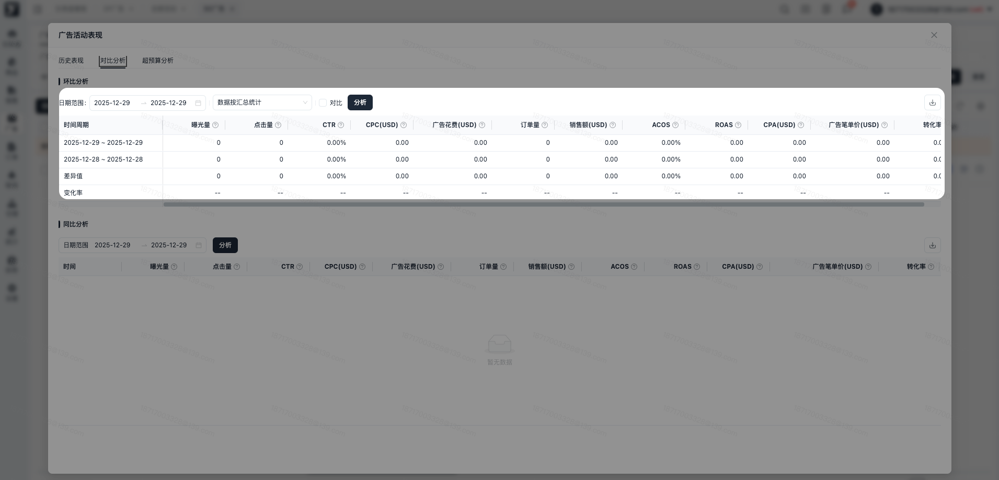
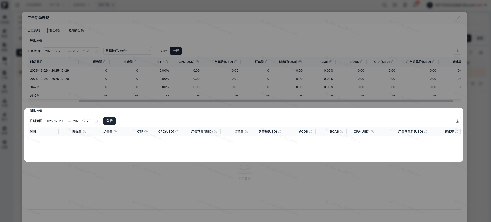
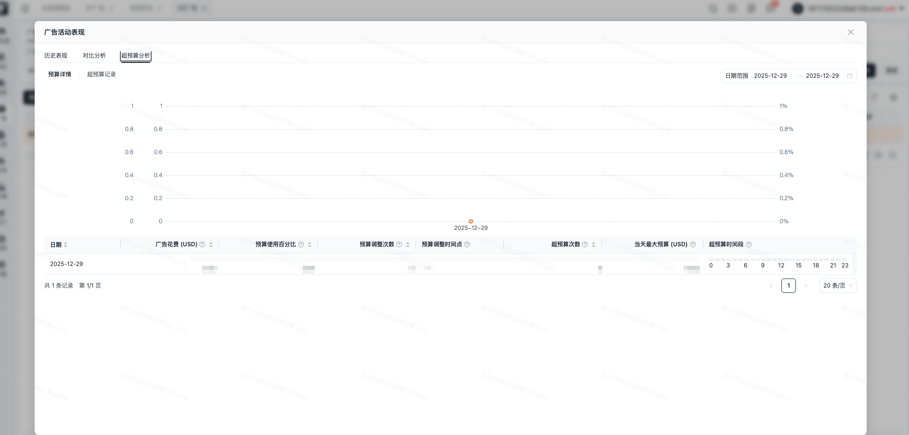

# 飞书文档：全部活动

全部活动

当前版本：v1.0.2

## 功能介绍

平台提供广告概览分析，基于亚马逊数据，展示广告活动的小时、天、周、月数据图表，提供对比分析。支持进行广告活动维度的历史表现查询，支持进行对比查询，查看同比和环比数据。

## 操作说明

### 广告活动概览

1. 进入【广告】-【广告业务】-【全部活动】，可以查看活动概览页面，提供按小时、按日、按周、按月的数据图表呈现，支持选择指标卡展示。列表提供对比数据展示，仅展示有数据的时间维度。图表默认展示4个指标，点击添加指标，可唤起指标选择面板，一次最大可查看5个指标，如需更换指标，点击指标上的x按钮可以关闭指标趋势图。

 
2. 全部活动展示筛选条件下的全部广告活动信息，支持进行跳转，跳转后进入对应的广告活动筛选列表，可以进行广告活动操作，当前列表仅作数据查看。

 

### 广告活动表现

进入【广告管理】-【广告业务】-【SP/SB/SD广告活动列表】，点击分析图表，可以查看广告活动详情，根据切换tab展示不同的内容，包括历史表现和对比分析。

#### 历史表现

历史表现展示当前广告活动的历史明细数据，提供按小时、按日、按周、按月的切换面板查询，可根据不同的时间维度查看明细。图表默认点亮4个指标，可点亮更多图标进行数据查看，并在图表下方提供明细指标查询。

#### 对比分析

对比分析展示当前广告活动的环比分析和同比分析，可多维度的进行广告活动数据查看。

1. 环比分析

支持进行日期筛选，可进行汇总方式选择，可选择按不同的统计方式进行数据汇总，包括按数据汇总统计、按日均统计、按有曝光量的天数平均统计，默认环比日期为上一个时间周期，可以点击对比按钮，自定义对比时间，自定义对比时间后，模块标题变更为对比分析。每进行一次调整，都需要点击一下分析按钮，列表数据才会发生变化。

1. 同比分析

同比分析展示当前时间筛选周期内按星期数的同比数据呈现，默认星期折叠，点击展开后，可以查看具体星期值下的日期数据明细，如需进行日期范围变更，切换后，点击分析列表数据发生变化。

#### 超预算分析

展示当前广告活动的预算详情和超预算记录时间点，以天维度记录每天的预算调整时间点、超预算时间段等数据，支持查看预算变化。

## 常见问题

#### **Q1：进行了日期调整时，怎么限制了最大长度？**

A1：部分数据进行查询时，时间维度过大，对列表展示值的响应速度会产生影响，则广告活动概览最大一次性查询日期长度为1年，大于1年时，系统会默认变更为1年。另广告活动详情-对比分析-同步分析，因会展示按星期数的数据汇总展示，则最大限制日期查询长度为90天，超过90天时，系统会默认填充日期为90天。

#### **Q2：导出后为什么表格中的数据和列表中展示不一致？**

A1：在进行数据统计时，部分字段存在小数位展示，但是在实际页面呈现时，进行了统一的展示处理，则整数字段会被默认取整，但为了确保数据真实性，导出表格中字段保留了原始数据，则和页面数据存在少量差异。
